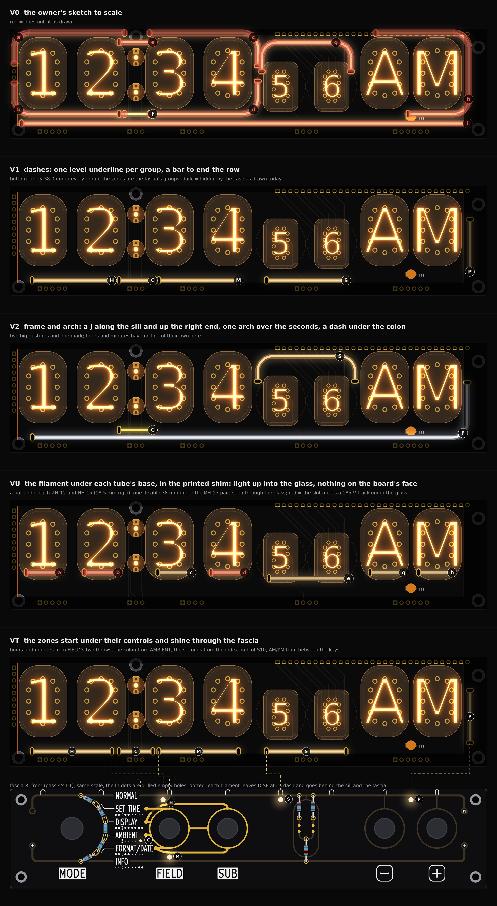
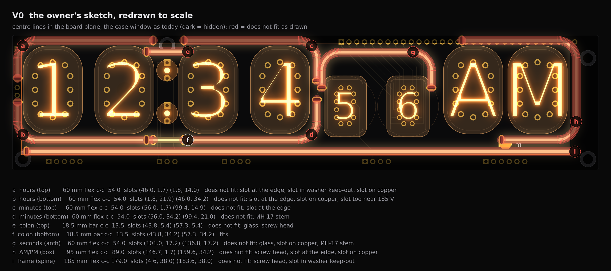
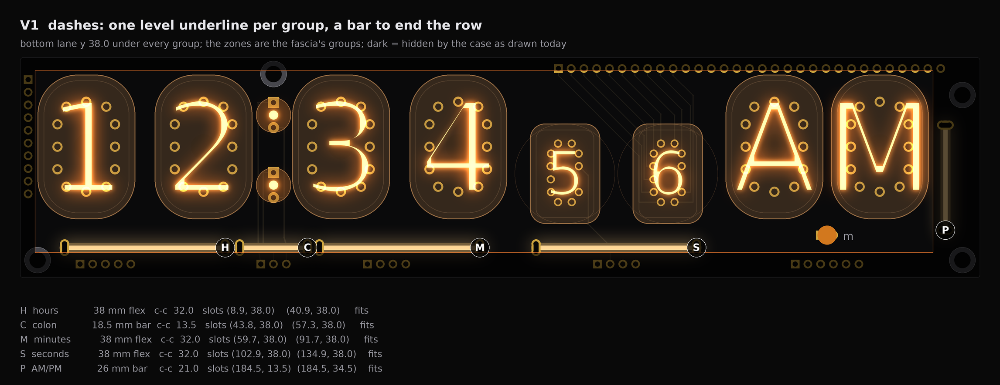
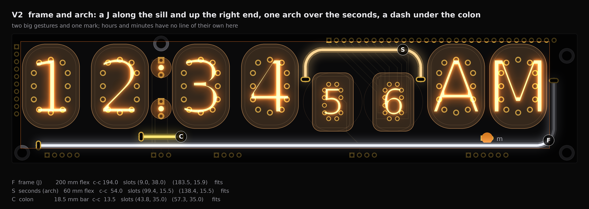
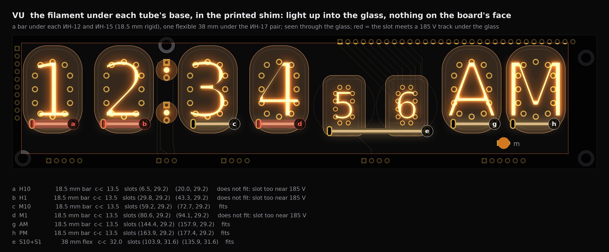
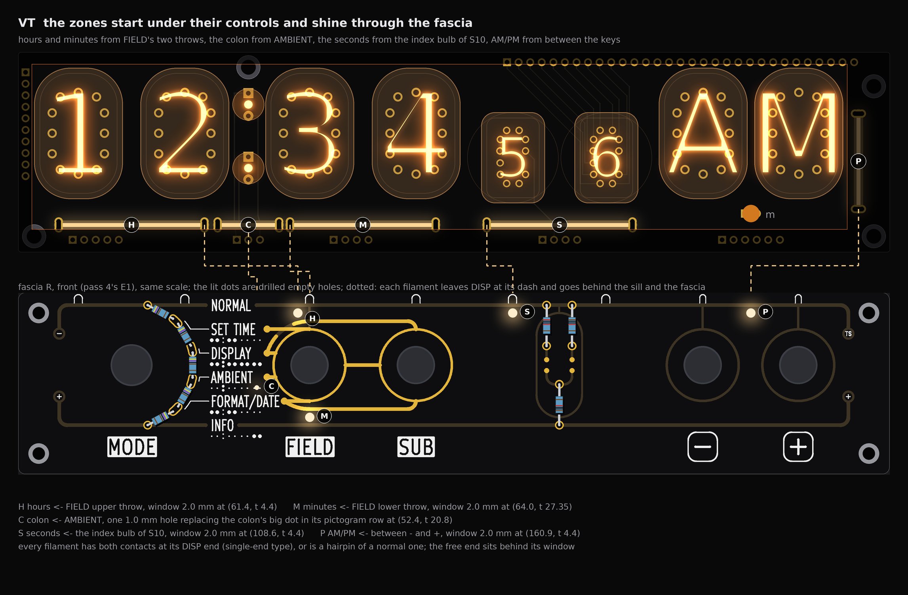
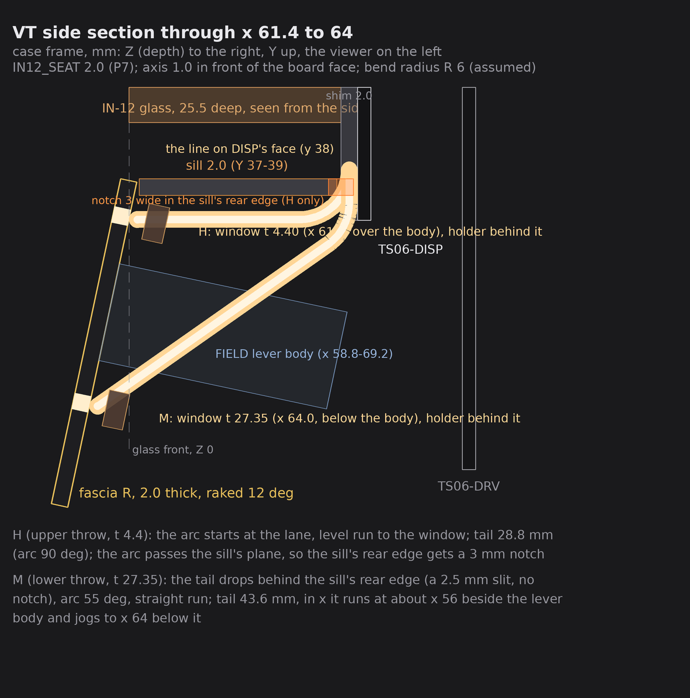
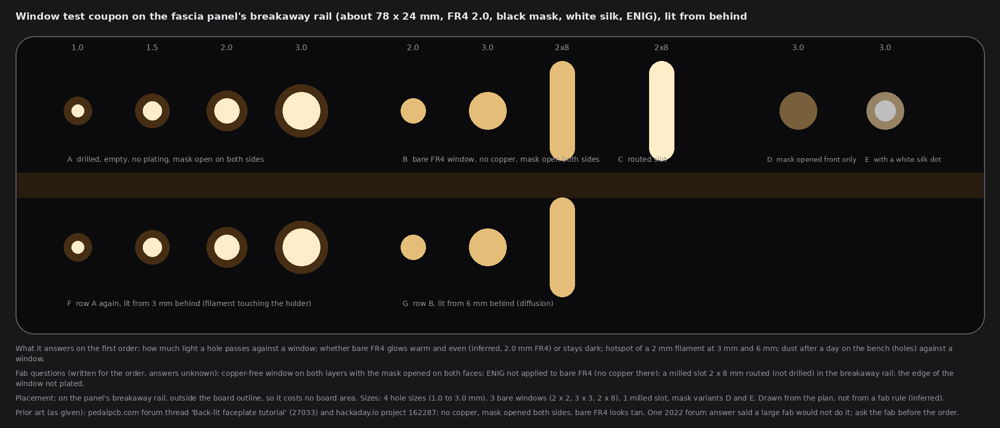
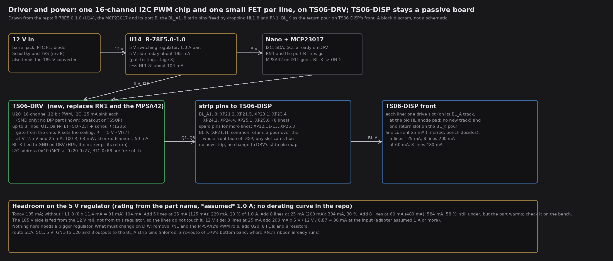
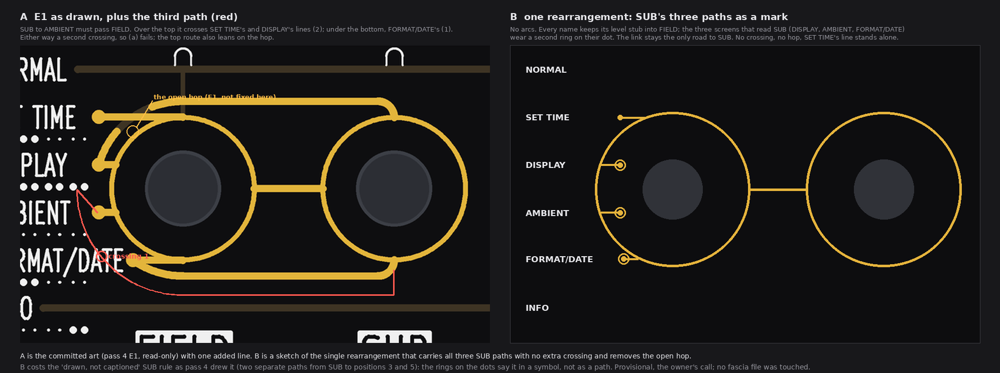

# TS06-DISP light lines, pass 1: the owner's sketch to scale, four faces, the through-fascia idea, the control and the driver (drawings and feasibility, nothing built)

No board, schematic, fab, tool, 3D, firmware or spec file was touched. The pictures are drawn from `PCB/TS06-DISP/TS06-DISP.kicad_pcb` (read, never written), the case model `3d/case-pair/case_pair.py` (run only as a what-if that writes nothing) and fascia pass 4's E1 picture. Marks: *listing data* is from the shop pages and reviews the owner sent; *inferred* is arithmetic or a typical figure; *assumed* is my reading, not measured or asked. No prices. The scratch scripts are in the run's output folder, not in the repo.

## 1. What the board says before any variant (read this first)

I scanned the whole board file for where a 2.0 mm body and a 1.0 x 2.5 mm plated slot can stand. The slot is the hard part: a plated slot blocks both layers, so it needs copper-free room round it. Rules I applied, all from the repo: slot pad to other-net copper at least 0.25 mm; to 185 V tracks 0.6 mm and to 185 V pads 0.8 mm (`PCB/README.md`, the DRU file); to the board edge 0.5 mm (`min_copper_edge_clearance`); clear of the four standoff keep-outs (the washer areas on `TS06-DISP`); body to glass at least 0.5 mm, to a screw head 0.3 mm, line to line at least 0.4 mm.

| Finding | Numbers | What it does to the variants |
|---|---|---|
| **The top band cannot take a slot at the end of a level line.** | Glass top y 3.40 over the ИН-12 and ИН-15; a 2.0 body fits (0.7 mm each side) but a slot pad is 3.3 tall (1.0 x 2.5 plus 0.4 ring, *inferred*): 3.3 + 0.5 edge + 0.5 glass needs 4.3, there is 3.4. | Level lines cannot start or end in the top lane. Top lines would have to end where the glass corner recedes or turn down. None of my faces uses the top lane over the ИН-12/ИН-15. |
| **The top band is cut twice.** | H3's screw head (x 50.5, y 3.3, dia 5.5) takes x 47.8 to 53.3 over the colon; XP12's pad row (y 2.2, x 107 to 184) owns the top over the right half. | No line runs the whole top. |
| **The left band is XP11's pad column and the H1 washer keep-out.** | Pads x 0.75 to 2.45, glass edge x 3.48, case wall x 3.0. | A plumb line there has no place for its slots. |
| **The right band is free from y 13 to 35.** | x 183.3 to 189.3 free; H4's keep-out above, H2's below. The case's right wall is at x 182.0. | One plumb bar fits there. The wall must move out about 4 mm. |
| **A straight 185 mm line does not fit.** | Slot centres 179 mm apart would sit at about x 8.4 and 187.4; the right one lands in H2/H4's keep-out. | The owner's "one horizontal that spans all tubes" fits only as a 200 mm line that turns up into the right band (the J in V2). |
| **Beside the ИН-17 pair there are two corridors.** | x 99.4 (between M1's glass edge 97.1 and S10's stem) and x 138.4 (between S1's stem and ИН-15Б's glass 140.67), y 8 to 15.5 free for slots. | An arch over the seconds fits, with its legs standing in them (V2). |
| **The bottom lane is free.** | Slots fit at y 38.0 under every group; glass bottoms are y 32.3 (ИН-12) and 33.2 (ИН-17), the sill top is y 39.0, XP pads start at y 40.45. | V1's dashes and V2's J. The old LED anode pads sit at y 35.5 and 36.5 on the BL_A tracks: a slot can replace each one with no new track. |
| **HL9 ("m", which stays) fills the ИН-15 pair's lane.** | LED at (160.9, 35.5), flange to y 37.4. | No dash under AM/PM at y 36 to 38. V1 stands a bar in the right band instead. |
| **The whole front face of TS06-DISP is the BL_K pour** (the LED return). | One polygon, x 0.5 to 190.9, y 0.5 to 43.5 on F.Cu. | A return slot can stand anywhere on the face with no track. Only the drive end needs a track (to a BL_A strip pin). |

**Assumed values, and what changes if each is wrong.**

| Value | Kind | If wrong |
|---|---|---|
| Body dia 2.0 mm | *listing data* (a close product, 260 mm) | At 2.5 and 3.0 the arch legs keep 1.0 and 0.8 mm to the glass (still at least 0.5); V1's lane at y 38 touches the sill (move it to y 37.5, then 37.0); the slots would need to be wider (tab width): not rechecked. |
| Length includes 5 mm of tab each end | *listing data* (the 60 mm review) | As used. |
| Slot centre 2.0 mm past the silicone, so slot to slot along the path is L - 6 mm (rigid bars L - 5, 2.5 mm of lead each end) | *assumed* | A different bend point moves every end slot by the same amount along its line. V1's dashes have only 0.9 and 0.4 mm between ends (H to C, C to M): they would need re-spacing. |
| Bend radius 6 mm | *assumed* | V1 has no bends. V2: R 4 is fine (arch top y 6.3); R 10 breaks the arch (its top rises to y 3.7, into XP12's pads and the case valance). V0's corners all depend on it. |
| Glass outline a rounded rectangle, corner radius 8 | *assumed* (the real oval may leave more room at the corners) | Corridor and bottom-lane figures are the safe side. |
| Slot 1.0 x 2.5, ring 0.4 | *inferred* | A bigger slot narrows the free sites in section 1. |
| Filament axis 1.0 mm above the board face | *assumed* | Only the section changes. |

## 2. V0: the owner's sketch, redrawn to scale

Nine strokes as sketched (hours' top and bottom, minutes' top and bottom, two colon marks, the arch over the ИН-17, the box round the ИН-15, the long line under all). The sketch was drawn over the page's perspective render, where the glass is magnified round the camera and so looks wider than it is; here every line is in the board plane at the glass edges it meant. Lengths are the nearest sold size, bends R 6 (*assumed*).

What fits as drawn: only the lower colon mark (f). **What does not, and why:**

| Stroke | Problem against the board |
|---|---|
| a, b hours' bracket | the left leg lands on XP11's pad column (the slots on K2/K8 pads, 1.2 to 1.4 mm short), at the board edge, and in H1's washer keep-out; b's right slot is 0.39 mm from a 185 V track |
| c, d minutes' brackets | c's slot is 0.05 mm from the edge (the top-lane rule); d's right leg stands on S10's stem |
| e colon top mark | H3's screw head sits where it was drawn (1.65 mm short), and the shortest bar (18.5 mm, 13.5 between slots) is longer than the colon's 7.95 mm gap and runs under both glasses |
| f colon bottom mark | fits alone, but its ends overlap b's and d's ends (-2.0 mm) |
| g arch | with 54 mm between slots it needs legs to y 17.2, which stand on the stems and the glass |
| h ИН-15 box | the top stroke lies on XP12's pad row (0.5 mm into a cathode pad), at the edge, and 0.16 from H4's head |
| i spine | 179 mm between slots needs x 4.6 and 183.6: the left slot is in H1's keep-out, the right is 0.41 mm into H2's |

**The case opening V0 would need**, against today's window (x 3.0 to 182.0, y 2.6 to 39.0): left +2.65, top +2.3, right +3.4, bottom +0.4 mm. The top +2.3 raises the brow's underside from 0.8 to 3.1 mm over the glass tops: the spec's brow look (§6, the brow hides the dome and the getter band) is gone along the whole top. **Moves on the board:** drop HL1-8 and RN1 (owner's word), about 18 slots, and re-route round XP11 and XP12: not worth doing, which is why the next faces start from the free sites.

## 3. V1: dashes, one level underline per group and a bar to end the row (restraint)

Mirrors the fascia's groups. Every dash is level, straight, centred under its group, in one lane at y 38.0; the colon dash and the three digit dashes read as one broken underline. The bar at the right end stands plumb and ends the row. **Info first:** each zone is one group, the same groups E1's tube map uses. Nothing alternates top and bottom because the top lane cannot be used (section 1).

| Tag | Zone | Length (flex or bar), slots apart | Slot centres (x, y) | Channel (strip pin it would take) |
|---|---|---|---|---|
| H | hours (H10, H1) | 38 flex, 32.0 | (8.9, 38.0) and (40.9, 38.0) | BL_A1 (XP21.2), drive at the left slot |
| C | colon | 18.5 rigid bar, 13.5 | (43.8, 38.0) and (57.3, 38.0) | BL_A3 (XP23.1), drive at the right slot |
| M | minutes (M10, M1) | 38 flex, 32.0 | (59.7, 38.0) and (91.7, 38.0) | BL_A4 (XP23.4), drive at the right slot |
| S | seconds (S10, S1) | 38 flex, 32.0 | (102.9, 38.0) and (134.9, 38.0) | BL_A5 (XP24.1), drive at the left slot |
| P | AM/PM (ИН-15 pair) | 26 rigid bar, 21.0 | (184.5, 13.5) and (184.5, 34.5) | BL_A8 (XP25.6), drive at the lower slot |

**Checks against the board file** (my scan): every slot passes: at least 0.68 mm to other copper (the nearest is H's left slot to the H1 washer keep-out), at least 2.6 mm to 185 V tracks and pads (the colon's slots, beside COLON_U and COLON_RET), 1.3 mm to the P keep-outs; the bodies keep 3.8 mm to the glass at the least and 2.2 mm to the nearest screw head. Gaps between bodies: H to C 0.89 mm, C to M 0.40 mm (between the slot pads), the others 9 mm or more.

**Case opening:** only the right wall, from x 182.0 to about 186 (+3.9 mm), to show P; that also uncovers H4's black head. Brow, sill, left wall untouched (the lane's lower edge is the sill's top), so the brow look is kept. The slot pads reach 0.65 mm under the sill's edge, where they are hidden.

**Moves on the board:** HL1-8 and RN1 gone; five return slots on the BL_K pour (no track); five drive tracks of about 5.6, 12, 14.8, 12.2 and 24 mm (about 70 mm in all, *inferred*) from the slots to the BL_A stubs that already end near y 36 to 41. Low routing cost: the bottom band is empty once the LEDs go. Silk (the circuit ornament's numerals at y 34 to 36) is covered by the lane: art only.

## 4. V2: frame and arch (two big gestures and one mark)

A glyph look: one J along the sill and up the right end, one arch over the seconds, one dash under the colon, generous dark space. **It gives up hours, minutes and AM/PM zones**, which is why it is not my pick: the owner's bar is "info first".

| Tag | Zone | Length, slots apart | Slot centres | Channel |
|---|---|---|---|---|
| F | frame (the J) | 200 flex, 194.0; level run from x 9.0 along y 38.0, one R 6 corner, then plumb at x 183.5 to y 15.9 | (9.0, 38.0) and (183.5, 15.9) | BL_A1 (6 mm of track) |
| S | seconds (the arch) | 60 flex, 54.0; legs in the two corridors, top at y 5.4 (4.4 to the body's edge, 0.4 under the valance), R 6 | (99.4, 15.5) and (138.4, 15.5) | the spare XP12.13 (x 137.8, y 2.2), about 13.5 mm of track down the right corridor |
| C | colon | 18.5 rigid, 13.5, at y 35.0 | (43.8, 35.0) and (57.3, 35.0) | BL_A3 |

Checks: all slots pass (at least 0.79 to copper, 6.1 mm to 185 V); the arch body keeps 1.27 mm to the glass and 1.03 mm to the S1/S10 stems, the J 1.37 mm to the glass; F to C 1.0 mm. **Opening:** right wall +2.9 mm; the arch sits just under the case's valance (bottom edge y 4.0), so no change at the top. **Needs a DRV line on XP12.13**, a spare pin the display strip already carries. The J's rise at x 183.5 sits right of ИН-15А's glass.

## 5. VU: the filament under each tube's base, in the printed shim

The soldering shim (P7) becomes a printed part with a channel that holds a filament under each tube, glowing up into the glass. Nothing on the board's face; the lines are seen through the glass, soft. A rigid 18.5 mm bar under each ИН-12 and ИН-15, 13.5 mm between slots, at 11.35 mm below the glass centre (between the lowest pins and the glass bottom, 0.36 mm from the nearest pin pad); one flexible 38 mm under the ИН-17 pair at 8.35 below their centre (0.87 from the pin pads).

| Tag | Tube | Slot centres | Fits? |
|---|---|---|---|
| a, b | H10, H1 | (6.5, 29.2) to (20.0, 29.2); (29.8, 29.2) to (43.3, 29.2) | no: the right slot is 0.42 mm from a 185 V anode track (0.6 needed): the track moves 0.2 mm |
| c | M10 (nudged +2.0) | (59.2, 29.2) to (72.7, 29.2) | yes |
| d | M1 | (80.6, 29.2) to (94.1, 29.2) | no, same cause as a and b |
| g, h | AM (+0.75), PM (-0.75) | (144.4, 29.2) to (157.9, 29.2); (163.9, 29.2) to (177.4, 29.2) | yes |
| e | S10 + S1 (+1.0) | (103.9, 31.6) to (135.9, 31.6) | yes |

**The gap it needs** (pins 6.0 mm, board 1.6, 1.0 mm out the back leaves at most 3.4): the filament lies on the board in a channel cut through the shim, the glass rests on the shim's bridge. Width 2.0 needs 2.4 mm (0.4 clearance), **2.5 needs 2.9, 3.0 needs 3.4**, the limit with no spare. `IN12_SEAT` follows the gap; outside depth is 76.55 + gap (78.5 at 2.0, 78.9 at 2.4, 79.5 at 2.9, 80.0 at 3.4; from the what-if run). The width is a bench measurement, as the owner said. **Case opening: none.** **Moves on the board:** seven drive tracks of about 6 to 9 mm up through the bottom band into the tube field where B.Cu is busiest, three anode tracks nudged 0.2 mm (*inferred*); this is the riskiest routing of the four. It can be combined with V1 (VU adds the per-tube glow, V1 the lines); I did not draw the pair.

## 6. VT: the zones start under their controls and shine through the fascia (the main variant)

DISP carries V1's lines. Each zone's filament leaves its dash, goes behind the sill, and ends behind a window in fascia R next to the control that picks it, as the owner drew in the side-view picture. This makes pass 4's "traces point to the bulbs they change" literal in depth.

| Tag | Zone | Window (fascia R, x, t down the face) | Control it sits at | Light path from the dash |
|---|---|---|---|---|
| H | hours | 2.0 mm at (61.4, 4.4) | FIELD, upper throw (in the lane above its ring, left of the masked stem at x 64.0) | tail 28.8 mm + 21 sideways |
| M | minutes | 2.0 mm at (64.0, 27.35) | FIELD, lower throw (lane under the ring) | tail 43.6 mm + about 12 sideways |
| C | colon | 1.0 mm replacing the colon's big dot in AMBIENT's pictogram row, (52.4, 20.8) | AMBIENT | about 40 mm |
| S | seconds | 2.0 mm at (108.6, 4.4) | the index bulb of S10 (no control of its own; the ladder is beside it) | tail 28.8 mm + 5.7 sideways |
| P | AM/PM | 2.0 mm at (160.9, 4.4) | between the minus and plus keys, under the "m" | tail 28.8 mm + 23.6 sideways |

The owner's INFO for the ИН-15 pair also works, but costs a 100 mm sideways run; DISPLAY for the whole row has no filament (all zones at once is firmware). **Filament lengths** (tails, a dash and sideways runs added, *inferred* within 10 per cent): H 95 mm, M 95, C 60, S 80, P 95 or 125, all sold sizes; tabs included.

### 6.1 The far end's contact

Both contacts at the DISP end: **preferred**. Look for: a flexible 3 V filament with the two pads on one end (a "single-ended" or "one-end power" strip), a steady type with **no effect chip** (the 59 and 70 mm single-end listings the owner found carry a small board with an 8-pin chip at the end, *inferred* an effect driver, which steady PWM would upset). I know of no such part for sure; **buy one sample before the order**. Fallback with ordinary two-end filaments, nothing on the fascia: a hairpin, the filament going out and coming back with a U at the window (legs 12 mm apart at R 6, so two windows or one slot 12 mm wide, and twice the length: 125 to 185 mm). Second fallback: the second tab on a thin insulated wire back to DISP, held by the holder. Fascia R's J1 is a 6-pin connector and cannot take any of it; no wiring on the fascia in any of these.

### 6.2 The path in the case

From `case_pair.py` with the P7 gap (`IN12_SEAT` 2.0): the board's front face is at Z 27.5, the sill's rear edge at Z 25.0 (a 2.5 mm slit), the fascia's top edge at the sill's front edge, raked 12 degrees. R 6 bends. The filament axis lies 1.0 mm in front of the board face.

* **Upper windows (H, S, P, at t 4.4)** sit at Y 34.3, level with DISP's bottom edge: a 29 mm run almost level. The bend from the board face needs the sill's rear edge notched 3 mm wide at each (three notches; **a case change**).
* **Lower windows (M, C)** start below the sill (no notch) and run 40 to 44 mm down to the fascia's back.
* **Bodies in the way:** the FIELD lever body (10.4 wide, 30 deep; fascia R's x, sizes from the case model) is in the plane of M; M's tail runs at x 56, beside it, and jogs to x 64 below it. The rotary body fills x 12 to 37 up to Y 37.1, so nothing can reach a window above the dial: this is why hours go to FIELD, not SET TIME. The keys' bodies (13.75 x 16.9, 20 deep) top out at Y 33.2: 1.3 mm under P's run (tight).
* **Holder:** a printed block behind each window, 4.5 mm wide, presses the free end against the back face; it is printed and clipped to the sill or the case wall (*assumed*). The fascia's rake makes the hole axis 12 degrees below horizontal: a 2.0 mm hole in 2.0 mm FR4 is seen through within 45 degrees, so the lit dot shows from the desk.

### 6.3 Holes or windows; dust, hotspots, the gold and the names

* **Drilled empty holes** (the owner's words): sharp, bright points like indicator LEDs, 2.0 mm passes a hot spot where the filament's end touches; they collect dust, so keep them at 2.0 mm or under (a 1.0 mm hole passes little light, *inferred*).
* **Copper-free, mask-opened FR4 windows**: bare FR4 glows warm and diffuse (*inferred*), no hot spot, and it looks tan (the prior art: the pedalpcb.com thread "Back-lit faceplate tutorial", 27033, and hackaday.io 162287). A tan patch on a black face is a visible mark when unlit: pick it only if the owner likes the tan.
* **Clear of the art:** the windows sit in lanes where E1 has no art: H is 0.3 mm from the top rail's copper edge and 2.6 mm from the masked stem at x 64.0; M is 0.25 mm from the bottom rail's copper edge and 0.8 mm from FORMAT/DATE's tangent gold (tight; the fab's copper-to-hole rule decides, a 0.3 mm move up fixes it); C replaces one white dot; S and P stand in open top lane. Gold is ENIG on copper only: a window has none.
* **Dust:** the holder's front face seals against the back, so dust only reaches the front of the hole; wipeable.

### 6.4 The test coupon

A 78 x 24 mm strip on the fascia panel's breakaway rail, outside the board, so it costs no board area: four hole sizes (1.0, 1.5, 2.0, 3.0), three bare windows (2 x 2, 3 x 3, 2 x 8), one routed slot, a window with the mask opened on the front only, and one with a white silk dot, lit from 3 and 6 mm behind. **Ask the fab:** copper-free windows with the mask opened on both faces; no finish on bare FR4; a routed slot in the rail; whether a large fab refuses (one 2022 forum answer said it would not). Unanswered here.

### 6.5 Fascia R changes (it is in the order)

Five holes or windows (four 2.0 mm, one 1.0 mm), one white dot dropped in AMBIENT's row, the coupon on the rail, and option 2's extra gold trace (section 8). No other art moves. **This touches the order**; without the windows the coupon alone adds nothing to the fascia board itself.

### 6.6 The owner's alternative (fascia parallel to DISP, lines over its top)

Short answer, not drawn. A fascia in DISP's plane puts the controls about 27.5 mm behind the glass fronts: reach into a recess under the sill and brow (finger and knob reach, no 12 degree rake), the lever bodies (30 deep, from Z 29) would run into TS06-DRV (Z 40.1) unless DRV's bottom 30 mm is cut, and the J1 lead gets very short. Filaments on the face where fingers go wear and clutter the gold. The light middle way, a line bent over the fascia's top edge only (a lit lip), is a groove in the sill's underside fed by the same tail; it costs nothing the notches do not already cost and I would try it on the bench before drawing it.

## 7. Control, option 2 (a proposal for spec §1; the spec is not edited)

**Rows** (AMBIENT's row changes; the other five stay):

| # | Rotary | Lever A, FIELD | Lever B, SUB | Buttons |
|---|---|---|---|---|
| 4 | Ambient | Colon ↔ Backlight | *read only when FIELD = Backlight*: up = **Zone** (the buttons step All, Hours, Minutes, Seconds, AM/PM, Frame, Colon), down = **Level** of that zone (the buttons set it, bottom = off) | Colon: cycles that item's styles as before. Backlight: steps the zone or sets the level as SUB says; a **long press** cycles the selected zone's style |

**The one rule**, wording kept: *Lever B is read only when Lever A is thrown to its second position.* It now holds on three screens, DISPLAY (Effects), FORMAT/DATE (Date) and AMBIENT (Backlight). The zone set follows the faces: V1/VT have no Frame zone; V2 has Frame.

**Styles per zone:** Steady, Breathe, Glitch, Live. Chosen by a long press on either button while SUB is up (Zone) and the zone is selected: no new lever. *Why:* the zone is already chosen there, a style belongs to a zone, and the bring-up sketch already uses hold to toggle glitch (`PCB/TS06-pair-testing.md`, stage 7), so the habit exists.
* **Steady:** the zone's level.
* **Breathe:** a slow sine, about 4 s, between 30 per cent and 100 per cent of the zone's level, each zone 1/7 of a period later (a wave along the row), in the gamma domain.
* **Glitch:** the zone drops out or flickers on the same random events as the tubes' glitch and at DISPLAY's glitch rate (drop-outs 30 to 120 ms, *inferred*); glitch off at the bottom of that rate gives steady.
* **Live:** the zone lights while its group is set or shown, the "info first" mode: SET TIME lights hours or minutes as FIELD points; FORMAT/DATE the digits; AMBIENT the colon; INFO the AM/PM zone; DISPLAY all zones; on NORMAL the seconds zone pulses with the tick.

**Dimming, so the lines never overpower the nixie glow** (the owner's worry): the hardware maximum is low (the series resistor sets 20 to 30 mA, *inferred*; the footprint takes any value), so 100 per cent is already soft; PWM is 12-bit with a gamma curve (duty = level to the power 2.2) so the low steps are smooth; **default: every zone follows the tubes' brightness** (DISPLAY Brightness scales all lines, product of the two); per-zone Level and style live in EEPROM (about 10 bytes). Bench test decides the final current.

## 8. Driver and power sketch

**Channels = zones**, one I2C 12-bit PWM chip (16 channels) with one small N-FET and one series resistor per line, **on TS06-DRV, not on DISP**. Why: DISP carries no 5 V, no ground and no I2C (its nets are the tubes' only), its strips have four spare pins (XP12.11 to 13, XP25.3), and the eight BL_A1..8 strip pins and BL_K that dropping HL1-8 and RN1 frees are exactly eight drive lines plus a return. DISP stays a passive board; each line's drive end sits on its BL_A track; the return is the BL_K pour, tied to ground on DRV (HL9 keeps its return). **What changes on DRV:** RN1 and the MPSA42's PWM role go; add the chip, up to eight FETs and eight resistors; route SDA, SCL, 5 V and ground to the chip and its outputs to the BL_A strip pins (*inferred*: a re-route of the bottom band, where RN1's ribbon already runs). **No DIP I2C PWM chip is known** (the usual part is TSSOP only): a breakout module or a hand-soldered fine-pitch chip, a break with the board's "every part through-hole" rule. A DIP part with a serial input (TLC5940-class, constant-current) was rejected: it needs five signals the freed pins would have to bit-bang. The alternative on DISP's back needs four new strip pins and an SMD island; rejected.

**Current per line and total** (*inferred*; the reviews say the filament glows from 2.5 to 2.7 V at about 150 mA for a 60 mm piece and heats at 3 V: drive by current): a 100 R resistor at 5 V and Vf 2.5 V gives 25 mA (63 mW in the resistor), and 50 mA even if a filament shorts. Five lines 125 mA, eight lines 200 mA, eight at 60 mA 480 mA.

**The 5 V regulator** is the R-78E5.0-1.0 (U14; `PCB/TS06-DRV/bom.md`), a 1.0 A part by its name (*assumed*; no derating curve in the repo). The 5 V side today draws about 195 mA (stage 8 of `PCB/TS06-pair-testing.md`); without HL1-8 (8 x 11.4 mA) 104 mA. Five lines at 25 mA: 229 mA (23 per cent of 1.0 A); eight: 304 mA (30 per cent); eight at 60 mA: 584 mA (58 per cent), still inside, but the part warms: check it on the bench. The 185 V side is fed from 12 V, so the lines do not touch it; eight lines at 25 mA add about 96 mA at the 12 V input. **Nothing needs a bigger regulator.**

## 9. Fascia impact

* **Option 2 adds AMBIENT to the SUB rule.** Fascia R's gold must add one path from the SUB box to AMBIENT, and E1's AMBIENT pictogram row changes if the backlight lights every tube (E1's own question 2). Art only, in the same order (fascia R is ordered; this is the future face, E1).
* **Can pass 4's E1 take a third path to SUB without a crossing? No.** AMBIENT's stub is between DISPLAY's and FORMAT/DATE's on the ring's left. A third path round the top crosses SET TIME's and DISPLAY's lines (two crossings and it leans on the open hop); under the bottom it crosses FORMAT/DATE's (one more, on top of the hop). So (a) fails, and the top route also fails (b).
* **The hop is still open and is not touched.** E1's SET TIME line crosses DISPLAY's arc at x 58.45, the arc going under the mask for 2.4 mm each side (pass 4, section 3); the top line can read as SET TIME's. I treat it as provisional: nothing here depends on its route.
* **One rearrangement carries all three SUB paths and also removes the hop (c):** drop the two long arcs, keep every name's level stub into FIELD, and show the screens that read SUB (DISPLAY, AMBIENT, FORMAT/DATE) with a second ring on their dot; the link between the rings stays the only road to SUB.

  It adds no crossing and does not use the hop. **What it costs:** pass 4 (and spec §6's "drawn, not captioned") drew SUB's rule as separate paths from SUB to positions 3 and 5; the rings say it as a symbol, not as a path. It is a sketch for the owner to judge, not a decision, and no fascia file was edited.

## 10. My pick, the questions

**Pick: V1 for DISP, with VT's windows as its upgrade.** Every V1 line fits the real board with no 185 V conflict, the opening grows only at the right wall, the brow look is kept, and its five zones are the fascia's groups. VT is V1 plus five holes, three sill notches and the filament tails; do it when the coupon passes. V2 is the show piece but loses the info zones; VU is a bonus that costs the busiest routing; V0 does not fit.

**Questions** (each with my recommendation):
1. **Do the fascia windows go in this order?** *Recommendation: only the coupon on the rail now (free); the five windows with the next fascia, after the bench shows hole against window. If the owner wants them on this fascia, add them now and accept that the filament type is not yet known.*
2. **May I buy samples now (a 38 mm and a 95 mm flexible, an 18.5 mm bar, and any single-end steady type) so width, voltage at 20 mA, tab and slot size are measured before the slots are drawn?** *Recommendation: yes; it is the largest unknown (slot size, single-end exists or not) and costs a week's wait, not a board.*
3. **May the case's right wall move out about 4 mm (to x 186) and the sill's rear edge take three 3 mm notches?** *Recommendation: yes to the wall (V1's end bar needs it); the notches only when VT is chosen.*

## 11. Left open, skipped, refused

* Nothing was refused. A compound shell command was stopped by the guard once before it ran; I split it into plain commands.
* **Not drawn:** the lit-lip middle way; VU together with V1; the filament at 2.5 and 3.0 mm as separate pictures (reasoned in section 1); slot sizes for wider tabs.
* **Not checked:** the real glass outline (the oval); the filament's bend radius, width, tab and slot size, voltage at 20 mA (all bench); the single-end part (does it exist); the fab's answer on windows; the lever and key bodies' real depth and orientation (case model figures); whether a line over XP12's front pads is acceptable (V0 only).
* The case frame's fascia is the 176 stand-in in `case_pair.py`; I used fascia R's own control x with the model's body sizes.
