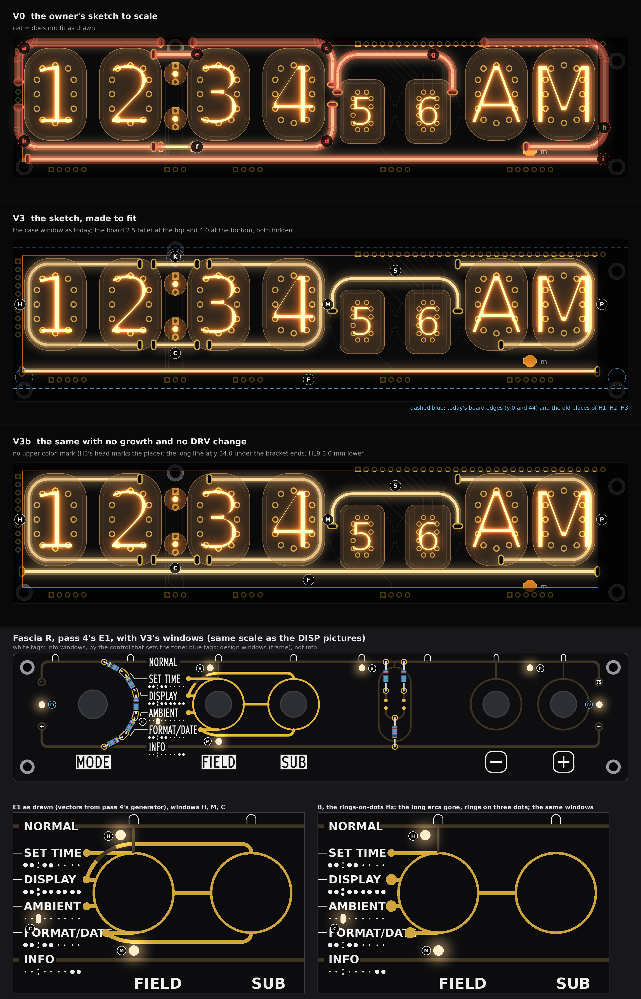
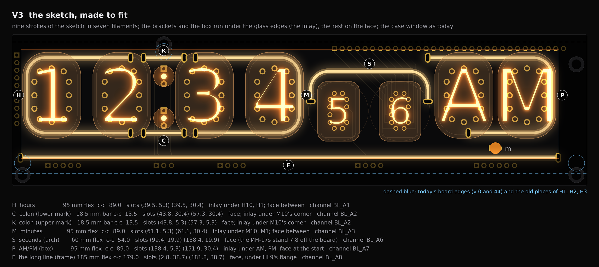
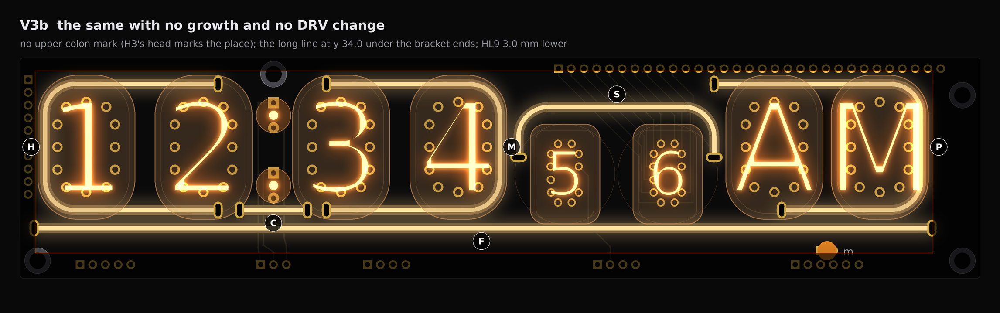
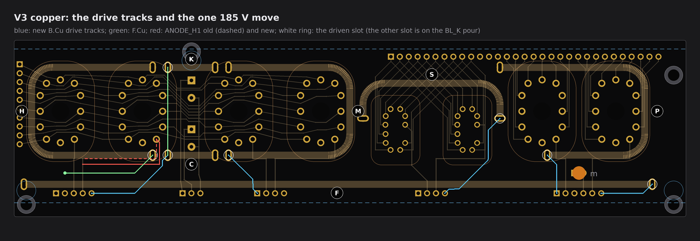
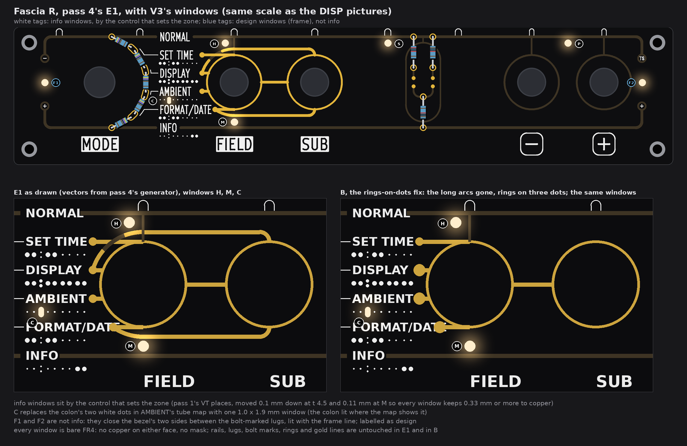

# TS06-DISP light lines, pass 2: V3, the owner's sketch made to fit (drawings and feasibility, nothing built)

No board, schematic, fab, tool, 3D, firmware or spec file was touched. I read `PCB/TS06-DISP/TS06-DISP.kicad_pcb` and `PCB/TS06-DRV/TS06-DRV.kicad_pcb` with a script, and ran the case model `3d/case-pair/case_pair.py` in memory only (it wrote nothing). Marks: *measured* is from a board file or the case model; *listing data* is from the shop pages; *inferred* is arithmetic; *assumed* is my reading, not measured or asked. The scratch scripts stay in the run's folder, not in the repo.

**In short.** V3 puts all nine strokes of the sketch on the board, in seven filaments, inside today's case window. The brackets and the box run under the glass edges (the inlay); the arch, the colon marks and the long line stand on the face. It needs one 185 V track moved about 1 mm, seven drive tracks, the board 2.5 mm taller at the top and 4.0 mm at the bottom (three standoffs move with it), and the tubes 0.4 mm prouder on the shim. No case window change; the brow look is kept everywhere. Fascia R gets five info windows by their controls and two design windows that close the bezel.

## 1. The board scan, with the owner's new rule

**The new rule.** The owner allows the inlay under the bulb. So a filament may pass under the glass, between the glass edge and the pin pads, if the shim gap is 2.4 mm or more (section 5). The glass is then no obstacle for a body. Only the slots need clean copper. Pass 1 kept every body 0.5 mm off the glass; that is why most of V0 failed.

**Rules I kept from pass 1, section 1** (all *measured* from the repo's DRU and README): slot pad to other-net copper 0.25 mm; to 185 V tracks 0.6 mm; to 185 V pads 0.8 mm; to the board edge 0.5 mm; out of the standoff keep-outs; 0.3 mm to a screw head. Slot 1.0 x 2.5 mm plated, ring 0.4 (*inferred*). The BL_K pour is ignored (it is the return). The BL_A tracks of HL1-HL8 are free: they may be deleted or reused.

**New body rules** (*assumed*): body to an ИН-12/ИН-15 pin pad 0.4 mm at least (a printed wall in the shim between the channel and the pin hole); to other pads, HL9's flange and screw heads 0.3 mm; line to line 0.4 mm.

**The tubes' bands** (*measured* from the footprints and `case_pair.py`):

| Band | Glass edge | Pin pad edge | Room | Centre line |
|---|---|---|---|---|
| top, under each ИН-12/ИН-15 | y 3.40 | y 7.84 | 4.44 | y 5.62 |
| bottom, under each ИН-12/ИН-15 | y 32.26 | y 27.83 | 4.44 | y 30.04 |
| left side of H10 | x 3.48 | x 6.47 | 2.99 | x 4.97 |
| right side of M1 | x 97.11 | x 94.11 | 2.99 | x 95.61 |
| right side of PM | x 181.14 | x 178.14 | 2.99 | x 179.64 |

A 2.0 mm body fits each band with 0.5 mm or more on each side. The ИН-17s stand 7.8 mm off the board (*measured*: the case model puts their faces level with the ИН-12s), so under them only their lead pads count.

**Free slot sites on the lanes V3 uses** (*measured*: a scan every 0.1 mm with the rules above; "free" means a slot at the end of a level line fits there today):

| Lane | Free x (mm) | What blocks the rest |
|---|---|---|
| top, y 5.27 (under the glass tops) | 8.0-45.8, 55.3-103.1, 134.5-139.4; over the ИН-15 pair only scraps under 0.4 mm long | H3's keep-out at the colon; XP12's cathode tracks fan down over AM and PM (CAT_B_* and CAT_A_*, B.Cu) |
| bottom, y 30.40 (under the glass bottoms) | 2.0-15.3, 42.3-45.7, 54.3-66.3, 93.1-101.9, 115.0-118.5, 135.8-152.7, 158.8-163.0, 177.1-189.0 | each tube's anode track (B.Cu, 185 V) runs along y 31.4; ANODE_H1 takes x 15.3 to 42.3 |
| spine, y 38.70 (between HL9 and the strip pads) | 8.3-13.7, 22.9-45.7, 54.9-67.8, 77.7-113.6, 123.5-153.1, 160.4-160.8, 168.1-183.1 | H1 and H2 (heads and keep-outs) at both ends; the strip pads' clearance in between |
| arch legs, x 99.4 and x 138.4 | y 8 to 32, all of it | nothing: the ИН-17 glass is raised |

**What the scan says before any drawing:**

* **The hours bracket's lower end cannot sit under H1 today.** ANODE_H1 (185 V, B.Cu) drops from H1's pin 7 at x 40.56 and runs along y 31.4 to x 19.56. A slot at (39.48, 30.40) is -0.80 mm from it. The track must move about 1 mm (section 3).
* **The AM/PM box cannot start at AM's glass edge.** CAT_B_AMP, CAT_B_OHM, CAT_B_SIEMENS and CAT_B_VOLT leave XP12 between x 140.4 and 148.0. A slot at (141.0, 5.27) is -0.82 mm from CAT_B_AMP. At x 138.4 it is free, so the box starts there.
* **The upper colon mark does not fit while H3 stays.** Between H3's head (bottom at y 6.05) and V7's upper pad (top at y 7.90) there are 1.85 mm, and a body is 2.0. Its slots are free (x 43.78 and 57.28 at y 5.27); only the head is in the way.
* **The long line does not fit while H1 and H2 stay.** At y 38.7 (the only height under HL9's flange and over the strip pads) a 185 mm line needs slot centres 179.0 mm apart. Free sites span x 8.3 to 183.1, which is 174.8 mm. H1's head and keep-out take the left end.
* **Everything else fits on today's copper.** The arch's legs, the minutes bracket, the colon's lower mark and the box's other end stand on free sites.

## 2. V3: the sketch, made to fit

**What it is.** All nine strokes of the sketch, in seven filaments. Each bracket is one 95 mm piece: it runs under the glass edges of its two tubes and comes out on the face for 3.9 mm between them. The box round the ИН-15 pair does the same. The arch stands on the face beside the raised ИН-17s. The colon's two marks and the long line are on the face. The case window is today's: x 3.0 to 182.0, y 2.6 to 39.0.

**What changed against the sketch, and why.**

* **The top runs are under the glass tops, not above them.** Above the glass the brow hides the board (y under 2.6), and a slot needs 4.3 mm where there are 3.4 (pass 1). Under the glass the band is 4.44 mm.
* **Each bracket is one piece, not two.** The sketch drew each bracket as two strokes with a gap on the outer side. One 95 mm piece fits exactly: the arms end 2.9 mm past the inner tube's centre, where the sketch's ends are. It costs two slots, not four, and one channel. *Inferred* from the sold lengths; a 60 + 60 pair overlaps on the outer side.
* **The colon's marks line up with the bracket ends.** Top and bottom, the row reads: bracket arm, gap, colon mark, gap, bracket arm. The gaps are 4.3 and 3.8 mm (slot to slot); the colon mark is centred on the lamps (x 50.54), the bracket ends on x 50.29; the 0.25 mm between makes the two gaps differ.
* **The box starts 2.3 mm left of AM's glass,** right over the arch's right leg. Further right, XP12's cathode tracks fill the top band (section 1).
* **The long line sits at y 38.7,** under HL9's flange (0.30 mm clear) and over the strip pads. It is one 185 mm piece, lit from x 4.8 to 179.8, centred under the row.
* **Symmetry:** the two brackets mirror each other about the colon; the top lane and the bottom lane are symmetric about the tubes' centre line (y 5.27 and 30.40, 12.57 each side of y 17.83).

**The zones** (every number *measured* on the board file or *inferred* from the sold lengths; slot centres in the board's frame, y down from today's top edge):

| Tag | Stroke (sketch) | Filament (sold) | Slot to slot | Slots: driven, return | Face or inlay | Channel |
|---|---|---|---|---|---|---|
| H | hours bracket (a + b) | 95 mm flex | 89.0 | (39.48, 30.40), (39.48, 5.27) | inlay under H10 and H1; face between them | BL_A1 |
| K | colon, upper mark (e) | 18.5 mm bar | 13.5 | (43.78, 5.27), (57.28, 5.27) | face; its right end under M10's glass corner | BL_A2, with C |
| C | colon, lower mark (f) | 18.5 mm bar | 13.5 | (43.78, 30.40), (57.28, 30.40) | face; its right end under M10's glass corner | BL_A2 |
| M | minutes bracket (c + d) | 95 mm flex | 89.0 | (61.10, 30.40), (61.10, 5.27) | inlay under M10 and M1; face between them | BL_A3 |
| S | arch over the ИН-17 pair (g) | 60 mm flex | 54.0 | (138.40, 19.88), (99.40, 19.88) | face; top at y 9.80, legs down to the ИН-17s' upper third | BL_A6 |
| P | box round the ИН-15 pair (h) | 95 mm flex | 89.0 | (151.86, 30.40), (138.40, 5.27) | face for 2.3 mm, then inlay under AM and PM | BL_A7 |
| F | the long line under all (i) | 185 mm flex | 179.0 | (181.81, 38.70), (2.80, 38.70) | face | BL_A8 |

The return slot of every line stands on the BL_K pour and needs no track. BL_A4 and BL_A5 stay spare. Six zones, six channels: no channel beyond pass 1's sixteen.

**Clearances** (*measured* on the drawn centre lines, body 2.0 mm): body to an ИН-12/ИН-15 pin pad 0.50 at the least (the bracket and box legs; rule 0.4); body to HL9's flange 0.30 (F); body to V8's lower pad 0.30 (C); line to line 1.79 at the least (M's leg to the arch's leg); every slot passes the 185 V rules after the one move in section 3. The colon lamps are taken to stand on their leads near the glass fronts, like the ИН-17s, so their 6.97 mm envelope is not on the board face (*assumed*; C passes 0.41 mm from it even if it were).

**What changes on the board for the face** (the list is in section 3): seven pairs of slots; one 185 V track moved about 1 mm; seven drive tracks; the board 2.5 mm taller at the top and 4.0 mm at the bottom, with H1, H2 and H3 moved (section 4).

### 2.1 V3b, the same with no growth (an alternative)

If no standoff may move: drop the upper colon mark K (H3's head stays where the sketch drew it) and lift the long line to y 34.0, 3.6 mm under the bracket ends. At y 34.0 the line's slots clear H1 and H2 (x 2.80 and 181.81 are free there), but the line crosses HL9's pads, so HL9 moves 3.0 mm down to (160.9, 38.5) and its M_A track gets 3.0 mm shorter. HL9's pads keep 1.05 mm to XP25's. The cost: the upper colon mark, and the "m" LED then sits half behind the sill when seen straight on (*inferred*: its flange spans y 36.6 to 40.4, the sill top is y 39.0). Board, DRV and case otherwise as V3, without section 4's growth.

## 3. The reroutes

I tested every drive track with a small grid router (0.1 mm grid, 0.3 mm track, 45-degree moves, the rules of section 1, every slot an obstacle). Lengths are *inferred* from its paths; corners are rounded to 0.1 mm.

| Net | Layer | From, to (through) | Length: old, new | What and why |
|---|---|---|---|---|
| ANODE_H1 (185 V) | B.Cu | H1 pin 7 (40.56, 25.83), a 45-degree jog to (41.40, 26.70), down to (41.40, 33.00), left to (19.56, 33.00), down to XP21.4 | 36.5, 37.6 (+1.1) | The drop moves 0.84 mm right and the run 1.60 mm down, so H's lower slot keeps 0.80 mm. It keeps 0.60 to C's drive track and 1.73 to the next track (K1). The only 185 V track that moves. |
| BL_A1 (H) | F.Cu, one via | via at HL1's old anode pad (14.48, 35.50), right to (34.4, 35.5), up to H's slot (39.48, 30.40) | 5.8, 5.8 + 27.1 | H's slot sits inside ANODE_H1's new route, so its drive crosses it on the front. The track cuts the BL_K pour along its length; the pour stays one piece. |
| BL_A2 (C and K) | B.Cu | XP21.5 (22.1, 41.3), right to (34.4, 41.3), up to (42.3, 33.4), to C's slot (43.78, 30.40) | 21.5, 27.1 (+5.6) | Runs under ANODE_H1's new run with 0.60 mm. |
| BL_A2 (K) | F.Cu | C's slot (43.78, 30.40) straight up to K's slot (43.78, 5.27) | new, 25.1 | B.Cu between the colon and H1 is full; the front is free there (COLON_U is 3.3 mm away). K and C share the colon zone. |
| BL_A3 (M) | B.Cu | XP23 (69.28, 41.3), up to (68.0, 37.3), to M's slot (61.10, 30.40) | 9.8, 14.3 (+4.5) | |
| BL_A6 (S) | B.Cu | XP24 (122.73, 41.3), along y 40.0 to (126.8, 40.0), to (135.0, 31.8), up to (135.1, 23.2), to the arch's right slot (138.40, 19.88) | 12.5, 29.5 (+17.0) | The longest; it passes between S1's pads and ИН-15Б's left pins. BL_A5 to the left leg is 28.2 mm and also fits. |
| BL_A7 (P) | B.Cu | XP25 (154.55, 41.3), up to (154.6, 33.1), to P's slot (151.86, 30.40) | 8.7, 12.0 (+3.3) | |
| BL_A8 (F) | B.Cu | XP25 (167.25, 41.3), right to (179.2, 41.3), to F's slot (181.81, 38.70) | 11.2, 15.7 (+4.5) | |
| BL_A4, BL_A5 | B.Cu | deleted | 17.5 and 10.0, to 0 | spare channels; the strip pins stay |
| M_A (V3b only) | B.Cu | HL9's anode pad moves to y 38.5 | 5.8, 2.8 (-3.0) | V3b only |

Every new track keeps 0.25 mm to other copper and 0.6 mm to 185 V copper (the router's rule), and no two new tracks on one layer come within 2 mm of each other except where they share a net. **Not checked:** a real DRC in KiCad (the board file is not edited), the pour's fill after the F.Cu tracks, thermal reliefs on the slots.

## 4. The height, DRV behind it, and the case

**The board grows 6.5 mm: 2.5 at the top edge and 4.0 at the bottom edge** (44.0 to 50.5 mm; width 191.4 as today). The strips XP11, XP12, XP21-25 and H4 do not move.

| Edge | Growth | What moves | Why | Least that works |
|---|---|---|---|---|
| top | 2.5 mm (new edge at y -2.5) | H3 up 2.5, to (50.535, 0.80), on DISP and DRV; its keep-out with it | K's body clears H3's head by 0.72 mm (head bottom y 3.55, body top 4.27) | 2.1 mm (*inferred*) |
| bottom | 4.0 mm (new edge at y 48.0) | H1 and H2 down 4.0, to y 44.5, on DISP and DRV; their keep-outs with them | F's left slot (2.80, 38.70) clears H1's keep-out by 0.34 mm and its head by 1.4 | 3.7 mm (*inferred*) |

Each moved hole keeps today's distance to its new edge (3.3 mm at the top, 3.5 at the bottom). On DISP the moved keep-outs cover only ground the old ones covered or the new strips, so no DISP track is in the way (*measured*).

**TS06-DRV behind the added area** (*measured* from `3d/case-pair/boards.json` and the DRV board file; DRV's top edge is 26 mm above DISP's, its bottom 30 mm below):

* **Parts.** DRV's display-facing side carries only the socket strips (XS11, XS12, XS21-25) and J1. Behind the top strip (world Y 78.0 to 80.5) there is none: XS12's courtyard ends at Y 77.6. Behind the bottom strip (Y 30.0 to 34.0) there is none: XS21-25 start at Y 34.9, J1 is at Y 6.8 to 12.3. The parts on DRV's rear side there (R33, R35, R72, and RN1, which goes anyway) face away; their lead ends reach about 2 mm into the 11 mm gap between the boards (*inferred*). DISP has no slot in the new strips, so nothing on DISP's back meets them.
* **The standoffs.** No DRV part is within 6 mm of the three new hole places. DRV's copper is close: at H3's new place A3 (B.Cu) passes 0.09 mm outside the keep-out square and 3.91 mm from the hole's centre; at H2's, XA7 (B.Cu) 0.01 mm outside, 3.83 from the centre; at H1's, the nearest is GND at 1.48. The rules pass with no margin at A3 and XA7: nudging A1-A3 and XA5-XA7 by 0.3 mm gives some (*inferred*).
* **The pair mate check** needs Docker and was not run. This is a file-to-file check only.

**The case** (`case_pair.py` run in memory with the board 50.5 mm tall, the seat 2.4 and DRV where it is; *measured*):

* **Window: no change** (x 3.0 to 182.0, y 2.6 to 39.0). Every lit body is inside it: x 3.97 to 180.64, y 4.27 to 39.70.
* **Brow: no change, and the brow look over the glass tops is kept everywhere.** The top strip hides behind the brow and soffit (board y under 2.6).
* **Sill: no change.** The bottom strip hides under the sill and behind the fascia. The long line's lower 0.7 mm is behind the sill seen dead level; from 1.4 degrees above, all of it shows (*inferred*).
* **Depth: +0.4 mm** (outside depth 78.5 to 78.9), from the seat (section 5).
* **The model's checks: the same 85 rows, the same results** (68 OK, 8 TIGHT, 6 NOTE, 3 FAIL, as today with the 2.0 seat). Envelope 204.4 x 120.0 mm (W x H), unchanged. The levers' bodies behind the fascia come back to Z 28.6, but at DISP's face depth they stay below world Y 24.6: 5.4 mm under the new bottom edge (*inferred* from the model's body sizes; the КМД1 depth is *assumed* there).

**One thing the brow does to the top runs.** The top lane (H, M, K and P's top, body y 4.27 to 6.27) lies 27.9 mm behind the brow's front edge. Seen level or from below it shows whole. From above, the brow starts to cover it at 3.4 degrees and hides it past 7.5 degrees; the arch's top shows up to 12.5 degrees (*inferred*: the hidden line is y = 2.6 + 27.9 x tan of the angle). This is the same brow that hides the glass domes on purpose (spec §6). The bottom runs and the long line show from every angle above.

## 5. The shim gap

The inlays are H (under H10 and H1), M (under M10 and M1), P (under AM and PM), and the right ends of K and C (under M10's glass corner). So every ИН-12 and ИН-15 stands on a gap of **2.4 mm** for a 2.0 mm body (2.9 for 2.5, 3.4 for 3.0, the limit; pass 1 section 5). One printed jig seats all six, so the whole row goes to 2.4. The ИН-17s stand 7.8 mm off the board and need nothing.

The shim carries a channel 2.4 mm wide along each bracket and the box, cut through, with the glass resting on the shim round it. The thinnest wall is at the bracket and box legs: 0.5 mm from the body to the pin pad, about 0.6 mm of plastic between the channel and a 1.4 mm pin hole (*assumed* hole size). `IN12_SEAT` goes from 2.0 to 2.4: the tubes stand 0.4 mm prouder, the case 0.4 mm deeper.

**If the bend radius is not 6** (*assumed*): the bracket and box arms end 0.43 mm further out per mm of radius (*inferred*). R 8 still passes (H's end at x 40.34, 0.50 to the pins), but ANODE_H1's drop must then sit at x 42.05, about 0.65 mm from H's and C's lower slots: little margin (*inferred*). R 10 fails: the corner comes 0.09 mm from H10's pin 1.

## 6. Fascia R: the windows

Bare FR4 windows: no copper on either face, no mask. I checked each against pass 4's E1 as its generator draws it (every gold and masked-copper item, the pads, the white) and against the rings-on-dots fix B (E1 without the two long arcs to SUB, with a second ring on DISPLAY's, AMBIENT's and FORMAT/DATE's dots). Rule: 0.3 mm from a window to any copper on either face and to the white (*assumed*; the fab's copper-to-cut rule decides). Every window suits both E1 and B.

| Window | Zone | Centre (x, t down the face) | Size | Kind | By what | Copper (E1 / B) | White |
|---|---|---|---|---|---|---|---|
| H | hours | (61.4, 4.5) | 2.0 | info | FIELD's upper throw | 0.33 / 0.33 (top rail) | 1.68 |
| M | minutes | (64.0, 27.46) | 2.0 | info | FIELD's lower throw | 0.37 (FORMAT/DATE's gold run) / 0.37 (+5V rail) | 3.94 |
| C | colon (both marks) | (45.04, 21.10) | 1.0 x 1.9 | info | the colon's two dots in AMBIENT's tube map, replaced by one window | 5.53 / 5.53 | 0.32 (the name AMBIENT) |
| S | seconds | (108.6, 4.5) | 2.0 | info | under S10's index bulb | 0.33 / 0.33 (top rail) | 1.28 |
| P | AM/PM | (160.9, 4.5) | 2.0 | info | between minus and plus | 0.33 / 0.33 (top rail) | 8.99 |
| F1 | frame | (9.0, 16.0) | 2.0 | **design, not info** | the bezel's left side, between its two bolt-marked lugs | 4.65 / 4.65 | 5.43 |
| F2 | frame | (182.4, 16.0) | 2.0 | **design, not info** | the bezel's right side, mirror of F1 | 1.85 / 1.85 (the plus key's ring) | 5.43 |

* **Against pass 1's places:** H, S and P move 0.1 mm down (t 4.4 to 4.5) to keep 0.33 from the top rail; M moves 0.11 mm down to sit midway between FORMAT/DATE's gold run and the +5V rail. Pass 1's colon window at (52.4, 20.8) sat on the AM tube's speck in AMBIENT's map, not on the colon; C now replaces the colon's own two dots.
* **The frame has no control of its own**, so its windows are design: they close the bezel's open sides between the lugs, one at each end, under the two ends of the long line. They are labelled so on the picture.
* **Kept:** the rails, the four lugs and their bolt marks, the rings, every gold line, the tube index and the maps (less the colon's two dots in AMBIENT's row).
* **The light path** is pass 1's (sections 6.1 and 6.2): a short tail per window on its zone's channel, a single-end filament if one exists, else a hairpin. The upper windows (H, S, P) need the three sill notches; M, C, F1 and F2 start below the sill (*inferred*, as pass 1's M and C). F1 and F2 keep 12.3 mm from fascia R's screw holes and clear the controls' bodies (*measured* from `boards.json`).
* **Load:** seven filaments on the face plus seven tails at 25 mA each is 350 mA; with the 104 mA left on the 5 V side, 454 mA, 45 per cent of U14's 1.0 A (*inferred*, from pass 1 section 8's figures). Each filament keeps its own series resistor: 14 on DRV, 6 FETs.

## 7. My pick, the questions

**Pick: V3.** It keeps every stroke of the sketch and its meaning, all inside today's case window, with the brow look intact. It costs one 185 V track moved about 1 mm, three standoff holes moved on both boards, and 0.4 mm more shim. V3b is the fallback if DRV must not change: it loses the upper colon mark and moves the "m" LED down. For the fascia: the five info windows go with the next fascia, after pass 1's coupon; F1 and F2 only if the owner likes design windows.

**Questions** (each with my recommendation):
1. **May the board grow 2.5 mm at the top and 4.0 mm at the bottom, with H3 moving up 2.5 mm and H1 and H2 down 4.0 mm on both boards?** *Recommendation: yes. It buys the upper colon mark and a long line the full row long. Both new strips hide behind the brow and the fascia, nothing on DRV stands behind them, and the case model's checks do not change. Nudge DRV's A1-A3 and XA5-XA7 by 0.3 mm.*
2. **Where will the clock usually be seen from?** From more than about 4 degrees above the glass line the brow starts to cover the top runs. *Recommendation: keep the top runs as drawn (they are half the sketch). If the clock will sit low on a desk, say so: the top lane can drop to the band's lower edge (y 6.3, 0.5 mm from the pins), which buys about 2 degrees.*
3. **Keep F1 and F2, the two design windows for the frame?** They mean nothing but close the bezel. *Recommendation: yes, with the long line; drop them if every lit point on the fascia must carry information.*

## 8. Left open, skipped, refused

* Nothing was refused. No board, schematic, fab, tool, 3D, firmware or spec file was edited; `case_pair.py` ran in memory and wrote nothing.
* **Not checked:** a KiCad DRC on the changed copper (the board file was not edited); the pair mate check (needs Docker); the real glass outline (a rounded rectangle, corner radius 8, *assumed*: a true oval leaves more room at the corners, which only helps); the filament's width, bend radius, tab and slot size (bench); whether a single-end steady filament exists (pass 1, question 2); the fab's answer on bare windows (pass 1's coupon).
* **Not drawn:** V3 at 2.5 and 3.0 mm bodies (the gap numbers are in section 5); the lit-lip idea; the tails in the case section (pass 1's section 6.2 holds for these windows).
* **The colon lamps** are taken to stand on their leads near the glass fronts (*assumed*). If they sat on the board, C would pass 0.41 mm from the envelope and K 1.75 mm: both still clear.
