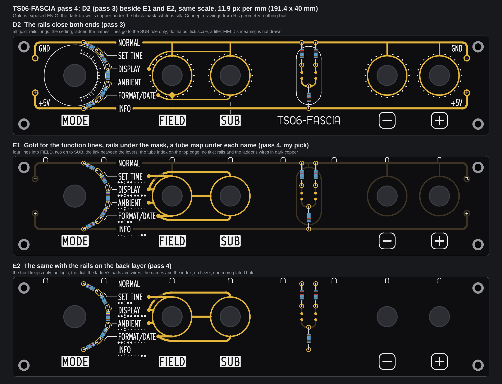
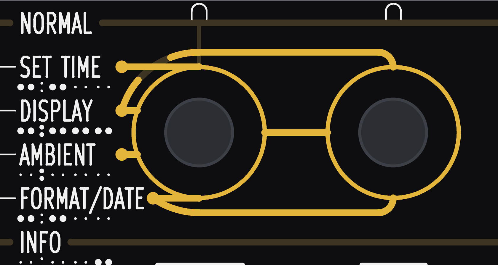
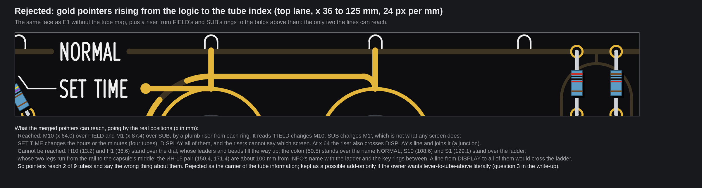
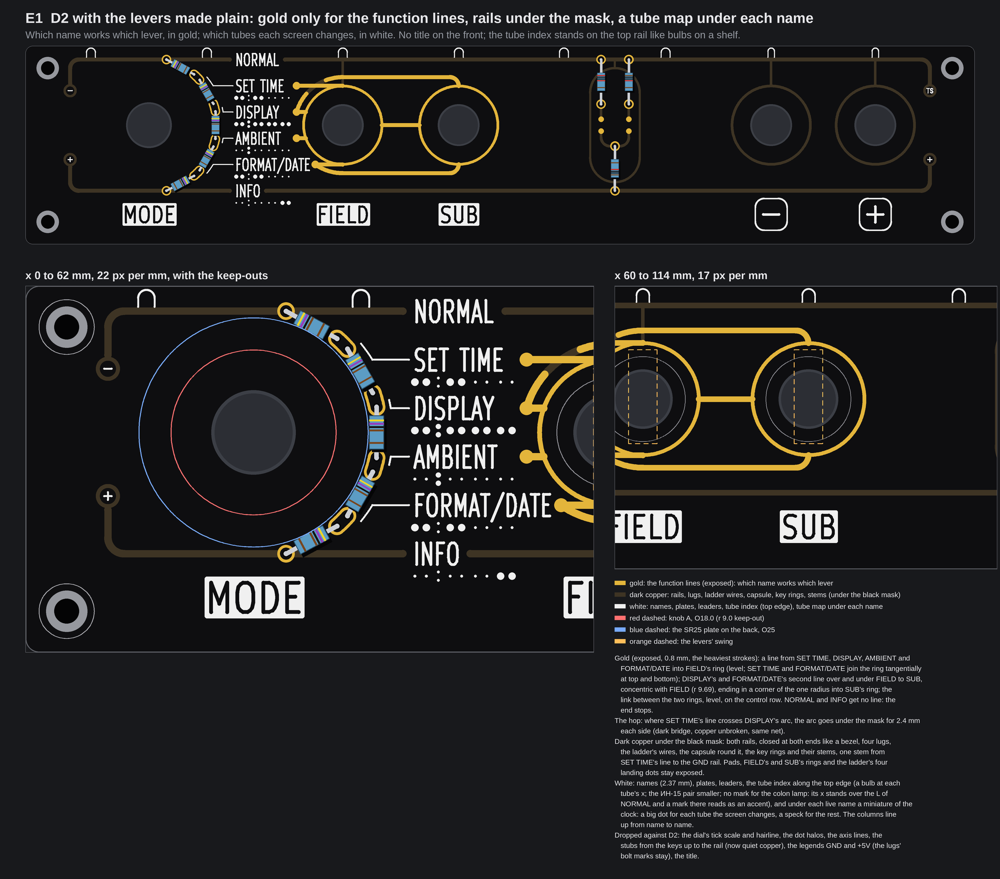
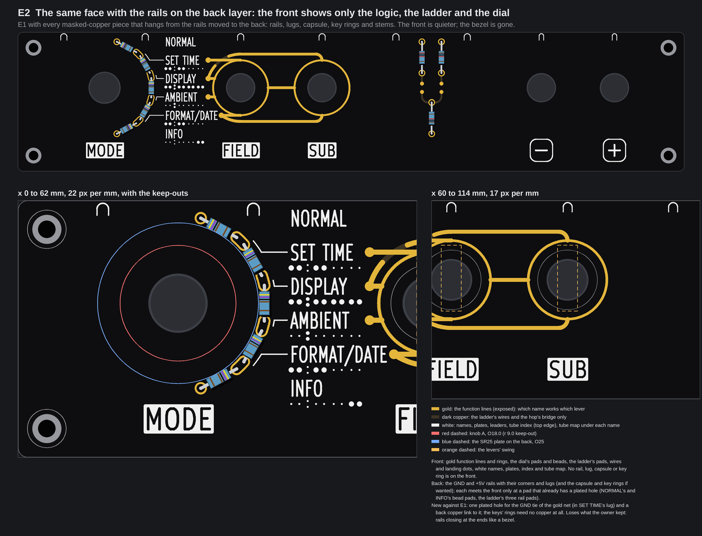
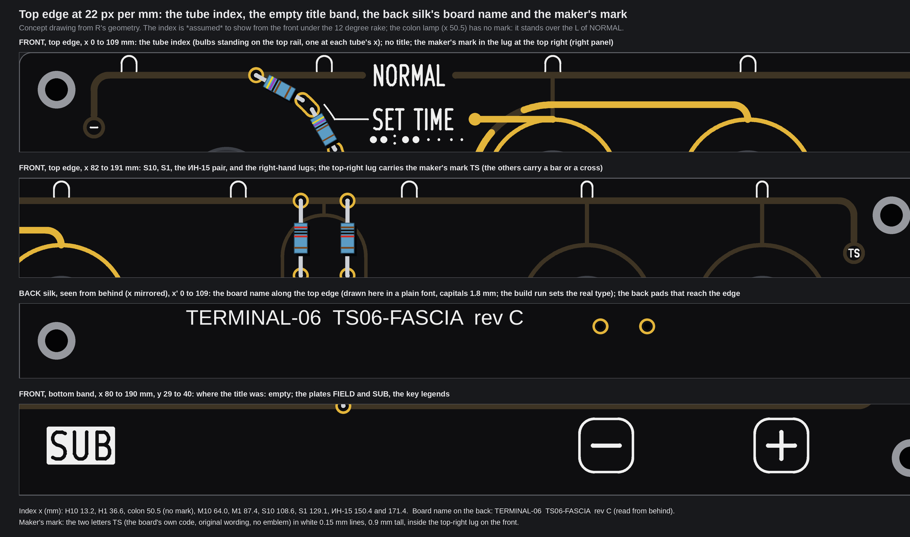

# TS06-FASCIA pass 4: D2 with the levers' meaning made plain (two faces, E1 and E2; concepts, nothing built)

No board file, generator, footprint, `tools/` file, `fab/` file, firmware file or page source was touched, and no board was built. The pictures are drawn from fascia R's real geometry (the committed board with its control holes opened, the one that was ordered), names at their real size (2.37 mm; the MODE, FIELD and SUB plates 3.2 mm, KiCad's own stroke font), and both faces were run through `check()` of `tools/fascia_gold.py`. Items marked *inferred* are arithmetic on the drawing or typical figures, not something a datasheet, a measurement or a fab told us here; items marked *assumed* are my reading, not asked. There is **no price** on this page. The scratch scripts are in the run's output folder, not in the repo. Pass 3 is [TS06-FASCIA-pass3.md](TS06-FASCIA-pass3.md), pass 2 [TS06-FASCIA-pass2.md](TS06-FASCIA-pass2.md), pass 1 [TS06-FASCIA-pass1.md](TS06-FASCIA-pass1.md).

## 1. The owner's words, and what I took

On 2026-10-07 at about 23:5x UTC, after pass 3 (verbatim, spelling as sent):

> the purpose of showing visuallly which lever acted on which menu option got lost a bit in the clutter, can you make that more promiant while keping any gold traces connecting the two levers themselves to the center while the traces to rotary posyions go on the sides / best candidate is d2 but I still hope to see integrated complexity from C* / title line should be something else completely / ... maybe we have the traces from rotary positions/levers/buttons actually physsically point to the bulbs they will be changing, since fascia sits right underneath the bulbs.

On 2026-10-08 at about 00:00 UTC: "info first as a design choice, deal with clutter creatively". On 2026-10-12, answering xstream's two options: "title agree / dial agree / go / without xstream confirmation, its idle". So two picks are settled and not reopened: **no title on the front** (the board name goes on the back silk), and **the dial's six names at equal pitch**.

What I took from them:

1. **The face exists to say which lever works on which screen, and which tubes each screen changes.** Every other layer serves that read or steps back. The test is a 3-second read (section 8).
2. **D2 is the base**, as before: no flip (GND rail on top at the NORMAL row, +5V at the bottom at INFO's), round corners of one radius (1.79 mm), the rails closing at both ends like a bezel, rings of one radius, the ladder as the centrepiece.
3. **Clutter is solved by form, not by dropping information** (section 4).

## 2. xstream's verdict on pass 3, and what I took

Read: `embassy/review/nixie-fascia-fresh-eyes/verdict-pass3.md` on agent-commons at 979349f, with `git show` only (read-only; nothing written or pulled there).

| xstream's point | Taken? | What I did |
|---|---|---|
| Invert the weights: exposed gold only for the function lines, the heaviest strokes | **Taken** | Exposed gold is only the lines from the names to the levers' rings, the rings of FIELD and SUB, the dial's and the ladder's pads and the ladder's four landing dots. The function lines are 0.8 mm, the rings 0.5 mm |
| Rails and the ladder's capsule as copper under the black mask, or on the back | **Both drawn, E1 picked** | E1: under the mask on the front (a dark sheen, no opening). E2: on the back layer. Section 6 says what each costs |
| White silk for the names and the tube index only | **Taken, plus one thing** | White is the names, plates, leaders, the key legends, the tube index, and the tube map under each name (new: it is the tube index in miniature, section 4). The lugs keep a tiny white bolt mark (a bar on GND, a cross on +5V) |
| Drop the dot halos, the tick scale inside the dial, the stubs from minus and plus to the top rail | **Taken** | All three are gone. The key rings and their stems are now dark copper, not gold. The legends GND and +5V are gone too (a quiet rail does not need a loud label; the lugs' marks stay) |
| Equal name pitch, bends on one arc | **Settled by the owner** | As pass 3 (5.29 mm; one bend, all bends on the circle r 15.2 about the dial) |
| One line per fact; where a lever acts in two screens the bundle splits once, visibly, at the dial; no gold that only decorates | **Taken, with one hop** | Section 3 |
| "Rails start at SUB" only if the rails stay exposed gold | **Not needed** | The rails went under the mask, so by xstream's own rule it no longer matters, and by the net rule below the GND lines may even touch the GND rail. Not drawn |
| Title: (a) none on the front, board name on the back silk, a small maker's mark on one lug | **Settled by the owner, drawn on both faces** | Section 7 |

## 3. The plan's four points on D2: what fitted, what did not

P1a's plan (entry P1a of `TS06-parked.md`, in the repo's outputs folder) asked for (1) the logic layer in bold gold, symmetric about the control row: positions 2 and 3 over the top of FIELD, 4 and 5 under it, as C\*'s parallel lines with concentric bends, 3 and 5 on to SUB, the FIELD-to-SUB link in the centre; (2) rails from SUB rightwards; (3) pointers up to the tubes; (4) three levels of ink.

**The finding: that bundle cannot be drawn without a crossing, and one crossing is the least that will do.** Names 2 to 5 stand in a column; FIELD takes all four, SUB takes only 3 and 5.

* Over the top, SET TIME stands above DISPLAY, so on concentric arcs SET TIME's line is the outer one. It ends on FIELD; DISPLAY's line, the inner one, goes on to SUB. To reach FIELD, SET TIME's line has to cross DISPLAY's. Nothing outside DISPLAY's arc can reach FIELD.
* Under the bottom it works by itself (FORMAT/DATE is the outer line and is the one that goes on to SUB), but FORMAT/DATE is the longest name (to x 57.3), so its lug stands on the circle r 9.69 about FIELD at x 58.45, and the lane has room for that one circle only; AMBIENT's line cannot go round under as a second one.
* So the F-lines (names into FIELD) are **short and level**: DISPLAY and AMBIENT go straight into FIELD's ring from the left (their rows are 2.65 mm either side of the ring's axis); SET TIME and FORMAT/DATE, whose rows touch the ring's top and bottom, run level and join the ring tangentially. Only the two lines on to SUB go round FIELD, concentric with it (r 9.69, as D2's setting), over the top and under the bottom, and end in a corner of the one radius into SUB's ring. The link between the levers is level on the control row, 7.6 mm long, clear of both swings.
* **One hop:** SET TIME's level line crosses DISPLAY's arc at x 58.45. Both are on the GND net, so the copper is unbroken; the arc goes **under the mask for 2.4 mm each side** (a dark bridge, in the picture) so the eye reads a crossing, not a junction. It is the only one.

**Lanes.** The 4.68 mm lane over FIELD's ring is not used by a second line (the crossing is the reason, not the room). Under the mask the GND rail is on the same net as the lines, so a line could even touch it; the +5V rail at the bottom stays 2.7 mm from the lower run.

**Pointers to the tubes (point 3): rejected as the carrier**, see section 4.

**Three levels of ink (point 4)**: exposed gold for the function lines; dark copper for everything that is circuit and not function; white for names and the tube index. This is xstream's three inks, and it answers the plan's three levels with the weights inverted.

## 4. Tactics against the clutter: which I used, and the one I rejected

| Tactic (from the brief) | Used? | Why |
|---|---|---|
| Merge, don't add | **Yes** | The names' lines are the logic: no separate pointer lines, no dot halos, no second lane. SET TIME's and FORMAT/DATE's lines are the ring's own tangents; the key stems and the capsule stem are one copper tree on the GND net |
| Hierarchy by ink | **Yes, the main one** | Gold 194 mm in all (D2: 683 mm); 440 mm of copper under the mask; white for names and index. One visual level per meaning |
| Negative space | **Yes** | NORMAL and INFO get no line (the end stops show themselves); NORMAL gets no tube map either; the title band is empty; the dial is bare inside |
| Glyph, not line: a tube map by each screen name | **Yes, the answer for the tubes** | Under each live name, the clock in miniature: a big dot (0.8 mm) for each tube the screen changes, a speck (0.3 mm) for the rest, the colon as two dots; the columns line up from name to name, so a column reads down as "which screens change this tube". INFO's has only the last two. Nothing crosses the face |
| Shape the rail: a tooth or notch at a tube's x | **No** | With the rails under the mask a tooth would only repeat the index, which already stands on the rail |
| Pointers: gold risers from the logic to the index | **Rejected** | See below |

**Why the pointers fail.** The tubes stand at x 13.2, 36.6, 50.5, 64.0, 87.4, 108.6, 129.1, 150.4 and 171.4. Only two are above something a line can reach: M10 over FIELD and M1 over SUB, and a riser there says "FIELD changes M10, SUB changes M1", which is true of no screen (SET TIME changes four tubes, DISPLAY all of them). H10 and H1 are over the dial, the colon over the name NORMAL, S10 and S1 over the ladder, the ИН-15 pair 100 mm from INFO's name with the ladder and the key rings between. One gold bus along the top edge would join every screen to every tube. The crop above is E1 without the tube map and with the two risers, 24 px per mm. The fascia sits under the bulbs, but the lines cannot get to them: the **map says it with no line crossing the face**, and the index on the top edge is its key at full size.

## 5. E1: gold for the function lines, rails under the mask, a tube map under each name

**New against D2:** the lines of section 3; exposed gold only for the function lines, the rings, the pads and the ladder's four landing dots (exposed in D2, kept exposed: *assumed* hand-wiring landing dots); rails, lugs, the ladder's wires, the capsule, the key rings and their stems in dark copper under the mask (the capsule hangs from the GND rail by one short stem, so it has a net; its bottom is 0.58 mm from R6's +5V pad); one masked stem from SET TIME's line to the GND rail ties the gold net to GND; white tube index of bulbs standing on the top rail; the tube map; no title; the maker's mark in the top-right lug.
**Costs:** 16 plated holes (10 ring, 6 ladder; none new); no firmware or DRV change; exposed gold 194 mm of line, arc and ring (D2: 683 mm); copper under the mask 440 mm; 50 white dots; two exposed rails are gone (no bare 5 V line on the face: the +5V rail is under the mask). The face is left-heavy: all the gold stands in the middle-left, the keys' half is dark.

## 6. E2: the same with the rails on the back layer

**New against E1:** every dark-copper piece that hangs from the rails (rails, lugs, capsule, key rings, stems) is on the back layer; the front shows the gold logic, the dial and the ladder (pads, wires, landing dots) and the white. **Costs:** one new plated hole (the GND tie of the gold net, in SET TIME's lug) and a back copper link; each rail meets the front only at a pad that already has a hole (NORMAL's and INFO's bead pads, the ladder's three rail pads); nothing else. What it loses: the bezel the owner kept. The front is quieter and the right half is bare (the bulbs hang over nothing, with no shelf). E2 reads no worse and no better than E1 in the 3-second test; it is the second best.

## 7. The top edge

* **Front:** a bulb outline (a dome, two short sides, 1.8 mm wide) stands on the top rail at each tube's x, nine less one: H10, H1, M10, M1, S10, S1 and the two smaller ones for the ИН-15 pair. **The colon (x 50.5) has no mark:** it stands over the L of NORMAL, and any mark there reads as an accent on the L (I tried a small bulb and a dot; both did). The tube map shows the colon as two dots. The title band, at the bottom between SUB's plate and the minus key, is empty.
* **Back silk:** the board name along the top edge, "TERMINAL-06  TS06-FASCIA  rev C" (xstream's wording from pass 3's question 3), capitals 1.8 mm; shown here in a plain font, the build run sets the real type; clear of the back pads that reach the edge (NORMAL's bead, the ladder's two top pads).
* **Maker's mark:** the two letters TS (the board's own code, original wording, no logo, emblem, state mark or trademark), white 0.15 mm lines, 0.9 mm tall, inside the top-right lug on the front (the GND lug at that end; the other three lugs keep a bar or a cross, so each rail is still marked). *Assumed:* that "one lug" meant a front lug. At 0.15 mm it is at the fab's silk limit (`tools/dfm_check.py`); *inferred*, not asked of a fab.
* *Assumed:* that the index shows from the front under the 12 degree rake. E1 does not lean on it: the tube map under the names says the same without it.

## 8. The 3-second test

My reading of the pictures, not a test with a person (*assumed* to be the next best; showing the contact sheet to one stranger for three seconds is the real test). What a stranger can read off each face:

| Screen | Which lever (from the lines) | Which tubes (from the tube map) | D2 (pass 3) for comparison |
|---|---|---|---|
| 1 NORMAL | none: no line, no map, a quiet row between two rail ends | none | no line either; reads as "rail" |
| 2 SET TIME | one line into the left ring: FIELD only | the four digit tubes (hours and minutes) | no line: nothing says FIELD works here |
| 3 DISPLAY | a line into FIELD and a second line over the top on to SUB: both levers | all nine dots big: every tube | one line to SUB (the rule); FIELD not drawn |
| 4 AMBIENT | one line into FIELD only | the colon: the pair of dots in the middle | no line |
| 5 FORMAT/DATE | a line into FIELD and a second under the bottom on to SUB: both levers | the four digit tubes | one line to SUB |
| 6 INFO | none (a read-only screen) | the last two dots: the ИН-15 pair | no line; reads as "rail" |

**What reads at once:** which screens use a lever (2 to 5) and which are parked (1 and 6); that SUB comes only with DISPLAY and FORMAT/DATE (exactly two lines reach the right ring); that the tube map is a row of clocks' worth of dots, DISPLAY's full and INFO's at the far end. **What takes a second look:** which ring is FIELD and which SUB (the plates stand 18 mm lower, across the +5V rail, and the reader goes by x); which dot is which tube (the map is a miniature, the bulbs on the top edge are its key at full size, but the spacing differs). The pass-3 face fails the first and the last columns outright. **E1 passes; the rejected pointers do not** (2 of 9 tubes, wrong meaning); E2 is as readable as E1.

## 9. The checker, and the angle check

`check()` of `tools/fascia_gold.py`, run two ways on each face: *exposed only* (gold and white, the real exposure; white over copper under the mask is allowed) and *all copper counted as gold* (the pass-3 way, the worst case, gold and copper only). **No problem on either, on E1 or on E2.** Numbers (rules in brackets):

| | E1 | E2 |
|---|---|---|
| Gold to white (0.30), exposed only | 0.37 | 0.37 |
| Gold to the edge (1.4) | 1.82 (NORMAL's bead pad) | 1.82 |
| Gold to a screw (3.0), exposed only / all copper | 23.0 / 4.10 (the lugs) | 23.0 |
| Gold to the knob keep-out (9.0), margin | 3.75 | 3.75 |
| Narrowest web between separate pieces (0.30): exposed / all copper | 1.30 (the ladder's landing dots) / 0.58 (capsule to R6's pad) | 1.30 |
| Narrowest web inside one net | 0.32 (the hop) | 0.32 |
| Thinnest gold line | 0.50 exposed (rings), 0.40 with copper (lugs) | 0.50 |
| Thinnest silk line / text stroke | 0.15 (the maker's mark; all else 0.20) / 0.30 | 0.20 / 0.30 |
| Exposed gold length, mm | 194 | 194 |

**The angle check (pass 2's):** no gold line is neither level nor plumb (0 on both faces). Gold arcs by centre: 8 concentric with a control (4 round FIELD: the two gold pieces of DISPLAY's arc and FORMAT/DATE's, plus the hop's masked bridge counted with them; 4 are the dial's pad stadiums) and 8 corners of the one radius in E1 (four rail corners, the ladder bar's two, the two into SUB's ring; 4 in E2, the rails being on the back). The capsule's two end arcs are masked copper about its own ends. No silk line is oblique now (the dial's radial ticks are gone); the bulbs' domes are arcs about their own centres.

## 10. Answers to the grill (P1a)

* **Does it move the order? No.** Fascia R rev B is ordered as it stands; this is the future T face, concepts only. E1 needs no new hole; E2 one.
* **Clutter, and pointers adding lines: the 3-second read decides.** The pointers failed it, so I dropped them to a crop and said so (section 4) and answered with the tube map, which carries all nine tubes of every screen and crosses nothing.
* **Lanes are tight; do the rails have to start at SUB? No.** The rails went under the mask. Two lines at 2.0 mm pitch fit the 4.68 mm lane over FIELD, but a second line there needs the one crossing (section 3), which a hop does; so the lane holds one line each way.
* **Gold for logic, not just circuit: which rule wins?** Gold for the function lines wins, for the owner's purpose (the logic made plain); spec §6 already draws the SUB rule in gold ("drawn, not captioned"), and xstream's own verdict on pass 3 asks for it. The critics' "no gold that is not a net" survives: the function lines, the rings and the link are all one copper tree on the GND net, tied to the rail by one masked stem. So both hold: ink follows meaning, and no gold floats.
* **The 12 degree rake: does the top-edge index show?** *Assumed* yes; E1 does not depend on it (section 7).
* **Pace.** The run started on the owner's word on 2026-10-12 at about 18:57 UTC, without waiting for xstream's go ("its idle").

## 11. My pick

**E1.** It is the only form I found that carries all of the information with the least ink: which name works which lever in the heaviest strokes, which tubes in white, no line crossing the face, the bezel and one radius kept, no new hole, 71% less exposed gold than D2, and the rails no longer bare 5 V on the front. E2 is the fallback if the owner wants the front quieter than the bezel allows; the pointers are rejected.

## 12. Questions for the owner

1. **Rails under the mask on the front (E1), or on the back (E2)?** *Recommendation: E1. It keeps the bezel the owner kept, costs no new hole and puts nothing bare at 5 V; E2 quiets the front but loses the bezel and costs one hole.*
2. **Two tube facts I could not read from the spec:** which tubes does AMBIENT's *backlight* light, and does FORMAT/DATE touch anything beyond the four digits (the date, the 12/24 h flip; the A or P on the ИН-15 pair follows the format by itself)? *Recommendation: as drawn (AMBIENT the colon only; FORMAT/DATE the four digits). If the backlight lights all tubes, AMBIENT's map gets every dot big and one row of the face changes; tell me and I redraw that row only.*
3. **Should a lever also point straight up at the tube above it (FIELD to M10, SUB to M1), as the owner's words half suggest?** *Recommendation: no. It reaches two of nine tubes and says what no screen does (the crop in section 4); the map says the real thing.*

## 13. Left open, refused, skipped

- Nothing was refused. One compound shell command (a Python call with a runtime-computed path next to a copy) was stopped by the guard before it ran; I split it into plain commands on named files and nothing else was stopped.
- **Left open:** the keys. They work on screens 2 to 5 whatever the levers point at (spec §1), so no line ties them to a screen; their rings are dark copper, and the right half of E1 is quiet. If the owner wants the keys tied to the live screens too, it is a separate bracket along the bottom lane and needs its own question.
- **Not drawn:** rails starting at SUB (not needed); a tooth on the rail; the real type for the back name (no Docker daemon, as in passes 2 and 3: the name is drawn in a plain font); the build.
- *Inferred, not asked of a fab:* the 0.3 mm specks and the 0.15 mm maker's mark in white silk; mask over copper as a dark sheen (standard); the ladder's landing dots staying exposed. The J1 pad range is still read from the generator's constants, not measured.
