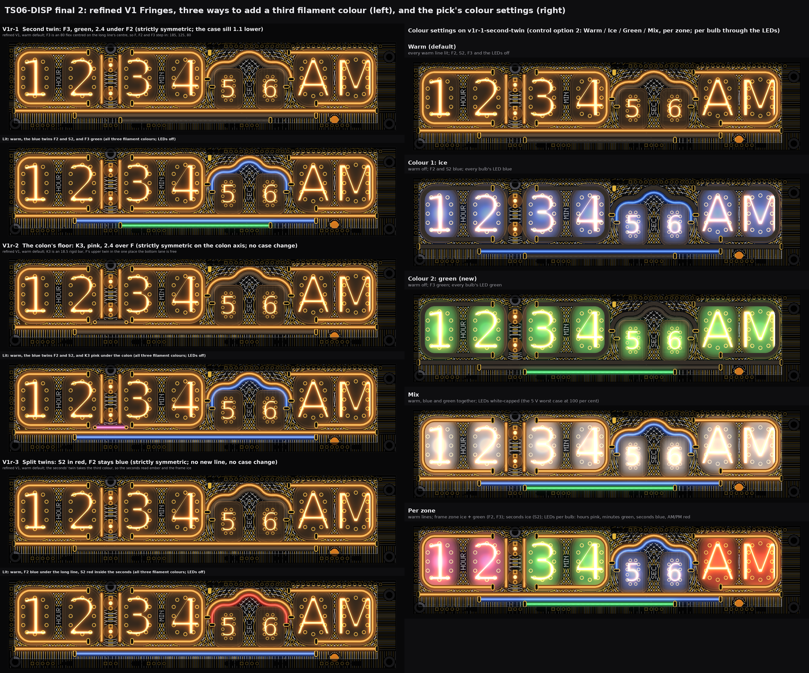
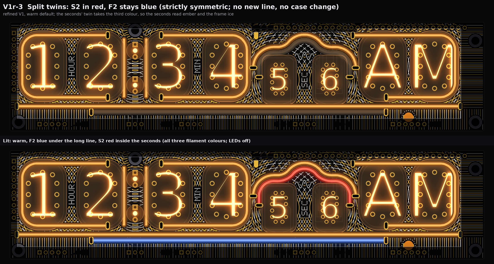
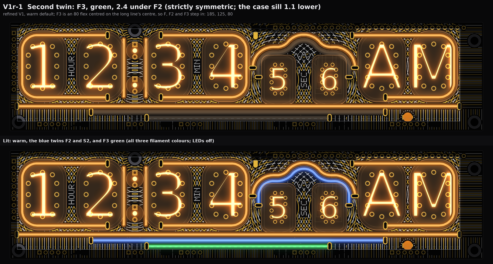
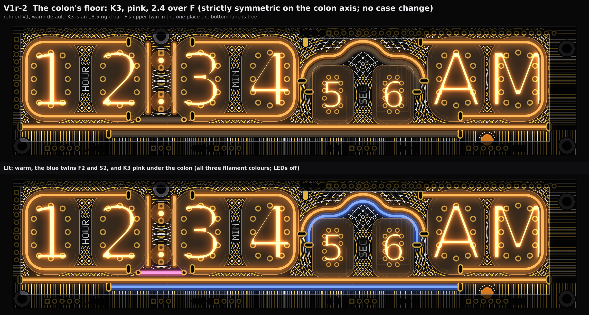
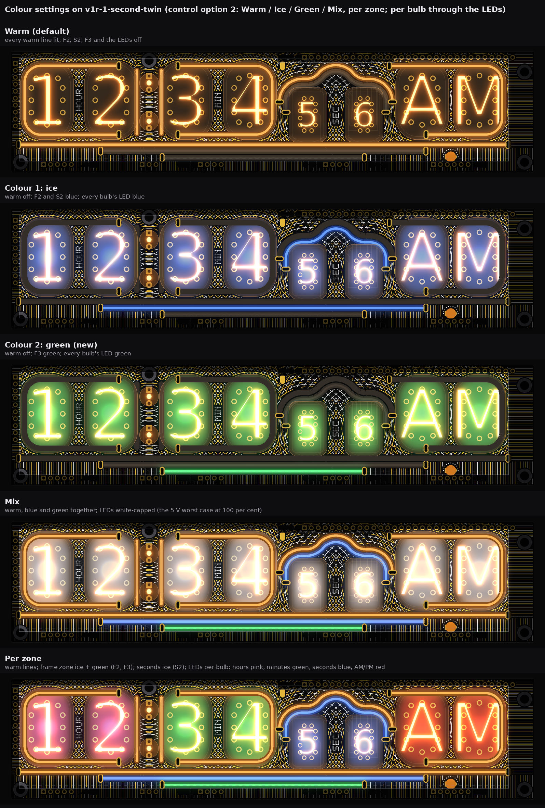
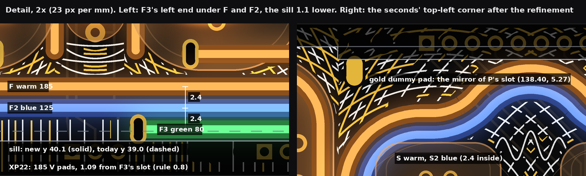

# TS06-DISP final 2: V1 Fringes refined, and three ways to add a third filament colour (drawings and checks only)

2026-10-14, front round 3, run disp-final-2, on the owner's note on V1 Fringes: "best, refine, propose how to add one more color
of filament glyphs". V2 and V3 are out. This builds on `TS06-DISP-final.md` (the base: light base, twins, LEDs, change list) and
changes only what is listed here. No board, schematic, fab, tool, 3D, firmware or spec file was touched. The faces are drawn from
`PCB/TS06-DISP/TS06-DISP.kicad_pcb` (pass 2's extract), read, never written. One scale, 11.5 px per mm, tubes lit, the case window
drawn (the board outside it, and under the valance over the ИН-17 pair, is dimmed). Marks: *measured* is from the board file, the
router on it or the drawn raster (0.043 mm pixels); *inferred* is arithmetic; *assumed* is my reading. Scratch scripts stay in the
run's scratch folder.

**In short.** V1 refined: the plain ruled band under the long line is now the double slit's **screen**; the zones meet with no seam;
the lines lie on the art without leaving ghosts; the one blank left by the mirror is a gold dummy pad. The largest empty spot in the
window falls from 1.49 to 0.83 mm. **For a third colour, DISP has only three places, and each costs one small change:** V1r-1 a
second twin under F2 (**F3, 80 flex, green**; the case sill 1.1 mm lower); V1r-2 the long line's upper twin where the bottom lane is
free, under the colon (**K3, 18.5 rigid, pink**; Q1 and Q2 1.0 mm higher in the shim); V1r-3 no new line, **S2 bought red** while F2
stays blue (no change at all). Channels 15 of 16 for V1r-1 and V1r-2 (14 for V1r-3); 5 V worst case 792 mA, 79 % (600 mA, 60 % with
the LED cap). **My pick: V1r-1, the second twin.**

## 1. V1 refined

The refinements, one line each (all silk and mask only; the light base, the fronts, the collapse curve, the legends and the m lamp's
ring are as in `TS06-DISP-final.md`):

1. **The screen under the long line.** The band under F (y 35.2 to the board edge) was plain ruled lines. It is now where the
   double slit's fringes land: plumb lines whose pitch closes to 0.43 in a bright fringe and opens to 1.05 in a dark one (fringe
   period 6.4, under a sinc² envelope 80 wide on a 0.4 floor), white and gold in turn, mirrored on F's own centre (x 92.305).
   It reads as bright and dark bands, strongest at the long line's centre (between the minutes and the seconds) and fading to
   the ends. Most of the band is under the sill; the window shows it below F2 and beyond F2's ends.
2. **No seam between the zones.** The minutes zone now runs x 53.75 to 97.61 (its overlap with the colon lies inside Q2's keep-out,
   so it draws nothing there), the seconds 97.61 to 140.16, AM/PM 140.16 to 181.64. The plumb hairline that stood between M's leg
   and S's corridor (x 96.3 to 97.8) is gone; the fronts reach both.
3. **The board's two ends** (x 0.5 to 3.73 and 181.64 to 190.9, both under the case) carry the screen's fringes turned level,
   mirrored on the bulbs' axis y 17.834, in place of plumb hairlines.
4. **No ghosts.** The art is still mirrored on each zone's axis with every copper cut (pads, slots, tracks) shown on both sides. A
   filament body now cuts only where it lies. Before, the mirror of P's top run left a blank band outside P's top-right corner
   (x 173.6 to 181.6, y 4.0 to 6.6) and the mirror of Q2 a blank strip beside M's leg. Both are filled.
5. **A gold dummy pad at the mirror of P's driven slot** (99.37, 5.27), the slot pad's own capsule (1.8 x 3.3, upright): a mask
   opening on the BL_K pour, 7.01 from the nearest F.Cu track. V1 had a blank hole there (its largest empty spot, 1.49).
6. **The m lamp and the left screw are parts, not copper:** the screen's lines break round them on their own side only, so their
   mirror images (x 23.71 and 181.11) carry lines and no blank disc.

* **Symmetric**, exactly: every zone on its own axis (hours 24.89, colon 50.535, minutes 75.68, seconds 118.885, AM/PM 160.9), the
  screen on F's centre. The only one-sided things are parts and lines: the m lamp, the screws, P's open-left box, F2's and the new
  lines' slots (each mirrored with its line).
* **White:** even fronts at 0.9 round each pair's centres (0.18), the fine collapse curve (0.16) on its own 0.35 ground, the screen's
  even lines (0.16), the end fringes; the names HOUR, MIN, SEC on calm pads. About 1.7 m.
* **Gold:** odd fronts (0.22), the screen's odd lines (0.20), the dummy pad; chopped round 185 V copper. About 1.9 m.
* **Checks** (*measured*, section 6): gold 0.67 from 185 V tracks (rule 0.6), 0.84 from 185 V pads (0.8); art 0.31 from the glass;
  white 0.22 from gold; largest empty spot 0.83 mm (inside the seconds arch: the collapse curve's own clear ground).
* **Buildable? Needs X:** `TS06-DISP-final.md` section 4's base list, and the art deltas in section 5 here.

## 2. Where a third colour can go: the search

Rules as before: body 2.0, 0.4 to an ИН-12/ИН-15 pin pad, 0.3 to other pads, 0.4 line to line (2.4 centre to centre), slots on
free copper, 0.6 / 0.8 to 185 V tracks / pads; no filament under any bulb. Today: warm (H, M, P, F, Q1, Q2, S) + blue (F2, S2) + the
RGB LED per bulb. Every candidate was checked with pass 2's body and slot checks (*measured*):

| Kind | Candidate | Result |
|---|---|---|
| A second twin beside the first | **F3 under F2** (y 38.8) | **Fits** as an 80 flex centred on F's centre. 125 puts its slots on F2's (pads overlap by 0.9); 130 puts its right slot on XP25.1; 95 puts its left slot on XP22.1 (COLON_U, 185 V) and the COLON_U / COLON_L tracks. Its body (to 39.8) is 0.8 under today's sill (39.0): **the sill goes 1.1 lower.** → V1r-1 |
| | S3 inside S2 | No: its legs fall where KS7 / KS8 block slots (y 6.3 to 30.3) and its brim under the ИН-17 glass (TS06-DISP-final 3b). |
| | S3 outside S | No: its peak lies under the valance (y < 4.0). |
| Parallel twins by other glyphs | H, M brackets, P box, Q bars | No (TS06-DISP-final 3b): brow, pin pads, F, trench, colon lamp pads. Short inner twins across each pair's gap (rigid 18.5 at y 7.67 or 28.0) also fail: 0.16 to the pin pads (rule 0.4), holes on K6, ANODE_H10, ANODE_M10 and CAT tracks. |
| | **F's upper twin** (y 31.6) | **Fits only under the colon**, between H's and M's bottom slots (x 40.4 to 60.2), as an 18.5 rigid bar. It needs Q1 and Q2 1.0 higher (their round ends now reach y 31.0). → V1r-2 |
| | Twins above the top runs (y 2.87) | No: the brow hides y < 2.6, and raising it would show the glass domes it hides on purpose (spec section 6). |
| New glyph strokes of their own | Rail ends: rigid bars in F2's row at its two ends | No: the holes land on ANODE_H1 (x 19.56) and ANODE_PM (x 164.71), the right bar on the m lamp's ring, the left hole in the screw's keep-out. |
| | A bar between the ИН-17s (the slits' barrier) | No: its top hole lands on KS0 / KS4 / KS5 / KS9, which cross the gap at y 9 to 14, and SEC has no room below it. |
| | Pockets above S's corners | No: 12 mm long, shorter than any sold piece. |
| A twin re-coloured | **S2 red, F2 blue** | **Fits with no change.** One filament per colour, and S2 and F2 already have their own channels. → V1r-3 |

## 3. The three ways (all on refined V1)

Each file: top, the warm default (the colour lines off, dark silicone); bottom, all three filament colours lit (LEDs off).

### V1r-1 Second twin: F3, green (my pick)

* **Creative decision:** a third line in the long line's stack, so the frame steps in: F warm 185, F2 blue 125, F3 green 80, each
  centred on F's centre. It reads as the screen's envelope narrowing, and as a spectrum band under the digits.
* **Symmetric**, exactly, on F's centre (x 92.305), like F and F2.
* **Filament:** F3, 80 flex (sold), green, y 38.80, 2.4 under F2. Slots (55.31, 38.80) driven and (129.31, 38.80) return, heading
  180 / 0. Body: 0.4 to F2 (line to line), 0.65 to XP23.1 (rule 0.3), 9.98 to the nearest pin pad, 28.7 to the m lamp. Slots: 1.09
  to XP22.3 (COLON_RET, 185 V; rule 0.8) and 5.05 to XP24.4. All *measured*.
* **The case:** the sill moves from y 39.0 to 40.1 (1.1 lower) along the window, so F3's body shows whole with 0.3 to spare. The strip
  pins XP21 to XP25 (pad tops at 40.45) stay hidden by 0.35. *Inferred*; the case model is not checked (lower bezel lip 1.1 thinner,
  or the window 1.1 taller). Viewed from above (a clock below eye level), the sill hides less, so F3 shows at every angle above.
* **How it reads with warm and blue:** green is the one sold colour far from both: the stack reads warm / blue / green, each line
  clearly its own. Mix lights all three.
* **Drive:** BL_A4 (the spare strip pin XP23.4), B.Cu, 24.2 mm: (76.9, 41.3), (74.9, 43.1), (59.6, 43.1), (55.31, 38.8). S's drive
  BL_A6 is re-routed round F3's right slot, still 31.4 mm. Both *measured* (router).
* **Channels 15 of 16** (F3 on channel 15, the first spare). **5 V: 792 mA, 79 %; 600 mA, 60 % with the LED cap.**
* **Colour settings it adds** (control option 2, the long press with SUB down): **Warm / Ice / Green / Mix**. Ice lights F2 and S2
  (and the LEDs blue); Green lights F3 (and the LEDs green); Mix lights all. Per zone: the frame zone takes Ice, Green or both; the
  seconds Ice; hours, minutes and AM/PM through the LEDs.
* **White / gold:** refined V1 (section 1); the screen's lines yield 0.3 / 0.4 round F3 and its slots.
* **Buildable? Needs X:** the base list, the case sill 1.1 lower, F3's slots and BL_A4's track (section 5).

### V1r-2 The colon's floor: K3, pink

* **Creative decision:** the long line's upper twin, in the one place the bottom lane is free: under the colon, between H's and
  M's bottom slots. The two warm colon borders now stand on a pink floor, a cup round the two neon dots.
* **Symmetric**, exactly, on the colon axis (x 50.535).
* **Filament:** K3, 18.5 rigid (sold), pink, level at y 31.6, 2.4 over F; body x 42.785 to 58.285 between its two lead holes
  (round, 1.8 pad, 1.0 hole, *assumed*; the bar's 18.5 includes 1.5 end caps, as front-merge drew Q). Body: 0.4 to F, 1.50 to V8's
  pad (COLON_RET), 4.02 to the nearest pin pad, 1.62 to the colon lamps' envelope. Holes: 1.18 to ANODE_H1 (rule 0.6) and 3.40 to
  V3.9. H's and M's bottom slot pads are 1.5 away. All *measured* (the holes checked as slots, the larger shape).
* **Q1 and Q2 1.0 higher** in the shim: centre lines y 6.0 to 29.0 (drawn with their round ends 5.0 to 30.0). They still cover both
  lamps (y 8.0 to 29.0), keep 1.49 from H3's head (2.06 today), and stop 0.6 over K3. No DISP change; the shim's channels move 1.0 up. K3 lies on
  DISP's face; the shim needs a 2.4 channel there, or its lower edge at y 30.3 between x 42.5 and 58.6 (*inferred*).
* **How it reads with warm and blue:** pink sits between the two: soft against the warm bars and the orange neon, clearly apart from
  F2's blue just below. It changes the colon glyph the owner settled ("two vertical bars as borders"): with K3 off, a dark bar lies
  under the colon.
* **Drive:** BL_A4, B.Cu, 24.8 mm: (76.9, 41.3), (74.9, 43.1), (68.8, 43.1), (68.0, 42.3), (68.0, 41.3), (58.28, 31.6) (*measured*,
  router). Return hole (42.785, 31.6) on the BL_K pour.
* **Channels 15 of 16. 5 V: 792 mA, 79 %; 600 mA, 60 % with the LED cap.**
* **Colour settings it adds:** the colon zone gets a colour for the first time: **Warm / Rose / Mix** (today it stays warm). Zone
  All: Ice (F2, S2) and Rose (K3) together.
* **Buildable? Needs X:** the base list, Q1 and Q2 1.0 higher, the shim's channel, K3's holes and track.

### V1r-3 Split twins: S2 red, F2 blue

* **Creative decision:** no new line. The seconds' twin is bought red, the frame's stays blue: the seconds read ember (warm + red;
  Mix makes a deeper orange, nearer the neon), the frame reads ice. Three filament colours on the board; each glyph keeps two.
* **Symmetric**, exactly; nothing moves.
* **Filament:** S2, 60 flex, red (sold), as in `TS06-DISP-final.md` (slots (100.60, 22.22) driven, (137.17, 22.22) return).
* **How it reads with warm and blue:** red inside the warm arch is the quietest of the three: close to warm, so it reads as the
  seconds glowing hotter, with blue only in the frame.
* **Channels 14 of 16, 5 V 772 mA, 77 % (580, 58 %)**, both unchanged: F2 and S2 already have their own channels (7 and 8).
* **Colour settings it adds:** none. Zone Seconds' Colour is red, zone Frame's is blue; zone All lights both.
* **Buildable? OK** with the base list (the colour is a purchase choice).

## 4. Channels and 5 V

| | Today (TS06-DISP-final) | V1r-1 | V1r-2 | V1r-3 |
|---|---|---|---|---|
| DISP warm (H, colon, M, S, P, F) | 6 | 6 | 6 | 6 |
| DISP colour lines | 2 (F2, S2) | 3 (+ F3) | 3 (+ K3) | 2 |
| Fascia (new connector) | 6 | 6 | 6 | 6 |
| **Channels of the one 16-channel chip** | **14** | **15** | **15** | **14** |
| 5 V, Mix at 100 %, 20 mA a filament, LEDs full white | 772 mA, 77 % | 792 mA, 79 % | 792 mA, 79 % | 772 mA, 77 % |
| 5 V with the LED cap (R + G + B <= 255) | 580 mA, 58 % | 600 mA, 60 % | 600 mA, 60 % | 580 mA, 58 % |

*Inferred* from `TS06-DISP-final.md` section 3c: one more filament at 20 mA. The regulator is the 1.0 A 5 V switching module U14.
A fourth colour (both V1r-1 and V1r-2) would use the last channel: 16 of 16, 812 mA (81 %).

## 5. The change-list delta against TS06-DISP-final.md

Coordinates in mm, DISP's frame (y down from the top edge).

**Refined V1, art only (all three ways):**

| # | Layer | Change | Check | Mark |
|---|---|---|---|---|
| A1 | Silk + mask | Band y 35.2 to 43.5: plumb fringe lines (white 0.16 even, gold 0.20 odd), pitch 0.43 to 1.05 by the fringe law of section 1, mirrored on x 92.305; the old ruled lines go | gold 0.67 / 0.84 to 185 V | *measured* |
| A2 | Silk + mask | Zones: M x 53.75 to 97.61, S 97.61 to 140.16, P 140.16 to 181.64; the seam's plumb lines (x 96.3 to 97.8) go | | *measured* |
| A3 | Silk + mask | Ends x 0.5 to 3.73 and 181.64 to 190.9: level fringe lines, mirrored on y 17.834 | | *measured* |
| A4 | Mask | Gold dummy pad, capsule 1.8 x 3.3, upright, centred (99.37, 5.27), on the BL_K pour | 7.01 to F.Cu | *measured* |
| A5 | Silk + mask | Fronts fill outside P's top-right corner (x 173.6 to 181.6, y 4.0 to 6.6) and beside M's leg (x 96.6 to 97.6) | | *measured* |

**V1r-1 (F3):**

| # | Board | Change | Check | Mark |
|---|---|---|---|---|
| B1 | DISP | F3's slots (55.31, 38.80) driven, BL_A4, heading 180; (129.31, 38.80) return on the BL_K pour, heading 0 | 1.09 to XP22.3 (185 V), 5.05 | *measured* |
| B2 | DISP | BL_A4 (B.Cu): XP23.4 (76.9, 41.3), (74.9, 43.1), (59.6, 43.1), (55.31, 38.8); 24.2 mm. The old BL_A4 track (88.64, 35.504) to (76.9, 41.3) is deleted (base item 1) | router: 0.25 / 0.6 / 0.8 | *measured* |
| B3 | DISP | BL_A6 (S, B.Cu) re-routed round F3's right slot: (122.73, 41.3), (123.9, 40.1), (125.4, 40.1), (128.7, 36.8), (130.1, 36.7), (135.0, 31.8), (135.1, 26.9), (139.1, 22.9), (139.3, 18.8), (139.57, 18.45); 31.4 mm | router | *measured* |
| B4 | Case | Sill from y 39.0 to 40.1 along the window (x 3.0 to 182.035) | XP tops 40.45 hidden | *inferred* |
| B5 | DRV | Channel 15 of the PWM chip: one N-FET and one 120 R more (15 FETs, 20 resistors) to strip pin XP23.4's partner | room not checked | *inferred* |
| B6 | Art | Band lines keep 0.3 (white) / 0.4 (gold) round F3's body and slots | | *measured* |

**V1r-2 (K3):**

| # | Board | Change | Check | Mark |
|---|---|---|---|---|
| C1 | DISP | K3's two plated round holes, 1.0 drill, 1.8 pad: (58.285, 31.60) driven BL_A4, (42.785, 31.60) return on BL_K | 1.18 to ANODE_H1, 3.40 to V3.9 | *measured* (as slots), *assumed* (hole size) |
| C2 | DISP | BL_A4 (B.Cu): (76.9, 41.3), (74.9, 43.1), (68.8, 43.1), (68.0, 42.3), (68.0, 41.3), (58.285, 31.6); 24.8 mm | router | *measured* |
| C3 | Shim | Q1, Q2 channels 1.0 higher (centre lines y 6.0 to 29.0); a 2.4 channel for K3 at y 31.6, x 41.5 to 59.5, or the shim's edge at y 30.3 there | 1.49 to H3's head | *inferred* |
| C4 | DRV | As B5 | | *inferred* |

**V1r-3 (S2 red):** no board change. Buy S2 (60 flex) in red instead of blue. *Measured*: nothing moves.

## 6. The checks

*Measured* on the drawn rasters against DISP's board file, with pass 2's body and slot checks and router.

| Check | Rule | V1 (disp-final) | V1 refined | V1r-1 | V1r-2 | V1r-3 |
|---|---|---|---|---|---|---|
| Gold to 185 V F.Cu tracks | 0.6 | 0.63 | 0.67 | 0.67 | 0.67 | 0.67 |
| Gold to 185 V pads | 0.8 | 0.84 | 0.84 | 0.84 | 0.84 | 0.84 |
| Art to the glass and the colon lamps | 0.3 | 0.31 | 0.31 | 0.31 | 0.31 | 0.31 |
| Art to the names and the m lamp's ring | own ground | 0.52 | 0.52 | 0.52 | 0.52 | 0.52 |
| White to gold | 0.15 break | 0.22 | 0.22 | 0.22 | 0.22 | 0.22 |
| Largest empty spot in the window (radius) | "no empty space" | 1.49 | 0.83 | 0.96 | 0.83 | 0.83 |
| New line: body to pin pad / other pad | 0.4 / 0.3 | | | 9.98 / 0.65 | 4.02 / 1.50 | (S2 as before) |
| New line: slots or holes to other copper | 0.25, 185 V 0.8 / 0.6 | | | 1.09 (185 V pad), 5.05 | 1.18 (185 V track), 3.40 | |
| New line to its neighbours, line to line | 0.4 | | | 0.4 to F2 | 0.4 to F, 0.6 to Q's ends | |

V1r-1's largest empty spot (0.96 at 50.3, 38.7) is in the newly shown sill strip under the colon, where the 185 V colon tracks cut
the gold on both sides.

## 7. My pick

**V1r-1, the second twin.** It is the only way that adds a whole line, it keeps every glyph the owner settled, and it stays
exactly symmetric on the long line's centre; the price is one channel, 20 mA and a sill 1.1 mm lower. If the case must not change,
take V1r-3 (S2 red): it costs nothing and is buildable as it stands.

## 8. Left open, assumed

* **Not buildable as drawn: nothing.** V1r-1 needs the case sill moved (check it against the case model: the bezel's lower lip, the
  viewing angle from below); V1r-2 needs the shim's channels moved and a channel for K3.
* A rigid bar's lead holes on DISP (K3) are *assumed* round, 1.0 drill; the listing gives no lead size. The bar's 15.5 glowing body
  between its holes is *assumed* from front-merge's drawing of Q.
* Green flex next to blue flex and the green LEDs: the bench decides the tints, as for blue (`TS06-DISP-final.md` section 7).
* The fringe law of the screen (period 6.4, envelope 80, floor 0.4) and the line pitches are choices, not needs.
* Not checked: a real DRC (no board file edited), the pour after the new tracks, thermal reliefs on the new slots and holes.
