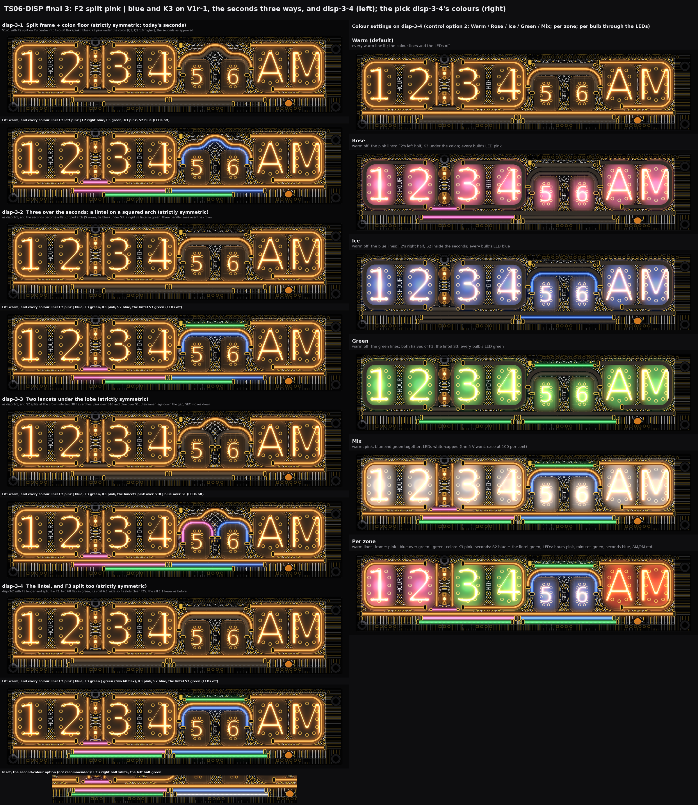
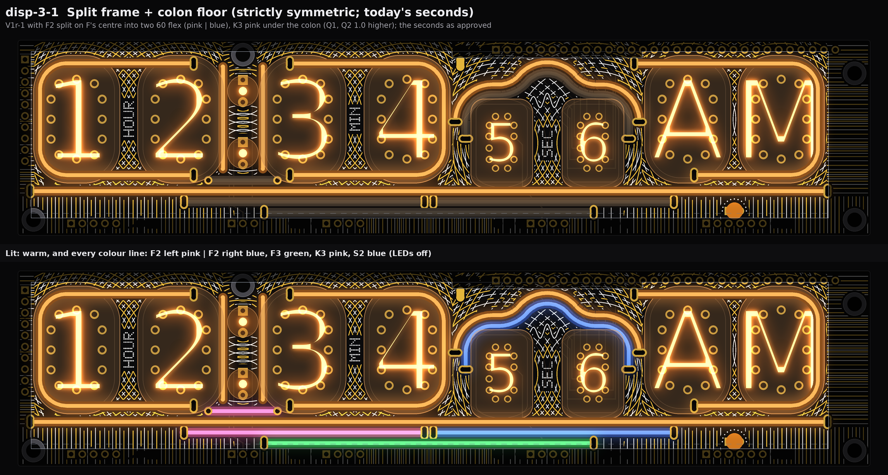
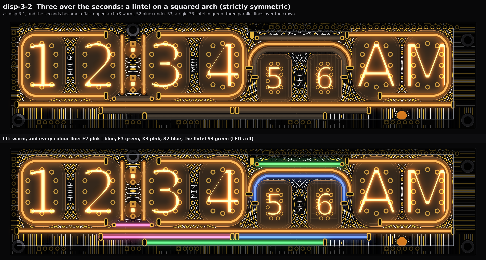
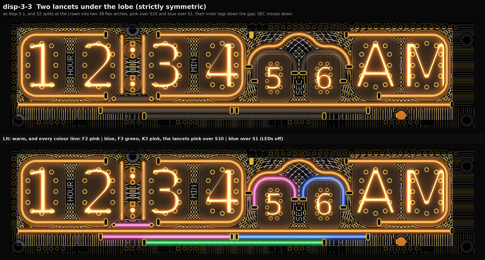
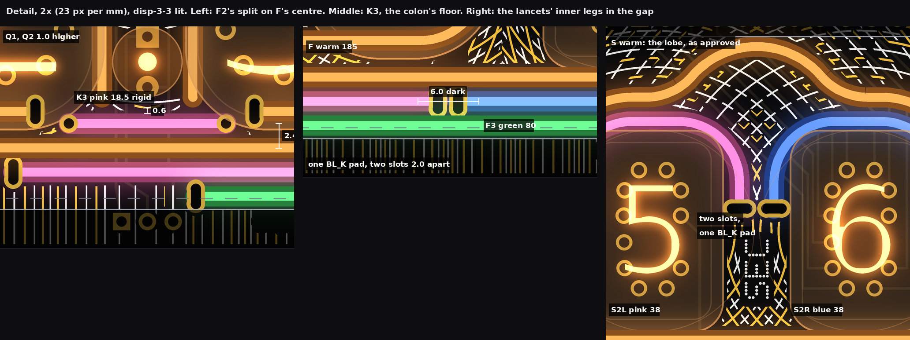
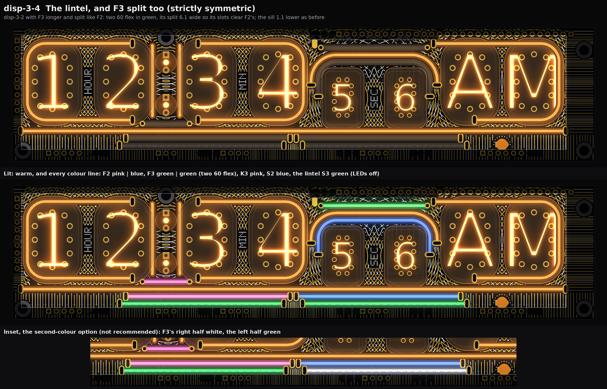
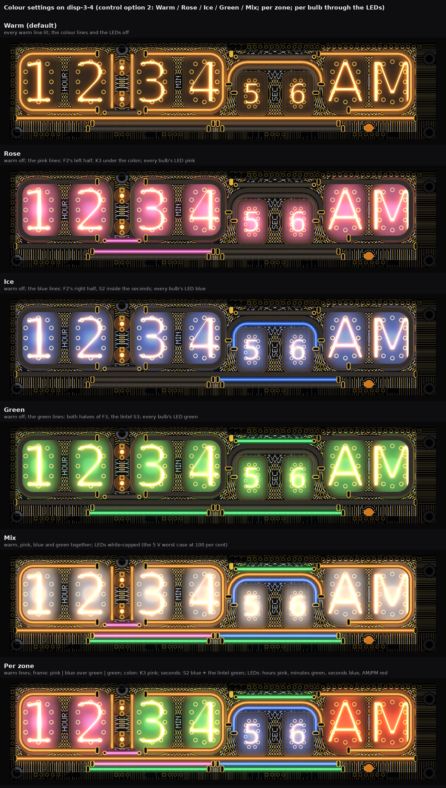

# TS06-DISP final 3: F2 split in two colours, the colon floor, and the seconds' arch (drawings and checks only)

2026-10-14, front round 3, run disp-final-3, on the owner's answer on the third-colour card: "approve. can we split second
horizontal line in the bottom in two colors, add the colon floor, and decide if there is a more optimal shape for the lines above
the secnds that lets us ut three parallel or some longer splits?" The base is **V1r-1** (refined V1 Fringes with F3 green under
F2, `TS06-DISP-final-2.md`). This run changes only what is listed here. No board, schematic, fab, tool, 3D, firmware or spec file
was touched. The faces are drawn from `PCB/TS06-DISP/TS06-DISP.kicad_pcb` (pass 2's extract), which was read and never written. The
drawings use one scale (11.5 px per mm), with the tubes lit and the case window drawn. Marks: *measured* comes from the board file,
the router on it or the drawn raster (0.043 mm pixels); *inferred* is arithmetic; *assumed* is my reading.

**In short.**
* **F2 is split** on F's centre into two 60 flex pieces: **pink on the left, blue on the right.** The split falls between the
  minutes and the seconds. The two inner slots share one BL_K pad.
* **K3 (18.5 rigid, pink) is added under the colon**, with Q1 and Q2 1.0 mm higher. **disp-final-2 missed one thing:** K3's
  left hole sits 0.33 mm from pass 2's moved ANODE_H1 (185 V; the rule is 0.6). ANODE_H1 is now routed above H's slot, with 0.73 mm
  or more to all copper.
* **The seconds:** no slot can go in the crown, because the ИН-17 cathode fan KS0 to KS9 crosses it on both layers. Each corridor
  holds only two legs. So:
  * **three parallel lines** fit only as a **rigid 38 lintel over a flat-topped arch**, and the lobe is lost (disp-3-2);
  * **longer split pieces** fit as **two 38 flex lancets** under the lobe, with their inner legs down the gap between the
    ИН-17s (disp-3-3).
* **Channels: 17, 18, 18 of 16.** Sharing one channel per colour brings every variant to **15**.
* **5 V worst case: 832 / 852 / 852 mA**, and 640 / 660 / 660 mA with the LED cap.
* **My pick: disp-3-3, the lancets.**
* **Follow-up (the owner, 23:1x UTC): disp-3-4 is now the pick.** The owner chose the lintel (disp-3-2) and asked to keep F3,
  extend it and split it too.
  * **60 + 60 is the longest symmetric pair.** 80 + 80 runs into the m lamp and XP21's 185 V pad.
  * Both halves stay green. Their split is 6.1 wide, so their slots clear F2's.
  * The sill stays 1.1 lower, with no other case change.
  * 19 channels one per line, 15 one per colour. 5 V 872 mA (680 with the cap).
  * Section 5's last subsection.

## 1. Split F2 in two colours (all three variants)

* **Geometry** (*measured*): two 60 flex pieces at y 36.40, end to end, mirrored on F's centre (x 92.305).
  * **F2L:** slots (37.305, 36.40), driven, and (91.305, 36.40), return.
  * **F2R:** slots (93.305, 36.40), return, and (147.305, 36.40), driven.
  * The two inner slots are both on BL_K. They are one pad (3.8 x 3.3) with two 1.0 x 2.5 slots, 2.0 apart.
  * Between the two silicone ends is a 6.0 mm dark gap (*inferred*: 2.0 between the slots, plus the silicone ending 2.0 before
    each slot).
* **Why 60 + 60:** it is the only symmetric pair of sold lengths.
  * 80 + 80 would reach x 17.3 and 167.3, into the m lamp.
  * A split that is not on the centre needs two different lengths, and then F2 is no longer mirrored on F.
  * The frame still steps in: F 185, F2 two 60s (x 37.3 to 147.3), F3 80 (x 55.3 to 129.3).
* **Clearances** (*measured*):
  * Body: 0.4 to F, and 0.4 to F3. The pin pads are 7.58 and 8.06 away; other pads 3.05; HL9's flange 10.86 from F2R.
  * Slots: F2L's outer slot is 3.20 from ANODE_H1 (as drawn in the board file) and 2.2 or more from the new run (section 2). The
    inner slots are 3.20 and 3.63 from ANODE_M1. F2R's outer slot is 6.30 from XP25.1.
  * As in the base, each slot pad's outer 0.25 lies under the next line's body, F above or F3 below.
* **Colours: pink | blue.**
  * Blue stays on the right, under the seconds, beside S2's blue.
  * Pink is the one sold colour left that is far from warm, blue and green: red is next to the neon, white next to blue, and
    yellow is the warm.
  * Pink is K3's colour as well. So the left (hours and minutes) reads rose, the right (seconds and AM/PM) reads ice, and F3's
    green runs across the middle.
  * The split marks hh:mm | ss.
  * The LEDs can take either colour.
* **Drive** (*measured*, router):
  * F2L keeps **BL_A2** on B.Cu: XP21.5 (22.1, 41.3), (32.4, 41.3), (37.31, 36.4); 17.2 mm.
  * F2R takes the spare strip pin **XP25.3**, as the new net BL_A9, on B.Cu: (159.63, 41.3), (157.6, 43.1), (154.0, 43.1),
    (147.31, 36.4); 15.9 mm.
  * H's BL_A1 (F.Cu) re-routes straighter: (14.48, 35.5), (34.4, 35.5), (39.48, 30.4); 27.1 mm.
* **Channels:** one each (+1). Section 4 explains how two pieces of one colour can share a channel.

## 2. The colon floor K3 (all three variants)

* **K3** is V1r-2's bar on top of V1r-1 and the split: 18.5 rigid, pink, level at y 31.60. The lead holes are at (42.785, 31.60)
  on BL_K and (58.285, 31.60), driven. The holes are round, 1.0 drill, 1.8 pad (*assumed*).
* **Q1 and Q2 are 1.0 higher** in the shim, with centre lines at y 6.0 to 29.0. Their round ends stop 0.6 above K3. The shim gets
  a channel for K3.
* **The re-check of F's upper twin together with F2's split slots and K3's holes** (*measured*):
  * K3's body is 0.4 from F's body.
  * K3's hole pads are 0.5 from F's body.
  * F2's slot pads reach 0.25 under F's body, as before.
  * K3 is 2.8 from F2L.
  * Nothing of the split is near K3: the nearest F2 slot is 5.0 away.
  * K3's body is 4.02 from the pin pads and 1.50 from V8's pad. Its holes are 3.40 from V3.9.
* **Correction to `TS06-DISP-final-2.md` (V1r-2, item C1).** Its "1.18 to ANODE_H1" was measured against the board file's ANODE_H1.
  Pass 2 has already moved that track to x 41.4 / y 33.0 (base item 1), and K3's left hole is **0.33** from the moved track
  (rule 0.6). **Fix:** route ANODE_H1 (B.Cu) from H1's anode pin above H's bottom slot:
  * path: (40.557, 25.834), (39.4, 27.0), (37.1, 28.8), (32.0, 28.8), (20.6, 40.2), (19.56, 41.3); 27.3 mm;
  * the router held every other copper at the 185 V distances;
  * nearest copper: 0.73 to V2.8 (no net), 0.84 to XP21.5, 1.09 to H's slot, 1.54 to F2L's track (*measured*).
* **Drive:** no bottom strip pin is left at the left; BL_A4 is F3's.
  * **K3's driven hole takes a harness wire** on DISP's back, beside Q's wires (*inferred*). The harness grows from 5 to 6 wires.
  * Another way: a 4th pin on XP22 at (55.61, 41.3), which changes the strip on both boards. Its pad would be 0.84 from
    COLON_RET's pad (rule 0.8).
* **How it reads:** the two warm colon bars stand on a pink floor. With K3 off, a dark bar lies under the colon. This changes the
  colon glyph the owner settled; the owner has asked for it.

## 3. The seconds: three parallel lines or longer split pieces? The search and the decision

Today the seconds have two lines. S is warm: the collapse lobe, 60 flex, with its legs at x 98.20 / 139.57. S2 is 2.4 inside it,
with its legs at 100.60 / 137.17. Rules as before: body 2.0, 0.4 to pin pads, 0.4 line to line, slots on free copper, R 6 or more.

**What bounds every shape** (*measured*, a slot scan every 0.4 mm in four orientations, plus 0.2 mm in the corners):
* **The crown has no slot site at all.** The ИН-17 cathode tracks KS0 to KS9 fan out of XP12 (y 2.2) over the whole crown on both
  layers. They block x 101.6 to 135.6 from y 3.6 down to y 20.
* **Each corridor holds two legs.**
  * The left one runs from M's leg (x 95.61) plus its body and 0.4, so leg centres from x 98.0, to S10's glass at 101.64.
  * The right one is the mirror.
  * A third leg (x 103.0) would stand 1.4 under the glass, on KS7 / KS6 / KS5.
* **Free sites outside the corridors:**
  * the top-left corner (x 96 to 104, y 2.4 to 6);
  * the top-right corner, which is mostly P's driven slot (138.40, 5.27), with XP12's pads blocking y < 4.6;
  * the gap between the ИН-17s, from y 19 to 29 (x 115.8 to 121.6).
* **The valance** hides y < 4.0.

| Shape searched | Result (*measured* unless marked) |
|---|---|
| S3 inside S2 (legs in the corridors) | No: no third leg fits in a corridor (above) |
| S3 outside S, today's lobe | No: its peak at y 2.6 is under the valance |
| Flatter arch + S3 outside S, flex, concentric (R 10.8), its ends in the top corners | No (*inferred*, arithmetic on the scan): a 38 flex ends at (102.96, 7.6) on KS7. A 60 flex reaches x 96.0 and runs into M's leg, which needs x 98.0. A larger corner radius moves the end further into the fan |
| Wider arch (legs moved out) | No: M's leg and P's slot bound both corridors |
| Split crown, pieces ending at the top | No: the crown has no slot site |
| **Squared arch + a straight lintel on top** (rigid 38: holes 35.0 apart, at x 101.385 / 136.385, outside the fan) | **Fits at y 6.6.** At y 5.27 (in line with P's top run) its right hole would be 0.22 from P's driven slot (rule 0.25); at 6.6 it is 0.30. S's crown becomes flat at y 9.0, S2's at 11.4 (12.4 body, 0.8 over the glass). Flex 38 straight: no (slots in the fan). → **disp-3-2** |
| **Gothic: S2 split at the crown into two lancets**, inner legs down the gap between the tubes | **Fits as two 38 flex.** The outer legs stay in S2's corridor places. The inner legs are at x 117.185 / 120.585 (1.4 apart), with slots at y 21.0 on one BL_K pad. SEC moves down to y 27.0. A 60 lancet needs 22 mm more leg: no room. → **disp-3-3** |
| Longer whole pieces (S or S2 as 80 flex, the legs 10 mm deeper in the corridors) | Fits (the corridors are free at every height), but adds nothing visible: not drawn |

**Decision.**
* **Three parallel lines are possible only as a lintel over a squared arch.**
  * The seconds lose the collapse lobe, which was V1's motif and the S glyph the owner approved.
  * They gain a third line over the crown: 24.6 mm of three parallel straight lines. The lintel runs on 5 mm past each corner.
* **Longer split pieces are possible as two lancets under the lobe.**
  * The lobe stays.
  * The twin becomes the double slit's two sources, one arch over each ИН-17, each a sold 38 and each its own colour.
  * It costs one channel and moves SEC down 3.6.
* **I recommend the lancets.**

## 4. Channels and 5 V

| | V1r-1 (approved) | disp-3-1 | disp-3-2 | disp-3-3 | disp-3-4 |
|---|---|---|---|---|---|
| DISP warm (H, colon Q1 + Q2, M, S, P, F) | 6 | 6 | 6 | 6 | 6 |
| DISP colour lines | 3 (F2, S2, F3) | 5 (F2L, F2R, F3, K3, S2) | 6 (+ S3) | 6 (F2L, F2R, F3, K3, S2L, S2R) | 7 (disp-3-2 with F3L, F3R) |
| Fascia (new connector) | 6 | 6 | 6 | 6 | 6 |
| **Channels, one per line** | **15** | **17** | **18** | **18** | **19** |
| **Channels, one per colour (option a)** | 14 | **15** | **15** | **15** | **15** (16 with a white half) |
| DISP filaments; 120 R on DRV (one per filament) | 10; 20 | 12; 22 | 13; 23 | 13; 23 | 14; 24 |
| DISP drive pins / wires | BL_A1 to A8 | + XP25.3, + K3's wire | + XP12.12 | + XP12.13 | + XP12.12, + XP12.13 |
| 5 V, Mix at 100 %, 20 mA a filament, LEDs full white | 792 mA, 79 % | 832 mA, 83 % | 852 mA, 85 % | 852 mA, 85 % | 872 mA, 87 % |
| 5 V with the LED cap (R + G + B <= 255) | 600 mA, 60 % | 640 mA, 64 % | 660 mA, 66 % | 660 mA, 66 % | 680 mA, 68 % |

*Inferred* from `TS06-DISP-final.md` section 3c: each filament adds 20 mA. The module is U14, 5 V, 1.0 A. XP12.11 stays spare.

**Over 16, the options and their costs:**
* **(a) One channel per colour.** One N-FET drives all the lines of one colour. Each line keeps its own 120 R and its own pin or
  wire, so no two filaments share a resistor.
  * The groups: Rose = F2L + K3 (+ S2L); Ice = F2R + S2 (or S2R); Green = F3 (+ S3).
  * Result: **15 of 16, one spare.** No new part; two or three FETs fewer. At most 60 mA per FET.
  * Cost: a filament colour is per colour group, not per zone. "Ice" lights F2R and the seconds' blue together. The LEDs still give
    per zone and per bulb.
  * In between: share only K3 with F2L (disp-3-1 gives 16 of 16). Or share that pair and one more (disp-3-2 / 3-3 give 16).
* **(b) A second 16-channel chip on DRV** (*inferred*, a rev-B change item; room not checked):
  * the same part at the next I2C address (one address strap changed);
  * the same SDA, SCL, 5 V, GND and output-enable nets, so no new MCU pin;
  * one 100 nF capacitor;
  * the 1 or 2 channels over 16 move to it with their FETs;
  * place: next to the first chip on DRV. It is SMD, like the first (both break the through-hole rule);
  * firmware: a second address;
  * result: 32 channels and per-line control kept.
* **(c) Fewer fascia channels.** Use front-merge's 3 instead of 6: 14 / 15 / 15. Cost: the fascia's ten lights grouped in three.
  The fascia runs counted on 6.
* **I recommend (a):** per-zone colour already comes from the LEDs. Take (b) if the owner wants each filament on its own.

## 5. The three variants

All three are strictly symmetric (geometry mirrored on each zone's axis: frame 92.305, colon 50.535, seconds 118.885). They are
white-led, V1 refined, with the settled glyphs kept, the warm default, and the case sill 1.1 lower (V1r-1). Each picture shows the
warm default on top and every colour line lit below, with the LEDs off.

### disp-3-1 Split frame + colon floor (today's seconds)

* **Creative decision:** the owner's two asks on V1r-1, and nothing else. F2 is pink | blue, K3 pink, and the seconds stay as
  approved: S warm lobe, S2 blue.
* **Filaments:** sections 1 and 2; S and S2 as `TS06-DISP-final.md`.
* **Channels 17** (15 by colour). **5 V 832 mA, 83 %; 640 mA, 64 % with the cap.**
* **Colour settings** (control option 2): **Warm / Rose / Ice / Green / Mix.** Rose is new.
  * Rose = F2L, K3, LEDs pink. Ice = F2R, S2, LEDs blue. Green = F3, LEDs green.
  * Per zone: the frame takes Rose, Ice, Green or a mix; the colon gets a colour for the first time (Rose); the seconds take Ice.
* **White / gold:** refined V1. The screen's lines yield round the new slots and holes. White about 1.5 m, gold about 1.7 m.
* **Buildable? Needs X:** section 6's common list.

### disp-3-2 Three over the seconds: a lintel on a squared arch

* **Creative decision:** the owner's "three parallel". The seconds become a flat-topped arch under a straight lintel:
  * S3 on top: rigid 38, green, y 6.6;
  * S in the middle: warm, crown y 9.0;
  * S2 at the bottom: blue, crown y 11.4.
  The fine collapse curve moves 1.2 lower, between the tubes. Green ties the lintel to F3 below.
* **Filaments:**
  * S: 60 flex, corners R 8.4, flat crown 24.57. Slots (98.20, 18.92) / (139.57, 18.92).
  * S2: 60 flex, corners R 6.0. Slots (100.60, 22.69) / (137.17, 22.69).
  * S3: rigid 38. Holes (101.385, 6.60), return, and (136.385, 6.60), driven.
  * Checks (*measured*):
    * S3 body: 0.4 to S, 0.41 to P, 2.55 to XP12's pads.
    * S3 holes: 0.30 to P's driven slot, 0.66 to KS7, 1.19 to KS8 (the holes were checked as slots, the larger shape).
    * S2's body is 0.30 under the raised ИН-17 glass (today 0.94).
* **What the seconds lose:** the lobe, which was V1's collapse-curve motif and the approved S. Only 24.6 mm of the stack is
  parallel; the lintel's last 5 mm each side runs straight on past the corners.
* **Drive:**
  * S3 takes the spare **XP12.12**, as the new net BL_A10, on B.Cu: (135.29, 2.2), (135.3, 3.0), (135.9, 3.6), (135.9, 6.1),
    (136.385, 6.6); 4.9 mm.
  * BL_A6 (S) is 31.0 mm and BL_A5 (S2) 24.9 mm (*measured*, router).
* **Channels 18** (15 by colour). **5 V 852 mA, 85 %; 660 mA, 66 %.**
* **Colour settings:** Warm / Rose / Ice / Green / Mix. Green = F3 and S3. The seconds zone takes Ice (S2), Green (S3) or both.
* **Buildable? Needs X:** the common list, plus S's and S2's slots moved, S3's holes and track, and the DRV side of XP12.12.

### disp-3-3 Two lancets under the lobe (the first pick)

* **Creative decision:** the owner's "longer splits". The warm lobe stays. Under it, S2 splits at the crown into two arches, one
  over each ИН-17: pink over S10, blue over S1. Their inner legs drop into the gap between the tubes. It reads as a gothic window,
  and as the double slit's two sources under the collapse lobe, V1's own motif. The two split lines read the same way left to right
  (pink | blue on F2, pink | blue on the lancets).
* **Filaments:**
  * S2L: 38 flex. Slots (100.60, 24.37), driven, and (117.185, 21.00), return.
  * S2R: 38 flex. Slots (137.17, 24.37), driven, and (120.585, 21.00), return.
  * Shape: corners R 6.0 (the outer one concentric with S's), crown y 12.4, inner legs 1.4 apart. The two inner slots are on one
    BL_K pad.
  * Checks (*measured*):
    * bodies: 0.4 to S, 5.49 to the pin pads, 3.01 to other pads;
    * slots: 0.55 to KS7 (outer left, as today's S2), 1.54, 1.21 and 1.07;
    * the corners pass 0.94 under the raised ИН-17 glass, as today's S2 does.
  * **SEC** moves from y 23.4 to 27.0, below the slots, on its own calm pad.
* **Drive:**
  * S2L keeps **BL_A5** on B.Cu: (115.11, 41.3), (113.4, 40.1), (102.4, 29.1), (102.4, 26.2), (100.60, 24.37); 23.2 mm.
  * S2R takes the spare **XP12.13**, as the new net BL_A11, on **F.Cu** down the right corridor: (137.83, 2.2), (137.83, 3.0),
    (137.2, 3.6), (137.1, 4.1), (137.1, 24.3), (137.17, 24.37); 22.5 mm. The gold keeps 0.36 from it (rule 0.35).
  * BL_A6 (S) is 31.4 mm (*measured*, router).
* **Channels 18** (15 by colour). **5 V 852 mA, 85 %; 660 mA, 66 %.**
* **Colour settings:** Warm / Rose / Ice / Green / Mix. Rose = F2L, K3, S2L. Ice = F2R, S2R. The seconds zone takes Rose (tens),
  Ice (units) or both.
* **Buildable? Needs X:** the common list, plus the lancets' slots, the shared pad, S2R's F.Cu track, the DRV side of XP12.13, and
  SEC moved.

### disp-3-4 The lintel, and F3 split too (my pick; the owner's follow-up)

The owner, 23:1x UTC: "lintel over arch looks good ... on disp3: keep the green line, extend iand split in two also?" The base is
disp-3-2. F3, the bottom green line, becomes longer and splits in two, as F2 does.

**The search** (*measured* with the body and slot checks, row y 38.8 and a nudged row y 39.0; each pair centred on F's centre and
mirrored on it):

| Pair (sold flex), split width between the inner slots | Result |
|---|---|
| 95 + 95 | No: the slots fall past the board edge and into the screw keep-outs |
| 80 + 80, any split | No: the right body crosses HL9, the m lamp (-2.6). At a 2.0 split the left slot is 0.02 from XP21.3 (ANODE_H10, 185 V; rule 0.8) and on its track; the right slot is on XP25.6 |
| **60 + 60, 2.0** (F2's own split) | No: each slot lands right under one of F2's. The pads overlap by 0.9 and the inner holes touch |
| **60 + 60, 6.1** | **Fits: the smallest split that clears F2's slots.** Span x 35.26 to 149.36 → **drawn** |
| 60 + 60, 10.2 | Fits: span 33.21 to 151.41, but the dark gap at the centre grows to 14.2 |
| 60 + 60, 14.3 | No: the right slot is 0.03 from XP25.1 (rule 0.25) |
| Row y 39.0 | The same results. The bodies come 0.45 from XP24.1 and need the sill 1.3 lower: no gain, so the row stays at y 38.8 |
| Widen F2's split instead (6.1) and keep F3's at 2.0 | Fits, and F3 then steps in 2.05 inside F2. Not drawn: it changes the approved F2 |

* **Creative decision:** F3 becomes F2's twin in form, two 60s split on F's centre, but stays one colour. The bottom two lines read
  pink | blue over green | green. The lintel (green) still ties the seconds to the frame.
* **Symmetric**, exactly, on F's centre (x 92.305). Each green half is F2's half moved 2.05 outwards: the slots stagger, so the green
  ends show 2.05 past F2's ends.
* **Filaments:**
  * F3L: 60 flex, green. Slots (35.255, 38.80) on BL_K and (89.255, 38.80), driven.
  * F3R: 60 flex, green. Slots (95.355, 38.80) on BL_K and (149.355, 38.80), driven.
  * The single F3 (80) and its slots (55.31, 38.80) and (129.31, 38.80) go.
  * The dark gap at the centre is 10.1 (F2's is 6.0).
  * Checks (*measured*):
    * body: 0.4 to F2, 2.8 to F; 9.98 / 10.02 to the pin pads; 0.65 to XP23.1 / XP24.1 (rule 0.3); 8.65 to HL9's flange;
    * slots: 0.44 to each of F2's slot pads (rule 0.25). F3R's inner slot and F2R's are both on BL_K, with a 1.05 web between the
      holes;
    * slots to board copper: 5.60 or more (F3L), 3.54 (F3R to XP25.1); 7.79 to ANODE_H1 (D6).
* **The sill and the case:** unchanged from V1r-1. F3 stays in its row, its bodies end at y 39.8, and the sill at y 40.1 (1.1 lower
  than today) shows them whole. The halves end at x 35.3 and 149.4, inside the window (x 3.0 to 182.0). **No other case change.**
* **Drive** (*measured*, router):
  * F3L keeps **BL_A4** at its inner slot, on B.Cu: (76.9, 41.3), (86.8, 41.3), (89.255, 38.8); 13.4 mm.
  * F3R takes the spare **XP12.13**, as the new net BL_A11, on B.Cu: down the right side of the seconds and past AM's left edge,
    (137.83, 2.2), (139.5, 3.7), (139.7, 4.1), (139.7, 16.4), (141.7, 18.7), (141.7, 33.4), (146.7, 38.4), (149.1, 38.5),
    (149.355, 38.8); 42.9 mm. No harness wire is needed. On F.Cu the route is 41.5 mm, but it would cut the pour; B.Cu is drawn.
  * F2L's BL_A2 and F2R's BL_A9 re-route round the new slots, 17.2 mm each.
  * XP12.11 is the last spare pin.
* **Colours:** **green | green, recommended.** The split is there for length; one colour keeps F3 one line under F2's two-tone.
  * **Inset:** the right half white (the only sold flex colour left that is far from warm; red sits by the neon, and yellow is the
    warm). It reads cold beside blue, and it breaks the bottom into four colours. Not recommended.
* **Channels: 19 one per line; 15 one per colour** (Green = F3L, F3R and S3; 16 with a white half). Over 16 one per line: section 4's
  options (a) to (c).
* **5 V:** **872 mA, 87 %; 680 mA, 68 % with the LED cap** (*inferred*, 20 mA a filament). The 1.0 A module holds it.
* **Colour settings:** Warm / Rose / Ice / Green / Mix. Rose = F2L and K3. Ice = F2R and S2. Green = F3L, F3R and S3. Per zone, the
  frame takes Rose, Ice or Green, and the seconds Ice or Green.
* **White / gold:** refined V1, yielding round the new slots. White about 1.4 m, gold about 1.6 m.
* **Buildable? Needs X:** disp-3-2's list, plus section 6's G1 to G6.

## 6. The change-list delta against TS06-DISP-final-2.md

Coordinates are in mm, in DISP's frame (y down from the top edge). V1r-1's items (B1 to B6, with F3, BL_A4 and the sill) stand.
V1r-2's C1 to C4 are replaced by D5 to D9 below.

**Common to all three:**

| # | Board | Change | Check | Mark |
|---|---|---|---|---|
| D1 | DISP | F2's slots (32.81, 36.40) and (151.81, 36.40) go. New slots: F2L (37.305, 36.40), driven, and (91.305, 36.40); F2R (93.305, 36.40) and (147.305, 36.40), driven. The two inner slots are on one BL_K pad, 3.8 x 3.3 | 3.20 / 3.63 to ANODE_M1; 6.30 to XP25.1 | *measured* |
| D2 | DISP | BL_A2 (B.Cu): (22.1, 41.3), (32.4, 41.3), (37.305, 36.4); 17.2 mm. It replaces base item 3's track | router 0.25 / 0.6 / 0.8 | *measured* |
| D3 | DISP | XP25.3 becomes BL_A9 (F2R): B.Cu (159.63, 41.3), (157.6, 43.1), (154.0, 43.1), (147.305, 36.4); 15.9 mm | router; 0.75 to the board edge | *measured* |
| D4 | DISP | BL_A1 (H, F.Cu): (14.48, 35.5), (34.4, 35.5), (39.48, 30.4); 27.1 mm. It replaces base item 4 | router | *measured* |
| D5 | DISP | K3's two plated round holes: (42.785, 31.60) on BL_K and (58.285, 31.60), driven; 1.0 drill, 1.8 pad. No track: a harness wire is soldered on DISP's back | 3.40 to V3.9; 2.2 or more to ANODE_H1 (D6) | *measured*; hole size *assumed* |
| D6 | DISP | **ANODE_H1 re-routed** (B.Cu), replacing pass 2's run at x 41.4 / y 33.0: (40.557, 25.834), (39.4, 27.0), (37.1, 28.8), (32.0, 28.8), (20.6, 40.2), (19.56, 41.3); 27.3 mm | 0.73 to V2.8, 0.84 to XP21.5, 1.09 to H's slot (rule 0.6) | *measured* (router) |
| D7 | Shim | Q1, Q2 channels 1.0 higher (centre lines y 6.0 to 29.0); a 2.4 channel for K3 at y 31.6, x 41.5 to 59.5 | 0.6 between Q's ends and K3 | *inferred* |
| D8 | Harness | 6 wires: LED 5 V, GND, DATA; Q drive, Q return; K3 drive | | *inferred* |
| D9 | DRV | Channels by section 4: (a) 15 FETs, or (b) a second PWM chip. 120 R: 22 (disp-3-1) or 23 (disp-3-2, 3-3). Tracks to XP25.3 and to K3's wire | room not checked | *inferred* |
| D10 | Art | The screen's lines yield 0.3 (white) / 0.4 (gold) round the new slots and holes; gold keeps 0.35 from the new F.Cu tracks | section 7 | *measured* |

**disp-3-2 only:**

| # | Board | Change | Check | Mark |
|---|---|---|---|---|
| E1 | DISP | S's slots to (98.20, 18.92) / (139.57, 18.92); S2's to (100.60, 22.69) / (137.17, 22.69); BL_A6 31.0 mm, BL_A5 24.9 mm (the base's paths with new ends) | 0.96 to CAT_B_AMP; 0.55 to KS7 | *measured* |
| E2 | DISP | S3's holes (101.385, 6.60) on BL_K and (136.385, 6.60) driven. XP12.12 becomes BL_A10: B.Cu (135.29, 2.2), (135.3, 3.0), (135.9, 3.6), (135.9, 6.1), (136.385, 6.6); 4.9 mm | 0.30 to P's slot; 0.66 to KS7 | *measured* |
| E3 | Art | The fine collapse curve 1.2 lower (peak y 13.2), on its own 0.35 ground | | *measured* |
| E4 | DRV | The mate of XP12.12 to its channel | | *inferred* |

**disp-3-3 only:**

| # | Board | Change | Check | Mark |
|---|---|---|---|---|
| F1 | DISP | S2's slots go. New slots: S2L (100.60, 24.37), driven BL_A5, and (117.185, 21.00); S2R (137.17, 24.37), driven BL_A11, and (120.585, 21.00). The two inner slots (heading 90) are on one BL_K pad | 0.55 to KS7; 1.07 to KS7 F.Cu | *measured* |
| F2 | DISP | BL_A5 (B.Cu): (115.11, 41.3), (113.4, 40.1), (102.4, 29.1), (102.4, 26.2), (100.60, 24.37); 23.2 mm | router | *measured* |
| F3 | DISP | XP12.13 becomes BL_A11: F.Cu (137.83, 2.2), (137.83, 3.0), (137.2, 3.6), (137.1, 4.1), (137.1, 24.3), (137.17, 24.37); 22.5 mm. It cuts the BL_K pour along the corridor | router; gold 0.36 | *measured* |
| F4 | DISP | BL_A6 (S, B.Cu): (122.73, 41.3), (123.9, 40.1), (125.4, 40.1), (128.7, 36.8), (130.1, 36.7), (135.0, 31.8), (135.1, 31.5), (135.1, 23.0), (139.57, 18.45); 31.4 mm | router | *measured* |
| F5 | Silk | SEC centred at y 27.0 (from 23.4); its calm pad goes with it | 0.52 to the art | *measured* |
| F6 | Art | The fine collapse curve is dropped (the lancets fill its place) | | *measured* |
| F7 | DRV | The mate of XP12.13 to its channel | | *inferred* |

**disp-3-4 only** (on disp-3-2's E1 to E4):

| # | Board | Change | Check | Mark |
|---|---|---|---|---|
| G1 | DISP | F3's slots (55.31, 38.80) and (129.31, 38.80) go (V1r-1 item B1). New slots: F3L (35.255, 38.80) on BL_K and (89.255, 38.80), driven BL_A4; F3R (95.355, 38.80) on BL_K and (149.355, 38.80), driven BL_A11 | 0.44 to F2's slot pads; 3.54 to XP25.1 | *measured* |
| G2 | DISP | BL_A4 (B.Cu): (76.9, 41.3), (86.8, 41.3), (89.255, 38.8); 13.4 mm. It replaces V1r-1's B2 | router | *measured* |
| G3 | DISP | XP12.13 becomes BL_A11: B.Cu (137.83, 2.2), (139.5, 3.7), (139.7, 4.1), (139.7, 16.4), (141.7, 18.7), (141.7, 33.4), (146.7, 38.4), (149.1, 38.5), (149.355, 38.8); 42.9 mm | router | *measured* |
| G4 | DISP | BL_A2 (F2L): (22.1, 41.3), (30.1, 41.3), (34.5, 36.9), (37.0, 36.7), (37.305, 36.4); BL_A9 (F2R): (159.63, 41.3), (157.6, 43.1), (154.0, 43.1), (153.3, 42.4), (153.3, 40.1), (150.1, 36.9), (147.6, 36.7), (147.305, 36.4); 17.2 mm each. They replace D2 and D3 | router | *measured* |
| G5 | DRV | One more 120 R (24) and, one per line, the 19th channel (section 4 (a) to (c)); the mate of XP12.13 to its channel | room not checked | *inferred* |
| G6 | Case | None beyond V1r-1's B4 (sill 1.1 lower) | F3's bodies end at y 39.8; sill 40.1 | *inferred* |

## 7. The checks

*Measured* on the drawn rasters against DISP's board file, with pass 2's body and slot checks and router.

| Check | Rule | V1r-1 | disp-3-1 | disp-3-2 | disp-3-3 | disp-3-4 |
|---|---|---|---|---|---|---|
| Gold to 185 V F.Cu tracks / pads | 0.6 / 0.8 | 0.67 / 0.84 | 0.67 / 0.84 | 0.67 / 0.84 | 0.67 / 0.84 | 0.67 / 0.84 |
| Gold to the new F.Cu tracks | 0.35 | | 0.39 | 0.39 | 0.36 | 0.39 |
| Art to the glass and the colon lamps | 0.3 | 0.31 | 0.31 | 0.31 | 0.31 | 0.31 |
| Art to the names and the m lamp's ring | own ground | 0.52 | 0.52 | 0.52 | 0.52 | 0.52 |
| White to gold | 0.15 break | 0.22 | 0.22 | 0.22 | 0.22 | 0.22 |
| Largest empty spot in the window (radius) | "no empty space" | 0.96 | 0.96 | 0.96 | 0.96 | 0.78 |
| Line to line (the new lines) | 0.4 | 0.4 | 0.4 (F2 to F, F3; K3 to F) | 0.4 (S3 to S); 0.41 (S3 to P) | 0.4 (lancets to S); 1.4 between their inner legs | 0.4 (F3 to F2) |
| Slot or hole pads of different nets | 0.25 | | 0.2 / 0.1 are same-net (BL_K) pairs | 0.30 (S3 to P) | same-net pairs only | 0.44 (F3 to F2); 0.30 (S3 to P) |
| 185 V copper to a new slot, hole or track | 0.6 / 0.8 | 0.80 (pass 2's ANODE_H1 to H's slot) | 0.73 (new ANODE_H1 to V2.8), 1.09 (to H's slot) | same | same | same; 7.79 (ANODE_H1 to F3L) |

The largest empty spot (50.3, 38.7) is V1r-1's: the newly shown sill strip under the colon, where the 185 V colon tracks cut the
gold on both sides. In disp-3-4 F3L's body covers that strip, and the largest spot (0.78) is at (6.6, 32.0), by the left end.

## 8. My pick

**Now disp-3-4: the lintel with F3 split too.** It is the owner's choice (the lintel over the squared arch) with the owner's follow-up
(F3 longer and split). Its cost over disp-3-2:
* one channel (19 one per line, 15 one per colour);
* 20 mA;
* one spare pin (XP12.13);
* no further case change.

**The first pick, kept for the record: disp-3-3, the lancets.** It does all three things the owner asked:
* F2 in two colours;
* the colon floor;
* longer split pieces in the seconds;
and it keeps the approved lobe, exact symmetry and the double-slit story. Shared by colour it needs 15 of the 16 channels.

If the owner wants three parallel lines more than the lobe, take disp-3-2. It costs the same: one channel and 20 mA.

## 9. Left open, assumed

* **Not buildable as drawn: nothing.** Each variant needs section 6. V1r-2's K3 would have broken the 185 V rule against pass 2's
  ANODE_H1; D6 fixes that.
* Rigid lead holes (K3, S3): round, 1.0 drill, 1.8 pad, 35.0 / 15.5 apart (L - 3, front-merge's drawing of Q). All *assumed*. A
  1.6 pad gives S3 0.40 to P's slot.
* The two-slot pads (F2's split, the lancets): a 1.0 web between F2's slots and 0.9 between the lancets' (*inferred*). Ask the fab.
* XP12.12 / 13 and XP25.3 are unconnected on DISP (*measured*). Their DRV side is not checked.
* The pink, blue and green tints against the LEDs: the bench decides.
* Not checked: a real DRC (no board file edited), the pour after the new tracks (S2R's F.Cu track cuts it along the right corridor),
  thermal reliefs, and the case sill (V1r-1).
