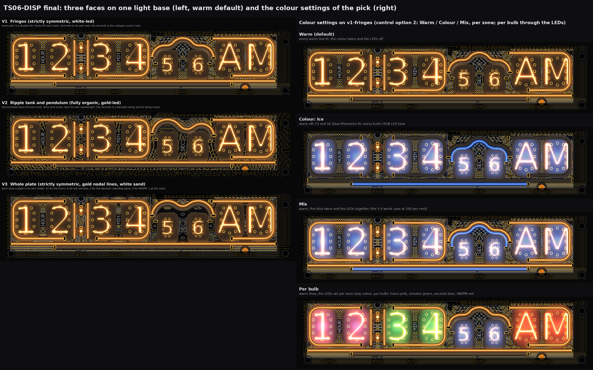
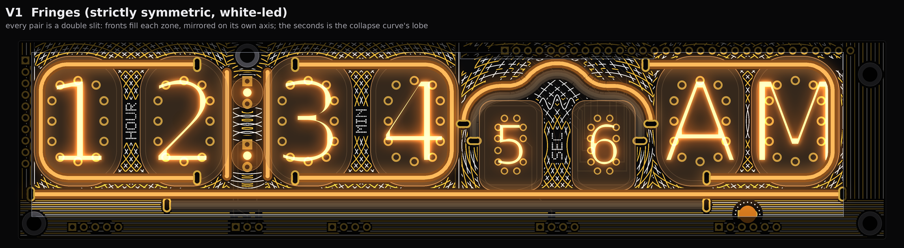
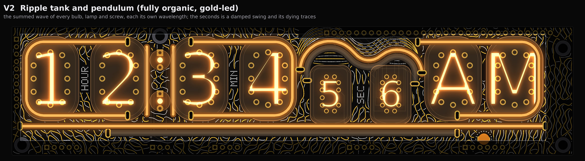
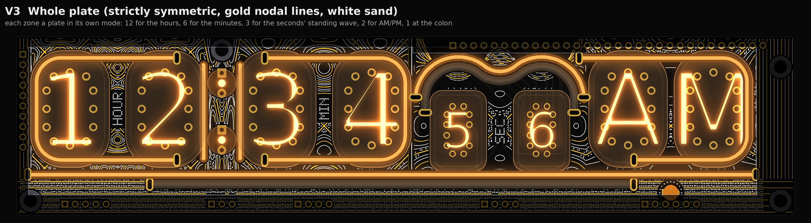
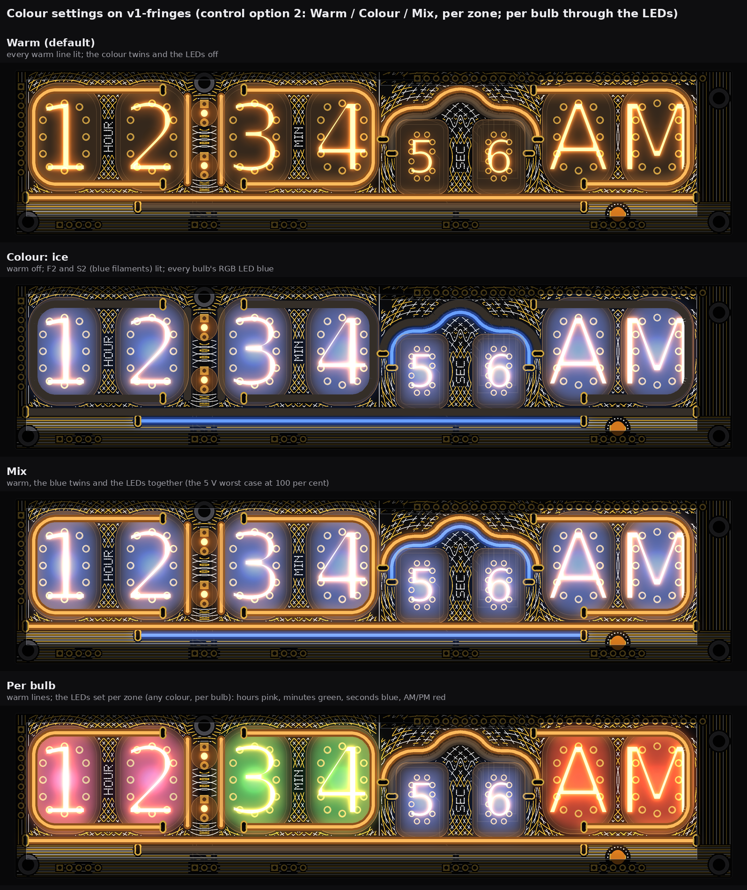
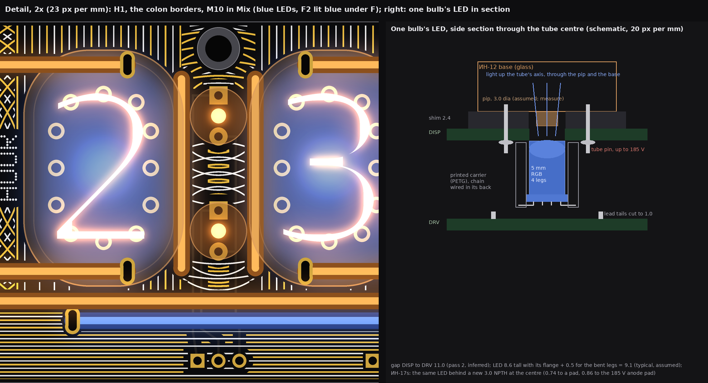

# TS06-DISP final: three wild faces on one light base, an RGB LED per bulb, colour twins (drawings and checks only)

2026-10-14, front round 3, run disp-final. No board, schematic, fab, tool, 3D, firmware or spec file was touched. The faces are drawn
from `PCB/TS06-DISP/TS06-DISP.kicad_pcb` (pass 2's extract), and the room behind the bulbs from `PCB/TS06-DRV/TS06-DRV.kicad_pcb`;
both were read, never written. One scale, 11.5 px per mm, tubes lit, the case window drawn (the board outside it, and under the valance
over the ИН-17 pair, is drawn dimmed). Marks: *measured* is from a board file or the drawn raster; *inferred* is arithmetic; *assumed*
is my reading, not measured or asked. The scratch scripts stay in the run's scratch folder.

**In short.** One light base under all three faces: V3b's strokes, the colon borders at x 46.05 and 55.02, and a seconds curve
of each face's own geometry, all warm. No filament under any bulb. Colour comes two ways. First, one diffused 5 mm RGB LED behind each
bulb. Second, two colour twins, filaments parallel to the two glyphs that have room: F2 under the long line and S2 inside the
seconds curve. **RGB LED pick: the addressable 5 mm four-leg type, on one MCU pin (D11).** It needs no PWM chip. Its 240 us write fits
inside the tube multiplex's 640 us dead time. **Channels: 14 of the one 16-channel chip.** **5 V worst case: 772 mA (77 per
cent), or 580 mA (58 per cent) with a firmware cap on the LEDs.** **My pick: V1, Fringes.**

## 1. The light base (common to all three faces)

| Line | Filament (sold) | Where | Slots (driven, return) | Drive | Channel | Default |
|---|---|---|---|---|---|---|
| H, hours bracket | 95 flex | V3b | (39.48, 30.40), (39.48, 5.27) | BL_A1, F.Cu, **re-routed** round F2's slot (section 4) | 1 | warm |
| M, minutes bracket | 95 flex | V3b | (61.10, 30.40), (61.10, 5.27) | BL_A3, pass 2 | 2 | warm |
| P, AM/PM box | 95 flex | V3b, from x 138.4 | (151.86, 30.40), (138.40, 5.27) | BL_A7, pass 2 | 3 | warm |
| F, the long line | 185 flex | V3b, y 34.0 | (181.81, 34.0), (2.80, 34.0) | BL_A8, re-routed to y 34.0 | 4 | warm |
| Q1, Q2, colon borders | 26 rigid each | plumb at x 46.05 and 55.02, y 7.0 to 30.0, in the shim (front-merge section 3) | none on DISP | 2 wires through H1's and M10's centre holes | 5 | warm |
| S, seconds | 60 flex | each face's own curve, R 6 or more, legs in the corridors | per face (section 2) | BL_A6, re-routed | 6 | warm |
| **F2**, colour twin of F | 125 flex | y 36.4, centred on F's own centre (x 92.305), 0.4 under F | (32.81, 36.40), (151.81, 36.40) | BL_A2 (spare strip pin) | 7 | off |
| **S2**, colour twin of S | 60 flex | 2.4 inside S (centre to centre), the same bends with R +/- 2.4 | per face (section 2) | BL_A5 (spare strip pin) | 8 | off |
| **8 RGB LEDs** | 5 mm, diffused, 4 legs | behind DISP on each bulb's axis (section 3a) | none | one data line from D11 | 0 | off |

* **No filament under any bulb.** Front-merge's six colour bars, AML and the two ИН-17 cradle bars are dropped, and so is the
  cradle. The strokes' inlays and the colon borders still pass under the glass edges, as in V3b and front-merge.
* **The seconds' corridors moved** (*measured*). Pass 2's legs at x 99.4 and 138.4 leave the twin's legs at 101.8 and 136.0.
  At those places the ИН-17 cathode tracks (KS7 on B.Cu, KS8 on F.Cu) block a slot from y 6.5 to 30.2 on the left and from 6.7 to
  32.7 on the right. A scan every 0.2 mm found free slot sites at every height only for x up to 100.8 on the left and x from
  136.97 on the right. So S's legs stand at x 98.2 and 139.57 and S2's at 100.6 and 137.17. That is the only mirror-symmetric pair
  that leaves both on free sites. S's left leg keeps 0.59 to M's leg (rule 0.4).
* **Why F and S get twins and nothing else does:** see section 3b's table.

## 2. The three faces

All three share section 1. A face changes only its seconds curve (S and S2) and its art. White is silkscreen over the mask. Gold is
mask openings on the BL_K pour. It keeps 0.65 from 185 V F.Cu tracks and 0.85 from 185 V pads (drawn keep-outs; rule 0.6 and 0.8),
0.35 from other F.Cu copper, and 0.5 from the board edge. Art fills the whole board face up to the edge. Under the case it is drawn
dimmed. It stays 0.3 from glass, lamps, pads, slots, screws and filament bodies. White breaks 0.16 or more round gold. The names HOUR, MIN
and SEC (5 x 7 dot type, read bottom to top) stand on their own calm pad in the gap of their pair. A half ring of dots frames the
m lamp. Nothing crosses them.

### V1 Fringes

* **Creative decisions:** P1-B's double slits filling every zone to the board's edge (S pool), P1-R's fine collapse curve with its
  side lobes, and a plane wave under the long line. White-led. The seconds is the collapse curve's main lobe.
* **Symmetric**, exactly: every zone is mirrored on its own axis (hours 24.89, colon 50.535, minutes 75.68, seconds 118.885, AM/PM
  160.9). The art is cut by a mirrored mask, so a break round copper on one side shows on the other. The band under F is
  lines parallel to F, each its own mirror image. The strips the mirrored zones leave at x 0.5 to 3.7, 96.3 to 97.8 and 181.8 to
  190.9 carry plumb hairlines.
* **Filaments:** the base. S: 60 flex, corners R 8.4, shoulders R 6, peak R 8.4, brim y 10.0, peak top y 5.0 (the body's
  edge on the valance), slots (98.20, 18.45) and (139.57, 18.45). S2: 60 flex, corners R 6, shoulders R 8.4, peak R 6, slots
  (100.60, 22.22) driven and (137.17, 22.22) return. S2's brim passes under the raised ИН-17 glass for 0.94 mm. That is allowed:
  the ИН-17s stand 7.8 mm off the board, so only their lead pads count (pass 2). It keeps 3.01 from them. All warm. F2 and S2 are
  shown off (blue when lit).
* **White:** even fronts at a 0.9 mm pitch round each pair's two centres (0.18 wide). The whole collapse curve, side lobes and all,
  under the lit lobe on its own 0.35 clear ground. Every second plane-wave line under F (0.45 pitch).
* **Gold:** the odd fronts (0.22) and the other plane-wave lines (0.20), chopped where 185 V F.Cu runs (the colon's COLON_U, the
  ИН-17s' anodes). About 2.3 m of gold.
* **Buildable? Needs X:** section 4's base list. The art is silk and mask openings only.

### V2 Ripple tank and pendulum

* **Creative decisions:** P1-W's ripple tank over the whole board (S pool), with the screws as sources too, and B's harmonograph
  pendulum as the seconds glyph (P4-W) with its dying traces (P4-B's persistence). Gold-led.
* **Organic:** fifteen sources (8 bulbs, 2 colon lamps, the m lamp, 4 screws), each moved up to 1.5 mm, with its own wavelength
  (3.5 to 4.3 mm) and phase. The seconds swing is tall over S10 and lower over S1. Its legs are at different heights, so it shows
  no mirror anywhere.
* **Filaments:** the base. S: 60 flex, a damped swing: crest R 10.2 (top y 5.0), trough R 6 (bottom y 11.5), second crest R 8.4
  (top y 7.9), slots (98.30, 14.72) and (139.80, 15.83). S2: 60 flex, 2.4 inside it, slots (100.70, 18.49) driven and
  (137.40, 19.60) return. S's trough comes 0.14 inside the ИН-17 glass outline and S2 passes under it. Both are allowed, because the glass is raised. All warm; the twins off.
* **White:** the zero lines of the summed wave's quarter-period twin (0.15). In the seconds band, the swing redrawn as it dies away:
  12 copies of falling amplitude and 11 echoes stepping up and left.
* **Gold:** the zero lines of the summed wave (0.24), so the gold leads and white and gold alternate about every 1 mm. They meet only
  at the nodes, where the white breaks. About 1.6 m of gold.
* **Buildable? Needs X:** section 4's base list.

### V3 Whole plate

* **Creative decisions:** P3-W's Chladni plate (A pool), every zone a plate in its own mode, the count the zone's own: 12 for the
  hours, 6 for the tens of minutes, 3 for the seconds, 2 for AM/PM, 1 at the colon. The seconds is P3's standing wave. Gold nodal
  lines carry white sand.
* **Symmetric**, exactly: the plate's field is built from cosines of the distance to the zone's axis, so each zone is its own
  mirror image by construction. The sand is placed on one half and mirrored. The band under F (gold lines every 1.5 mm, sand
  either side) is mirrored on F's own centre.
* **Filaments:** the base. S: 60 flex, mode 3: crests R 10.435 centred over S10 and S1 (top y 5.0), trough R 6 on x 118.885,
  slots (98.20, 14.98) and (139.57, 14.98). S2: 60 flex, crests R 8.035, trough R 8.4, slots (100.60, 18.75) driven and
  (137.17, 18.75) return. It keeps 0.03 from the ИН-17 glass outline. All warm; the twins off.
* **White:** the plate's parallels either side of each nodal line (f = +/-0.3, 0.5, 1.0, 1.25, 1.75; 0.14 wide). Sand grains
  (0.26 dots) where the plate is still. Above the ИН-17s, the standing wave's other phases (14), all pinched at its two nodes.
* **Gold:** the nodal lines (f = 0, 0.24 wide) and two more level lines (f = +/-0.75, +/-1.5; 0.17). The odd phases of the
  seconds' bundle. About 1.4 m of gold.
* **Buildable? Needs X:** section 4's base list.

## 3. Colour, the two ways the owner allowed

Warm stays the default. Colour is a setting in control option 2 (front-merge section 5): AMBIENT, FIELD = Backlight, SUB down, then
a long press cycles **Warm / Colour / Mix** for the selected zone. With zone "All" it is one colour for all. **Per bulb is new:**
the LEDs take any colour each, so zone Hours, Minutes, Seconds or AM/PM sets its two bulbs. The colon stays warm.

### 3a. One diffused RGB LED per bulb (8: 4 ИН-12, 2 ИН-15, 2 ИН-17)

| | Addressable 5 mm, 4 legs (DIN, VDD, GND, DOUT; built-in 3-channel driver, single-wire 800 kHz protocol) | Plain 5 mm, 4 legs, common anode |
|---|---|---|
| MCU | **one pin, D11** (*inferred*: it is free once the PWM chip takes over the backlight and RN1 and the MPSA42 go, front-merge item 8) | none, I2C |
| Chips | none | 24 PWM channels. The first chip has 2 spare (section 3c), so **two more** 16-channel I2C chips (TSSOP, which breaks the through-hole rule again). A 24-channel serial LED driver needs 4 pins; none are free. |
| Wires behind DISP | 3 for the chain (5 V, GND, DATA) | 9 or more (common 5 V + 24 cathodes, or one ribbon per pair) |
| Timing | 8 x 24 bits x 1.25 us = **240 us with interrupts off**, against the multiplex ISR's 128 us tick (Timer2, prescaler 8). Start the write on the first of the 5 dead ticks (640 us, anode off and decoder blanked): it ends inside the dead time. At most one compare match is lost, which makes that one slot's dead time 128 us longer and dims nothing. **Latch-only:** write only when a colour changes. The LEDs hold their colour between writes. During a fade, write at most once per frame. *Inferred* from `isr.ino` and the MULTIPLEX TIMING note. | no interaction: the chips run their own PWM |
| 5 V at full white | 3 x 12 mA = 36 mA each, 288 mA for 8 (*assumed*: typical of the 5 mm addressable type; 18 mA kinds exist: 432 mA). Firmware cap R + G + B <= 255: 96 mA | 3 x 20 mA = 60 mA each, 480 mA |
| Verdict | **pick** | works, but adds 2 chips, 24 resistors and a ribbon to save one pin's timing care |

**Placement, the four places the brief named** (*measured* unless marked):

* **Each ИН-12/ИН-15's 5.0 mm centre hole: yes, from behind.** The LED sits on the bulb's axis behind DISP, dome to the hole. Its
  light goes up through the pip and the glass base, the classic under-light. **No DISP change for these six.** The inner pins
  stand at r 5.74 (pad edge r 4.74). The LED's flange is r 2.9, so 1.84 mm of air and a printed wall separate a 5 V LED from the
  185 V pin tails.
* **The ИН-17s have no centre hole** (the pip hole was removed; README). A new **3.0 mm NPTH** at each centre clears the nearest
  pad by 0.74 and the 185 V anode pad by 0.86. No copper is in the hole, so the 0.6/0.8 copper rules do not apply. The nearest track
  is 1.42 away. A 5.0 hole does not fit: the pads stand at r 3.04 to 3.23. The LED behind it lights the pip, which hangs up to
  6.4 mm into the 7.8 mm gap (README). *Assumed*: dimmer than the ИН-12s; trim it in firmware.
* **On DRV, under each axis: no.** DRV's display side is free, but behind every bulb's axis it has the pins of a DIP or a capacitor
  1.4 to 2.8 mm off the axis: pins of a DIP, a resistor or a capacitor (U2, U6, U7/U8, R26, C17, U10, U15, U16). Four LED pads need about 2.9 (*inferred*).
* **On DISP's face with tracks, or in front-merge's shim: no.** Inside the pin ring there is 1.4 mm. The shim is 2.4 thick and the
  LED 5.
* **How it is held and wired:** one printed carrier (PETG or ASA) clipped to DISP's back, with 8 pockets on the bulb axes (x 13.21,
  36.57, 63.99, 87.37, 108.635, 129.135, 150.4, 171.4; y 17.834, the ИН-17s 23.209). It has clearance holes for the tube pins'
  tails. The legs bend 90 degrees into grooves on its back, and the chain runs left to right (H10 first). **Depth:** the gap
  between DISP and DRV is 11.0 (pass 2, *inferred*). The LED is 8.6 with its flange (*assumed*, typical) and the bent legs add
  0.5, so 9.1. DRV's lead tails stick up to 2.0 into the gap, so **cut them to 1.0 under the 8 spots**. That leaves 0.9.
  Measure the gap before the carrier is drawn.
* **185 V:** nothing bare at 5 V comes within 1.8 of a 185 V pin. The legs and joints sit on the axis, inside the carrier.
* **Light through the glass:** the diffused dome on the axis fills the whole envelope from below and leaves the digits' glow on
  top. This is P8's "one LED on one side looks lopsided" answered by a centred, diffused source.

### 3b. Colour filaments parallel to the big glyphs (one filament per colour)

Rules: body 2.0, 0.4 to pin pads, 0.4 line to line, slots on free copper (pass 2's rules). Offsets are 2.4 centre to centre.

| Glyph | One parallel line? | Two? | Why (*measured* on the drawn lines) |
|---|---|---|---|
| H and M brackets | no | no | Outside the top run (y 2.87) the brow hides y < 2.6, so 37 % of the body is hidden. Inside (y 7.67) it overlaps the pin pads by 0.83. Under the bottom run (y 32.80) it overlaps F by 0.8. Outside H's leg (x 2.57) the case trench hides 72 %. |
| P box | no | no | The same as the brackets. Outside its right leg (x 182.04) it is behind the trench (x 182.035). |
| Colon bars Q1, Q2 | no | no | Outward (x 43.65 / 57.42) it overlaps H1's/M10's pin pads. Inward (x 48.45 / 52.62) it comes 0.02 off the colon lamps' pads (*inferred* from front-merge's 2.38). |
| F, the long line | **yes, below** (F2, y 36.4) | no | The band from F's body to the sill is 4.0; two bodies need 4.8. F2 stops 6.4 short of the m lamp's flange. |
| S, the seconds curve | **yes, inside** (S2) | no | A second twin at 4.8 needs legs at x 103.0 / 134.77, where KS7/KS8 block slots from y 6.3 to 30.3. Its brim would sit under the ИН-17 glass. |

* **So two colour lines, one colour each.** **Ship blue on both ("ice")**, front-merge's pick: the strongest contrast to the warm
  lines. Any sold flex colour fits: yellow, red, green, blue, pink, white. With one filament per colour, F2 and S2 may also differ,
  for example F2 red and S2 blue. That is a build option, not a setting.
* **Per zone:** F2 is the frame zone's colour and S2 the seconds'. Hours, minutes and AM/PM take their colour from the LEDs.

### 3c. Channels and 5 V

| Use | Channels (16-channel I2C PWM chip on DRV, front-merge item 8) |
|---|---|
| DISP warm: H, colon (Q1 + Q2), M, S, P, F | 6 |
| DISP colour twins: F2, S2 | 2 |
| Fascia: the new connector's channels (front-merge item 11; the fascia runs' limit) | 6 |
| RGB LEDs | 0 (one data pin) |
| **Total** | **14 of 16, 2 spare** (11 if the fascia uses front-merge's 3) |

**5 V worst case** (Mix at 100 per cent, 20 mA a filament, front-merge's recommendation; U14 R-78E5.0-1.0, 1.0 A):

| Load | mA |
|---|---|
| 5 V side without HL1-8 (pass 1, *measured* stage 8) | 104 |
| DISP warm: 7 filaments (H, M, S, P, F, Q1, Q2) | 140 |
| DISP colour: F2, S2 | 40 |
| Fascia: 10 filaments (front-merge section 6) | 200 |
| 8 RGB LEDs at full white (12 mA a die, *assumed*) | 288 |
| **Total** | **772 (77 %)**; **580 (58 %)** with the firmware cap (LEDs 96); 916 (92 %) with 18 mA dies and no cap |

The cap (R + G + B of an LED at most one die at full) costs nothing and keeps white at a third. **I recommend it.**

## 4. The change list for the board-change run

*measured* = from the board file or the router on it; *inferred* = arithmetic or routing not yet checked by DRC; *assumed* = not
measured. Coordinates in mm, DISP's frame (y down from the top edge).

**The light base (all faces):**

| # | Board | Change | Check | Mark |
|---|---|---|---|---|
| 1 | DISP | Keep V3b: H, M, P slots and tracks (pass 2), F at y 34.0, HL9 at (160.9, 38.5), ANODE_H1 moved (pass 2), BL_A4 deleted (its strip pin spare), no growth | pass 2 | *measured* |
| 2 | DISP | F's drive (BL_A8, B.Cu) to V3b's slot (181.81, 34.0): (167.25, 41.3), (174.5, 41.3), (181.8, 34.0); 17.6 mm | router: 0.25 / 0.6 / 0.8 kept | *measured* (router) |
| 3 | DISP | **F2's slots** (32.81, 36.40) driven and (151.81, 36.40) return on the pour, heading 0 / 180; **BL_A2** (B.Cu): XP21.5 (22.1, 41.3), (28.2, 41.0), (32.8, 36.4); 12.7 mm | slots 3.20 to ANODE_H1's run (185 V), 2.91 to XP25.1; body 6.43 to HL9's flange | *measured* |
| 4 | DISP | **BL_A1 (H, F.Cu) re-routed** round F2's slot: via (14.48, 35.5), (31.1, 35.5), (32.2, 34.4), (35.6, 34.3), (39.48, 30.40); 27.1 mm (pass 2's ran straight on y 35.5 into F2's slot) | router | *measured* |
| 5 | DISP | **S's slots** move to the new corridors (per face, section 2); **BL_A6** re-routed from XP24 (122.73, 41.3) along pass 2's path to (135.1, 31.5), then up the right corridor to the slot: V1 31.4 mm, V2 34.2, V3 34.9 | router; slots 0.72 or more to CAT_B_AMP | *measured* |
| 6 | DISP | **S2's slots** (per face, section 2); **BL_A5** (B.Cu): XP24 (115.11, 41.3), (113.4, 40.1), (102.4, 29.1), up the left corridor to the slot: V1 25.4 mm, V2 29.1, V3 28.9 | router; slots 0.46 or more to KS7 | *measured* |
| 7 | DISP | **Two 3.0 mm NPTH** at the ИН-17 centres (108.635, 23.209) and (129.135, 23.209), for their LEDs' light | 0.74 to a pad, 0.86 to the anode pad, 1.42 to a track | *measured* |
| 8 | DISP | No slot, track or hole for Q1, Q2 or any bulb's light (front-merge items 3 and 6 are dropped); the ИН-12/ИН-15 LEDs use the existing 5.0 NPTH | | *measured* |
| 9 | Shim | Front-merge item 5 without the bar channels: channels for V3b's inlays and Q1, Q2 only; Q's 2 wires in grooves to H1's and M10's centre holes, past the LED's dome (a 0.6 groove in the carrier) | | *inferred* |
| 10 | LED carrier | New printed part behind DISP (section 3a): 8 pockets, pin-tail clearances, the chain's 3 wires in grooves | | *inferred* |
| 11 | Harness | 5 wires (LED 5 V, GND, DATA; Q drive, Q return), replacing front-merge's 12-pin harness | | *inferred* |
| 12 | DRV | The 16-channel I2C PWM chip (front-merge item 8) with 14 N-FETs (8 DISP channels, 6 fascia) and 19 resistors of 120 R (9 DISP filaments, Q1 and Q2 one each; 10 fascia), in place of front-merge's 13 FETs and 26 resistors; 330 R in DATA at D11; 100 uF at the chain's 5 V; RN1 and the MPSA42's PWM role go | room not checked | *inferred* |
| 13 | DRV | Cut the lead tails to 1.0 under the 8 LED spots (DRV x = 191.4 - x, y = y + 26.0: (178.19, 43.83), (154.83, 43.83), (127.41, 43.83), (104.03, 43.83), (82.77, 49.21), (62.27, 49.21), (41.00, 43.83), (20.00, 43.83)) | | *measured* (spots), *assumed* (need) |
| 14 | Strip pins | BL_A2 = F2, BL_A5 = S2 (both were spare), BL_A4 stays spare; XP12.11 to 13 and XP25.3 unchanged | | *measured* |
| 15 | Firmware (later) | D11 released from Timer2's OC2A; LED writes latch-only, in the dead time; the Colour setting per zone, per bulb | | *inferred* |
| 16 | Case | 0.4 deeper for the 2.4 shim (front-merge item 12); no window change | | *inferred* |

**Each face's art deltas** (silk and mask only; no copper beyond the base):

| Face | Silk (white) | Mask openings (gold on the BL_K pour) | S and S2 slots | Checks |
|---|---|---|---|---|
| V1 | fronts 0.18, fine curve 0.16, plane lines 0.16, names, half ring; about 2.2 m | fronts 0.22, plane lines 0.20; about 2.3 m | S (98.20, 18.45) / (139.57, 18.45); S2 (100.60, 22.22) / (137.17, 22.22) | section 5 |
| V2 | zero lines 0.15, traces 0.15; about 1.1 m | zero lines 0.24, traces 0.20; about 1.6 m | S (98.30, 14.72) / (139.80, 15.83); S2 (100.70, 18.49) / (137.40, 19.60) | section 5 |
| V3 | parallels 0.14, sand dots 0.26, bundle 0.15; about 2.2 m | nodal lines 0.24 and 0.17, bundle 0.20; about 1.4 m | S (98.20, 14.98) / (139.57, 14.98); S2 (100.60, 18.75) / (137.17, 18.75) | section 5 |

## 5. The checks

*Measured* on the drawn rasters (0.043 mm pixels) against DISP's board file. The lines were checked with pass 2's body and slot
checks and router.

| Check | Rule | V1 | V2 | V3 |
|---|---|---|---|---|
| Gold to 185 V F.Cu tracks | 0.6 | 0.63 | 0.65 | 0.67 |
| Gold to 185 V pads | 0.8 | 0.84 | 0.84 | 0.84 |
| Art to the glass and the colon lamps | 0.3 | 0.31 | 0.31 | 0.31 |
| Art to the names and the m lamp's ring | own ground | 0.52 | 0.52 | 0.52 |
| White to gold | 0.15 break | 0.22 | 0.22 | 0.22 |
| Largest empty spot in the window (radius of the biggest disc with no line) | "no empty space" | 1.49 (top left of the seconds, where the mirror of P's slot cuts) | 1.10 | 1.48 (under S2's left crest) |
| S body to an ИН-12 pin pad, to another pad | 0.4, 0.3 | 3.11, 1.02 | 3.09, 0.96 | 3.24, 0.97 |
| S2 body to a pin pad, to a pad | 0.4, 0.3 | 5.49, 3.01 | 5.26, 2.97 | 5.49, 3.37 |
| S and S2 slots to other copper | 0.25 | 0.95, 0.55 | 0.72, 0.46 | 0.96, 0.55 |
| F2 body to HL9's flange, F2 slots to copper | 0.3, 0.25 | 6.43, 2.91 | same | same |

## 6. My pick

**V1, Fringes.** It is the owner's top S face grown to fill the whole board. Every pair is a double slit, mirrored exactly on its own
axis, under one collapse curve, and the white leads so the warm lines and the blue twins read cleanly over it. V2 is the
organic alternative and the fullest of the three. If the owner wants a face with no mirror, take V2. Nothing else changes, because
the base, the twins and the LEDs are the same.

## 7. Left open, assumed

* **Not buildable as drawn: nothing.** Each face needs section 4's base list.
* To measure: the gap between DISP and DRV (11.0 *inferred*); the LED's height with its flange (8.6 *assumed*); the ИН-12 pip
  (front-merge question 3). If the pip is short, the LED's dome can enter the 5.0 hole and the depth worry goes. If the gap is
  under 10, use a short-body 5 mm LED.
* The ИН-17 LEDs light through a 3.0 hole and the pip: the bench decides how bright.
* The colour of F2 and S2 against the blue LEDs: the bench. Sold "blue" flex and a blue LED die may differ in tint.
* Line widths (white 0.14 to 0.18, gold 0.17 to 0.24), pitches and V2's seed are choices, not needs. The 0.14 silk is under the
  0.15 used before: ask the fab or widen to 0.15.
* Not checked: a real DRC (no board file edited), the pour's fill after the new tracks, thermal reliefs on the new slots.
