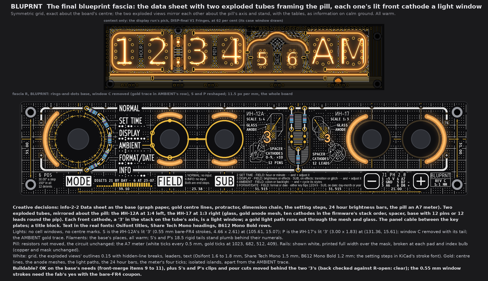
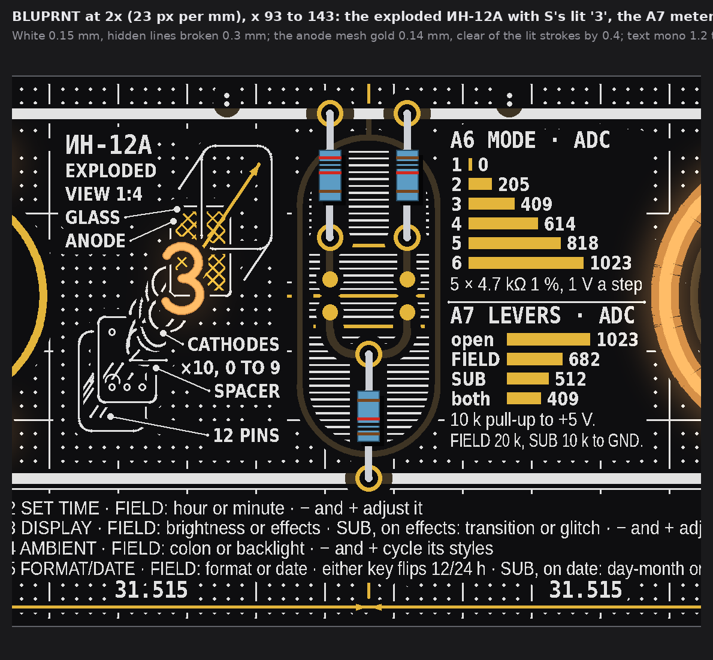
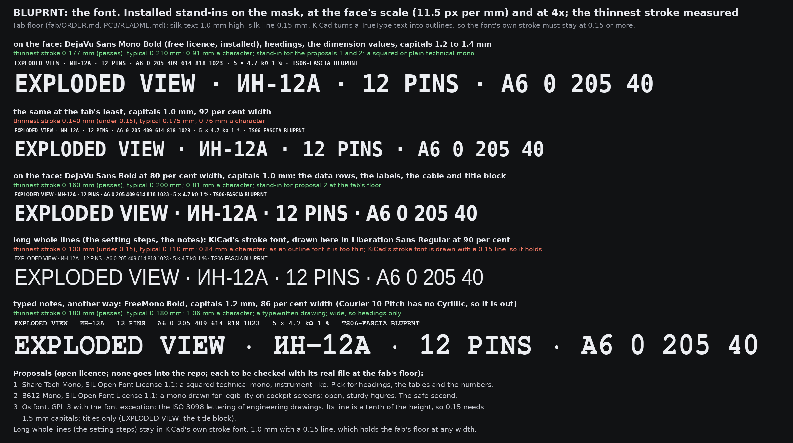
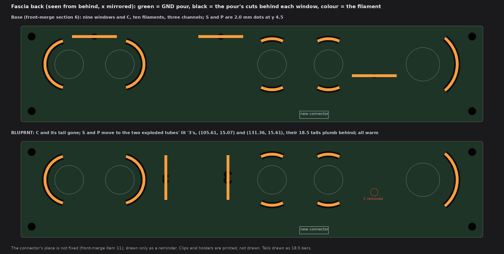

# TS06 fascia BLUPRNT: the final blueprint face (drawings only, nothing built)

2026-10-14, front round 3, run fascia-BLUPRNT, then BLUPRNT 2 on the owner's note.

**The owner's words:**
* 21:5x UTC: "final BLUPRNT fascia option: converge on 1 mixing all three, 2-2 looks best, but drop pixelated windows, make diagrams
  more interesting maybe a nixie blowup components? the gold bars as stats are a cool idea too, any way for a more interesting font?"
* 22:4x UTC: "explosion on bluornt looks amazing, but the number isnt really in the place its supposed to be and were making the number
  a light window right? / can you make a similar one on the right replacing the two gold bar charts? it can be either a mirrored
  view or in17 / I like the stylized fonts better"

**Change (BLUPRNT 2, 22:4x UTC):**
* The lit "3" is now the front cathode of the stack: on the explosion's axis, at the stack's own pitch, the same size.
* A second exploded tube, the ИН-17, replaces the A6 and A7 bar charts. It is the mirror of the ИН-12А about the pill, and its lit
  "3" is P's window. P's centre mark is gone.
* The face's own text is drawn in the real proposed fonts, downloaded to scratch, never into the repo.
* S's and P's tails, clips and pour cuts move behind the two numerals, and the back is checked.

One face. It starts from info-2-2 Data sheet (`TS06-FASCIA-info-2.md`). From info-2-1 it keeps the title block; from info-2-3, the
light path. The info-2 set stays as history.

Fascia R with the rings-and-dots base (front-merge section 6), one scale (11.5 px per mm). DISP-final V1 Fringes stands above it for
context. No board, schematic, fab, tool, 3D, firmware or spec file was touched; the scripts are scratch. Marks used:
* *measured*: on the drawing's raster (23 px per mm), or on `R-open.kicad_pcb`;
* *inferred*: arithmetic;
* *assumed*: my reading.

## 1. The face

* **Creative decisions:**
  * **Kept from info-2-2:**
    * the graph paper, the gold centre lines, and the MODE switch's hidden outline and protractor;
    * the dimension chain and hole pitch;
    * the setting steps of the four live screens, one per line under the +5V rail;
    * the 24 hour digit brightness bars, the gold bars as stats;
    * the parking screens, the dial's numbers, and the pill as an A7 meter.
  * **Two exploded tubes frame the pill**, mirrored about its axis (x 118.885):
    * the **ИН-12А** at 1:4 on the left, its front up and right;
    * the **ИН-17** at 1:3 on the right, its front up and left.
    Each one's parts float apart along its axis:
    * the base: the ИН-12А's rear face with 12 pins and the tip-off pip, or the ИН-17's round stem end with 12 leads round the pip,
      one cut short as the key;
    * a spacer;
    * ten cathodes, as single-stroke numerals in the firmware's stack order;
    * the anode mesh, in gold;
    * the glass, as its face and barrel. On the ИН-17 the flattened lens narrows to the round Ø20 stem, which is dashed behind it.
  * **The front cathode of each stack, a "3", is a light window:** S on the left, P on the right. It sits on the axis at the stack's
    own pitch (0.6 and 0.55 mm), the same size as the nine behind it. It glows through the gold mesh, and a gold arrow carries its
    light out through the mesh and the glass. Rear parts break 0.3 mm where a nearer part crosses them, as hidden lines do on a
    drawing.
  * **Labels:** glass, anode, cathodes (0-9, ×10 on the left), spacer, 12 pins or 12 leads, the scale, and each tube's name as a
    title.
  * **The panel cable** sits between the key plates.
  * **A title block** sits right of the plus plate: BLUPRNT, REV C, 1:1 MM.
* **Symmetric or organic:** symmetric.
  * The grid, the centre lines and each control's construction are exact (about the board's centre and each control's axes).
  * The two exploded views mirror each other's layout about the pill. They are two different tubes, so they are information on calm
    ground, like the tables, not decoration.
* **Lights (A1, A5):**
  * No cell windows and no centre marks.
  * **S** is the ИН-12А's "3": bare-FR4 strokes 0.55 mm wide, a numeral 4.66 × 2.61 mm (18.63 at 1:4), centred at (105.61, 15.07).
  * **P** is the ИН-17's "3": strokes 0.55, 3.00 × 1.83 mm (9.00 at 1:3), centred at (131.36, 15.61).
  * Window C is gone with its tail. A 0.3 mm gold trace runs in AMBIENT's row into its mark on FIELD's ring (the GND gold net), and
    C's place in the tube map gets its colon dots back.
* **Filaments:**
  * The base's places and lengths, **all warm**: rigid bars in warm white, flex in yellow (front-merge section 5).
    * The MODE arc is 38 flex.
    * FIELD and SUB are 18.5 rigid in curved clips, or 38 flex.
    * The keys are 38 flex.
  * S's and P's tails are **18.5 rigid warm bars, plumb**, behind their numerals (section 3).
* **Pill (A2):** the resistors are not moved, so the circuit is unchanged. The pill is the A7 meter: 0 at its foot, 1023 at its head,
  white ticks every 0.5 mm, and gold ticks at 1023, 682, 512 and 409. It is now the only place the A7 states show; the bar charts are
  gone.
* **Rails (A3): shown white.** Silk is printed full width over the masked copper, broken at each pad and index bulb. Copper and mask
  are unchanged.
* **White:**
  * the grid: 1 mm dots, 5 mm lines 0.15;
  * the exploded views' outlines, 0.15, with hidden-line breaks of 0.3;
  * leaders, 0.15 with a 0.22 dot;
  * the meter's ticks, the title block's rules and the text (section 2).
  * Fragments under 0.06 mm² are dropped, so no silk specks are left.
* **Gold:**
  * the centre lines, hidden outline, protractor and dimension lines, 0.2;
  * the two anode meshes, 0.14 lines on a 0.64 mm diagonal pitch;
  * the two light paths, 0.22 with heads;
  * the 24 hour bars, and the meter's four ticks.
  All are isolated islands, apart from the AMBIENT trace.
* **Buildable? OK** on the base's needs (front-merge items 9 to 11), with three conditions:
  * S's and P's clips and pour cuts move behind the numerals (section 3; the back is clear);
  * the 0.55 mm window strokes need the fab's yes with the bare-FR4 coupon (said once here; not decided);
  * the outline fonts are used at the sizes in section 2.

## 2. The fonts (the real files)

The fab's floor for silk is 1.0 mm text and 0.15 mm lines (`fab/ORDER.md` line 95, *inferred* there; `PCB/README.md` line 272).
KiCad turns a TrueType text into outlines, so each font's own thinnest stroke must be 0.15 or more at the size and width used.

**Method:**
* Strokes were measured on a 200 px per mm raster: the 5th percentile of the stroke width at the glyphs' ridges, over the strings the
  face prints.
* Coverage was checked per glyph against each font's empty box.

**Sources:** downloaded to the session's scratch folder `front-final/fonts/` only. No font file is in the repo.

| Font | Source | Licence | Coverage of what the face prints |
|---|---|---|---|
| Osifont | `https://raw.githubusercontent.com/hikikomori82/osifont/master/osifont-lgpl3fe.ttf` | GNU LGPL 3 with the font exception (its README also offers GPL 3 and GPL 2 files, each with the exception) | Cyrillic yes; **no minus sign** (U+2212) |
| Share Tech Mono | `https://raw.githubusercontent.com/google/fonts/main/ofl/sharetechmono/ShareTechMono-Regular.ttf` | SIL Open Font License 1.1 (Reserved Font Name "Share") | **no Cyrillic** (И, Н, А) and **no Ω** |
| B612 Mono Bold | `https://raw.githubusercontent.com/google/fonts/main/ofl/b612mono/B612Mono-Bold.ttf` | SIL Open Font License 1.1 | all used here (Cyrillic, ×, −) |

**Where each one is used, and its thinnest stroke** (*measured*):

| Use | Font | Size | Thinnest |
|---|---|---|---|
| Titles: ИН-12А, ИН-17 | Osifont | 1.8 mm capitals | 0.170 |
| BLUPRNT in the title block | Osifont | 1.6 mm | 0.150 |
| Headings and figures: 6 POS, J1 PH 2.0 | Share Tech Mono | 1.5 mm | 0.160 |
| Rows, labels, the scale, the dimension values, the 24 hour heading, REV C, 1:1 MM | B612 Mono Bold, 86 to 90 % width | 1.2 mm | 0.160 |
| Long whole lines: the setting steps, the parking screens, the dial's lines | KiCad's own stroke font; drawn here in Liberation Sans | 1.0 mm | 0.15 by its line |
| E1's names, plates and key legends | unchanged (fixed on every fascia) | | |

**Per-glyph fallbacks:**
* Nothing in Cyrillic is set in Share Tech Mono; the tube names are in Osifont.
* The minus signs (J1's "5 D7 −" and the setting steps) are in B612 Mono and in the stroke font, never in Osifont.
* No glyph falls back to another font inside one word.

**Too thin at the floor:**
* Share Tech Mono at 1.0 mm: 0.110.
* B612 Mono Bold at 1.0 mm: 0.130.
* Osifont below 1.6 mm (its line is about a tenth of the height, as ISO 3098 sets it).
So none of the three is used under the sizes above.

## 3. The light base, what this face changes, and the back

The base is front-merge section 6: nine windows and C, ten filaments, three fascia channels, all warm.

| Item | Base | BLUPRNT | On the fascia's back |
|---|---|---|---|
| info S | 2.0 mm dot at (108.6, 4.5) | ИН-12А's lit "3" at (105.61, 15.07) | 18.5 rigid warm tail, plumb, x 105.61, y 5.8 to 24.3; a new clip place; the pour cut follows the numeral |
| info P | 2.0 mm dot at (160.9, 4.5) | ИН-17's lit "3" at (131.36, 15.61) | 18.5 rigid warm tail, plumb, x 131.36, y 5.9 to 24.4 (set 0.5 up from centre); a new clip place; the pour cut follows the numeral |
| info C | window at (45.04, 21.2) | removed (A5); gold trace in AMBIENT's row | no cut, no tail |
| the rest | MODE arc, FIELD and SUB up and down, key arcs | unchanged | unchanged |

**The back, checked against `R-open.kicad_pcb`** (scratch copy of the fascia's board file; board and art share one frame, *measured*):
* B.Cu between x 97 and 141 carries only three tracks:
  * A7 at y 26.2, from x 90 to 142.8;
  * A6 at y 33.7;
  * +5V at y 38.8.
* S's tail ends at y 24.3 and P's at 24.4, so both are **1.8 to 1.9 mm above the A7 track**. The clips sit on mask, not on copper.
* The back's parts are all clear:
  * R1 to R5 at y 35.2;
  * R6 at (75.68, 22.5), R7 at (64.24, 30), R8 at (87.62, 30);
  * J1 at (155.4, 33.4);
  * the SUB lever's body (to x 93.3);
  * the minus key's body (from about x 144, *assumed* from the key at 150.4).
  The nearest is the SUB lever's body, 12 mm from S.
* The GND pour (B.Cu) is cut behind each numeral, as behind every window. Each cut is an island in the pour, so the pour stays one
  net round it (*inferred*).
* The art model's capsule (E1's ladder, x 113.9 to 123.9) is 8.3 mm from S's tail and 7.5 mm from P's.

**Channels and power:**
* The info channel drives S and P only. That makes nine windows and nine filaments on the same three channels.
* That is 20 mA less on the 5 V side at front-merge's 20 mA a filament (*inferred*).
* The connector stays at 6 channels.

## 4. Where each printed fact comes from

| Printed | Source |
|---|---|
| ИН-12А (hours and minutes), ИН-17 (seconds) | `knowledge/TERMINAL-06-spec.txt` lines 6 and 7 |
| ИН-12А view: face 19.47 × 28.86, 25.50 deep (drawn at 1:4), 12 pins Ø0.92 with 6.25 free, tip-off pip Ø3.70; the leads leave the rear face | `knowledge/TERMINAL-06-measurements-IN12.txt`, the `3d/IN12.FCStd` parameters (envW, envH, envD, pinCount, pinD, pinFreeL, pipD). Their provenance is unconfirmed there; only "12 PINS" is printed |
| The ИН-12А numeral, 18.63 (drawn 4.66) | the same sheet, reading 4, *measured* |
| ИН-17 view: glass 22 along the axis, a Ø20 stem flattening to a 14 × 20 lens, 12 leads round a central exhaust pip, leads 35 long (drawn broken), one cut short as the key; digit 9.00 × 5.5 | `knowledge/TERMINAL-06-measurements-IN17.txt` Rev 5 (row 13, the factory outline drawing), rows 5, 7 and 17, Rev 5 downstream notes; 9 × 5.5 from its source table |
| End-view, both tubes (the parts explode along the viewing axis) | IN12 sheet ("the 12 leads leave the REAR face"); IN17 sheet Rev 3 ("end-view") |
| CATHODES, 0-9, ×10 | `TERMINAL-06-measurements-PCB-GYVER-NETLIST.md` line 127 (ИН-12А pins 2 to 11 are the cathodes 0 to 9) |
| Stack order, rear to front 1 6 2 7 5 0 4 9 8 3 (drawn, not printed) | `firmware/nixieClock_TS06/nixieClock_TS06.ino` lines 284 to 286 (`cathodeMask`); `effects.ino` line 63 ("scroll along the physical cathode stack") |
| GLASS, ANODE (a mesh), SPACER; the lit cathode's light out through the mesh and glass | general nixie construction, no figures |
| SCALE 1:4, SCALE 1:3 | true of the drawings |
| J1 PH 2.0: 1 +5 V, 2 GND, 3 A6, 4 A7, 5 D7 −, 6 D8 + | spec section 2, the J1 table (Rev D.4) |
| Setting steps 2 to 5 | spec section 1, the control table |
| 1 NORMAL and 6 INFO: no input; both are end stops | spec section 1 |
| 6 POS, 30.00° a step, 150° in all, 12 detents | spec section 2, the switch table |
| Digits 21 by day, 6 at 23-07 | firmware `nixieClock_TS06.ino`: `INDI_BRIGHT 21`, `INDI_BRIGHT_N 6`, `NIGHT_START 23`, `NIGHT_END 7` |
| The meter's gold ticks 1023, 682, 512, 409 (A7, not printed as numbers) | spec section 2 (lines 378 to 380) |
| Control pitches 39.10, 23.38, 31.515, 31.515, 21.00; hole pitch 31.00 | the board model's centres and screw holes (as info-1) |
| Title block: BLUPRNT; REV C; 1:1 MM | the owner's name for this option; pass 4 section 7 (rev C, the next fascia face); true of the drawing |

* *Assumed:* the firmware's `cathodeMask` gives the order along the stack, not which end faces the glass. It is drawn with the "3" at
  the glass. The mask itself is not yet measured on a tube:
  * `knowledge/QUADRANT-D-spec.txt` line 312 says "the ИН-12 mask looks *almost* right";
  * the ИН-17's own order is row 16 of its sheet, "not captured".
  The ИН-17 is drawn with the same order, since the firmware uses one `cathodeMask` for all its tubes. So the order is drawn, not
  printed. If the bench shows otherwise, both stacks are redrawn and the lit front numeral changes.
* *Drawn, not to scale:*
  * the pins' and leads' places (the ИН-17's lead circle is not dimensioned; the sheet bounds it at about 11 mm);
  * the spacer's holes;
  * the mesh pitch;
  * the barrels' depth, drawn cabinet, at half;
  * the leads' length, broken.
* **The A6 and A7 bar charts are gone** (the owner: "replacing the two gold bar charts"). The A6 numbers are no longer on the face.
  The A7 states remain only as the pill meter's four gold ticks.

## 5. Setting steps the firmware does not do yet

The face prints the spec's scheme (spec Rev D.4 section 1, control scheme rev B). The firmware is the display-layer port. Its TODO is
in the header of `ts06pair.ino`, and the spec's own list is section 5, "Firmware status: control scheme NOT implemented". The key
points were rechecked:
* `ts06pair.ino` lines 30 to 41 ("A7 is not read"; NORMAL and INFO "are meant to ignore every input");
* spec line 672 ("Still to write: A6 mode state machine ...; A7 lever decode").

What that means for the printed steps:
* **Not done: A7 is not read at all.** So none of the FIELD or SUB steps work yet:
  * SET TIME: hour or minute by FIELD;
  * DISPLAY: brightness or effects, then transition or glitch;
  * AMBIENT: colon or backlight;
  * FORMAT/DATE: format or date, then day-month or year;
  * the SUB rule.
* **Not done:** only SET TIME is its own screen (PROGRAM). There "−" switches hours and minutes and "+" counts up, so "− and + adjust
  it" is not yet how it works.
* **Not done:** DISPLAY, AMBIENT, FORMAT/DATE, NORMAL and INFO all run the old two-button controls:
  * "−" cycles the backlight mode, and a hold turns glitch on or off;
  * "+" cycles the transition effect.
  So these are not true yet:
  * "NORMAL and INFO: no input";
  * AMBIENT's style cycling;
  * FORMAT/DATE's 12/24 h flip and date edit;
  * the glitch *rate*.
* **Done:**
  * the five-reading agreement filter (`rotaryStable()`);
  * the A6 position decode (`rotaryPos()`, positions 1 to 6 as printed);
  * the day and night digit brightness (the 24 hour bars).

## 6. The checks (*measured* on the raster, 23 px per mm)

| Check | Rule | BLUPRNT |
|---|---|---|
| White, gold to a name, plate, key legend, tube map, leader or index dot | 0.75 | 0.78, 0.80 |
| White, gold to E1's exposed gold (rings, link, marks, pads) | 0.30 (gold frame 0.75) | 0.43, 0.75 |
| Pattern gold to any copper | 0.30 | 0.39 |
| White, gold to a lit window (both "3"s included) | 0.35 | 0.39, 0.40 |
| Lit window to copper | 0.30 | 0.68 |
| Lit window to a legend | (base's least was 0.26, C to AMBIENT) | 1.17 |
| White to the pattern's gold | 0.30 | 0.33 |
| AMBIENT trace to its name; to white; to pattern gold | 0.75; 0.30; 0.30 | 0.78; 1.17; 2.39 |
| Silk to silk in the exploded views (hidden-line break) | 0.15 | 0.30 by construction |
| Thinnest font stroke | 0.15 | 0.150 (BLUPRNT, Osifont 1.6); all others 0.160 or more |
| Free board within 1.2 mm of some ink | (no empty space) | 99.6 % |

White may run over copper under the mask (the rails, the key rings, the capsule), so white to copper is 0 by design.

## 7. What did not fit, and left open

* **Did not fit at a readable size:**
  * info-2-1's revision table and its section A-A of the MODE switch;
  * info-2-3's whole clock in section.
  The two tall calm blocks beside the pill now hold the two exploded tubes. What came across: info-2-1's title block (shortened) and
  info-2-3's light paths (inside the tubes).
* *Assumed:* each plumb 18.5 bar lights its numeral evenly enough through 2.0 mm FR4 (4.7 mm for S, 3.0 mm for P). The bench
  decides. A short flex piece bent to the "3" is the fallback.
* *Assumed:* 0.55 mm window strokes are wide enough to cut and to light.
* Not checked:
  * KiCad DRC (no board file edited);
  * the fonts inside KiCad itself (the outlines were measured here, not imported);
  * the connector's place on the back (front-merge item 11).
