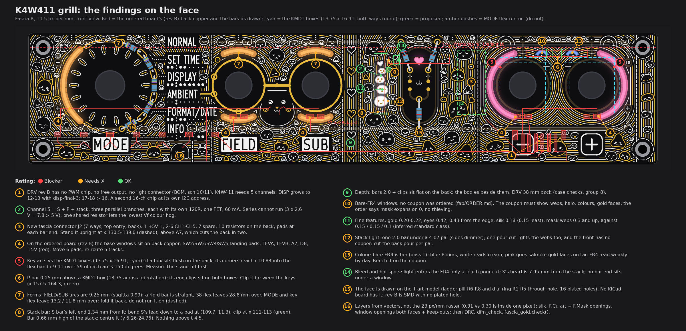

# TS06 fascia K4W411: the grill (can it be built, will it work)

2026-10-14, run grill-K4W411. The owner (22:2x UTC): "add K4W411 as approved, ryn a grill on its buildability, light source
cioonnection etc". K4W411 is approved. This page reviews it and proposes fixes. It applies none: no board, schematic, fab, tool,
3D, firmware or spec file was touched, and the face ([TS06-FASCIA-K4W411.md](TS06-FASCIA-K4W411.md)) is unchanged. The scripts
are scratch, not in the repo.

Marks:
* *measured*: read from a repo file (board, schematic, BOM, case model), or from the face run's own geometry.
* *inferred*: arithmetic on measured numbers.
* *assumed*: my reading, or a value nobody has measured.

The filament data in the repo is one listing line (front-merge section 5: "3 V DC, under 300 mA, CRI 80"). There is no forward
voltage curve and no rated current per length. Where a number depends on that, the bench check is named.

## Verdict

**Buildable after changes. Not buildable on the ordered board as it stands.** The art itself has no blocker: every stroke is
plain silk, ENIG or a mask opening, and the fine features pass the fab's standard limits. The lights carry the risk:

* the key arcs may hit the push buttons' boxes on the back (the one blocker, until a button is measured);
* DRV has no driver for any fascia light yet;
* five of the base windows sit on the ordered board's back copper;
* the face is drawn on the through-hole (T) art model, which has no KiCad board.

| # | Item | Rating |
|---|---|---|
| 1 | DRV: no PWM chip, no free output; the 16-channel budget | Needs X |
| 2 | Channel 5 shared by S, P and the stack | OK (one resistor per bar) |
| 3 | The new fascia connector, pin map, resistors, routes | Needs X |
| 4 | Base windows over the ordered board's back copper | Needs X |
| 5 | Key arcs against the push buttons' boxes | **Blocker** until measured |
| 6 | The P bar's clips against the same boxes | Needs X |
| 7 | Filament forms and lengths (lever arcs, MODE and key flex) | Needs X |
| 8 | The stack bar: the S bar's lead, centring, the top band | Needs X |
| 9 | Depth behind the fascia | OK |
| 10 | Bare-FR4 windows: the coupon and the order notes | Needs X |
| 11 | Fine features: gold in the openings, silk, gold, islands, mask webs | OK |
| 12 | The stack's glow: evenness, webs, halo | Needs X |
| 13 | Colours through bare FR4, and the gold faces by day | Needs X |
| 14 | Bleed between lights; hot spots | OK |
| 15 | The base board: the face is drawn on the T art model | Needs X |
| 16 | KiCad layers from vectors, and the re-checks | Needs X |

## 1. Light sources and connection, end to end

### Every filament, from the bar to DRV

The proposed wiring:
* every filament has its own series resistor on the fascia's back (front-merge item 11, the 7-wire way);
* each filament's anode goes through its resistor to a common +5V_L;
* the cathodes of each channel join and go to one pin of a new connector J2;
* on DRV, each channel is one low-side N-FET driven by one output of the PWM chip.

| Light | Sold part, colour | Held by | Its two leads | J2 pin | DRV | Finding |
|---|---|---|---|---|---|---|
| MODE arc | 38 flex, warm | arc clips on the back; the 13.2 mm over folded back | SMD pads at the ends: anode via 120R to +5V_L, cathode to CH1 | 2 | CH1, 20 mA | 4, 7 |
| FIELD up, FIELD down | 18.5 rigid (straight) or 38 flex, warm | two clips each | the same; both cathodes to CH2 | 3 | CH2, 40 mA | 4, 7 |
| SUB up, SUB down | the same, warm | two clips each | both cathodes to CH3 | 4 | CH3, 40 mA | 4, 7 |
| Key - arc, key + arc | 38 flex, pink | arc clips; the 11.8 mm over folded back | both cathodes to CH4 | 5 | CH4, 40 mA | 4, 5, 7 |
| S (the heart) | 18.5 rigid, pink | two end clips | cathode to CH5 | 6 | CH5 | 8 |
| P (the eyes) | 18.5 rigid, blue | two clips between the keys | cathode to CH5 | 6 | CH5 | 6, 13 |
| The stack (new) | 18.5 rigid, white | two end clips | cathode to CH5 | 6 | CH5, 60 mA with S and P | 8, 12 |

*Inferred* from front-merge's drive (low-side N-FETs, sections 5 and 7). The clip and pad places are not drawn on any board.

### Finding 1. DRV has no driver for the fascia lights yet (Needs X)

**What the repo says:**
* DRV rev B has no PWM chip (*measured*: `PCB/TS06-DRV/bom.md`; 96 parts fitted, all through-hole).
* The I2C bus carries only U3, the port expander at 0x20, and U13, the RTC module (*measured*: sheet 04's note).
* DRV's J1 is 6 ways: +5V, GND, A6, A7, D7, D8 (*measured*: sheet 11). It has no spare pin.
* The backlight is the expander's port B through RN1, with one common-cathode transistor (VT20) on D11's PWM (*measured*: sheet 10).

So "channel 5 or 6" has no hardware today. The 16-channel chip, its FETs and the light connector are front-merge item 8 and
TS06-DISP-final item 12, a DRV change that nobody has placed yet. K4W411's own write-up says "disp-final-2 counts 14 of DRV's
16". Those are 14 planned channels of a planned chip, not free outputs.

**The 16-channel budget** (*inferred* from TS06-DISP-final 3c, TS06-DISP-final-2 section 4 and disp-final-3's brief):

| Display | DISP channels | Fascia 6 | Fascia 5 (K4W411) | Fascia 3 |
|---|---|---|---|---|
| TS06-DISP-final | 8 | 14 | 13 | 11 |
| V1r-1 (approved) | 9 | 15 | 14 | 12 |
| disp-final-3 (+1 split, +1 K3, +1 or +2 for the seconds) | 12 or 13 | **18 or 19** | **17 or 18** | 15 or 16 |

**Fix:**
* K4W411 needs 5 channels: MODE, FIELD, SUB, the keys, and S + P + the stack. Leave channel 6 unwired, so the display gets one
  channel back.
* With disp-final-3 the one chip is still over. There are two ways out:
  * **a second 16-channel chip of the same part at another I2C address** (front-merge's own fix). It needs no new MCU pin.
    Cost: one chip, its address straps and the FETs as needed.
  * **the fascia on 3 channels** (MODE + FIELD + SUB, the keys, S + P + the stack). Cost: the control arcs can no longer light
    one at a time.
* **Bench check:** an I2C scan of the RTC module that is actually fitted. Any address it uses, besides U3's 0x20, must stay
  off the new chip's address straps. The repo does not list the module's addresses.

### Finding 2. S, P and the stack on channel 5 (OK, with one resistor per bar)

* **Series does not run.** Three bars in series need at least 3 x 2.6 = 7.8 V (*inferred*; 2.6 V is front-merge's assumed
  forward voltage at 20 mA). The rail is 5 V.
* **Parallel on one shared resistor is not OK.** Pink, blue and white are different emitters. The one with the lowest forward
  voltage takes most of the current (*inferred*; the repo has no forward voltage for any colour).
* **Parallel branches, each with its own 120R, on one FET: OK.**
  * Each bar gets its own current: 20 mA at Vf 2.6 V, 16.7 mA at Vf 3.0 V (*inferred*). That is the same brightness as alone.
  * The FET carries 60 mA. The other channels carry 20 or 40 mA.
  * The chip only drives gates, so its own output limit does not apply (*inferred* from the FET stage).
* **The FET** is not chosen in the repo. Pick a logic-level part, rated at the chip's output-high voltage, for 0.1 A or more.
* **What sharing means:** the stack always lights with S and P, at the same duty. If S and P carry a meaning (they were the
  "info" lights), the stack takes that meaning too. A channel of its own needs a chip channel (finding 1).
* **Bench check:** measure each colour's forward voltage at 10 and 20 mA. Pick the three resistors so that S, P and the stack
  look balanced: they share one duty, so the resistors are the only trim.

**5 V** (*inferred*, 20 mA a filament): K4W411 has ten filaments, 200 mA, the same as the base. With V1r-1 the clock's worst
case is 792 mA (79 % of the 1.0 A module), and 600 mA with the RGB LED cap. Disp-final-3's 2 or 3 more filaments make 832 to
852 mA, or 640 to 660 with the cap. It fits; the LED cap is needed.

### Finding 3. The new fascia connector: pin map, resistors, routes (Needs X)

There is no connector, light pad, resistor or route for any fascia light, on any board (*measured*: rev B's parts are J1, R1-R8,
SW1-SW5 and H1-H4 only).

**Proposed J2 on the fascia's back:** the same 2.0 mm pitch, top-entry SMD family as J1, but 7 ways. With 7 ways the J1 lead
cannot go into it by mistake.

| J2 pin | Net | Current, worst case |
|---|---|---|
| 1 | +5V_L: the common anode supply, from DRV's 5 V | 200 mA |
| 2 | CH1 MODE | 20 mA |
| 3 | CH2 FIELD up + down | 40 mA |
| 4 | CH3 SUB up + down | 40 mA |
| 5 | CH4 the keys | 40 mA |
| 6 | CH5 S + P + the stack | 60 mA |
| 7 | spare (CH6); not fitted on K4W411 | 0 |

* **Use its own +5V_L wire, not J1's +5V.** Then the lights' switched current stays out of the A6/A7 ladder's supply on the
  fascia (*inferred*).
* **Where J2 goes:**
  * Back track A7 runs level at y 26.2 from x 90.0 to 139.1, then down to J1 (*measured*, rev B). Below it run A6 (y 36.1) and
    +5V (y 39.0).
  * On the one back layer, A7 cuts the lights in the top half off from the bottom edge.
  * A 7-way needs about 19.4 x 8.5 mm of courtyard (*inferred* from J1's 6-way, 17.4 x 8.5).
  * **Spot (a), my pick: stood upright right of the pill, at x 130.5 to 139.0, y 5.5 to 24.9** (dashed in the picture). The
    back there holds only the GND pour (*measured*). It keeps 0.4 mm to the key - arc's flex (r 9 to 11, whose left edge is at
    x 139.4), 2.4 mm to the S bar's end, and 1.2 mm to A7.
  * **Spot (b): laid level below A7, at x 100 to 120, y 27 to 35.5,** between A7 and A6. This works only if A7 is re-routed lower
    (it moves anyway, finding 4) or if the light routes hop it with 0R jumpers.
* **The routes** (*inferred*, not routed):
  * MODE, FIELD and SUB come along the back's top band (y 1 to 3.8, above every window), as a bus of four.
  * P comes over the key - arc's top end.
  * +5V_L is a second bus to the ten resistors.
* **Is the space behind J2 free?** The plug stands about 9.5 mm off the back (case model, *assumed*). Nothing stands behind the
  fascia there: DRV is 38 mm behind its plug (case checks, group 8). This is *inferred* for this spot, which the case model does
  not check.
* **DRV side:** a 7-way through-hole header of J1's family. No footprint stands within 21.6 mm of DRV J1's origin (137.4, 95.0)
  (*measured*), so there looks to be room. It is not routed.
* **Cost:** J2, 10 resistors (1206, on the back), 20 light pads, about 10 short back routes, plus the DRV header and the lead.

### Finding 4. Base windows over the ordered board's back copper (Needs X)

The base windows were checked on the art model only (front-merge section 6: "Copper 0.84 ... 1.23"). On fascia R rev B, the
ordered board, five of them sit on back copper (*measured*: rev B's B.Cu rasterised at 40 px per mm against the face's own window
outlines):

| Window | Copper under it (rev B, back) |
|---|---|
| MODE arc | the +5V track, at (12.6, 23.1) |
| FIELD down | SW2's two landing pads (2.2 x 1.5 at y 25.5), LEVA, A7 |
| SUB down | SW3's two landing pads, LEVB, A7 |
| Key - arc | SW4's pad 1 |
| Key + arc | SW5's pad 2, D8 |

A window needs no copper on either face. The lever and button landing pads, where the hand wires land, sit right where the
"down" arcs and the key arcs need light.

**Fix:**
* Move the six landing pads 0.3 mm or more outside the windows. Below the arcs there is room, at y 28.7 to 35, beside R7 and R8, which stand there on rev B (*inferred*).
* Re-route +5V, LEVA, LEVB, A7 and D8 round the windows.
* The hand wires then cross behind the filaments: harmless.

**Cost:** six pads and five re-routes on the back. No front change.

## 2. Mechanics

### Finding 5. Key arcs against the push buttons' boxes (Blocker until measured)

**The repo's numbers:**
* The push button's body is a stamped box of 13.75 x 16.91 mm. Its orientation and depth are not known (*measured*:
  `3d/case-pair/params.scad`, KMD1_A and KMD1_B, from the owner's measurements).
* The face run took "the bodies inside r 8.8" (*assumed* in front-merge section 6).

**What follows** (*inferred*):
* A box of that size, centred on the key, reaches r 10.88 at its corners.
* The key arcs are 2.0 mm flex on a circle of r 10.0, so the flex runs from r 9.0 to r 11.0.
* Either way round, the box passes r 9.0 over **59 of each arc's 150 degrees** (two 30-degree stretches round the corners), by
  up to 1.88 mm.
* If the box sits flush on the fascia's back, the flex cannot lie flat there. Those stretches of the pink cheeks go dark or
  patchy.

**Bench check (cheap):** fit one button to a scrap 2.0 mm panel with its nuts as built. Measure the gap between the board's
back and the box's front face, and note which way the box lies.

**Fix:**
* A gap of 2.2 mm or more (the flex's 2.0 plus 0.2): OK as drawn. The flex passes under the corners.
* No gap: a spacer under the back nut lifts the box (cost: the bushing's usable length and the knob's height; check against
  the measured bushing). Or move the arcs out to r 11.9, which clears the corners. That is a face change: the cheeks grow 1.9
  mm, the - arc meets J2's spot (a) (finding 3), and the + arc stays 5.0 mm from the hole at (186.9, 4.5) (*inferred*).

### Finding 6. The P bar's clips against the same boxes (Needs X)

The P bar's body (y 5.3 to 7.3, x 151.65 to 170.15) passes 0.25 mm above the boxes' top edge (y 7.545) if the boxes stand
13.75 across, and 1.83 mm if they stand 16.91 across (*inferred*).

Its end clips (x 151.65 to 153.65 and 168.15 to 170.15, as kawaii-2 drew them) sit on top of both boxes in the first
orientation.

**Fix:** hold the bar with two clips in the 7.2 mm gap between the boxes (x 157.5 to 164.3; green in the picture). Bend its
leads to pads at y 6.3 or above. Cost: none.

### Finding 7. Filament forms and lengths (Needs X)

| Window | Lit length needed | Sold part on the face | What happens (*inferred*) |
|---|---|---|---|
| FIELD and SUB arcs (r 10.6, 50 deg) | 9.25 mm, chord 8.96, sagitta 0.99 | "18.5 rigid in curved clips (or 38 flex)" | A rigid bar is straight; no clip curves it. Laid on the chord, it misses about 0.5 mm of the 2.0 band at the middle and at the ends. 38 flex leaves 28.8 mm over. |
| MODE arc (r 14.2, 100 deg) | 24.8 mm | 38 flex | 13.2 mm over: 26.7 deg past each end. Run on along the circle, the top end comes to (21.6, 2.2) (amber dashes) |
| Key arcs (r 10.0, 150 deg) | 26.2 mm | 38 flex | 11.8 mm over: 33.9 deg past each end, into finding 5's corners |

**Fix:**
* **Lever arcs:** the straight 18.5 bar on the chord, with the FR4 left to even out the 0.5 mm (bench look); or 38 flex with
  the over-length folded straight back off the board.
* **MODE and key flex:** fold the over-length back off the board at each window end. Do not run it on round the circle: at the
  top it would reach the band behind the fascia's top edge (finding 8).
* The over-length still glows, behind the opaque pour, so it adds no light to the face.

**Cost:** none in parts. A carrier or clips shaped for the fold.

### Finding 8. The stack bar: the S bar's lead, centring, the top band (Needs X)

* **The S bar's left lead has no room.**
  * The S bar ends at x 109.64; the stack bar's body ends at x 108.3. That is **1.34 mm** (*measured* on the face's numbers).
  * On kawaii-2's back view, the S bar's left clip runs up to the stack bar's body.
  * The S bar's lead comes out of its end, pointing at the stack bar.
  * **Fix:** bend the S bar's left lead straight down at its end, to a pad at about (109.7, 11.3). The pad keeps 0.7 mm to the
    stack bar and 4 mm or more to R7's lower pad. Move the left clip in, to x 111 to 113 (the heart starts at 117.4). Cost:
    none.
  * Shifting the S bar 2.5 mm right would also free the lead. But the bar would then run into J2's spot (a) (finding 3), so I
    do not propose it.
* **The stack bar is 0.66 mm high of the stack.**
  * The five windows span y 8.56 to 22.46 (13.90 mm, *measured* on the face's outlines). The bar runs y 5.6 to 24.1, so its
    centre is 14.85 against the stack's 15.51.
  * With 1.0 mm dark at each end (the face's *assumption*), the bottom pal keeps 0.64 mm of margin. With more than 1.64 mm dark,
    its base is no longer lit.
  * **Fix:** centre the bar at y 6.26 to 24.76. Then each end has 1.30 mm of margin, and up to 2.3 mm dark still lights the
    whole stack.
  * The bottom end comes to 1.31 mm from A7's edge, so its lead pad goes sideways (in x), not down.
  * Keep the end clips at 2.0 mm or shorter. They then stay 0.3 mm off the heart's top and the bottom pal's base.
  * **Bench check:** measure the dark length at each end of one 18.5 bar.
* **The top band behind the fascia.**
  * Today the sill stands behind the fascia's top edge down to case Y 37.0 (*measured*, case checks, group 8). That is about the top
    3.6 mm of the face (*inferred*).
  * In variant D, the frame's top rail lies behind the panel to t 4.5 (*measured*: `FF_TOP`).
  * No part, lead, joint or clip on the back may reach above t 4.5 (flat tracks under the mask are fine): not the stack's top lead and pad (its end is at 5.6), not the P bar's or the
    FIELD-up and SUB-up clips (their bodies' tops at 4.9 to 5.3), and not MODE's over-length (finding 7).
  * Cost: none, if the pads go sideways.

### Finding 9. Depth behind the fascia (OK)

* The bars and flex are 2.0 mm bodies flat on the back. With clips, call it 3 to 3.5 mm (*assumed*).
* Behind the fascia stand only the control bodies, which sit beside the lights, not over them (except finding 5's corners).
* DRV is 38.3 mm behind the J1 plug (*measured*, case checks, group 8).
* The stack bar clears the control bodies (SUB at x 87.37 and the - key at 150.4, about 20 and 43 mm away), the pill's pads (5 mm or more on
  the art model), J1 rev B (y 28.25 and below) and every rev B back track (A7, 1.98 mm from the bar's end as drawn).
* Note: the face run measured on `R-open`, which is the rev A copy (side-entry J1 at y 33.4). Rev B's upright J1 sits at y 33.0.
  No light comes nearer it than 1.6 mm (the key - arc's lower end).

## 3. Fab

### Finding 10. Bare-FR4 windows: the coupon and the order notes (Needs X)

`fab/ORDER.md` and `fab/README.md` name no coupon and no window (*measured*). Pass 1's coupon (TS06-DISP-lights-pass1 section
6.4) has not been ordered. Bare FR4 with the mask opened on both faces still needs the fab's yes.

**The coupon must show, lit at 20 mA from behind and by day:**
1. two pal windows with a 0.45 mm web: do they read as two when lit, or merge?
2. the glow beside a window under black mask, with and without masked copper on the front;
3. each colour K4W411 ships (warm, white, pink, blue) through bare 2.0 mm FR4;
4. a gold face in a window (0.2 mm lines, 0.42 mm dots, 0.43 mm from the edge), and the same face as black-mask islands;
5. a 0.95 mm slit (the hamster's eyes).

**The order must say** (the fab's defaults are *assumed* to differ):
* bare FR4 in the windows, no finish there;
* solder-mask expansion 0 (the board file already sets `pad_to_mask_clearance 0`, *measured*), so that no tan sliver shows
  beside each gold line;
* no copper thieving or balancing added;
* isolated copper islands are intended.

### Finding 11. Fine features (OK)

The limits are `tools/dfm_check.py`'s standard class (*inferred*, no fab asked): track and clearance 0.15, silk line 0.15, mask
web 0.10.

| Feature | K4W411 (the face run's checks) | Limit | |
|---|---|---|---|
| Gold in the stack's openings | lines 0.18 to 0.20, eyes 0.42 to 0.50 across, 0.43 from the edge | 0.15; 0.15 | OK |
| Pattern gold | 0.22 lines; 0.36 to other copper | 0.15; 0.15 | OK |
| Silk | 0.18; the smallest pals' strokes 0.15 | 0.15 | OK, at the limit |
| Mask webs | 0.32 (lines stop short of each pal), 0.45 (the stack) | 0.10 | OK |
| Silk on exposed copper | white to gold 0.31, to a window 0.39 | 0 (the fab clips silk off openings) | OK, but see finding 16 |
| Isolated islands | 34 gold pals, the line field's gold, the faces | ENIG is electroless, so islands plate (*assumed*) | OK, with finding 10's note |

## 4. Light quality

### Finding 12. The stack's glow: evenness, webs, halo (Needs X)

* **Evenness** (*assumed*, the bench decides):
  * One 2.0 mm bar lights windows 1.92 to 4.07 mm wide through 2.0 mm FR4.
  * The heart and the upper three pals (2.9 mm wide or less) light nearly even.
  * The bottom pal's sides reach 1.0 mm past the bar and read dimmer.
  * With the bar centred (finding 8), all five sit well inside its lit length.
* **The webs:**
  * The face calls the 0.45 mm webs "pour and mask". On the front there is no pour: rev B's only zone is GND on the back
    (*measured*).
  * The face's own window-to-copper rule (0.30) leaves no room for copper in a 0.45 web anyway.
  * And the write-up cuts the back pour as **one** cut under all five windows. Then the bar lights the FR4 under the webs and
    round the pals too.
  * Lit, the five pals may merge into one glowing column under the black mask (*assumed*).
* **Fix:**
  * Cut the back pour per pal (each outline plus 0.1). The 0.45 webs of back copper stay, so light enters the FR4 only under
    each pal.
  * If the coupon still shows a halo, add a masked front-copper web (0.25 wide, 0.10 from each window). That needs the fab's
    mask registration to allow 0.10.
  * Cost: none, or one small front copper island per web.

### Finding 13. Colours through bare FR4, and the gold faces by day (Needs X)

* Bare FR4 glows "warm and diffuse" and "looks tan" (pass 1 section 6.3, from prior art, *inferred* there).
* So K4W411's colours will not read as drawn (*assumed*):
  * the blue P dims most and may go greenish;
  * the white stack reads cream, which suits the "rice-white" the face hoped for;
  * pink goes toward salmon;
  * warm is least changed.
* By day the windows are tan patches. The stack's ENIG faces are gold on tan: low contrast (*assumed*).
* **Fix:** bench it on the coupon (finding 10, item 3).
  * If blue reads weak, lower P's resistor. The 5 V budget has room.
  * If the gold faces vanish by day, draw them as black-mask islands in the opening. They read dark on tan by day and dark on
    the glow when lit; 0.2 mm mask features are above the 0.10 web limit.
  * Cost: none.

### Finding 14. Bleed between lights; hot spots (OK)

* Light enters the FR4 only where the back pour is cut.
* The nearest two lit cuts of different colours are the S heart and the stack, 7.95 mm apart (*measured*: window outlines,
  x 109.44 to 117.39). Bleed between them is small (*inferred*).
* No bar end (where the dark caps and leads are) lies under a window, so there is no hot spot at a lead.
* Every window is lit along a bar's length, not at its end.

## 5. The path to a board

### Finding 15. The base board: the face is drawn on the T art model (Needs X)

* K4W411 is drawn on pass 4's E1 model, the future through-hole "T" fascia:
  * the dial's five resistors R1 to R5 stand on the face round the dial (the beads);
  * the ladder R6 to R8 stands in the pill (R7 and R8 are the bunny's ears);
  * there are 16 plated holes.
* No KiCad board has that layout (*measured*: the repo's fascia boards are `TS06-FASCIA`, `TS06-FASCIA-rhythm`,
  `TS06-FASCIA-wide` and `TS06-FASCIA-THT`).
* The ordered fascia R rev B is surface-mount, with no plated hole. R1 to R5 are 1206 parts at y 35.2 on the back; R6 at
  (75.68, 22.5); R7 and R8 at (64.24, 30) and (87.62, 30) (*measured*).
* K4W411's write-up says so in its section 7. It is the largest single cost of the path.
* **The owner's call:**
  * (a) **Build the T layout as fascia R rev C:** 16 plated holes, the pill and the dial ring as drawn. Cost: new footprints,
    holes and re-routes; spec section 6's "no plated hole" for R changes.
  * (b) **Keep rev B's surface-mount parts:** redraw the bunny's ears and the dial's beads as silk and gold art over masked
    copper. Cost: an art change in two places; the face then shows no real parts.

### Finding 16. KiCad layers from vectors, and the re-checks (Needs X)

**What the board-change run must do, in order:**
1. **Base:** (a) or (b) of finding 15, on a copy of `PCB/TS06-FASCIA-rhythm`.
2. **Back:** move the six landing pads and re-route five tracks (finding 4).
3. **Windows:** a mask opening on both faces for each window (polygons, not Edge.Cuts). A copper keep-out on both copper layers,
   for tracks and the pour, per window. The stack's back cuts per pal (finding 12).
4. **Lights:** two SMD pads per filament (20), ten 1206 resistors, J2, the routes above A7 (finding 3). Back silk: each bar's
   outline, its polarity and its clip places.
5. **Art, from vectors:** emit the face scripts' own polylines and polygons. Do not trace the 23 px per mm raster.
   * silk: 0.18 mm polylines;
   * gold: F.Cu graphic shapes with no net, plus F.Mask openings of the same shapes;
   * the stack's faces: F.Cu islands inside their openings;
   * names: KiCad's stroke font, as now.
6. **Re-check on the vectors:**
   * `fascia_gold.check()`;
   * KiCad's DRC with the fab rules;
   * `tools/dfm_check.py` on the fab zip (mask web, smallest silk aperture);
   * gold to the board edge, which the face run did not report.

   The face's margins (white to gold 0.31 against 0.30; to a window 0.39 against 0.35) are within one pixel of its raster
   (0.043 mm). Only the vector check counts.
7. **DRV rev C:** the chip, five FETs, the 7-way header (finding 1).

**What KiCad or the fab cannot make:** nothing on the face is impossible. The glow and halos in the picture are light, not ink.
Two things are not as drawn:
* the lit colours are the filaments seen through tan FR4 (finding 13);
* by day the windows are tan, not the pale white of the drawing.

## 6. Left open

* Not measured: the push button's stand-off and orientation (finding 5); a bar's dark end length (finding 8); every filament's
  forward voltage per colour (finding 2); the RTC module's I2C addresses (finding 1).
* Not done: routing on any board; KiCad DRC; the DRV room for the chip and FETs (only the header spot was looked at).
* The marked picture's red copper is rev B's back layer, drawn in front view (KiCad's own frame). The cyan boxes are centred on
  the keys, both ways round.
