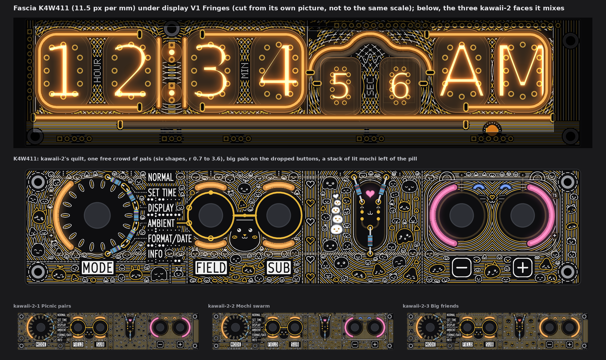
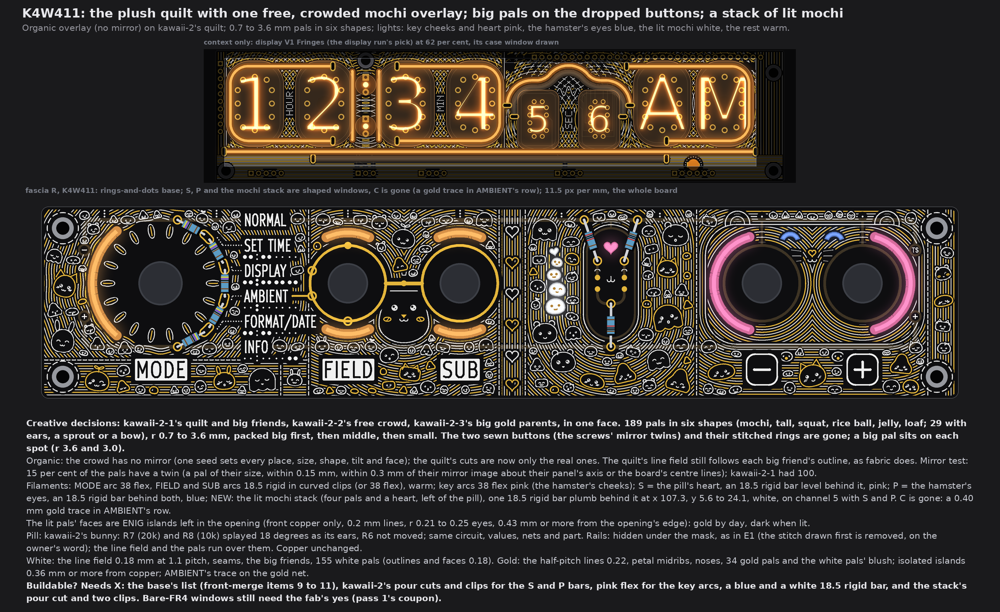
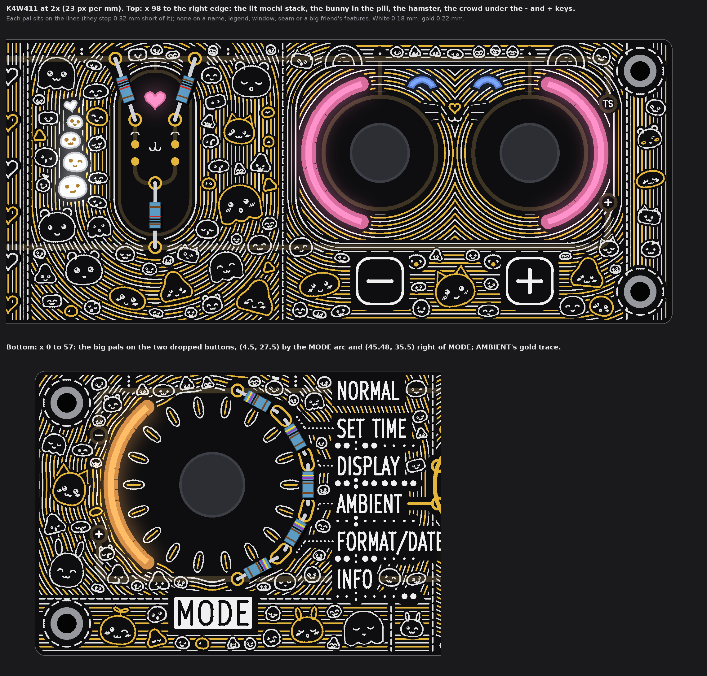
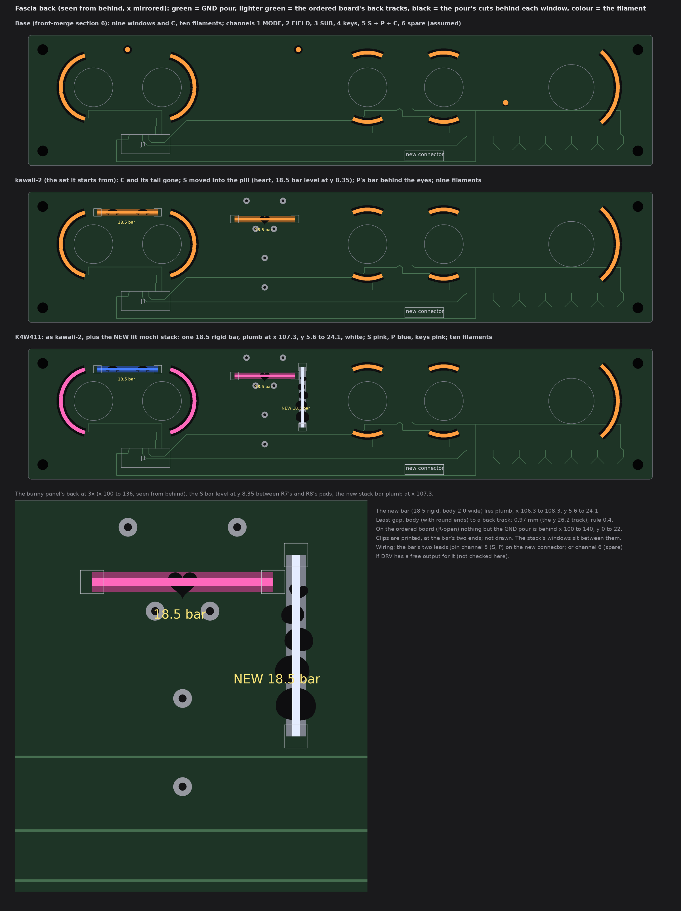

# TS06 fascia K4W411: the final kawaii face (drawings only, nothing built)

2026-10-14, front round 3, run fascia-K4W411. The owner's word (21:5x UTC): "final "K4W411" fascia option: converge on 1 mixing all
three, dropping symmetry for the mochi overlay, the pals are varied in size and shape, its crwded, big ones are covering the
unnecessary standoff mirrors that were used for bacground symmetry (the ones you marked with an x inside the circle) perhaps mochi
light windows are possible? space under the buttons is a bit bare too".

So K4W411 is one face made from the three kawaii-2 faces:
* kawaii-2-1's quilt and big friends (the daisy, the cub, the bunny in the pill, the hamster, the hearts column);
* kawaii-2-2's free crowd and its colours;
* kawaii-2-3's big gold parents.

All characters are my own. The queue changes A1 to A5 are in: no top-edge dots (S and P are shaped windows), the pill and the
rails said below, display V1 Fringes above the face, and the AMBIENT cutout C gone with a gold trace in its row.

The face is fascia R with the owner's rings-and-dots (front-merge section 6), drawn from the board file's copy that pass 4 used,
at one scale (11.5 px per mm), windows lit. No board, schematic, fab, tool, 3D, firmware or spec file was touched. The scripts are
scratch (copies of the kawaii-2 run's), not in the repo. Marks: *measured* is from the drawing's raster (23 px per mm) or the
board file; *inferred* is arithmetic; *assumed* is my reading.

## 1. The face

* **Creative decisions:** kawaii-2's plush quilt under one free, crowded overlay of 189 pals in six shapes, from r 0.7 to 3.6 mm.
  Big pals sit where the two sewn buttons were. A stack of four lit mochi with a lit heart stands left of the pill. The rails are
  hidden.
* **Organic.** The crowd has no mirror: one seed sets every pal's place, size, shape, tilt, face and colour.
  * The quilt's cuts are now only the real ones (round names, legends, windows, screws). kawaii-2 also cut each panel where a
    cut's mirror image fell, and filled two of those cuts with the buttons; both are gone.
  * The quilt's lines still follow each big friend's outline, like the seams of a sewn toy, and the big friends themselves (the
    cub, the bunny, the hamster) keep their own faces. Nothing else on the board is mirrored.
  * *Measured:* 15 per cent of the pals have a twin, meaning a pal of their size (within 0.15 mm) within 0.3 mm of their mirror
    image about their panel's axis or the board's centre lines. These are chance matches in the narrow bands along the edges and
    seams. kawaii-2-1 had 100 per cent.
* **Filaments:**
  * MODE arc: 38 flex, warm. FIELD and SUB arcs: 18.5 rigid in curved clips (or 38 flex), warm.
  * The key arcs (the hamster's cheeks): 38 flex, pink.
  * S: the heart in the pill, one 18.5 rigid bar lying level behind it, **pink**.
  * P: the hamster's closed eyes, one 18.5 rigid bar behind both, **blue** (kawaii-2-2's sleepy blue eyes).
  * **New: the lit mochi stack**, one 18.5 rigid bar, plumb, **white** (section 4).
* **Pill:** as kawaii-2. R7 (20k) and R8 (10k) are splayed 18 degrees out as the bunny's ears; R6 does not move. The circuit,
  values, nets and part do not change (section 5).
* **Rails: hidden** under the mask, as in E1 (section 5).
* **White:** the line field (0.18 mm at 1.1 mm pitch), the seams, the big friends, the screws' stitched rings, and 155 white
  pals (outlines and faces 0.18 mm).
* **Gold:** the half-pitch lines (0.22 mm), the petals' midribs, the noses, 34 gold pals, and the white pals' blush. All are
  isolated islands, 0.36 mm or more from copper. AMBIENT's trace is on the gold net. The lit pals' faces are gold islands inside
  their openings (section 4).
* **Buildable? Needs X:**
  * the base's list (front-merge items 9 to 11);
  * kawaii-2's pour cuts and clip places for the S and P bars;
  * pink flex for the key arcs, a blue 18.5 bar for P, a white 18.5 bar for the stack;
  * the stack's pour cut and two clip places.
  C's cut and tail are dropped.
* **Fab note (once):** bare-FR4 windows still need the fab's yes (pass 1's coupon). Not decided here.

## 2. The dropped buttons, and the big pals on them

kawaii-2 drew a sewn button (a circle with a gold x) and a stitched ring where a screw's mirror image fell inside a panel:
* (4.5, 27.5), the twin of the screw at (4.5, 4.5) across the daisy panel's row y 16;
* (45.48, 35.5), the twin of the screw at (4.5, 35.5) across the MODE hem's axis x 24.99.

Both buttons and both rings are gone, and so is the mirrored cut under them. The two mirror rings in the right edge panel (at x
189.53) go too; the rings round the four real screws stay. The crowd
is packed big first, and these two spots are placed before anything else:
* a big pal of r 3.6 centred on (4.5, 27.5), by the MODE arc's lower end;
* a big pal of r 3.0 at (46.1, 36.2), right of MODE. It is moved 0.9 mm off the old spot to clear the hem's seams, and still
  covers it.

The line field closes round them; the lines stop 0.32 mm short of each pal, as everywhere.

## 3. The crowd: sizes, shapes, and the space under the keys

| Pass | Radius, mm | Gap, mm | Pals | Bodies |
|---|---|---|---|---|
| Big (the two spots first, then up to 18 more) | 2.1 to 3.6 | 0.55 | 20 | gold where copper allows (0.36 mm), else white; most with ears, a sprout or a bow |
| Middle | 1.25 to 2.0 | 0.46 | 79 | white; up to one in three gold |
| Small | 0.74 to 1.15 | 0.36 | 90 | white and gold in turn |

* **Shapes:**

  | Shape | Pals |
  |---|---|
  | round mochi | 74 |
  | rice ball (a soft triangle) | 32 |
  | squat | 31 |
  | tall | 29 |
  | jelly (a round top over a wavy hem) | 10 |
  | loaf (the big ones with cat ears) | 13 |

  29 pals in all have bunny, cat or bear ears, a sprout or a bow.
* **Faces:** the same set as kawaii-1 (dot, happy, sleepy, wink and sparkle eyes; w, u, o, v and 3 mouths). Each pal leans up to
  16 degrees and looks toward its nearest control or big friend. The smallest (r under 1.0) get only dot eyes and a small smile,
  because finer strokes would fall under the silk limit.
* **Where pals may not sit:** a name, legend, plate, map, leader or index dot (0.75 mm calm ground); a window; a seam or a screw's
  ring; the big friends and their features (the cub's head, the bunny's capsule, the hamster's head, ears and paws, the daisy's
  petals, the hearts column).
* **Under the - and + keys:** the band below the hamster's head (x 136.8 to 185.0, y 29.3 to 39.4) is now as full as the rest of
  the board.
  * A gold cat-eared loaf sits between the two key plates, below the paws.
  * Gold and white pals fill both sides of the plates and the strip under them.
  * *Measured:* pals cover 31 per cent of that band's free ground; the board's average is 30 per cent. The rest is the line
    field showing between them.

## 4. The mochi light windows: a lit stack

**What it is:** four mochi pals stand on each other's heads, the biggest at the bottom, with a small lit heart floating above.
Each pal is a window cut to the pal's outline (bare FR4, lit from behind), left of the pill. One new 18.5 rigid bar lies plumb
behind all five windows.

| Window | Centre (mm) | Size (w x h, mm) | Tilt |
|---|---|---|---|
| Pal 1 (bottom) | (107.30, 20.80) | 4.07 x 3.32 | -5 deg |
| Pal 2 | (107.70, 17.27) | 3.49 x 2.84 | +6 deg |
| Pal 3 | (107.00, 14.21) | 2.91 x 2.37 | -4 deg |
| Pal 4 | (107.65, 11.63) | 2.33 x 1.90 | +9 deg |
| Heart | (107.02, 9.47) | 1.92 x 1.83 | -12 deg |

* The windows are 0.45 mm apart: a web of pour and mask between each pal and the next.
* **Their faces are gold islands left inside each opening:** two eyes (r 0.21 to 0.25; one pal winks) and a w or u mouth (0.18
  mm line). They are front copper only, 0.43 mm or more from the opening's edge (*measured*). By day they read gold on pale FR4;
  lit, they block the light and read dark on a white glow.
* **The light:** one 18.5 rigid bar, white, plumb at x 107.3 from y 5.6 to 24.1, on the fascia's back.
  * All five windows lie inside its lit length, taken as 1 mm in from each end (*assumed*).
  * The bottom pal is 4.1 mm wide over a 2.0 mm body, so its sides reach 1.0 mm past the bar. The FR4 spreads the light, so those
    sides read a little dimmer than the core (*assumed*; the bench decides).
* **On the back (*measured* on `R-open`):**
  * behind x 100 to 140, y 0 to 22 there is only the GND pour;
  * the nearest back track is the one at y 26.2, 0.97 mm from the bar's body (with round ends; rule 0.4);
  * the clips sit at the bar's two ends, beyond the windows.
* **Front:** the windows keep 0.68 mm or more from copper and 1.17 mm or more from any legend (the board's least gaps, section 6).

| Change against the base | Filament (sold list), form | Channel | On the fascia's back |
|---|---|---|---|
| C and its tail removed (A5) | none | 5 loses C | C's pour cut closes |
| S moved into the pill (kawaii-2): a 3.0 mm heart at (118.885, 8.35) | one 18.5 rigid bar, level at y 8.35, x 109.64 to 128.13, **pink** | 5 | pour cut under the heart; two clip places |
| P reshaped and moved 1.8 mm down (kawaii-2): the hamster's closed eyes at (156.3, 6.3) and (165.5, 6.3) | one 18.5 rigid bar, level at y 6.3, x 151.65 to 170.15, **blue** | 5 | pour cuts under the eyes; two clip places |
| **New: the lit mochi stack** (five windows above) | one **18.5 rigid bar, white**, plumb at x 107.3, y 5.6 to 24.1 | **5** (with S and P), or 6 | one pour cut under the five windows; two clip places; two leads to the new connector |
| Key arcs recoloured | 38 flex, **pink** | 4 | none |

* **What the new light costs:**
  * one sold part (an 18.5 rigid bar, white), one pour cut and two printed clips;
  * 20 mA at 5 V. The fascia goes back to ten filaments, the base's count (kawaii-2 had nine), so its worst case is the base's
    (*inferred*).
* **Channel:**
  * On channel 5 with S and P, it costs no channel. The stack lights whenever S and P do: they already share that channel, so
    they light together.
  * On channel 6 (the new connector's spare) it could be its own setting, but only if DRV has a free PWM output for it.
    disp-final-2 counts 14 of DRV's 16 for the display; not checked here.
* **The S bar still fits on the pill's back** (*measured*): 1.03 mm to R7's and R8's lower pads, against the 0.4 rule.

**Colours this face ships with:** warm (MODE, FIELD, SUB), pink (the key arcs, S), blue (P) and white (the stack). All are sold:
the 18.5 rigid bar in warm white, white, blue and pink, and the 38 flex in pink. **Warm is still the default** on everything that
says a control's state. The four colours are fixed by which part is fitted; none is a setting.

## 5. The pill and the rails

* **Pill:** kawaii-2's bunny. R7 (20k) and R8 (10k) are splayed 18 degrees out as its ears.
  * The top pads stay on the GND rail, at x 113.31 and 124.47.
  * The bottom pads are at (116.085, 11.33) and (121.685, 11.33).
  * R6 does not move, and the landing dots (the bunny's eyes) do not move.
  * The circuit, values, nets and part type do not change; the route to J1 is as on the ordered board.
  * The heart (S) sits between the ears.
* **Rails: hidden** under the mask, as in E1. The line field runs on over them, and the pals sit on them.
  * Over the rails' copper the quilt's half-pitch gold lines turn white, because gold keeps 0.36 mm off copper. So no bare strip
    is left along either rail.
  * Gold pals keep 0.36 mm from the rails' copper, so the pals that sit on a rail are white.
  * The copper does not change.
* **Changed after the first look (the owner: "rails look a bit wonky, remove them"):** the white running stitch drawn over both
  rails is removed. Nothing else changed: same pals, lights, pill and checks.

## 6. The checks (*measured* on the raster, 23 px per mm)

| Check | Rule | K4W411 |
|---|---|---|
| White, gold to a name, plate, key legend, tube map, leader or index dot | 0.75 | 0.78, 0.80 |
| White, gold to E1's exposed gold (rings, link, marks, pads, AMBIENT's trace) | 0.30 (frame 0.75 drawn) | 0.75, 0.75 |
| Pattern gold to copper | 0.30 | 0.36 |
| White, gold to a lit window | 0.35 | 0.39, 0.39 |
| White to the pattern's gold | 0.30 | 0.31 |
| Lit window to copper; to a legend | 0.30 | 0.68; 1.17 |
| Lit pals' gold faces to their opening's edge | 0.30 | 0.43 |
| AMBIENT's trace to a legend; to other copper | 0.75; 0.30 | 0.78; 10.0 |
| The new bar's body to a back track | 0.40 | 0.97 |
| Free board within 1.2 mm of some ink | (no empty space) | 97.5 % |
| Pals: all (gold); big, middle, small | | 189 (34); 20, 79, 90 |

What stays dark, as in kawaii-2, is the inside of the cub's head and the bunny's capsule, and the ring of mask between each knob
and its window.

## 7. Left open, assumed

* *Assumed:* the S, P and stack bars are the shortest sold rigid bars (18.5). Their lit length is 1 mm short of each end.
* *Assumed:* the white bar reads as rice-white, not blue-white; the bench decides. If not, the stack takes warm white (no other
  change).
* The rearranged pill, the moved S and P and the new stack are drawn on the art model's places (E1). On the ordered board
  (`R-open`), R6 to R8 are still 1206 parts on the back; the board-change run places them.
* The pattern's gold and the lit pals' faces are isolated islands (no net). Stems to GND can be added if the fab wants no floating
  copper; not drawn.
* The smallest strokes (0.15 to 0.18 mm silk) are at the fab's silk limit used before (0.15).
* Not checked: KiCad DRC (no board file was edited), and whether DRV has a free output for channel 6.
