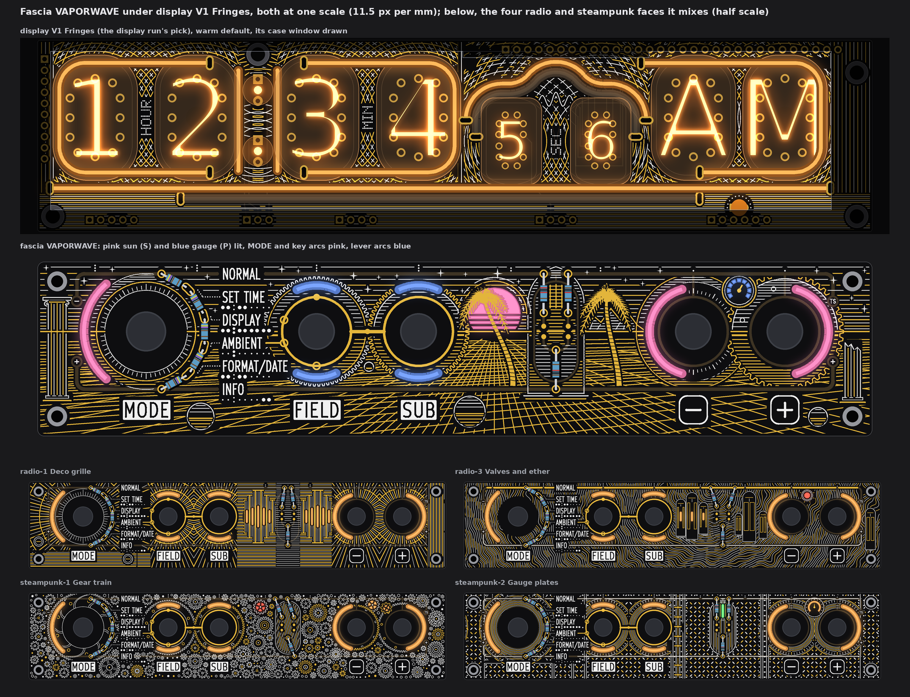
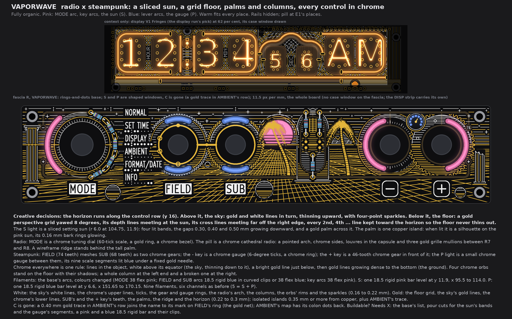
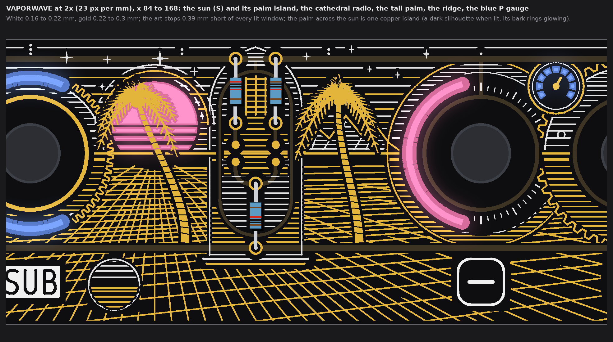
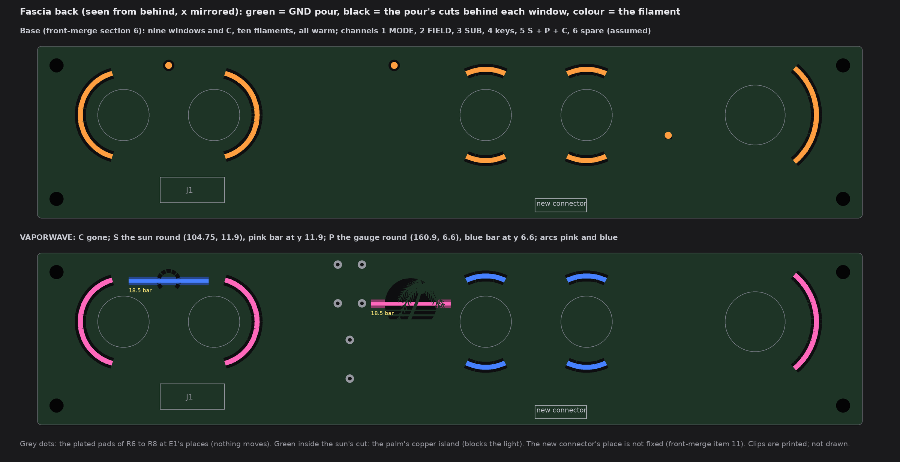

# TS06 fascia, VAPORWAVE: radio and steampunk mixed into one final face (drawings only, nothing built)

2026-10-14, run fascia-VAPORWAVE. The owner's words (22:2x UTC): "mix radio and steampunk for a final VAPORWAVE fascia option". One
face, wild, the whole board full. It starts from `TS06-FASCIA-radio.md` and `TS06-FASCIA-steampunk.md` and their faces:
* radio gives the tuning dial, the deco grille in a cathedral radio, and the wireframe ridge;
* steampunk gives the meshed gears and the gauges;
* the vaporwave idiom gives the rest: a sliced setting sun, a perspective grid floor to a horizon, palms and columns, chrome objects,
  and pink and blue light.

Queue changes A1 to A5 are in:
* no top-edge dots: S and P light shaped windows (the sun and a gauge);
* the pill and the rails are said below;
* display V1 Fringes is in the strip above the face and above it on the contact sheet;
* the AMBIENT cutout C is gone, with a gold trace in its row.

The face is fascia R with the owner's rings-and-dots (front-merge section 6), drawn from the board file's copy that pass 4 used, at
one scale (11.5 px per mm), windows lit. No board, schematic, fab, tool, 3D, firmware or spec file was touched. The scripts are scratch
(copies of the radio and steampunk runs' base and checks, plus a new vaporwave script), not in the repo.

Marks: *measured* is from the drawing's raster (23 px per mm) or the board file; *inferred* is arithmetic; *assumed* is my reading.

## 1. What the face keeps

* **Fixed:** the outline, holes, controls and their places, J1, the names, plates, key legends, tube maps, dot leaders and the
  top-edge tube index; FIELD's and SUB's gold rings, the link, the four SUB marks on FIELD's ring and the GND via.
* **Info first:**
  * every name, legend, map and leader keeps 0.78 mm of calm ground (rule 0.75);
  * E1's gold keeps its 0.75 frame;
  * no art crosses a legend.
* **No text** is added. The face has no numbers, no brands, no logos, no characters and no product or operating-system artwork. The
  palms, columns, sun, grid, gears, gauges and radio are generic shapes drawn for this face.
* **The AMBIENT cutout is gone (A5),** as in the radio and steampunk faces:
  * window C at (45.04, 21.2) and its tail are removed;
  * AMBIENT's tube map gets back its two colon dots;
  * a **0.40 mm gold trace** runs level at y 18.645 from x 52.43 to 55.75, into the outer edge of AMBIENT's mark on FIELD's ring. So
    it is on the gold net, which ties to GND through the link's via.
  * *Measured:* 0.78 from the name and the map, 10.0 from other copper, 0.78 from the art.
* **Channels on the new fascia connector** (J1 is full; front-merge items 10 and 11), grouping *assumed* as the earlier runs':
  1 MODE, 2 FIELD up + down, 3 SUB up + down, 4 the two keys, **5 S + P (C dropped)**, 6 spare. Nothing comes from DISP. The face adds
  no filament, so the six channels hold. A colour does not take a channel: each filament has one colour.
* **5 V:** nine fascia filaments instead of ten, so 20 mA less than the base at 20 mA each (*inferred*).
* **Fab note (once):** bare-FR4 windows still need the fab's yes (pass 1's coupon), and so does the fine copper island left inside
  the sun's window (section 2). Not decided here.

## 2. The face

* **Creative decisions (one line):** a sunset scene on the control row: a pink sliced sun (S) behind a gold palm, a gold perspective
  grid floor, a lined sky with sparkles, and every control a chrome object: MODE a tuning dial, FIELD and SUB meshed gears, - a
  gauge, + a gear, P a small gauge lit blue, the pill a cathedral radio.
* **Fully organic.** Nothing in the art mirrors:
  * the sun stands 9 mm right of the board's centre;
  * the grid is yawed 8 degrees, so its cross lines meet far off the right edge, not at the sun;
  * the two palms differ in height, lean and fronds;
  * the four chrome orbs have four sizes (r 1.05 to 3.55) and free places;
  * a whole column stands at the left end and a broken one at the right;
  * the - key is a gauge and the + key a gear.
* **The scene:**
  * **The horizon** is a 0.3 mm gold line along the control row (y 16), behind every control.
  * **The sky** above it: gold and white lines in turn, 0.6 mm apart at the horizon and thinning to about 1.6 mm at the top edge, with
    28 four-point sparkles in white.
  * **The floor** below it: a gold perspective grid. Its depth lines meet at the sun. Toward the horizon (and where the cells grow
    thin at the far left) every 2nd, 4th ... line stays, so the floor never thins out. Lines keep 0.5 to 0.62 mm apart.
  * **A wireframe ridge** (radio's grid in relief) stands on the horizon behind the tall palm: a gold ridge line, white terrace lines
    and white facet lines.
  * **The sun (the S light)** is a disc r 6.0 at (104.75, 11.9) cut off at the horizon. It is lit in four bands, and the mask gaps
    between them grow downward (0.30, 0.40 and 0.50 mm). White and gold halo arcs ring its top half.
  * **A gold palm stands across the sun.** It is one copper island, drawn over the sun's cut. When lit, it is a silhouette on the
    pink sun, and its 0.16 mm bark rings glow as thin lines. *Measured:* the cut is 84.7 mm², 58.5 mm² of it lit, 26.2 mm² behind the palm.
  * **A taller gold palm** stands right of the radio, and a whole and a broken column frame the ends (white outlines, flutes white and
    gold in turn, volutes on the whole one). The trunks stop above the +5V rail, since the rails stay under the mask.
* **The chrome objects** follow one rule (80s chrome):
  * lines run across the object;
  * above its equator they are white, dense at the top and thinning down to it (the sky);
  * just below it there is a bright gold line;
  * below that, gold lines grow dense to the bottom (the ground).
  * **MODE, a chrome tuning dial (radio):** a 60-tick scale with longer ticks every 30 degrees, a gold ring, a chrome bezel and a
    white rim. The MODE arc still closes the bezel on the left.
  * **FIELD and SUB, two meshed chrome gears (steampunk):** 74 and 68 teeth on one module, their pitch circles meeting at the link.
    FIELD has white teeth and a gold inner ring; SUB has gold teeth and a white inner ring. The lever arcs cut through the gears' webs.
  * **The - key, a chrome gauge:** 6-degree ticks with longer ones every 30, a chrome ring and a gold rim.
  * **The + key, a 46-tooth chrome gear** standing in front of the - key's ring, with six lightening holes in its web.
  * **The P light, a small chrome gauge** at (160.9, 6.6): nine scale segments lit blue, a fixed gold needle, a white and a gold
    bezel.
  * **Four chrome orbs** on the floor, each with a shadow (the grid stops in a flat ellipse below it).
* **Pill: E1's places, nothing moves; the circuit is unchanged.** The pill is drawn as a chrome cathedral radio:
  * a pointed arch over the capsule and chrome sides;
  * louvres inside the capsule at 0.78 mm pitch: gold and white in turn above y 19.5, white below (the gold stops 0.35 short of the
    pads, dots and the A7 bus);
  * three gold grille mullions between R7 and R8;
  * a white and gold plinth below.
* **Rails: hidden** under the mask, as the owner asked of kawaii-2's rails ("remove them"). The art runs over them; gold keeps 0.35 off
  the copper.
* **Filaments** (the base's layout; colours changed, sold list front-merge section 5):
  * the MODE arc: 38 flex, **pink**;
  * FIELD's and SUB's four arcs: 18.5 rigid **blue** in curved clips, or 38 flex blue;
  * the two key arcs: 38 flex, **pink**;
  * **S, the sun:** one 18.5 rigid **pink** bar, level at y 11.9, x 95.5 to 114.0;
  * **P, the gauge:** one 18.5 rigid **blue** bar, level at y 6.6, x 151.65 to 170.15.
  * **Warm stays possible** on every one: the same places take warm white bars or yellow flex in the same clips. The art does not
    change.
* **White (one line):** the sky's white lines, the chrome's upper lines, ticks, gear and gauge rings, the radio's arch, the columns,
  the orbs' rims, the ridge's terraces and the sparkles (0.16 to 0.22 mm); 263 mm² (*measured*).
* **Gold (one line):** the floor grid, the sky's gold lines, the chrome's lower lines, SUB's and the + key's teeth, the palms, the
  ridge, the horizon and the gauge's needle (0.22 to 0.3 mm lines, the palms as fills); 826 mm² (*measured*). All are isolated islands
  0.35 mm or more from copper, plus AMBIENT's trace on the gold net.
* **Buildable? Needs X:**
  * the base's list (front-merge items 9 to 11);
  * pour cuts for the sun's four bands (the palm's island left inside the cut) and the gauge's nine segments;
  * a pink and a blue 18.5 rigid bar and two clip pairs;
  * pink and blue arcs instead of warm.

## 3. The light base and what the face changes

| Change against the base | Filament (sold list), form | Channel | On the fascia's back |
|---|---|---|---|
| **C and its tail removed** (A5) | none | 5 loses C | C's pour cut closes |
| **S**: the dot (108.6, 4.5) becomes the sliced sun round (104.75, 11.9), moved 3.85 left and 7.4 down | 18.5 rigid **pink**, level at y 11.9, x 95.5 to 114.0 | 5 | 4 band cuts with the palm's copper left inside, 2 clips |
| **P**: the dot (160.9, 4.5) becomes the gauge's nine segments round (160.9, 6.6), 2.1 down | 18.5 rigid **blue**, level at y 6.6, x 151.65 to 170.15 | 5 | 9 segment cuts, 2 clips |
| MODE arc colour | 38 flex **pink** (was warm) | 1 | none |
| FIELD and SUB arcs colour | 18.5 rigid **blue** in curved clips, or 38 flex blue (was warm) | 2, 3 | none |
| Key arcs colour | 38 flex **pink** (was warm) | 4 | none |

**Colours the face ships with:** pink + blue (the ice set's blue and the rose set's pink, front-merge section 5). No warm filament,
but warm fits every place.

**Bar fit, *measured*** on the art model and the ordered board (`R-open`):

| Bar (body 2.0 wide) | To R6 to R8's plated pads (rule 0.4) | To a lever's or key's footprint (r 6.2) | To a back track | Vias near |
|---|---|---|---|---|
| S, the sun | 1.14 (R7's lower pad, 116.09, 11.77) | 2.50 | 12.3 | none |
| P, the gauge | 29.2 | 2.29 | 15.3 | none |

R6 to R8 are 1206 parts elsewhere on the ordered board, so the pad gaps above are the art model's (E1's through-hole places).

## 4. The checks (*measured* on the raster, 23 px per mm)

| Check | Rule | VAPORWAVE |
|---|---|---|
| White, gold to a name, plate, key legend, tube map, leader or index dot | 0.75 | 0.80, 0.78 |
| White, gold to E1's exposed gold (rings, link, marks, pads, AMBIENT's trace) | 0.30 (frame 0.75 drawn) | 0.74, 0.74 |
| Pattern gold to copper | 0.30 | 0.35 |
| White, gold to a lit window | 0.35 | 0.39, 0.39 |
| White to the pattern's gold | 0.30 | 0.31 |
| Lit window to copper; to a legend | 0.30 | 0.65; 1.17 |
| AMBIENT's trace to a legend; to other copper | 0.75; 0.30 | 0.78; 10.0 |
| The palms' gold to copper; to a legend; to another window | 0.30; 0.75; 0.35 | 0.39; 2.98; 3.26 |
| Free board within 1.2 mm of some ink | (no empty space) | 98.8 % |

* White over the masked rails and lugs is allowed, as in E1, so white to copper reads 0.
* What stays dark is the ring of mask between each knob and its window, and the orbs' shadows.
* The palm across the sun is inside the sun's cut by design (section 2), so it is left out of the "to a lit window" row.

## 5. Left open, assumed

* *Assumed:* the S and P lights are 18.5 rigid bars (the shortest sold), held in printed clips at their ends.
* *Assumed:* the sun's top band (6.15 mm tall) lights evenly enough from a 2.0 mm bar across its middle. The bench decides. If its top
  is dimmer, it reads as the sun's own gradient.
* *Assumed:* the pink and blue filaments run from the same series resistor as the warm ones. Their forward voltage may differ; the
  bench sets the current.
* The palm across the sun is front copper (ENIG) on bare FR4 inside the window. Its leaflets are 0.16 to 0.34 mm wide and its bark
  rings are 0.16 mm gaps. Both are at the fine end of the fab's copper rules; the fab's yes covers it with the windows.
* The pattern's gold is isolated islands (no net). Stems to GND can be added if the fab wants no floating copper; not drawn.
* The smallest strokes (0.16 mm silk) are at the fab's silk limit used before (0.15).
* Not checked: KiCad DRC (no board file was edited).
