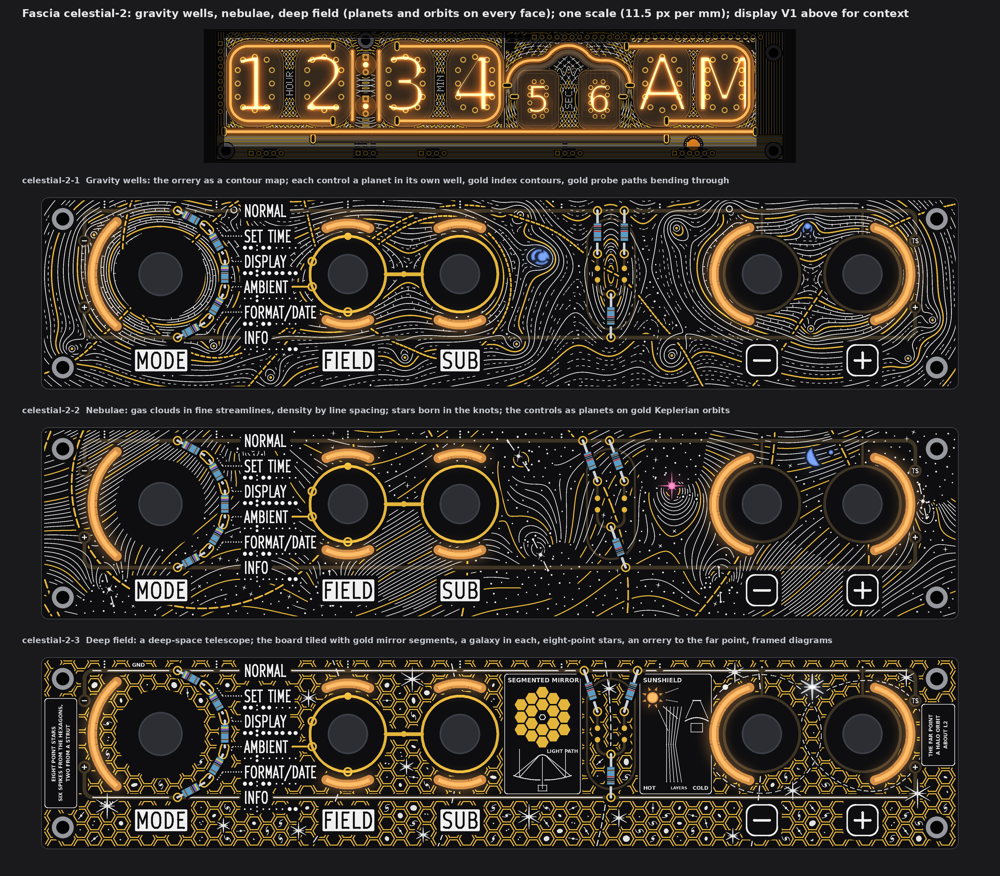
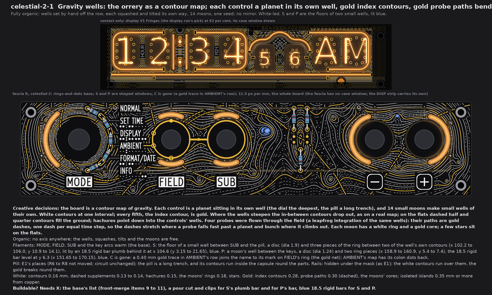
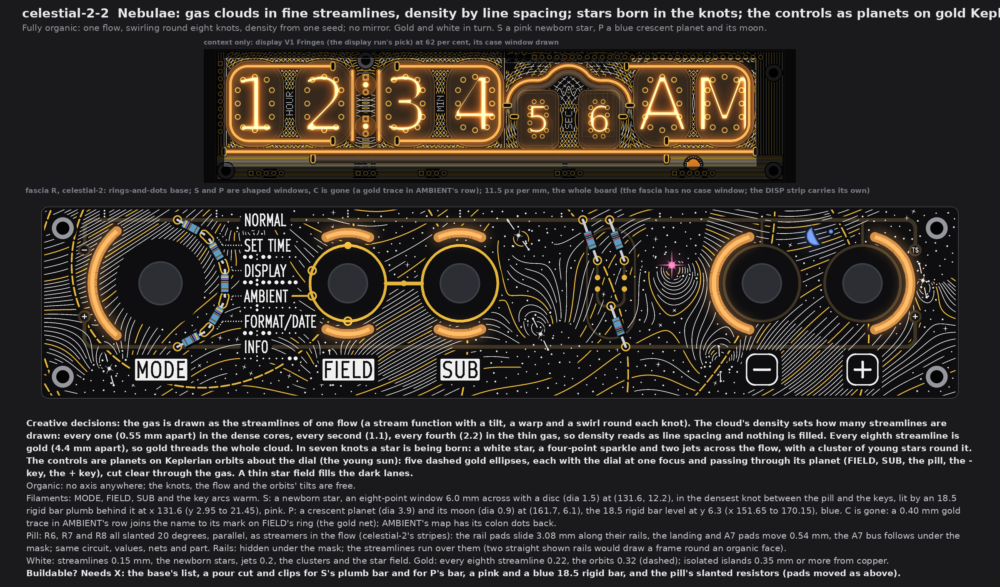
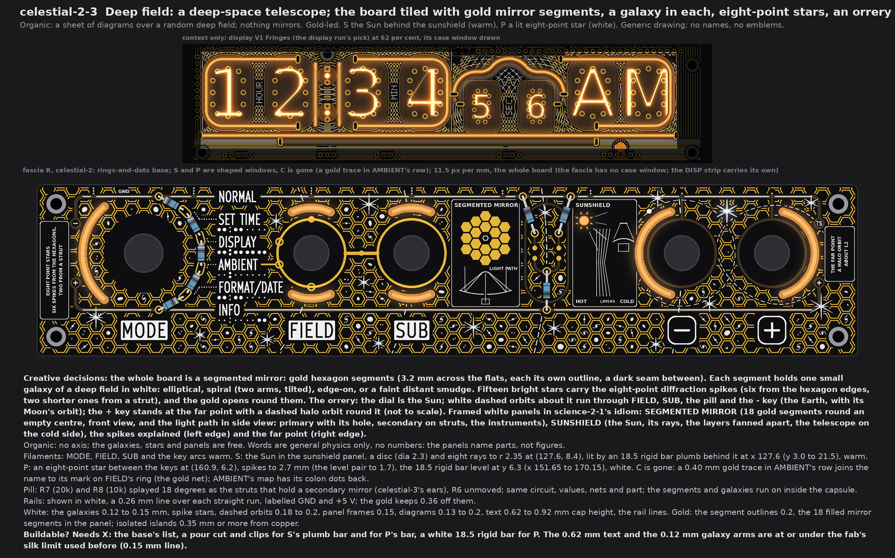
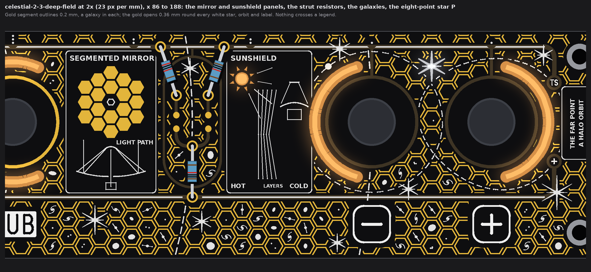
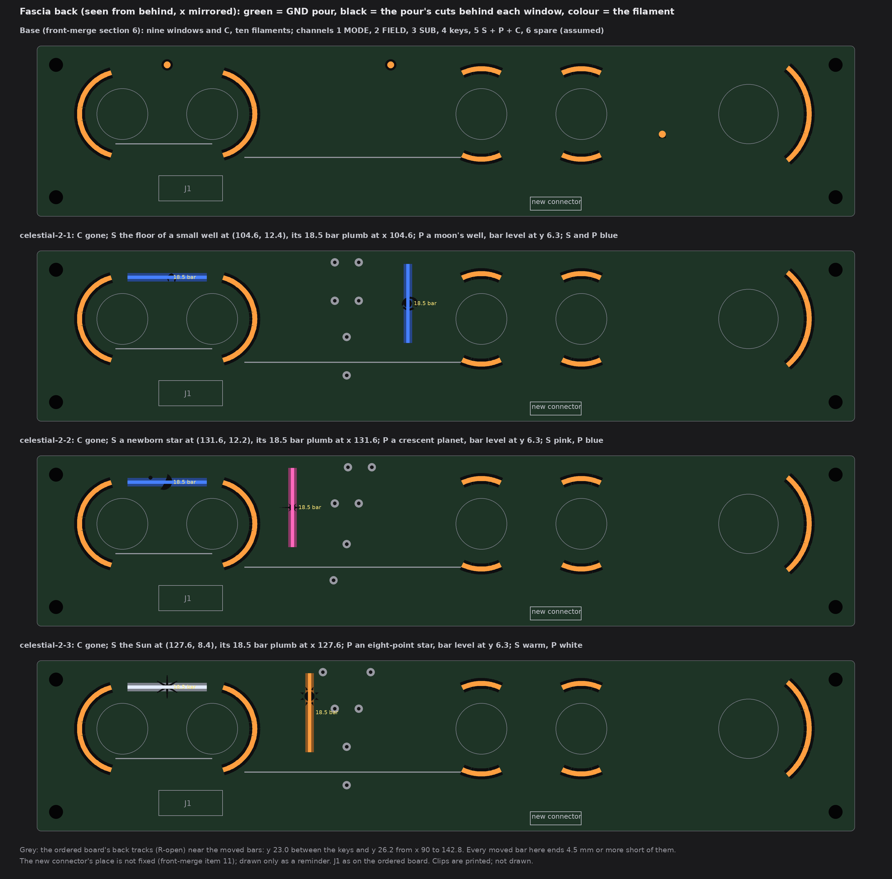

# TS06 fascia, celestial-2: gravity wells, nebulae, deep field (drawings only, nothing built)

2026-10-14, front round 3, run fascia-celestial-2. The owner's word: "do more variants on celestial with planets and orbits, mix
celestial2 with science 2-2, nebulaes, mix with science 2-1 for a james webb take maybe". Three wild faces of fascia R that cover the
whole board. Every face has planets and orbits, with celestial-2 Orrery as the lead. They differ in motif, white-led or gold-led,
the pill, the rails and the colours, not in how busy they are. celestial-3 Sundials stays final; the first set
(`TS06-FASCIA-celestial.md`) stays as history.

The queue changes are in on every face:
* A1: no top-edge dots. S and P are shaped windows in each face's own forms.
* A2: the pill is said per face.
* A3: the rails are said per face.
* A4: display V1 Fringes is in the strip above each face.
* A5: AMBIENT's cutout C is gone, with a gold trace in its row.

Each face is fascia R with the owner's rings-and-dots (front-merge section 6), drawn from the board file's copy that pass 4 used, at
one scale (11.5 px per mm), windows lit. No board, schematic, fab, tool, 3D, firmware or spec file was touched. The scripts are
scratch (copies of celestial's and science-2's), not in the repo.

Marks:
* *measured*: from the drawing's raster (23 px per mm) or the board file;
* *inferred*: arithmetic;
* *assumed*: my reading.

## 1. What every face keeps

* **Fixed:**
  * the outline, holes, controls and their places, and J1;
  * the names, plates, key legends, tube maps, dot leaders and the top-edge tube index;
  * FIELD's and SUB's gold rings, the link, the four SUB marks on FIELD's ring and the GND via.
* **Info first:**
  * Every name, legend and map keeps a calm ground of 0.78 mm or more (rule 0.75).
  * E1's gold keeps a calm frame of 0.74 mm.
  * Nothing crosses a legend. On celestial-2-3, the face's own words stand on framed calm panels.
* **AMBIENT (A5):** window C and its tail are removed, and AMBIENT's map gets back its two colon dots. In AMBIENT's row, a 0.40 mm
  gold trace runs level at y 18.645, from x 52.43 to 55.75, to the outer edge of AMBIENT's mark on FIELD's ring (the gold net), as
  in kawaii-2 and celestial.
* **Planets and orbits on every face:**
  * 2-1: the controls are planets in wells, with probes' paths bending past them.
  * 2-2: the controls are planets on Keplerian orbits about the dial.
  * 2-3: the dial is the Sun, with orbits through the controls and a halo orbit at the far point.
* **Channels on the new fascia connector** (J1 is full; front-merge items 10 and 11), grouping *assumed* as the earlier runs':
  * 1 MODE;
  * 2 FIELD up + down;
  * 3 SUB up + down;
  * 4 the two keys;
  * 5 S + P (C dropped);
  * 6 spare.

  Nothing comes from DISP. No face adds a channel.
* **5 V:** nine fascia filaments instead of ten, so the load is 20 mA less than the base (*inferred*).
* **Fab note (once):** bare-FR4 windows still need the fab's yes (pass 1's coupon). Not decided here.

## 2. celestial-2-1 Gravity wells (Orrery x Terrain)

* **Creative decisions:** the board is a contour map of gravity.
  * **The wells:** each control is a planet in its own well. The dial's well is the deepest, and the pill is a long trench. 14
    small moons make small wells of their own.
  * **The contours:** white at one interval, with every fifth (the index contour) in gold.
    * Where the wells steepen, the in-between contours drop out, as on a real map.
    * On the flats, dashed half and quarter contours fill the ground.
    * Hachures point down into the controls' wells.
  * **The orbits bending through:** four probes were flown through the same wells (a leapfrog integration of the drawn field).
    * Their paths are gold dashes, one dash per equal time step.
    * So the dashes stretch where a probe falls fast past a planet, and bunch where it climbs out.
  * **The moons:** each has a white ring and a gold core. A few stars sit on the flats.
* **Fully organic:** the wells' depths, squashes and tilts are set by hand off the row. The moons and stars come from one seed.
  Nothing mirrors.
* **Filaments:** MODE, FIELD, SUB and the key arcs are warm (the base). S and P are lit **blue**.
  * **S (moved):** the floor of a small well between SUB and the pill. It is a disc (dia 1.9) and three pieces of the ring
    between two of the well's own contours, x 102.2 to 106.0, y 10.9 to 14.1. An **18.5 rigid bar, blue**, stands plumb behind
    it at x 104.6, y 3.15 to 21.65.
  * **P (reshaped):** a moon's well between the keys. It is a disc (dia 1.24) and two ring pieces, x 158.9 to 160.9, y 5.4 to
    7.4. An **18.5 rigid bar, blue**, lies level at y 6.3, x 151.65 to 170.15 (kawaii-2's place).
* **Pill:** E1's places. R6 to R8 are not moved; the circuit is unchanged. The trench's contours run inside the capsule, round
  the parts.
* **Rails: hidden** under the mask, as in E1. The white contours run over them, and the gold breaks round them.
* **White:** contours (0.16 mm), dashed supplements (0.13 to 0.14), hachures (0.15), the moons' rings (0.18), stars.
* **Gold:** index contours (0.28), the probes' dashes (0.30), the moons' cores. All are isolated islands, 0.35 mm or more from
  copper, plus AMBIENT's trace.
* **Buildable? Needs X:**
  * the base's list (front-merge items 9 to 11);
  * a pour cut and clips for S's plumb bar and for P's bar;
  * two blue 18.5 rigid bars.

## 3. celestial-2-2 Nebulae

* **Creative decisions:** gas clouds drawn as the streamlines of one flow: a stream function with a tilt, a slow warp and a swirl
  round each of eight knots.
  * **Density by line spacing:** the cloud's density sets how many streamlines are drawn.
    * In the dense gas, every one is drawn (0.55 mm apart).
    * In thinner gas, every second (1.1) or every fourth (2.2).
    * Nothing is filled, so no blotches.
  * **Gold:** every eighth streamline is gold (4.4 mm apart), so gold threads the whole cloud.
  * **Stars born in the clouds:** in seven knots, a star is being born. Each is a white star with a four-point sparkle and two
    jets across the flow, inside a cluster of young stars. A thin star field fills the dark lanes.
  * **Planets and orbits:** the controls are planets on five dashed gold Keplerian orbits about the dial (the young sun). Each
    ellipse has the dial at one focus and passes through its planet: FIELD, SUB, the pill, the - key and the + key. The gas and
    the stars are cut clear 0.42 mm either side of each orbit, so the orbits run in dark lanes.
* **Fully organic:** the knots, the flow and the orbits' tilts are free, from one seed. Nothing mirrors.
* **Filaments:** MODE, FIELD, SUB and the key arcs are warm.
  * **S (moved):** a newborn star in the densest knot between the pill and the keys. It is an eight-point window, 6.0 mm across,
    with a disc (dia 1.5) at (131.6, 12.2). An **18.5 rigid bar, pink**, stands plumb behind it at x 131.6, y 2.95 to 21.45.
  * **P (reshaped):** a crescent planet (dia 3.9) with its moon (dia 0.9) at (161.7, 6.1). An **18.5 rigid bar, blue**, lies
    level at y 6.3, x 151.65 to 170.15.
* **Pill:** R6, R7 and R8 all slant 20 degrees, parallel, as streamers in the flow (celestial-2's stripes).
  * The rail pads slide 3.08 mm along their rails.
  * The landing pads and R6's A7 pad move 0.54 mm, and the A7 bus follows under the mask.
  * The circuit, values, nets and part do not change.
* **Rails: hidden** under the mask. The streamlines run over them. Two straight rails shown would draw a frame round an organic face
  (tried in gold, dropped).
* **White:** streamlines (0.15 mm), the newborn stars, jets (0.2), clusters and the star field.
* **Gold:** every eighth streamline (0.22, unbroken across the board) and the orbits (0.32, dashes 1.7 on, 0.65 off). All are
  isolated islands, 0.35 mm or more from copper, plus
  AMBIENT's trace.
* **Buildable? Needs X:**
  * the base's list;
  * a pour cut and clips for S's plumb bar and for P's bar;
  * a pink and a blue 18.5 rigid bar;
  * the pill's slanted resistors, with the pads moved as above (the board-change run places them).

## 4. celestial-2-3 Deep field (a deep-space telescope; Orrery x Nixie tech)

* **Creative decisions:**
  * **The mirror:** the whole board is tiled with gold hexagon segments, 3.2 mm across the flats. Each segment has its own outline,
    with a dark seam between neighbours.
  * **The deep field:** each segment holds one small galaxy in white: elliptical, a two-armed spiral at a tilt, edge-on, or a faint
    distant smudge.
  * **Eight-point stars:** fifteen bright stars carry the diffraction spikes: six from the hexagon edges and two shorter level ones
    from a strut. The gold opens round them.
  * **The orrery:**
    * The dial is the Sun. White dashed orbits about it run through FIELD, SUB, the pill and the - key.
    * The - key is the Earth, with its Moon's orbit and the Moon.
    * The + key stands at the far point, with a dashed halo orbit round it.
    * Not to scale; nothing printed claims a scale.
  * **Framed white panels**, in science-2-1's idiom:
    * **SEGMENTED MIRROR:** 18 gold segments round an empty centre (front view), with the secondary as a white hexagon. Under it,
      the LIGHT PATH in side view: the primary with its hole, the secondary on struts, rays in, and the instruments behind.
    * **SUNSHIELD:** the Sun (S, lit), its rays, the layers fanned apart, and the telescope on the cold side, marked HOT, LAYERS,
      COLD.
    * **Left edge:** "EIGHT-POINT STARS: SIX SPIKES FROM THE HEXAGONS, TWO FROM A STRUT".
    * **Right edge:** "THE FAR POINT: A HALO ORBIT ABOUT L2".
  * **Generic drawing:** no agency, mission or maker names, no logos or emblems. The words are general optics and orbits, with no
    numbers.
* **Organic:** a sheet of panels over a random deep field. Nothing mirrors.
* **Filaments:** MODE, FIELD, SUB and the key arcs are warm.
  * **S (moved):** the Sun in the sunshield panel. It is a disc (dia 2.3) with eight rays to r 2.35, at (127.6, 8.4). An **18.5
    rigid bar, warm**, stands plumb behind it at x 127.6, y 3.0 to 21.5.
  * **P (reshaped):** an eight-point star between the keys, at (160.9, 6.2). Its spikes reach 2.7 mm, and the level pair 1.7 mm.
    An **18.5 rigid bar, white**, lies level at y 6.3, x 151.65 to 170.15.
* **Pill:** R7 (20k) and R8 (10k) splay 18 degrees as the struts that hold a secondary mirror (celestial-3's ears). R6 does not
  move. The circuit, values, nets and part do not change. The segments and galaxies run on inside the capsule.
* **Rails: shown in white.** A 0.26 mm line runs over each straight run, labelled GND and +5 V, as in science-2-1. The gold keeps
  0.36 mm off them. The copper does not change.
* **White:** galaxies (0.12 to 0.15 mm), spike stars, dashed orbits (0.18 to 0.2), panel frames (0.15), diagrams (0.13 to 0.2),
  text (0.62 to 0.92 mm cap height), the rail lines.
* **Gold:** segment outlines (0.2) and the 18 filled mirror segments in the panel. All are isolated islands, 0.35 mm or more from
  copper, plus AMBIENT's trace.
* **Buildable? Needs X:**
  * the base's list;
  * a pour cut and clips for S's plumb bar and for P's bar;
  * a white 18.5 rigid bar.
  * The smallest text (0.62 mm) and the galaxies' arms (0.12 to 0.13 mm) are under the fab's silk limit used before (0.15 mm
    line); the arms would print as 0.15.

## 5. The light base and what each face changes

| Change against the base | Face | Filament (sold list), form | Channel | On the fascia's back |
|---|---|---|---|---|
| **C and its tail removed** (A5) | all | none | 5 loses C | C's pour cut closes |
| **S: a well's lit floor at (104.6, 12.4)**, 4.0 left of and 7.9 below the old dot | 2-1 | 18.5 rigid, blue, plumb at x 104.6, y 3.15 to 21.65 | 5 | a pour cut under the window; clips at the bar's ends |
| **P: a moon's lit well** at (159.9, 6.0) | 2-1 | 18.5 rigid, blue, level at y 6.3, x 151.65 to 170.15 | 5 | a pour cut; clips (kawaii-2's place) |
| **S: a newborn star at (131.6, 12.2)**, 23.0 right of and 7.7 below the old dot | 2-2 | 18.5 rigid, pink, plumb at x 131.6, y 2.95 to 21.45 | 5 | a pour cut; clips |
| **P: a crescent planet and its moon** at (161.7, 6.1) | 2-2 | 18.5 rigid, blue, level at y 6.3 | 5 | a pour cut; clips (kawaii-2's place) |
| **S: the Sun at (127.6, 8.4)**, 19.0 right of and 3.9 below the old dot | 2-3 | 18.5 rigid, warm, plumb at x 127.6, y 3.0 to 21.5 | 5 | a pour cut; clips |
| **P: an eight-point star** at (160.9, 6.2) | 2-3 | 18.5 rigid, white, level at y 6.3 | 5 | a pour cut; clips (kawaii-2's place) |

**Colours each face ships with** (all on the sold lists):
* celestial-2-1: warm + blue;
* celestial-2-2: warm + pink + blue;
* celestial-2-3: warm + white.

**Do the moved bars fit on the back?**
* Every bar clears the plated pads of R1 to R8 (body 2.0 wide, pad r 0.95; rule 0.4), with each face's own pill arrangement.
  *Measured* least gaps:

  | Bar | Least gap | To |
  |---|---|---|
  | 2-1 S, plumb at x 104.6 | 9.5 | R7's lower pad |
  | 2-1 P, level at y 6.3 | 28.2 | |
  | 2-2 S, plumb at x 131.6 | 8.0 | R8's lower pad (slanted) |
  | 2-2 P | 28.4 | |
  | 2-3 S, plumb at x 127.6 | 1.19 | R8's upper pad, splayed out to (124.47, 2.77) |
  | 2-3 P | 25.5 | |
* **The back's copper on the ordered board** (`R-open`, every B.Cu track, via and back part), with the bar as a 2.0 mm body with
  round ends:
  * The three plumb S bars come no nearer than 3.4 mm (2-1), 3.6 mm (2-2) and 3.6 mm (2-3) to the back track at y 26.2 (x 90 to
    142.8). Their ends stop 4.55 to 4.75 mm above it.
  * The level P bar (kawaii-2's place, all three faces) is 15.6 mm from the back track at y 23.0 between the keys.
  * *Assumed:* a clip adds no more than 0.5 mm at a bar's end.
* Each plumb bar is 17 mm or more from the nearest lever or key centre, outside every footprint's courtyard.

## 6. The checks (*measured* on the raster, 23 px per mm)

| Check | Rule | celestial-2-1 | celestial-2-2 | celestial-2-3 |
|---|---|---|---|---|
| White, gold to a name, plate, key legend, tube map, leader or index dot | 0.75 | 0.78, 0.78 | 0.78, 0.78 | 0.78, 0.78 |
| White, gold to E1's exposed gold (rings, link, marks, pads, AMBIENT's trace) | 0.30 (frame 0.75 drawn) | 0.74, 0.74 | 0.74, 0.74 | 0.76, 0.74 |
| Pattern gold to copper | 0.30 | 0.35 | 0.35 | 0.35 |
| White, gold to a lit window | 0.35 | 0.39, 0.39 | 0.36, 0.39 | 0.40, 0.35 |
| White to the pattern's gold | 0.30 | 0.31 | 0.31 | 0.31 |
| Lit window to copper; to a legend | 0.30 | 0.68; 1.17 | 0.68; 1.17 | 0.35; 1.17 |
| Free board within 1.2 mm of some ink | (no empty space) | 99.9 % | 98.7 % | 96.7 % |
| Ink area, white / gold (mm²) | | 536 / 235 | 373 / 162 | 291 / 736 |

* celestial-2-3's 0.35 window-to-copper is P's top spike to the GND rail (y 2.77).

* White over the masked rails is allowed (E1's rule). So the white's least distance to masked copper is 0; to exposed gold it is as
  in the table.
* The face's own words on celestial-2-3 stand inside the allowed ground: 0 text pixels off it (*measured*).
* What stays dark: the inside of each knob's ring, the ring of mask between each knob and its window, and on celestial-2-3 the calm
  ground inside the panels.

## 7. My pick

**celestial-2-3 Deep field.** It is the boldest of the three: the whole board reads as one gold segmented mirror full of galaxies
and eight-point stars, its panels teach how the telescope works, and the orrery runs from the Sun at the dial to the far point at
the + key. celestial-2-1 Gravity wells is the pick if the owner wants the orrery and the terrain map as one picture without words;
celestial-2-2 Nebulae is the softest and most painterly.

## 8. Left open, assumed

* *Assumed:* the S and P lights are 18.5 rigid bars (the shortest sold), clipped at their ends. The plumb S bars sit where no back
  copper was found on the ordered board (`R-open`) besides the tracks section 5 names. Not checked against the board-change run's
  new parts.
* *Assumed:* "six spikes from the hexagons, two from a strut" is the usual reading of such a telescope's star images; the other
  struts' spikes fall on the hexagon's own. The drawn mirror (18 segments) and the layered shield are generic; no name is printed.
* The probes' paths (2-1) and the Keplerian orbits (2-2) are computed from the drawn fields, not from any real system. The orbit
  sizes on 2-3 are not to scale, and nothing printed says they are.
* The rearranged pills (2-2 stripes, 2-3 ears) are drawn on the art model's places (E1). The ordered board (`R-open`) still has R6
  to R8 elsewhere, as 1206 parts on the back; the board-change run places them.
* The pattern's gold is isolated islands (no net). Stems to GND can be added if the fab wants no floating copper; not drawn.
  celestial-2-3's segment outlines are many small islands (one per segment).
* Not checked: KiCad DRC (no board file was edited), and the back's copper under the moved windows beyond what section 5 says.
