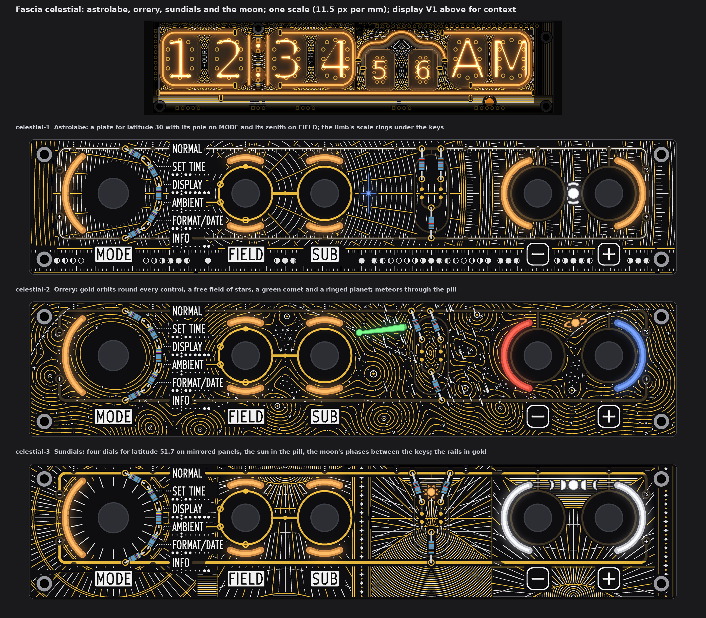
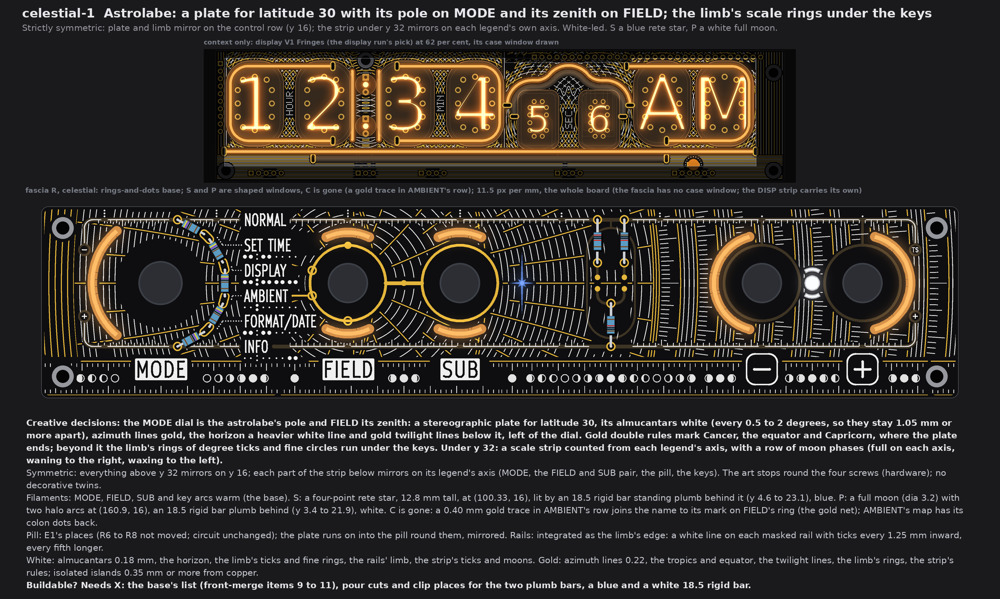
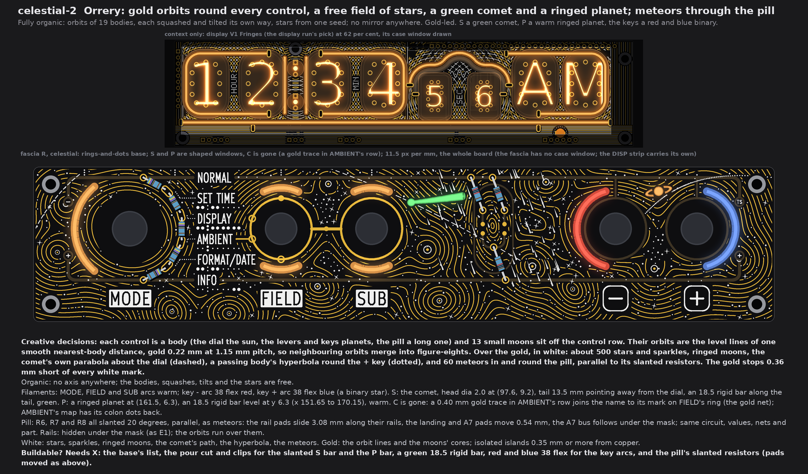
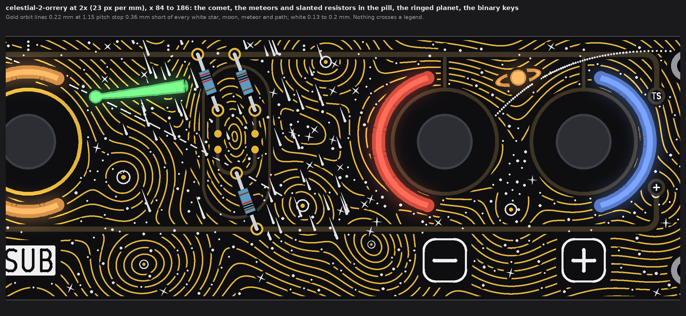
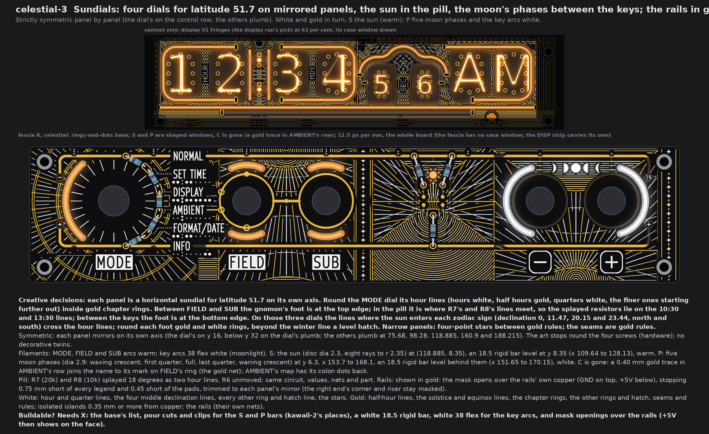
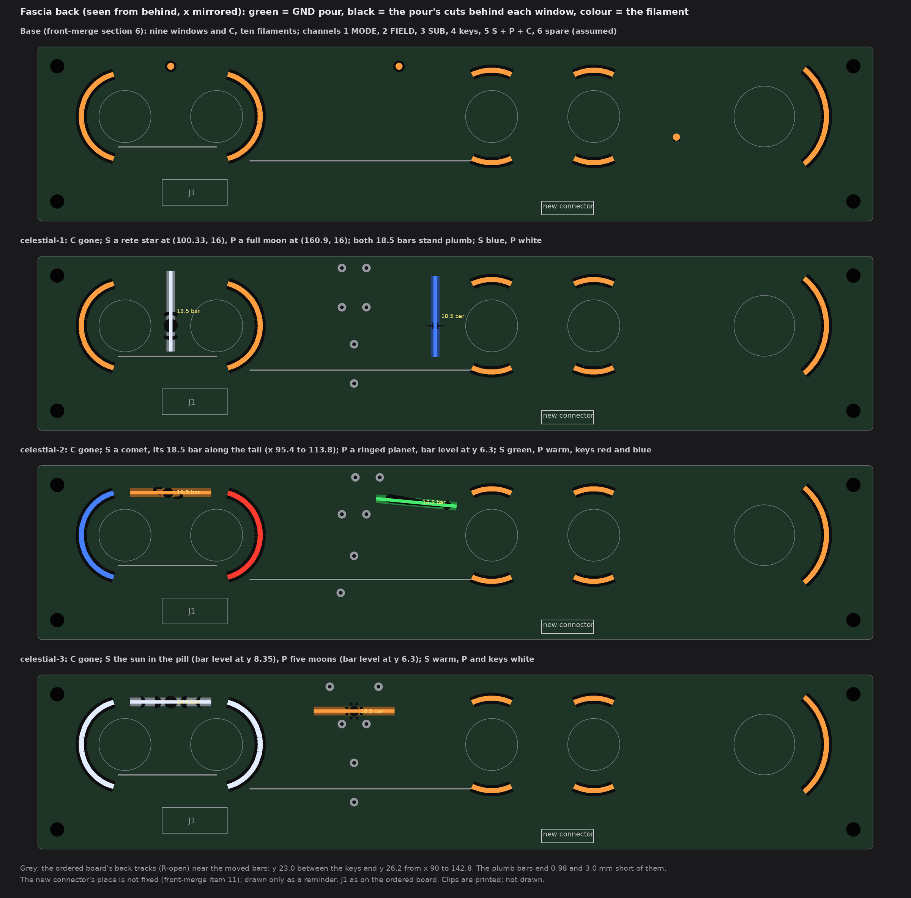

# TS06 fascia, celestial: astrolabe, orrery, sundials and the moon (drawings only, nothing built)

2026-10-14, front round 3, run fascia-celestial (the orchestrator's own theme: astrolabe, star charts, orbits, moon phases,
sundial hour lines). Three wild faces of fascia R that cover the whole board. They differ in motif, symmetry, white-led or
gold-led, the pill, the rails and the colours, not in how busy they are.

The queue changes are in on every face:
* A1: no top-edge dots. S and P are shaped windows in the theme's forms.
* A2: the pill is said per face.
* A3: the rails are said per face.
* A4: display V1 Fringes is in the strip above each face.
* A5: AMBIENT's cutout C is gone, with a gold trace in its row.

Each face is fascia R with the owner's rings-and-dots (front-merge section 6), drawn from the board file's copy that pass 4 used, at
one scale (11.5 px per mm), windows lit. No board, schematic, fab, tool, 3D, firmware or spec file was touched. The scripts are
scratch (copies of kawaii-2's), not in the repo.

Marks:
* *measured*: from the drawing's raster (23 px per mm) or the board file;
* *inferred*: arithmetic;
* *assumed*: my reading.

## 1. What every face keeps

* **Fixed:**
  * the outline, holes, controls and their places, and J1;
  * the names, plates, key legends, tube maps, dot leaders and the top-edge tube index;
  * FIELD's and SUB's gold rings, the link, the four SUB marks on FIELD's ring and the GND via.
* **Info first:**
  * Every name, legend and map keeps a calm ground of 0.78 mm or more (rule 0.75).
  * E1's gold keeps a calm frame of 0.74 mm.
  * Nothing crosses a legend.
  * No art reads as text or as a number. The scales and moon rows carry no figures.
* **AMBIENT (A5):**
  * Window C and its tail are removed, and AMBIENT's map gets back its two colon dots.
  * In AMBIENT's row, a 0.40 mm gold trace runs level at y 18.645, from x 52.43 to 55.75, to the outer edge of AMBIENT's
    mark on FIELD's ring. That puts it on the gold net. This is kawaii-2's trace.
* **The screws (a lesson from the owner's kawaii note):** the symmetric faces draw no decorative twins at the screws' mirror
  spots. The art stops 2.9 mm round each screw, which is hardware, and runs on at the mirror spot.
* **Channels on the new fascia connector** (J1 is full; front-merge items 10 and 11), grouping *assumed* as the earlier runs':
  * 1 MODE;
  * 2 FIELD up + down;
  * 3 SUB up + down;
  * 4 the two keys;
  * 5 S + P (C dropped);
  * 6 spare.

  Nothing comes from DISP.
* **5 V:** nine fascia filaments instead of ten. No face adds one, so the load is 20 mA less than the base (*inferred*).
* **Fab note (once):** bare-FR4 windows still need the fab's yes (pass 1's coupon). Not decided here.

## 2. celestial-1 Astrolabe

* **Creative decisions:** the MODE dial is the astrolabe's pole and FIELD its zenith.
  * **The plate:** a true stereographic plate for latitude 30 (the latitude that puts the zenith on FIELD).
    * The almucantars are white, every 0.5 to 2 degrees, so they stay 1.05 mm or more apart.
    * The azimuth lines are gold.
    * The horizon is a heavier white line. Below it, left of the dial, run gold twilight lines.
    * Gold double rules mark Cancer and the equator, and Capricorn where the plate ends (x 128).
  * **The limb:** beyond Capricorn, its rings of degree ticks and fine circles run under the keys.
  * **The strip under y 32:** a scale counted from each legend's axis, with a row of moon phases: full on each axis, waning
    to the right, waxing to the left, so time runs left to right.
* **Strictly symmetric.**
  * Above y 32, everything mirrors on the control row, y 16.
  * Below y 32, each part of the strip mirrors on its legend's axis: 24.99 MODE, 75.68 FIELD and SUB, 118.885 the pill, 160.9
    the keys.
  * *Measured* mirror misses: at most 0.15 per cent (raster rounding).
* **Filaments:**
  * MODE, FIELD, SUB and the key arcs are warm (the base).
  * **S:** a four-point rete star, 12.8 mm tall, at (100.33, 16). An **18.5 rigid bar, blue**, stands plumb behind it at x
    100.33, y 4.6 to 23.1.
  * **P:** a full moon (dia 3.2) with two halo arcs at (160.9, 16). An **18.5 rigid bar, white**, stands plumb at x 160.9,
    y 3.4 to 21.9.
  * Both windows lie on the mirror axis, so they keep the symmetry.
* **Pill:** E1's places. R6 to R8 are not moved; the circuit is unchanged. The plate runs on into the pill round them,
  mirrored.
* **Rails: integrated** as the limb's edge: a white 0.22 mm line on each masked rail, with ticks every 1.25 mm pointing
  inward, every fifth longer. The copper does not change.
* **White:** almucantars (0.18), the horizon, the limb's ticks and fine rings, the rails' limb, the strip's ticks and moons.
* **Gold:** azimuth lines (0.22), the tropics and the equator, the twilight lines, the limb's rings, the strip's rules. All
  are isolated islands, 0.35 mm or more from copper, plus AMBIENT's trace.
* **Buildable? Needs X:**
  * the base's list (front-merge items 9 to 11);
  * pour cuts and clip places for the two plumb bars;
  * a blue and a white 18.5 rigid bar.
  * C's cut and tail are dropped.

## 3. celestial-2 Orrery

* **Creative decisions:** each control is a body: the dial is the sun, the levers and keys are planets, and the pill is a
  long body. 13 small moons sit off the control row.
  * Their orbits are the level lines of one smooth nearest-body distance, gold 0.22 mm at 1.15 mm pitch. Each body's orbits
    are squashed and tilted its own way, so neighbouring orbits merge into figure-eights.
  * White marks lie over the gold:
    * 608 stars and sparkles, denser where the orbits thin out;
    * ringed moons;
    * the comet's own parabola about the dial, dashed;
    * a passing body's hyperbola round the + key, dotted;
    * 60 meteors in and round the pill, parallel to its slanted resistors.
  * The gold stops 0.36 mm short of every white mark, so the white sits on top.
* **Fully organic:** no axis anywhere. The bodies, squashes and tilts are set by hand off the row, and the stars come from one
  seed.
* **Filaments:**
  * MODE, FIELD and SUB arcs are warm.
  * **Key - arc: 38 flex red. Key + arc: 38 flex blue.** Together they are a binary star.
  * **S:** the comet. Its head (dia 2.0) is at (97.6, 9.2) and its 13.5 mm tail points away from the dial, as a comet's does.
    An **18.5 rigid bar, green** (comets glow green) lies along the tail, from (95.41, 9.40) to (113.83, 7.68).
  * **P:** a ringed planet at (161.5, 6.3). An **18.5 rigid bar, warm**, lies level at y 6.3, x 151.65 to 170.15
    (kawaii-2's place).
* **Pill:** R6, R7 and R8 all slant 20 degrees, parallel, as meteors.
  * The rail pads slide 3.08 mm along their rails.
  * The landing pads and R6's A7 pad move 0.54 mm, and the A7 bus follows under the mask.
  * The circuit, values, nets and part do not change. This is kawaii's "stripes" arrangement.
* **Rails: hidden** under the mask, as in E1. The orbits run over them. Showing two straight parallel rails would hint at a
  mirror.
* **White:** the stars (dots, dia 0.26 to 0.4), sparkles, ringed moons, the comet's path, the hyperbola and the meteors
  (strokes 0.15 to 0.2 mm).
* **Gold:** the orbit lines and the moons' cores. All are isolated islands, 0.35 mm or more from copper, plus AMBIENT's trace.
* **Buildable? Needs X:**
  * the base's list;
  * the pour cut and clips for the slanted S bar and for the P bar;
  * a green 18.5 rigid bar;
  * red and blue 38 flex for the key arcs;
  * the pill's slanted resistors, with the pads moved as above (the board-change run places them).

## 4. celestial-3 Sundials

* **Creative decisions:** each panel is a horizontal sundial for latitude 51.7 on its own axis.
  * **Round the MODE dial:** hour lines inside gold chapter rings. Hours are white, half hours gold and quarters white; the
    finer lines start further out.
  * **Between FIELD and SUB:** the gnomon's foot is at the top edge.
  * **In the pill:** the foot is where R7's and R8's lines meet, at (118.885, 19.95). The splayed resistors lie on the 10:30
    and 13:30 lines (tan 18 = sin 51.7 x tan 22.5, *inferred*).
  * **Between the keys:** the foot is at the bottom edge.
  * **On these three dials:**
    * The lines where the sun enters each zodiac sign cross the hour lines: declination 0, 11.47, 20.15 and 23.44, north and
      south.
    * Rings round each foot are gold and white in turn.
    * Beyond the winter line runs a level hatch.
  * **The narrow panels:** four-point stars between gold rules.
  * **The seams** are gold rules.
* **Strictly symmetric, panel by panel.**
  * The dial's panel mirrors on y 16 (and below y 32 on the dial's plumb).
  * The others mirror plumb at 75.68, 98.28, 118.885, 160.9 and 188.215.
  * *Measured* mirror misses: 0 in most panels, at most 0.9 per cent in the narrow hem by INFO (raster rounding).
* **Filaments:**
  * MODE, FIELD and SUB arcs are warm (day).
  * **The key arcs are 38 flex white** (moonlight).
  * **S:** the sun, a disc (dia 2.3) with eight rays to r 2.35, at (118.885, 8.35) between the splayed resistors. An **18.5
    rigid bar, warm**, lies level at y 8.35, x 109.64 to 128.13 (kawaii-2's S place).
  * **P:** five moon phases (dia 2.9) at y 6.3, x 153.7 to 168.1: waxing crescent, first quarter, full, last quarter, waning
    crescent. The row runs forward in time and mirrors exactly. An **18.5 rigid bar, white**, lies level behind them,
    x 151.65 to 170.15.
* **Pill:** R7 (20k) and R8 (10k) are splayed 18 degrees as two hour lines; R6 does not move (kawaii's "ears"). The circuit,
  values, nets and part do not change.
* **Rails: shown in gold.**
  * The mask opens over the rails' own copper (GND on top, +5V below).
  * The openings stop 0.75 mm short of every legend (*measured* 0.75) and 0.45 mm short of the pads.
  * They are trimmed to each panel's mirror, so the right end's corner and riser stay masked.
  * The art keeps a 0.75 mm frame off them. The copper does not change. +5V then shows on the face; it is a low-voltage net.
* **White:** hour and quarter lines, the four middle declination lines, every other ring and hatch line, the stars.
* **Gold:** half-hour lines, the solstice and equinox lines, the chapter rings, the other rings and hatch, the seams and rules.
  All are isolated islands, 0.35 mm or more from copper, plus the rails (on their own nets) and AMBIENT's trace.
* **Buildable? Needs X:**
  * the base's list;
  * pour cuts and clips for the S and P bars (kawaii-2's places, checked there);
  * a white 18.5 rigid bar;
  * white 38 flex for the key arcs;
  * mask openings with ENIG over the rails.

## 5. The light base and what each face changes

| Change against the base | Face | Filament (sold list), form | Channel | On the fascia's back |
|---|---|---|---|---|
| **C and its tail removed** (A5) | all | none | 5 loses C | C's pour cut closes |
| **S: a rete star at (100.33, 16)**, 8.27 mm left of and 11.5 mm below the old dot | 1 | 18.5 rigid, blue, plumb at x 100.33, y 4.6 to 23.1 | 5 | a pour cut under the star; clips at the bar's ends |
| **P: full moon and halo at (160.9, 16)**, 11.5 mm below the old dot | 1 | 18.5 rigid, white, plumb at x 160.9, y 3.4 to 21.9 | 5 | a pour cut; clips |
| **S: the comet**, head at (97.6, 9.2), tail to (111.0, 7.5) | 2 | 18.5 rigid, green, along the tail (95.41, 9.40) to (113.83, 7.68) | 5 | a pour cut; clips |
| **P: a ringed planet** at (161.5, 6.3) | 2 | 18.5 rigid, warm, level at y 6.3, x 151.65 to 170.15 | 5 | a pour cut; clips |
| **Key arcs recoloured** | 2 | 38 flex, red (-) and blue (+) | 4 | none |
| **S: the sun in the pill** at (118.885, 8.35) | 3 | 18.5 rigid, warm, level at y 8.35, x 109.64 to 128.13 | 5 | a pour cut; clips (as kawaii-2) |
| **P: five moon phases** at y 6.3 | 3 | 18.5 rigid, white, level at y 6.3, x 151.65 to 170.15 | 5 | pour cuts; clips (as kawaii-2) |
| **Key arcs recoloured** | 3 | 38 flex, white | 4 | none |

**Colours each face ships with** (all on the sold lists):
* celestial-1: warm + blue + white;
* celestial-2: warm + green + red + blue;
* celestial-3: warm + white.

**Do the moved bars fit on the back?**
* Every bar clears the plated pads of R1 to R8 (body 2.0 wide, pad r 0.95; rule 0.4). *Measured* least gaps:

  | Bar | Least gap | To |
  |---|---|---|
  | celestial-1 S | 13.8 | |
  | celestial-1 P | 37.3 | |
  | celestial-2 comet | 2.25 | R7's moved landing pad |
  | celestial-2 P | 28.4 | |
  | celestial-3 sun | 1.03 | R7's lower pad (as kawaii-2) |
  | celestial-3 P | 25.5 | |
* **The plumb bars of celestial-1** on the ordered board (`R-open`):
  * The S bar ends 3.0 mm short of the back track at y 26.2 (x 90 to 142.8).
  * The P bar ends 0.98 mm short of the back track at y 23.0, which runs between the keys.
  * The P bar's body is 9.5 mm from each key's centre, outside the key footprint's courtyard (r 6.2) and the assumed body
    (r 8.8).
  * *Assumed:* a clip adds no more than 0.5 mm at a bar's end.
* **The comet's bar (celestial-2):**
  * It starts 9.4 mm from SUB's centre.
  * It is 2.7 mm from the end of SUB up's own filament (*inferred*).
  * *Assumed:* the lever's body behind the board stays inside that.

## 6. The checks (*measured* on the raster, 23 px per mm)

| Check | Rule | celestial-1 | celestial-2 | celestial-3 |
|---|---|---|---|---|
| White, gold to a name, plate, key legend, tube map, leader or index dot | 0.75 | 0.78, 0.80 | 0.81, 0.80 | 0.80, 0.78 |
| White, gold to E1's exposed gold (rings, link, marks, pads, AMBIENT's trace) | 0.30 (frame 0.75 drawn) | 0.74, 0.75 | 0.74, 0.74 | 0.74, 0.74 |
| Pattern gold to copper | 0.30 | 0.35 | 0.35 | 0.35 |
| White, gold to a lit window | 0.35 | 0.36, 0.39 | 0.37, 0.37 | 0.37, 0.39 |
| White to the pattern's gold | 0.30 | 0.31 | 0.31 | 0.31 |
| Lit window to copper; to a legend | 0.30 | 0.68; 1.17 | 0.68; 1.17 | 0.68; 1.17 |
| Exposed rails to a legend | 0.75 | (masked) | (masked) | 0.75 |
| Free board within 1.2 mm of some ink | (no empty space) | 96.6 % | 99.4 % | 96.0 % |
| Largest mirror miss | (symmetric faces) | 0.15 % | (organic) | 0.9 % |

* White over the masked rails is allowed (E1's rule). So the white's least distance to masked copper is 0; to exposed gold it
  is as in the table.
* What stays dark is the inside of each knob's ring, and the ring of mask between each knob and its window.

## 7. My pick

**celestial-2 Orrery.** It is the fullest face (99.4 per cent covered) and the most alive: gold orbits round every control, a
free field of stars, and the comet, ringed planet and red-blue binary as lights, with no mirror anywhere. celestial-1
Astrolabe is the strict, classical one if the owner wants exact symmetry. celestial-3 Sundials is the cleverest about the
board, with the resistors on hour lines and day and night in two colours.

## 8. Left open, assumed

* *Assumed:* the S and P lights are 18.5 rigid bars (the shortest sold), clipped at their ends. celestial-1 stands both bars
  plumb, and its P bar ends 0.98 mm short of a back track. If the board-change run moves that track, the bar can sit
  centred on y 16.
* *Assumed:* the latitudes (30 for the astrolabe, 51.7 for the sundials) are choices that fit the board. The sundials' lines
  and the declinations are true for those latitudes. Nothing is printed as text or as a number.
* The rearranged pills (celestial-2 stripes, celestial-3 ears) are drawn on the art model's places (E1). The ordered board
  (`R-open`) still has R6 to R8 elsewhere, as 1206 parts on the back; the board-change run places them.
* The pattern's gold is isolated islands (no net). Stems to GND can be added if the fab wants no floating copper; not drawn.
* The smallest strokes (0.15 to 0.17 mm silk) are at the fab's silk limit used before (0.15). The meteors taper to points, and
  the smallest stars are dots (dia 0.26).
* Not checked: KiCad DRC (no board file was edited), and the back's copper under the moved windows beyond what section 5 says.
