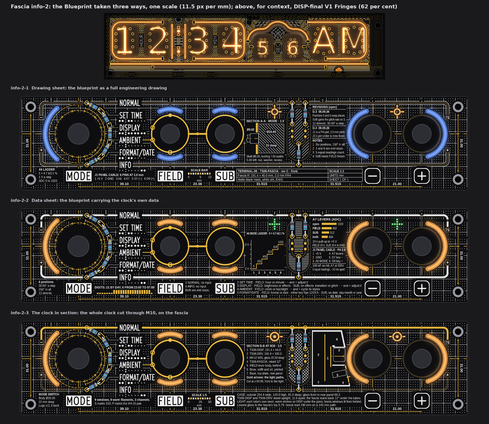
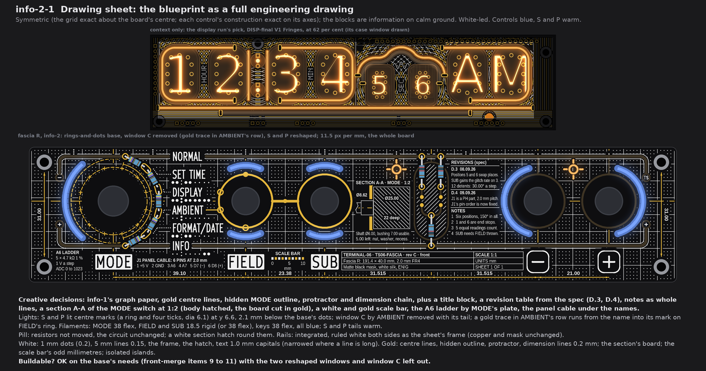
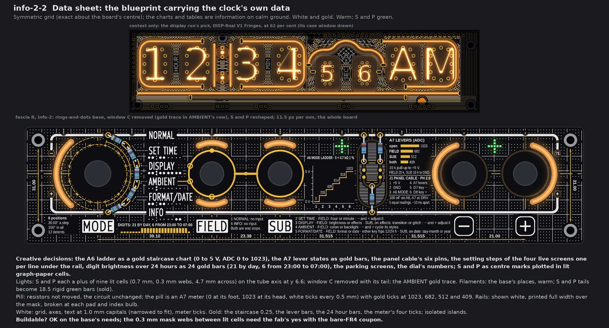
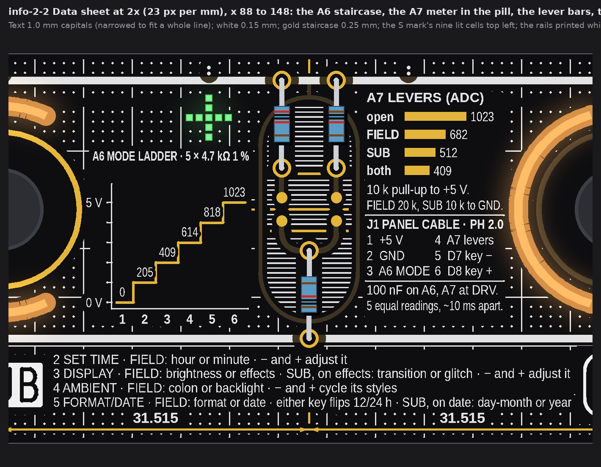
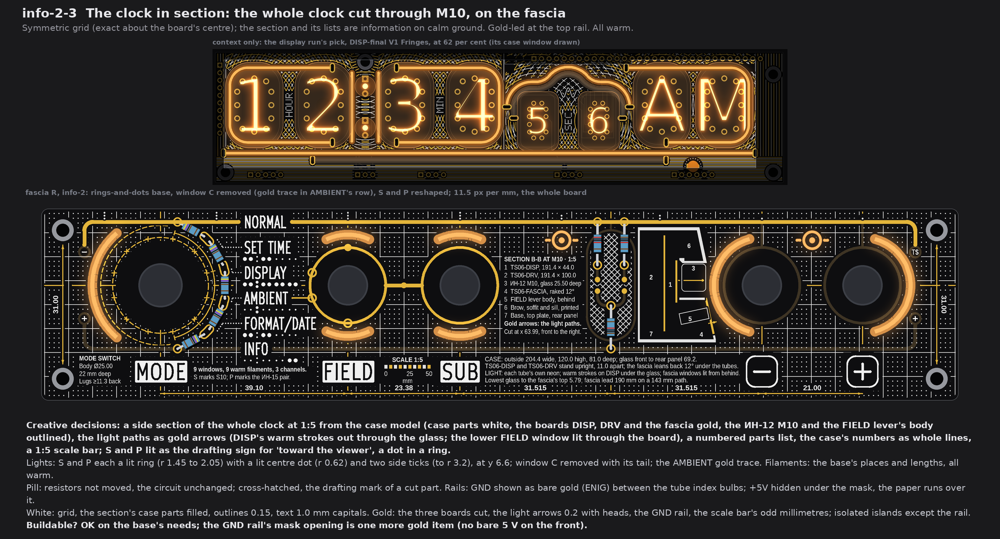
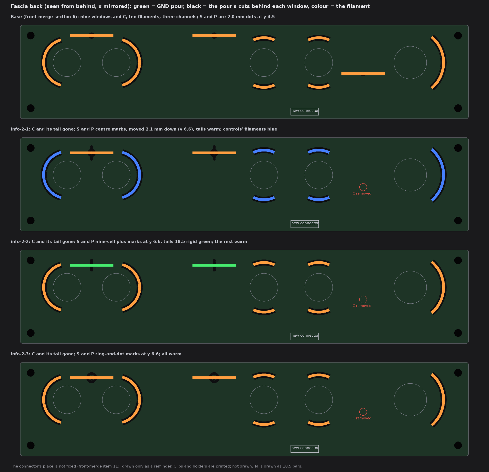

# TS06 fascia, info-2: the Blueprint taken three ways (drawings only, nothing built)

2026-10-14, front round 3, run fascia-info-2. The owner's words (20:5x UTC): "leave only info1 variant and expand on it". So only
info-1 Blueprint stays, and each face here takes it further its own way: the full drawing sheet, the blueprint with the clock's own
data, and the whole clock in section. All three keep what made info-1 work: the graph paper over the whole board, the gold centre
lines, the MODE switch's hidden outline, the protractor, the dimension chain and the lit centre-mark windows. The first info set
(`TS06-FASCIA-info.md`) stays as history.

Each face is fascia R with the rings-and-dots base (front-merge section 6), at one scale (11.5 px per mm). DISP-final V1 Fringes
stands above it in a thin strip, for context only. The queue changes apply to all three faces:
* **A1:** the S and P dots are gone, and their lights feed shaped windows.
* **A2 and A3:** each face says what it does with the pill and the rails.
* **A5:** AMBIENT's window C is removed, and a gold trace runs in AMBIENT's row instead.

No board, schematic, fab, tool, 3D, firmware or spec file was touched. The scripts are scratch, not in the repo; they are copies of
info-1's, and face 3 reads the case model `3d/case-pair/case_pair.py` without changing it. Marks used here:
* *measured*: read from the drawing's raster (23 px per mm), the board model or the case model;
* *inferred*: arithmetic;
* *assumed*: my reading.

## 1. What every face keeps, and the rules for printed facts

* **Fixed:** the outline, holes, controls and their places, J1, the names, plates, key legends, tube maps, dot leaders and the
  top-edge index; FIELD's and SUB's rings, the link, the four SUB marks, the GND via, the dial's and the ladder's pads. Nothing
  crosses a legend. Every legend, and every block of printed facts, stands on calm ground of 0.75 mm or more.
* **From info-1, on every face:**
  * white graph paper exact about the board's centre (95.7, 20);
  * gold dash-dot centre lines on the control row and through every control;
  * the MODE switch's hidden body and tap ring, dashed, with its 12 pins;
  * the 150 degree protractor over the six positions;
  * the dimension chain of the control pitches, and the hole pitch at both ends.
* **A5, the same on all three faces:**
  * Window C (45.04, 21.2) and its warm tail are gone.
  * A **gold trace, 0.3 mm**, runs level in AMBIENT's row (y 18.645) from 0.78 mm past the name into AMBIENT's mark on FIELD's ring.
    Through the mark and the ring it is on the gold net (GND).
  * C's place in AMBIENT's tube map gets its two colon dots back (r 0.28, as in DISPLAY's map), so the map says again that AMBIENT
    changes the colon.
* **Text:** every block is whole lines: one fact, one row of a table, or one screen per line. Capitals are 1.0 mm, the fab's
  least, and long lines are narrowed (66 to 90 per cent width). KiCad sets text width apart from height, so this is buildable as
  drawn; the stroke is 0.15.
* **Facts:** every number, setting step and label printed on a face is from the repo (section 6 gives each source).
* **Setting steps:** they are printed as the spec states them (spec Rev D.4 section 1, control scheme rev B). The firmware does not
  do most of them yet; section 7 lists which.
* **Fab note (once):** the bare-FR4 windows, the shaped ones included, still need the fab's yes (pass 1's coupon). That is not
  decided here.
* **Symmetric:** the grid, the centre lines and each control's construction are exact (about the board's centre and each
  control's axes). The printed blocks are information on calm ground, as in info-1; nothing decorative sits off the mirror.

## 2. info-2-1 Drawing sheet

* **Creative decisions:** the blueprint becomes a complete drawing sheet. It has:
  * a ruled **title block** under the +5V rail;
  * a **revision table** of the spec's fascia revisions, D.3 and D.4;
  * **notes** as whole lines;
  * **section A-A of the MODE switch at 1:2**: the body hatched with its diameter and depth, the bushing through the board, the
    board cut in gold, the shaft broken off;
  * a white and gold **scale bar**;
  * the A6 ladder by MODE's plate, and the panel cable under the names.
* **Symmetric** (as section 1). White-led.
* **Filaments:**
  * The base's places. MODE arc 38 flex, FIELD and SUB 18.5 rigid in curved clips (or 38 flex), keys 38 flex. All of these are
    **blue**, a cyanotype (sold in both forms).
  * S and P tails stay **warm**.
  * S and P are **lit centre marks**: a ring (r 0.9 to 1.5) and four ticks to r 3.05, 6.1 mm across. They stand at (108.6, 6.6)
    and (160.9, 6.6), 2.1 mm below the base's dots, so they clear the GND rail (0.39, *measured*).
* **Pill:** the resistors are not moved; the circuit is unchanged. A white section hatch (45 degrees, 0.85 mm pitch) runs round the
  resistors, pads and landing dots.
* **Rails: integrated.** Each rail is ruled white along both edges (0.18 wide, 0.22 off the copper), so the bezel reads as the
  sheet's frame. Copper and mask are unchanged.
* **White:** 1 mm dots (dia 0.2), 5 mm lines 0.15, the frame, the hatches, the tables' rules, the text.
* **Gold:** the centre lines, hidden outline, protractor, dimension lines and arrowheads (0.2 mm); the section's cut board; the
  scale bar's odd millimetres. All are isolated islands, apart from the A5 trace.
* **Buildable? OK** on the base's needs (front-merge items 9 to 11), with the two reshaped windows and window C left out.

## 3. info-2-2 Data sheet

* **Creative decisions:** the blueprint carries the clock's own data, as charts and tables:
  * the **A6 ladder** as a gold staircase (0 to 5 V, with each step's ADC value);
  * the **A7 lever states** as gold bars (open, FIELD, SUB, both);
  * the **panel cable's** six pins;
  * the **setting steps** of the four live screens under the +5V rail, one screen per line;
  * **digit brightness over 24 hours** as 24 gold bars (21 by day, 6 from 23:00 to 07:00);
  * the two parking screens, and the dial's numbers by MODE's plate.
* **S and P** are centre marks **plotted on the graph paper**: a plus of nine lit cells (0.7 mm squares, 1.0 mm pitch, 0.3 mm
  webs, 4.7 mm across) on each tube's axis at y 6.6.
* **Symmetric** (as section 1). White and gold in equal parts.
* **Filaments:** the base's places, all **warm**. The S and P tails become **18.5 rigid green** bars (sold), the colour of the data
  points.
* **Pill:** the resistors are not moved; the circuit is unchanged. The pill is an **A7 meter**: 0 at its foot (y 27.0), 1023 at its
  head (y 5.0), white ticks every 0.5 mm, and gold ticks at the four lever states 1023, 682, 512 and 409.
* **Rails: shown white.** Silk is printed full width over the masked copper and broken at each pad and index bulb, so the two rails
  read as the sheet's heavy border. Copper and mask are unchanged.
* **White:** the grid, the axes, the meter's ticks, the text.
* **Gold:** the staircase (0.25), the lever bars, the 24 hour bars, the meter's four ticks; isolated islands.
* **Buildable? OK** on the base's needs. The 0.3 mm mask webs between the lit cells need the fab's yes with the bare-FR4 coupon.

## 4. info-2-3 The clock in section

* **Creative decisions:** the fascia carries a **side section of the whole clock, cut through M10 at 1:5**, taken from the case
  model:
  * the printed case parts in white (base, top plate, rear panel, brow and soffit, sill);
  * the three boards, DISP, DRV and the raked fascia, in gold;
  * the ИН-12 M10 and the FIELD lever's body outlined;
  * the **light paths** as gold arrows: DISP's warm strokes out through the glass, and FIELD's lower window lit through the board.
  * Beside it are a numbered **parts list**, the case's numbers as whole lines and a 1:5 scale bar.
  * The section faces right, toward the keys, because the block between the pill and the minus key is the one tall enough
    (24 mm = 120 mm of clock).
* **S and P** are lit as the drafting sign for "toward the viewer": a lit ring (r 1.45 to 2.05, 4.1 mm across) with a lit centre
  dot (r 0.62) and two side ticks (7.0 mm across), at y 6.6. The light comes out of the board there.
* **Symmetric** (as section 1). Gold-led at the top.
* **Filaments:** the base's places and lengths, all **warm** (the neon's colour, as the section's light paths say).
* **Pill:** the resistors are not moved; the circuit is unchanged. It is cross-hatched, the drafting mark of a cut part.
* **Rails:** **GND shown as bare gold** (ENIG), opened between the tube index bulbs; **+5V hidden** under the mask, with the graph
  paper running over it. Nothing bare at 5 V on the front.
* **White:** the grid, the section's case parts filled, outlines 0.15, the text.
* **Gold:** the three boards cut, the light arrows (0.2 with heads), the GND rail, the scale bar's odd millimetres.
* **Buildable? OK** on the base's needs. The GND rail's mask opening is one more exposed gold item on the GND net.

## 5. The light base and what each face changes

The base is front-merge section 6: nine windows and C, ten filaments, three fascia channels, all warm. **Every face here:**
* drops **window C and its tail** (A5);
* drops the **S and P dots** (A1), and lights a shaped window with the same light, moved 2.1 mm down to y 6.6.

The info channel now drives only S and P. That leaves nine windows and nine filaments on the same three channels, and 20 mA less
on the 5 V side at front-merge's 20 mA a filament (*inferred*). No face adds a channel. The connector stays at 6 channels.

| Face | S and P windows (centres 108.6 and 160.9, y 6.6) | Filament changes | Colours shipped | On the fascia's back |
|---|---|---|---|---|
| info-2-1 | centre marks: ring and four ticks, 6.1 across | C's tail dropped; S, P tails move 2.1 mm down | blue (MODE, levers, keys), warm (S, P) | the pour cut follows each mark; no cut at C |
| info-2-2 | nine lit cells in a plus, 4.7 across | C's tail dropped; S, P tails are 18.5 rigid green, 2.1 mm down | warm, green (S, P) | the pour cut follows the cells; no cut at C |
| info-2-3 | lit ring and dot with two ticks, 7.0 across | C's tail dropped; S, P tails move 2.1 mm down | warm | the pour cut follows each mark; no cut at C |

## 6. Where each printed fact comes from

| Printed | Face | Source |
|---|---|---|
| Control pitches 39.10, 23.38, 31.515, 31.515, 21.00; hole pitch 31.00 | all | the board model's centres and screw holes (as info-1) |
| Section A-A: body Ø25.00, bushing Ø8.62 with 7.00 usable, shaft Ø6.00 | 1 | spec section 2, the switch table |
| "5.00 left: nut, washer, recess" | 1 | spec section 6, "Bushing stack, open" (7.00 usable less 2.0 mm FR4) |
| Body 22 deep; lugs ≥11.3 back | 1, 3 | the case model's `ROTARY_DEPTH` 22.0 (`3d/case-pair/case_pair.py`, citing spec section 6); spec section 6 for the lugs |
| Revisions: D.3 08.09.26 (positions 5 and 6 swap; SUB gains the glitch rate on 3; 12 detents, 30.00° a step) | 1 | spec Rev D.3 header and section 1; `TERMINAL-06-control-scheme-revB.md` (changes 1 and 2, step angle closed) |
| Revisions: D.4 09.09.26 (J1 a PH part, 2.0 mm pitch; pin order fixed) | 1 | spec Rev D.4 header and section 2 |
| Title block: "TERMINAL-06 · TS06-FASCIA · rev C" | 1 | pass 4 section 7, the back-silk wording (rev C is pass 4's name for the next face; R rev B is the one ordered) |
| Title block: 191.4 × 40.0 mm | 1 | the board model's outline (fascia R) |
| Title block: 2.0 mm FR4, matte black mask, white silk, ENIG | 1 | spec section 6, the TS06-FASCIA heading |
| SCALE 1:1, UNITS mm, SHEET 1 OF 1 | 1 | true of the drawing itself (the face is the board at full size) |
| Notes: six positions, 150° in all; 12 detents; 30.00° a step | 1, 2 | spec section 2, the switch table |
| Notes: 1 and 6 are end stops | 1, 2 | spec section 1 |
| Notes: five equal readings count, ~10 ms apart | 1, 2 | spec section 2, item 2; firmware `ts06pair.ino`, `rotaryStable()` |
| Notes: SUB is read only with FIELD thrown | 1, 2 | spec section 1, the SUB rule |
| A6: 5 × 4.7 kΩ 1 %, 1 V a step, ADC 0, 205, 409, 614, 818, 1023 | 1, 2 | spec section 2, the A6 table |
| A7: open 1023, FIELD 682, SUB 512, both 409; 10 k pull-up, FIELD 20 k, SUB 10 k to ground | 2 (and the meter) | spec section 2; firmware `ts06pair.ino` header; R6, R7, R8 in the board model |
| J1: 1 +5 V, 2 GND, 3 A6, 4 A7, 5 D7 (−), 6 D8 (+), PH 2.0 mm | 1, 2 | spec section 2, the J1 table (Rev D.4) |
| 100 nF on A6 and A7 at DRV | 2 | spec section 2, item 1 ("at the board end"); `ts06pair.ino` (C5, C6 at the driver board end) |
| Setting steps 2 to 5 (FIELD's pair, SUB's pair, what − and + do) | 2 | spec section 1, the control table |
| 1 NORMAL and 6 INFO: no input | 2 | spec section 1 |
| Digits 21 by day, 6 from 23:00 to 07:00 | 2 | firmware `nixieClock_TS06.ino`: `INDI_BRIGHT 21`, `INDI_BRIGHT_N 6`, `NIGHT_START 23`, `NIGHT_END 7`, `NIGHT_LIGHT 1` |
| Section B-B geometry: case profile, sill, brow, base, top, rear panel; DISP Z 30.0 to 31.6, DRV Z 42.6 to 44.2; the fascia raked 12° | 3 | the case model (`3d/case-pair/case_pair.py`, `profiles()`, read only), *measured* there; spec section 6 for the 12° rake |
| TS06-DISP 191.4 × 44.0, TS06-DRV 191.4 × 100.0 | 3 | `3d/case-pair/boards.json` (from the board generators) |
| ИН-12 M10, glass 25.50 deep | 3 | the case model's `IN12_D` (from `3d/IN12.FCStd`); its seat 4.5 is the model's *assumption* |
| The FIELD lever body (11.92 wide, 30 deep) | 3 | the case model's `MT1_W`, `MT1_DEPTH`; the depth is its *assumption* ("verify per sample"), so no depth is printed |
| Outside 204.4 wide, 120.0 high, 81.0 deep; glass front to rear panel 69.2 | 3 | `3d/case-pair/checks.md`, the envelope |
| DISP and DRV 11.0 apart | 3 | the case model: `Z_DRV_F` 42.6 less `Z_DISP_B` 31.6 (*inferred*) |
| Lowest glass to the fascia's top 5.79; lead 190 mm on a 143 mm path | 3 | `3d/case-pair/checks.md`, checks 6 and 8 |
| The light: warm strokes on DISP under the glass; the fascia's windows lit from behind | 3 | front-merge sections 2 and 6; DISP-final |
| 9 windows, 9 warm filaments, 3 channels | 3 | front-merge section 6, less C (A5) |
| S marks S10; P marks the ИН-15 pair (x 108.6, 160.9) | 3 (all as lights) | pass 2's light table; pass 4's tube positions |

## 7. Setting steps the firmware does not do yet

The faces print the spec's scheme. The firmware is the display-layer port; its own TODO is in the header of `ts06pair.ino`, and the
spec's list is section 5, "Firmware status: control scheme NOT implemented".
* **Not done:** A7 is not read at all. So none of the FIELD or SUB steps work yet:
  * SET TIME: hour or minute by FIELD;
  * DISPLAY: brightness or effects, then transition or glitch;
  * AMBIENT: colon or backlight;
  * FORMAT/DATE: format or date, then day-month or year;
  * the SUB rule.
* **Not done:** only SET TIME is its own screen (PROGRAM). There "−" switches hours and minutes and "+" counts up; the printed
  "− and + adjust it" is not how it works yet.
* **Not done:** DISPLAY, AMBIENT, FORMAT/DATE, NORMAL and INFO all run the old two-button controls:
  * "−" cycles the backlight mode, and holding it turns glitch on or off;
  * "+" cycles the transition effect.
  So "NORMAL and INFO: no input" is not true yet. Neither are AMBIENT's style cycling, FORMAT/DATE's 12/24 h flip and date edit,
  or the glitch *rate*; today glitch is only on or off.
* **Done:** the five-reading agreement filter (`rotaryStable()`), the A6 position decode (`rotaryPos()`, positions 1 to 6 as
  printed), and the day and night digit brightness.

## 8. The checks (*measured* on the raster, 23 px per mm)

| Check | Rule | info-2-1 | info-2-2 | info-2-3 |
|---|---|---|---|---|
| White, gold to a name, plate, key legend, tube map, leader or index dot | 0.75 | 0.78, 0.80 | 0.78, 0.80 | 0.78, 0.80 |
| White, gold to E1's exposed gold (rings, link, marks, pads) | 0.30 (gold frame 0.75) | 0.43, 0.77 | 0.43, 0.75 | 0.43, 0.77 |
| Pattern gold to any copper | 0.30 | 0.39 | 0.39 | 0.39 |
| White, gold to a lit window | 0.35 | 0.39, 0.43 | 0.39, 0.43 | 0.39, 0.43 |
| Lit window to copper | 0.30 | 0.39 | 0.68 | 0.68 |
| Lit window to a legend | (base's least was 0.26, C to AMBIENT) | 1.17 | 1.17 | 1.17 |
| White to the pattern's gold | 0.30 | 0.33 | 0.33 | 0.33 |
| AMBIENT trace to its name; to white; to pattern gold | 0.75; 0.30; 0.30 | 0.78; 0.39; 2.39 | 0.78; 1.17; 2.39 | 0.78; 0.39; 2.39 |
| White, gold to the exposed GND rail (info-2-3 only) | 0.30 | | | 0.39, 0.39 (index silk 0.30) |
| Free board within 1.2 mm of some ink | (no empty space) | 99.6 % | 96.9 % | 98.3 % |

* White may run over copper under the mask (the rails, the key rings, the capsule), so white to copper is 0 by design.
* Dropping C removes the base's tightest window-to-legend gap (0.26 to AMBIENT's box). The least gap is now 1.17.
* What is left dark is the information's own ground and the ring of mask round each knob and window.

## 9. My pick

**info-2-2 Data sheet.** It is info first in the plainest sense: the ladders, the lever states, the cable, the setting steps and the
night dimming are all on the board as charts and tables, with every number from the spec or the firmware, and the graph paper and
centre lines of info-1 are kept whole. info-2-1 Drawing sheet is the calmer, more formal choice, and info-2-3 the most striking, if
the owner wants the fascia to show the clock it sits in.

## 10. Left open, assumed

* *Assumed:* the S and P tails are short bars that can sit behind a 5 to 7 mm window (as info-1). In info-2-2 they are green bars
  of the same length.
* *Assumed:* "a gold trace in AMBIENT's row" means a trace from the name into AMBIENT's own mark, on the gold net. If the owner
  meant a trace at C's old place in the tube map, it is one short gold bar at (45.04, 21.2) instead; it must then be an isolated
  island, because nothing on the gold net reaches there without crossing the map.
* *Assumed:* the MODE switch's tap pins sit at 15 + n x 30 degrees in the board's own frame (as info-1).
* The case section is the case model as it stands: concept A in `3d/case-pair`, with its own assumptions (the tube seat 4.5, the
  lever depth 30). If the case changes, the section is redrawn from the model.
* The pill's resistors are not moved on any face. The queue allows it; no face here gained enough from it to be worth the copper
  check against `R-open.kicad_pcb`.
* Not checked: KiCad DRC (no board file edited); text in KiCad's stroke font (drawn here in a plain sans); the back's copper behind
  the reshaped windows; the connector's place on the back (front-merge item 11).
