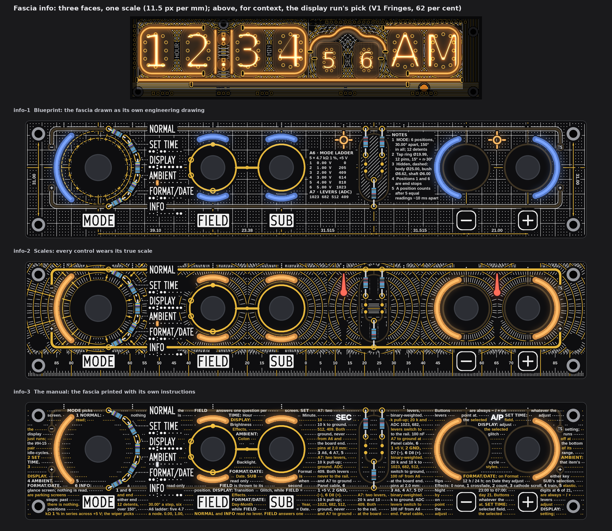
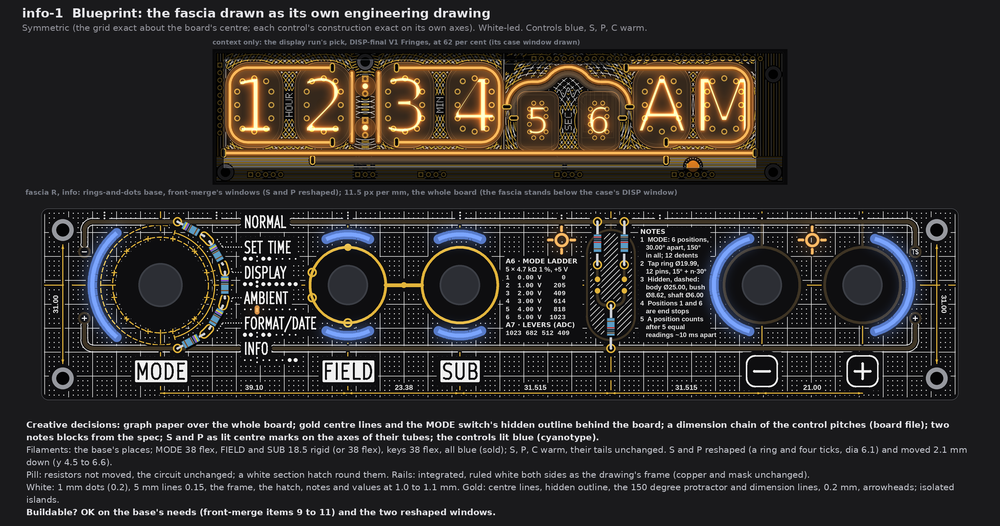
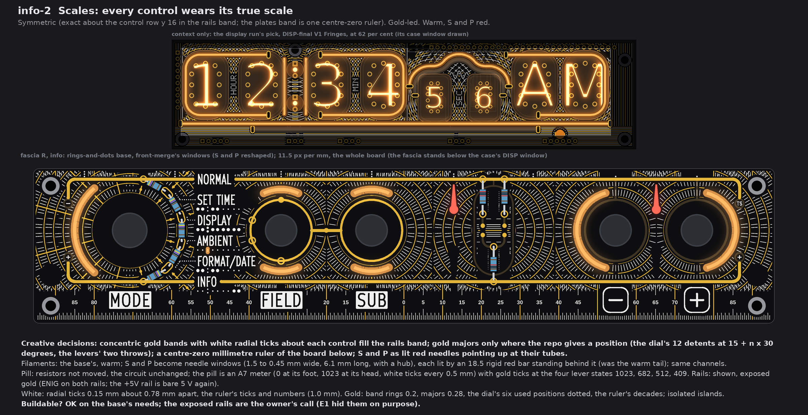
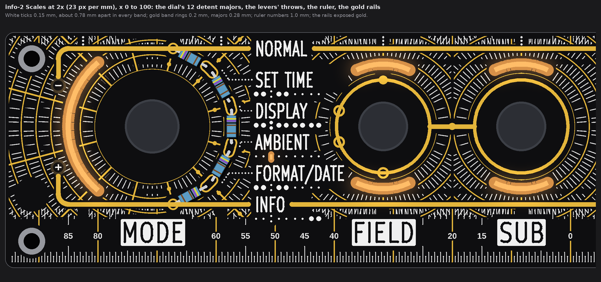
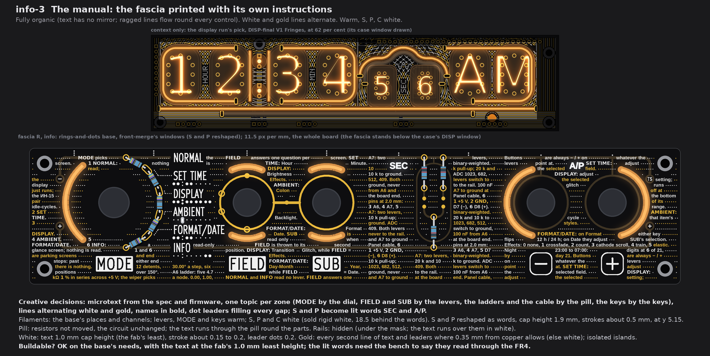
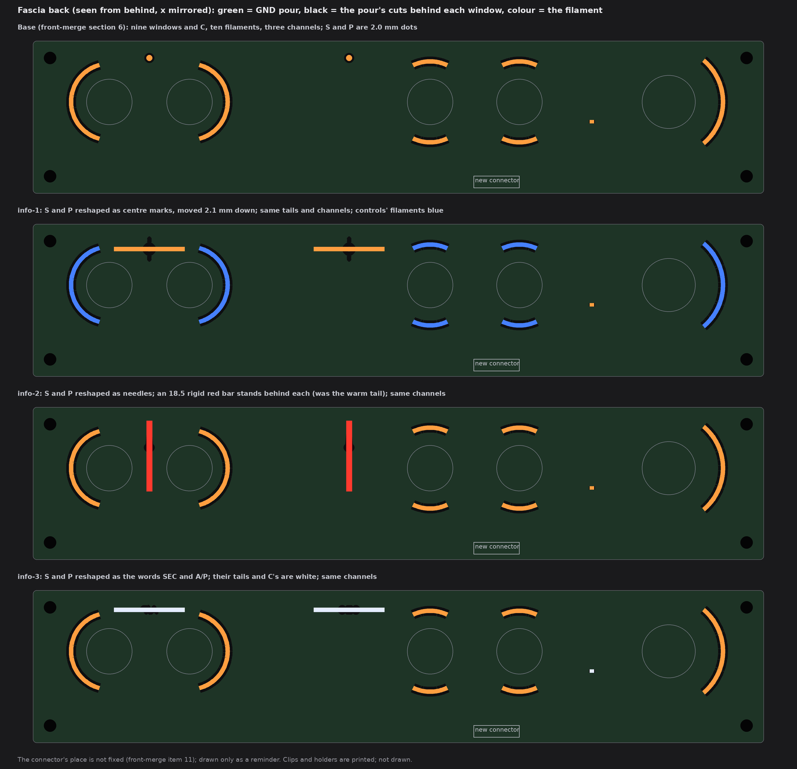

# TS06 fascia, info: three faces over the fascia light base (drawings only, nothing built)

2026-10-14, front round 3, run fascia-info. The owner's words for this theme: "info- infographics, indepth clock setting and data,
measurements, charts, blueprints etc."; all three faces wild, art over the whole board, one back kept unless a change helps the theme.
The queue changes of 19:5x UTC apply: the two top-edge info dots (S, P) are gone and their lights feed shaped windows; each face
says what it does with the pill and the rails. Each face is fascia R with the rings-and-dots base (front-merge section 6) and
front-merge's windows, at one scale (11.5 px per mm). The display run's pick, DISP-final V1 Fringes, stands above each face in a thin
strip, for context only.

No board, schematic, fab, tool, 3D, firmware or spec file was touched. The scripts are scratch (copies of the science run's, which
are front-merge's), not in the repo. Marks: *measured* is from the drawing's raster (23 px per mm) or the board model; *inferred*
is arithmetic; *assumed* is my reading.

## 1. What every face keeps, and the rule for printed facts

* **Fixed:** the outline, holes, controls and their places, J1, the names, plates, key legends, tube maps, dot leaders and the
  top-edge index; FIELD's and SUB's gold rings, the link, the four SUB marks on FIELD's ring, the GND via, the dial's and the
  ladder's pads. Nothing crosses a legend; each stands on a calm ground of 0.75 mm or more.
* **Facts:** every number, setting step and label printed on a face is from the repo; section 6 gives the source of each. The
  setting steps are the spec's control scheme (rev B, spec Rev D.3 section 1). **The firmware does not implement that scheme yet**
  (spec section 5, "Firmware status"); the faces print what the clock is specified to do.
* **Fab note (once):** the bare-FR4 windows, the shaped ones included, still need the fab's yes (pass 1's coupon). Not decided here.

## 2. info-1 Blueprint

* **Creative decisions:** the fascia drawn as its own engineering drawing. White graph paper over the whole board; gold centre lines
  on the control row and through every control; the MODE switch's hidden outline behind the board, dashed (body, tap ring and its
  12 pins); a 150 degree protractor over the six positions; a dimension chain of the control pitches under the plates and the hole
  pitch up both ends; two notes blocks (the MODE switch, the two ladders). S and P are lit **centre marks** on the axes of the tubes
  they serve. The controls are lit blue, a cyanotype; the info lamps stay warm, like the tubes.
* **Symmetric.** The grid is exact about the board's centre (x 95.7, y 20); each control's construction is exact on its own axes;
  the dimension values and the notes are information on their own calm ground.
* **Filaments:** the base's places and lengths. MODE arc 38 flex, FIELD and SUB 18.5 rigid in curved clips (or 38 flex), keys 38
  flex: **blue** (sold in both forms). S, P and C warm, their tails unchanged. **S and P reshaped and moved:** a lit ring (r 0.9 to
  1.5) with four lit ticks (0.6 wide, round ends, to r 3.05), dia 6.1, centres (108.6, 6.6) and (160.9, 6.6), 2.1 mm below the base's
  dots so the marks clear the GND rail (0.39 mm, *measured*).
* **Pill:** resistors not moved; the circuit is unchanged. Inside the capsule a white section hatch (45 degrees, 0.85 mm pitch)
  runs round the resistors, pads and landing dots.
* **Rails: integrated.** Each rail is ruled white along both edges (0.18 wide, 0.22 off the copper), so the bezel reads as the
  drawing's frame. Copper and mask unchanged.
* **White:** 1 mm dots (dia 0.2), 5 mm lines 0.15, the frame, the hatch; the notes and dimension values at 1.0 to 1.1 mm.
* **Gold:** centre lines (dash-dot), the hidden outline (dashed), the protractor and the dimension lines, all 0.2 mm, with
  arrowheads; isolated islands.
* **Buildable? OK** on the base's needs (front-merge items 9 to 11) and the two reshaped windows.

## 3. info-2 Scales

* **Creative decisions:** every control wears its true scale. Concentric gold bands (2.5 mm) with white radial ticks about each
  control fill the rails band, one cell per control, seams at the midpoints on the control row. Gold majors stand only where the
  repo gives a position: the dial's **12 detents** (the tap pins at 15 + n x 30 degrees; the six used ones dotted in every band) and
  each lever's **two throws** (straight up and down). The keys and the pill get minor ticks only. Below the +5V rail, a
  **centre-zero millimetre ruler** of the board (0 at x 95.7, numbers every 5 mm, gold decades). S and P are lit **red needles**
  pointing straight up at the tubes they serve.
* **Symmetric:** exact about the control row (y 16) from y 0.6 to 31.4, cuts included (the masks are mirrored before drawing; a
  pixel-level rounding of 37 px in 163 000 is left); the plates band is one ruler whose ticks are exact about the board's centre.
* **Filaments:** the base's, warm. **S and P reshaped:** needles 1.5 mm wide at the foot, 0.45 at the tip, from y 10.2 up to 4.1,
  with a hub r 1.15 at y 10.6; each is lit by an **18.5 rigid red** bar standing behind it (y 3.6 to 22.1), in place of the warm
  tail; same channels (a red filament on the same drive).
* **Pill:** resistors not moved; the circuit is unchanged. The pill is an **A7 meter**: 0 at its foot (y 27.0), 1023 at its head (y 5.0), white
  ticks every 0.5 mm, gold ticks at the four lever states 1023, 682, 512 and 409 (at y 5.0, 12.33, 15.99 and 18.20).
* **Rails: shown, exposed gold** (ENIG on both rails, the gauges' bezel). The art keeps 0.39 mm from them. This puts a bare +5V
  line on the front again, which pass 4's E1 removed on purpose: the owner's call.
* **White:** radial ticks 0.15 mm, about 0.78 mm apart in every band; the ruler's ticks; numbers 1.0 mm.
* **Gold:** band rings 0.2 mm, majors 0.28 mm, dots r 0.36, the ruler's decades 0.22 mm; isolated islands.
* **Buildable? OK** on the base's needs; the needles are 0.45 mm wide at the tip (the bench says whether that tip glows).

## 4. info-3 The manual

* **Creative decisions:** the fascia printed with its own instructions. Microtext flows round every control, ragged, one topic per
  zone: MODE and the A6 ladder by the dial, FIELD and SUB by the levers, the A7 ladder and the panel cable by the pill, the buttons,
  effects and night hours by the keys. Lines alternate **white and gold**; screen and control names are bold; dot leaders fill each
  run too short for a word. S and P become **lit words**, SEC and A/P.
* **Fully organic:** text has no mirror, and the ragged lines and leaders follow the controls, not an axis.
* **Filaments:** the base's places and channels; MODE, levers and keys warm. **S and P reshaped** as the words SEC and A/P (capitals
  1.9 mm, strokes about 0.5 mm) centred at (108.6, 5.15) and (160.9, 5.15); S, P and C lit **white** (sold rigid white, 18.5,
  behind each word).
* **Pill:** resistors not moved; the circuit is unchanged. The text runs through the capsule round the parts.
* **Rails: hidden.** They stay under the mask and the text runs over them in white.
* **White:** text at 1.0 mm capital height (the fab's least, `tools/dfm_check.py`), drawn bold here for the 0.15 mm stroke;
  leader dots dia 0.2. The build sets KiCad's stroke font at 1.0 mm, stroke 0.15.
* **Gold:** every second line of text and its leaders, where 0.35 mm from copper allows; a gold word that would come nearer is set
  white instead. Isolated islands.
* **Buildable? OK** on the base's needs, with all text at the fab's least height; whether the lit words read through the FR4 is
  the bench's to say.

## 5. The light base and what each face changes

The base is front-merge section 6: nine windows and C, ten filaments, three fascia channels, warm. **Every face drops the S and P
dots** (queue change A1) and lights a shaped window with the same light; C by AMBIENT stays. No face adds a channel or a filament.

| Face | S and P windows | Filament change | Colours shipped | On the fascia's back |
|---|---|---|---|---|
| info-1 | centre marks, dia 6.1, moved 2.1 mm down to y 6.6 | none in form; controls' filaments blue | blue (MODE, levers, keys), warm (S, P, C) | the pour cut follows each mark |
| info-2 | needles with a hub, 7.7 mm tall, at the base's x | S and P tails become 18.5 rigid red bars, standing behind the needles | warm, red (S, P) | a printed holder for each upright bar; pour cut follows the needle |
| info-3 | the words SEC and A/P, at the base's x, y 5.15 | none in form; S, P, C tails white | warm, white (S, P, C) | the pour cut follows each word's outline |

The 5 V total is unchanged (the same ten filaments). The connector stays at 6 channels.

## 6. Where each printed fact comes from

| Printed | Face | Source |
|---|---|---|
| Control pitches 39.10, 23.38, 31.515, 31.515, 21.00 (dial, FIELD, SUB, the ladder's axis, minus, plus) | 1 | the board model's centres (24.89, 63.99, 87.37, 118.885, 150.4, 171.4), *measured* in front-merge's geometry of fascia R; differences *inferred* |
| Hole pitch 31.00 | 1 | the board model's screw holes at y 4.5 and 35.5 |
| 6 positions, 30.00 degrees apart, 150 in all; 12 detents | 1, 2, 3 | spec section 2 (the switch table, "12 counted"); control scheme rev B, "Step angle closed" |
| Tap ring dia 19.99, 12 pins at 15 + n x 30 degrees; body dia 25.00; bushing dia 8.62; shaft dia 6.00 | 1, 2 | spec section 2, the switch table |
| Positions 1 and 6 are end stops; parking screens; "past either end there is nothing" | 1, 3 | spec section 1 |
| A position counts after 5 equal readings about 10 ms apart | 1, 3 | spec section 2, item 2; firmware `ts06pair.ino`, `rotaryStable()` |
| A6: 5 x 4.7 kOhm 1 % across +5 V; 0 to 5 V in 1 V steps; ADC 0, 205, 409, 614, 818, 1023 | 1, 3 | spec section 2, the A6 table |
| A7: 10 k pull-up, 20 k and 10 k to ground; ADC 1023, 682, 512, 409; levers switch to ground, never to the rail | 1, 2, 3 | spec section 2; R6, R7, R8 values in the board model |
| 100 nF from A6 and A7 to ground at the board end | 3 | spec section 2, item 1 |
| Panel cable, 6 pins at 2.0 mm: 1 +5 V, 2 GND, 3 A6, 4 A7, 5 D7 (-), 6 D8 (+) | 3 | spec section 2, the J1 table (the connector family's trade name left off) |
| The six screens and each lever's and button's job; SUB read only when FIELD is thrown to its second position; glitch runs off at the bottom of its range; Format: either key flips 12 h / 24 h | 3 | spec section 1, the control table and the SUB rule |
| NORMAL: the ИН-15 pair idle-cycles | 3 | spec section 1, Rev D addition |
| Effects 0 none, 1 crossfade, 2 count, 3 cathode scroll, 4 train, 5 elastic | 3 | firmware `nixieClock_TS06.ino`, the `FLIP_EFFECT` comment |
| Night 23:00 to 07:00; digits 6 of 21 at night, 21 by day | 3 | firmware `nixieClock_TS06.ino`: `NIGHT_START 23`, `NIGHT_END 7`, `INDI_BRIGHT 21`, `INDI_BRIGHT_N 6`, range 1 to 21 |
| A/P (the lit word) | 3 | spec section 3: the ИН-15Б's A means AM, the ИН-15А's Р means PM |
| S and P marks, needles and words on x 108.6 and 160.9 | 1, 2, 3 | pass 2's light table (S under S10's index, P between minus and plus); pass 4's tube positions (S10 at 108.6; the ИН-15 pair at 150.4 and 171.4, centre 160.9) |
| Ruler: millimetres from the board's centre (x 95.7 of 191.4) | 2 | the board model's outline |
| Lever majors straight up and down | 2 | front-merge section 6: the levers' two throws (windows at -115 to -65 and 65 to 115 degrees) |

## 7. The checks (*measured* on the raster, 23 px per mm)

| Check | Rule | info-1 | info-2 | info-3 |
|---|---|---|---|---|
| White, gold to a name, plate, key legend, tube map, leader or index dot | 0.75 | 0.78, 0.80 | 0.78, 0.80 | 1.00, 1.00 |
| White, gold to E1's exposed gold (rings, link, marks, pads) | 0.30 (gold frame 0.75 drawn) | 0.43, 0.77 | 0.43, 0.74 | 0.74, 0.91 |
| Pattern gold to any copper | 0.30 | 0.39 | 0.35 | 0.53 |
| Art to the exposed rails (info-2 only) | 0.30 | | 0.39, 0.39 | |
| White, gold to a lit window | 0.35 | 0.39, 0.43 | 0.39, 0.40 | 0.52, 0.61 |
| White to the pattern's gold | 0.30 | 0.33 | 0.33 | 0.30 |
| Lit window to copper | 0.30 | 0.39 | 0.68 | 0.68 |
| Free board within 1.2 mm of some ink | (no empty space) | 99 % | 94 % | 95 % |

* White may run over copper under the mask (the rails, the key rings, the capsule), so white-to-copper is 0 by design on every
  face; on info-2 the rails are exposed and the art keeps 0.39 from them.
* The least window-to-legend gap is still the base's info C to AMBIENT's box, 0.26 on this raster (front-merge gave 0.32); it is the
  base's, not a face's.
* What is left dark is the information's own ground and the ring of mask round each knob and window.

## 8. My pick

**info-2 Scales.** One idea fills the whole board: each control wears its real scale, the gold says only what the repo says (the
12 detents, the two throws, the four lever states), and it is exactly mirrored on the control row. info-1 Blueprint is the calm,
legible choice if the owner wants the fascia to read as a drawing rather than an instrument.

## 9. Left open, assumed

* *Assumed:* the S and P "tails" are short bars that can sit behind a 5 to 8 mm window (front-merge calls them tails); info-2's
  upright 18.5 bars need a printed holder each.
* *Assumed:* the MODE switch's tap pins sit at 15 + n x 30 degrees in the board's own frame, as the dial's tap pads (at -75 to +75
  degrees about the dial) suggest.
* The setting steps printed on info-3 (and the notes of info-1) are the spec's scheme; the firmware still runs the old controls
  (spec section 5). If the scheme changes before the build, the text changes with it.
* Not checked: KiCad DRC (no board file edited); text set in KiCad's stroke font (drawn here in a plain sans, bold for the stroke);
  the back's copper behind the reshaped windows. The connector's place on the back is not fixed (front-merge item 11).
