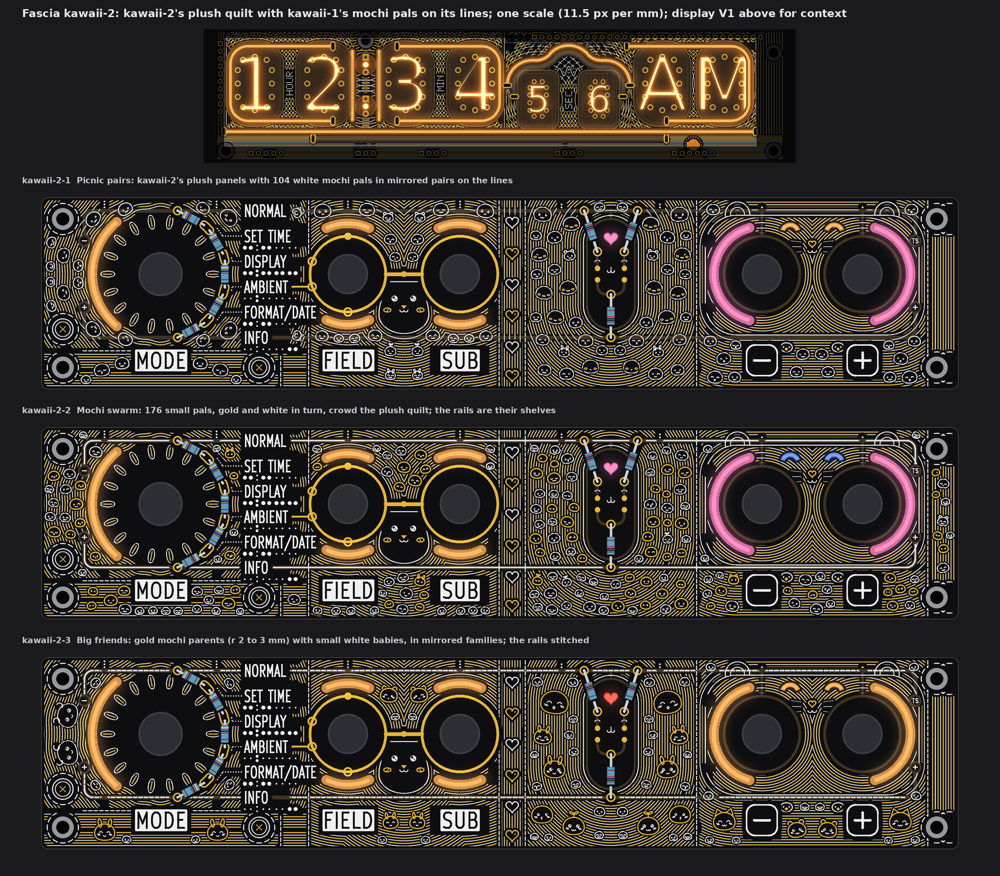
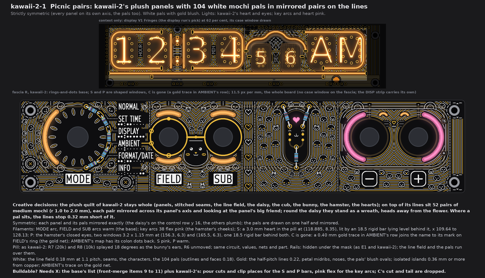
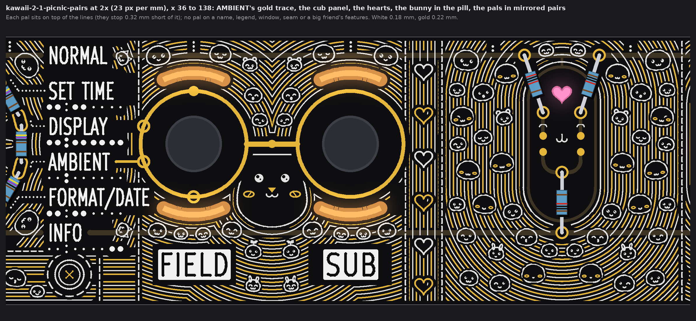
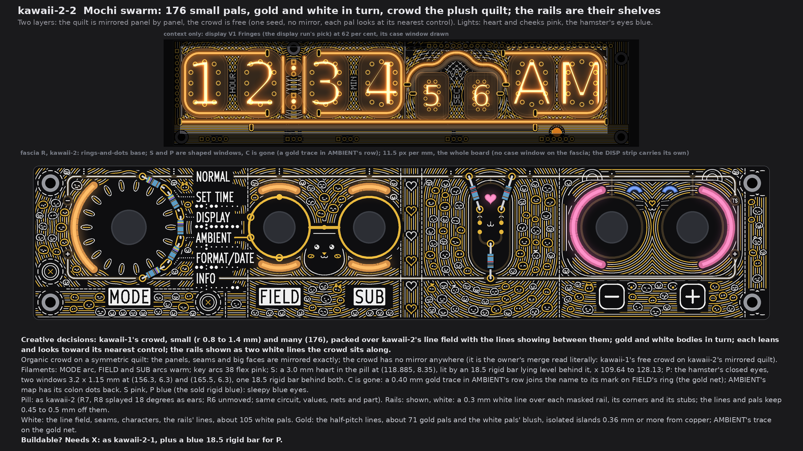
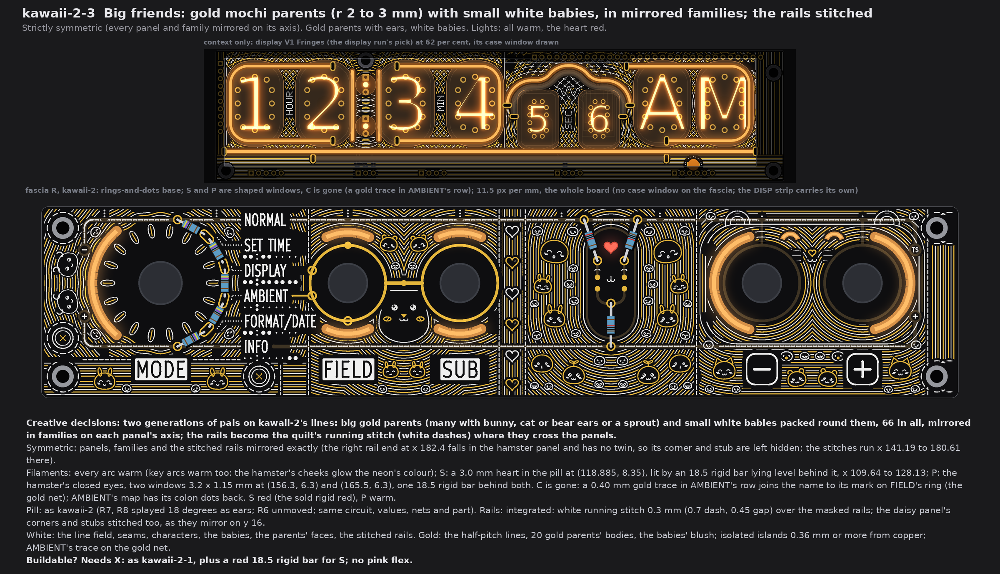
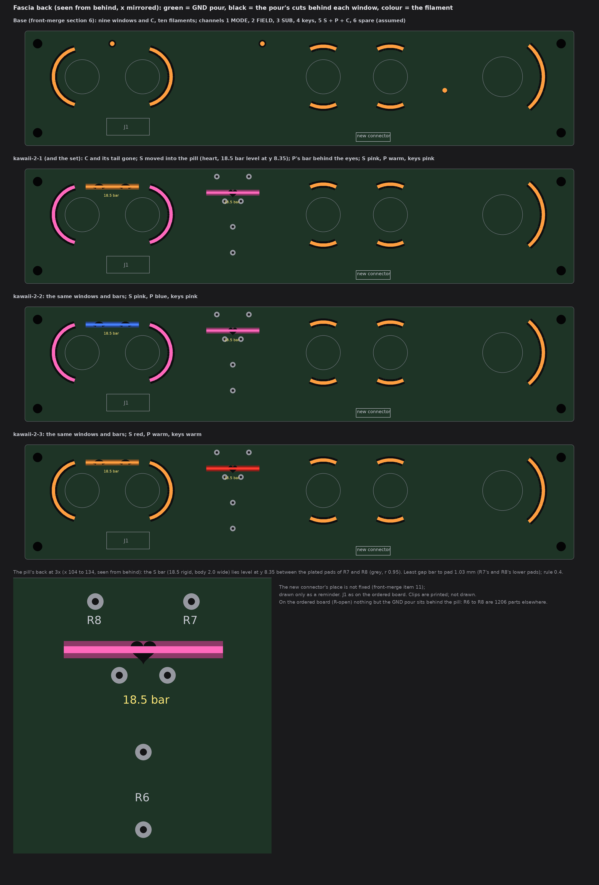

# TS06 fascia, kawaii-2: kawaii-2's plush quilt with kawaii-1's mochi pals on its lines (drawings only, nothing built)

2026-10-14, front round 3, run fascia-kawaii-2. The owner's word (20:5x UTC): "merge kawaii1and2 to have k2 as background with the
large faces and light windows and k1 as more mochi pals overlayed over the lines". So kawaii-2 Plush pals is the background on every
face: its panels, stitched seams, line field, the large faces (the daisy round the dial, the cub whose ears are the levers, the bunny
whose ears are R7 and R8, the hamster whose lit cheeks are the keys) and its light windows (the heart, the hamster's eyes).
Kawaii-1's mochi pals sit on top of the lines. The three faces differ in how many pals, how big, where they gather, white or gold,
mirrored or free, the rails, and the filament colours. All characters are my own.

The queue changes are in: no top-edge dots (S and P are kawaii-2's shaped windows), the pill and the rails said per face, display
V1 Fringes in the strip above each face, and **the AMBIENT cutout C is gone on every face, with a gold trace in its row**
(section 1).

Each face is fascia R with the owner's rings-and-dots (front-merge section 6), drawn from the board file's copy that pass 4 used, at
one scale (11.5 px per mm), windows lit. No board, schematic, fab, tool, 3D, firmware or spec file was touched. The scripts are
scratch (copies of the kawaii run's), not in the repo. Marks: *measured* is from the drawing's raster (23 px per mm) or the board
file; *inferred* is arithmetic; *assumed* is my reading.

## 1. What every face keeps

* **Fixed:** the outline, holes, controls and their places, J1, the names, plates, key legends, tube maps, dot leaders and the
  top-edge tube index; FIELD's and SUB's gold rings, the link, the four SUB marks on FIELD's ring and the GND via.
* **The background, whole:** kawaii-2's panels and their mirror axes, the seams, the line field (white 0.18 mm at 1.1 mm pitch,
  gold 0.22 mm at the half pitch), the four large faces, the hearts column and the sewn buttons.
* **How the pals sit on it:** each pal is a mochi outline with a face. Under each pal the lines stop 0.32 mm short of its body, so
  it reads as lying on top. A pal never sits on:
  * a name, legend, plate, map, leader or index dot (they keep their 0.75 mm calm ground);
  * a window, a seam or a button;
  * the large faces or their features: the cub's head, the bunny's capsule, the hamster's head, ears and paws, the daisy's petals
    and the hearts column.
* **The AMBIENT cutout is gone (queue change A5).**
  * Window C at (45.04, 21.2) and its tail are removed. The mask and the pour close over it.
  * AMBIENT's tube map gets back its two colon dots (E1's, at (45.04, 20.65) and (45.04, 21.55)), as on every other map.
  * **In AMBIENT's row, a 0.40 mm gold trace** runs level at y 18.645 from x 52.43 to 55.75, where it meets the outer edge of
    AMBIENT's circle mark on FIELD's ring. So it is on the gold net, which ties to GND through the link's via.
  * *Measured:* 0.78 from the name and the map, 10.0 from other copper, 0.78 from the pattern's white and gold.
  * *Assumed:* "in its place, in AMBIENT's row" read as the name's own row, joined to its mark. The trace is information, like a
    name, so it is outside the art's mirror.
* **Channels on the new fascia connector** (J1 is full; front-merge items 10 and 11), grouping *assumed* as the earlier runs':
  1 MODE, 2 FIELD up + down, 3 SUB up + down, 4 the two keys, **5 S + P (C dropped)**, 6 spare. Nothing comes from DISP.
* **5 V:** nine fascia filaments instead of ten (C's tail is gone), so 20 mA less than the base at 20 mA each (*inferred*). No
  face adds a filament.
* **Fab note (once):** bare-FR4 windows still need the fab's yes (pass 1's coupon). Not decided here.

## 2. kawaii-2-1 Picnic pairs

* **Creative decisions:** 104 white pals of medium size (r 1.0 to 1.95 mm) sit in mirrored pairs on every panel. Each pair looks
  at its panel's large character. Round the daisy they stand as a wreath, heads away from the flower. Some have bunny, cat or bear
  ears or a sprout.
* **Strictly symmetric.** The pals are drawn on one half of each panel and mirrored on its axis: the daisy's on the control row
  y 16, the others plumb (24.99, 52.89, 75.68, 98.28, 118.885, 160.9, 188.215).
  * *Measured:* the share of a panel's ink with no mirror partner within 2 px is 0 for the daisy, the hems and the edge, at most
    0.3 per cent for the cub and the bunny, and at most 1.6 per cent for the hearts and the hamster (raster rounding, as in
    kawaii-2).
* **Filaments:** MODE arc (38 flex) and the FIELD and SUB arcs (18.5 rigid in curved clips, or 38 flex) are warm. **The key arcs
  are 38 flex pink** (the cheeks). **S is pink** and **P is warm** (section 5).
* **Pill:** as kawaii-2. R7 (20k) and R8 (10k) are splayed 18 degrees out as the bunny's ears; R6 does not move. The circuit,
  values, nets and part do not change.
* **Rails: hidden** under the mask, as in E1 and kawaii-2; the lines and pals run over them.
* **White:** the line field, seams, the characters, the 104 pals (outlines and faces 0.18 mm).
* **Gold:** the half-pitch lines, the petals' midribs, the noses, and the pals' blush ovals. All are isolated islands, 0.36 mm or
  more from copper, plus AMBIENT's trace on the gold net.
* **Buildable? Needs X:** the base's list (front-merge items 9 to 11), plus kawaii-2's pour cuts and clip places for the S and P
  bars, and pink flex for the key arcs. C's cut and tail are dropped.

## 3. kawaii-2-2 Mochi swarm

* **Creative decisions:** kawaii-1's crowd, small (r 0.79 to 1.39 mm) and many: 176 pals, 71 gold and 105 white in turn. They
  are packed over the line field with the lines showing between them. Each leans and looks toward its nearest control. The rails
  are shown as two white lines the crowd sits along.
* **Two layers: a mirrored quilt with a free crowd.** The panels, seams and large faces are mirrored exactly. The crowd has no
  mirror anywhere: one random seed sets every pal. This is the owner's merge read literally (kawaii-1's free crowd on kawaii-2's
  mirrored quilt). If the owner counts it as near-symmetric, kawaii-2-1 is the same idea with the crowd mirrored.
* **Filaments:** as kawaii-2-1, but **P is blue** (the sold 18.5 rigid blue): sleepy blue eyes. S is pink, the key arcs pink.
* **Pill:** as kawaii-2 (R7 and R8 splayed 18 degrees as ears; circuit unchanged).
* **Rails: shown, white.** A 0.3 mm white line runs over each masked rail, its corners and its stubs to the lugs. The lines keep
  0.45 mm off them and the pals 0.5 mm.
* **White:** the line field, seams, characters, the rails' lines, and the 105 white pals.
* **Gold:** the half-pitch lines, the 71 gold pals, and the white pals' blush. All are isolated islands, 0.36 mm or more from
  copper, plus AMBIENT's trace.
* **Buildable? Needs X:** as kawaii-2-1, plus a blue 18.5 rigid bar for P.

## 4. kawaii-2-3 Big friends

* **Creative decisions:** two generations of pals on the lines, 66 in all, mirrored in families on each panel's axis:
  * 22 big parents (r 1.7 to 3.2 mm), most with ears or a sprout; 20 have gold bodies, and the two by the daisy are white because
    copper is too close for gold there;
  * 44 small white babies (r 0.83 to 1.15 mm) packed round them.
  * The rails become the quilt's running stitch where they cross the panels.
* **Strictly symmetric.** The panels, families and stitched rails are mirrored exactly.
  * The stitches are laid from both ends of each panel's span, so they mirror too.
  * The right rail end (x 182.4) falls in the hamster panel and has no twin, so its corner and stub stay hidden. The stitches run
    x 141.19 to 180.61 there, symmetric on 160.9. The daisy panel's corners and stubs are stitched, because they mirror on y 16.
  * *Measured:* mirror misses are 0.04 per cent for the daisy, at most 0.2 per cent for the cub and the bunny, and at most 1.4 per
    cent for the hearts and the hamster.
* **Filaments:** every arc is warm, the key arcs too (the hamster's cheeks glow the neon's colour). **S is red** (the sold 18.5
  rigid red) and P is warm.
* **Pill:** as kawaii-2 (R7 and R8 splayed 18 degrees as ears; circuit unchanged).
* **Rails: integrated** as a white running stitch, 0.3 mm (0.7 mm dashes, 0.45 mm gaps), over the masked rails. The copper does
  not change.
* **White:** the line field, seams, characters, the babies, the parents' faces, and the stitched rails.
* **Gold:** the half-pitch lines, the 20 gold parents, and the babies' blush. All are isolated islands, 0.36 mm or more from
  copper, plus AMBIENT's trace.
* **Buildable? Needs X:** as kawaii-2-1, plus a red 18.5 rigid bar for S. No pink flex is needed.

## 5. The light base and what each face changes

All three faces share one light layout (kawaii-2's windows, without C); only the colours differ.

| Change against the base | Filament (sold list), form | Channel | On the fascia's back |
|---|---|---|---|
| **C and its tail removed** (A5) | none | 5 loses C | C's pour cut closes |
| **S moved into the pill**: a 3.0 mm heart at (118.885, 8.35), 10.3 mm right and 3.85 mm down of the old dot | one **18.5 rigid bar**, level at y 8.35, x 109.64 to 128.13 | 5 | a pour cut under the heart; two clip places at the bar's ends |
| **P reshaped and moved 1.8 mm down**: the hamster's closed eyes, two windows 3.2 x 1.15 mm (0.95 thick) at (156.3, 6.3) and (165.5, 6.3) | one **18.5 rigid bar** behind both, level at y 6.3, x 151.65 to 170.15 | 5 | pour cuts under the eyes; two clip places |
| **Key arcs recoloured** (faces 1 and 2) | 38 flex pink | 4 | none |

**Colours each face ships with:**
* kawaii-2-1: warm + pink (S pink, keys pink).
* kawaii-2-2: warm + pink + blue (S pink, keys pink, P blue).
* kawaii-2-3: warm + red (S red, everything else warm).

All are sold: the 18.5 rigid bar in warm white, pink, blue and red; the 38 flex in pink.

**The open item: does the S tail fit on the pill's back? Yes.**
* The S light is an 18.5 rigid bar lying level behind the heart, its body taken as 2.0 mm wide (y 7.35 to 9.35).
* *Measured* on the art model's pill, to the plated pads of R6 to R8 (r 0.95):
  * 1.03 mm to R7's and R8's lower pads (116.085 and 121.685, 11.33), against the 0.4 rule;
  * 3.63 mm to their upper pads, on the GND rail;
  * 9.93 mm to R6's.
* The clips at the bar's ends (x 109.6 to 111.6 and 126.1 to 128.1) clear every pad.
* *Measured* on the ordered board (`R-open`): there are no tracks or vias on the back in x 100 to 140, y 0 to 22, only the GND
  pour, and R6 to R8 are 1206 parts elsewhere. So on that board the pill's back is empty.
* *Assumed:*
  * the trimmed lead ends of R7 and R8 stand about 1 mm proud, 1.03 mm beside the bar;
  * the back's board-name silk along the top edge (pass 4) stays above y 3, clear of the bar.
* The P bar also fits: its end corner (151.65, 7.3) is 8.79 mm from the key's centre, outside the key footprint's courtyard
  (r 6.2, *measured* in `R-open`).

## 6. The checks (*measured* on the raster, 23 px per mm)

| Check | Rule | kawaii-2-1 | kawaii-2-2 | kawaii-2-3 |
|---|---|---|---|---|
| White, gold to a name, plate, key legend, tube map, leader or index dot | 0.75 | 0.78, 0.80 | 0.78, 0.80 | 0.78, 0.80 |
| White, gold to E1's exposed gold (rings, link, marks, pads, AMBIENT's trace) | 0.30 (frame 0.75 drawn) | 0.75, 0.75 | 0.75, 0.75 | 0.75, 0.75 |
| Pattern gold to copper | 0.30 | 0.36 | 0.36 | 0.36 |
| White, gold to a lit window | 0.35 | 0.39, 0.39 | 0.39, 0.39 | 0.39, 0.39 |
| White to the pattern's gold | 0.30 | 0.31 | 0.31 | 0.31 |
| Lit window to copper; to a legend | 0.30 | 0.68; 1.17 | 0.68; 1.17 | 0.68; 1.17 |
| AMBIENT's trace to a legend; to other copper | 0.75; 0.30 | 0.78; 10.0 | 0.78; 10.0 | 0.78; 10.0 |
| Free board within 1.2 mm of some ink | (no empty space) | 96.7 % | 96.9 % | 96.8 % |
| Pals (gold bodies) | | 104 (0) | 176 (71) | 66 (20) |

* With C gone, the least window-to-legend gap rises from the base's 0.26 (C to AMBIENT) to 1.17 mm.
* What stays dark, as in kawaii-2, is the inside of the cub's head and the bunny's capsule, and the ring of mask between each knob
  and its window.

## 7. My pick

**kawaii-2-1 Picnic pairs.** It keeps all of kawaii-2 (the controls as characters, every name on calm ground, exact symmetry) and
adds a hundred pals in mirrored pairs that sit on the lines without hiding them. kawaii-2-2 Mochi swarm is the fullest crowd if the
owner wants kawaii-1's free look; kawaii-2-3 Big friends is the calmest and all-warm.

## 8. Left open, assumed

* *Assumed:* the S and P lights are 18.5 rigid bars (the shortest sold), lying level behind their windows; earlier runs called
  them "tails".
* *Assumed:* the AMBIENT trace's place (section 1). If the owner meant the trace to sit where C was (under the name, in the map's
  row), it cannot reach the gold net there without passing between the name and its map.
* The rearranged pill is drawn on the art model's places (E1). The ordered board (`R-open`) still has R6 to R8 elsewhere, as
  1206 parts on the back; the board-change run places them.
* The pattern's gold is isolated islands (no net). Stems to GND can be added if the fab wants no floating copper; not drawn.
* The smallest strokes (0.15 to 0.18 mm silk) are at the fab's silk limit used before (0.15). The smallest pals (r 0.8) get only
  dot eyes and a small mouth for that reason.
* Not checked: KiCad DRC (no board file was edited), and the back's own copper behind the moved windows beyond what is said in
  section 5.
