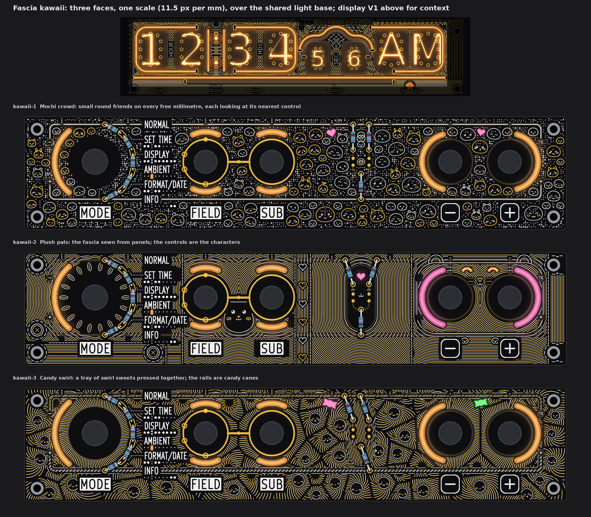
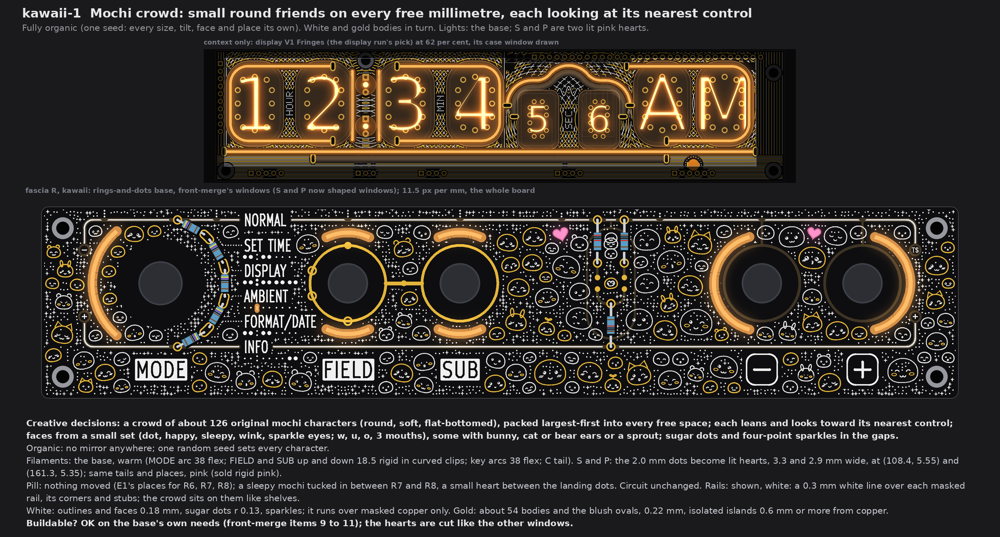
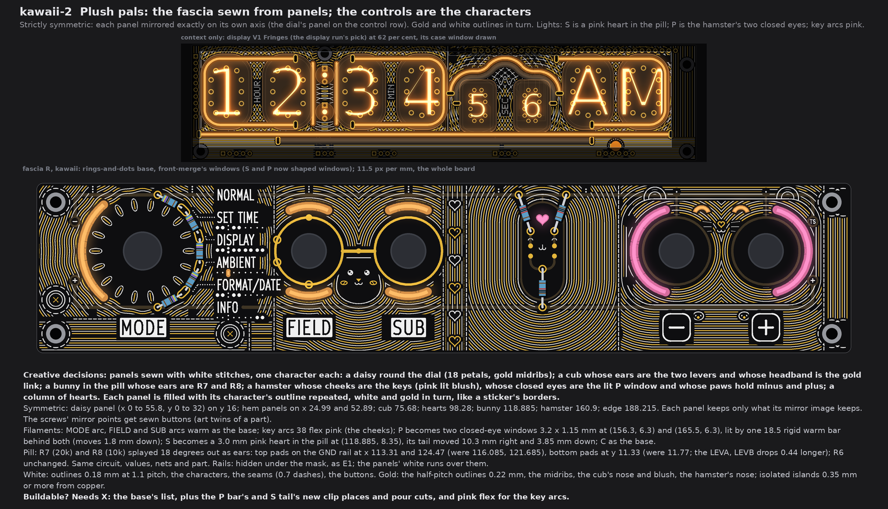
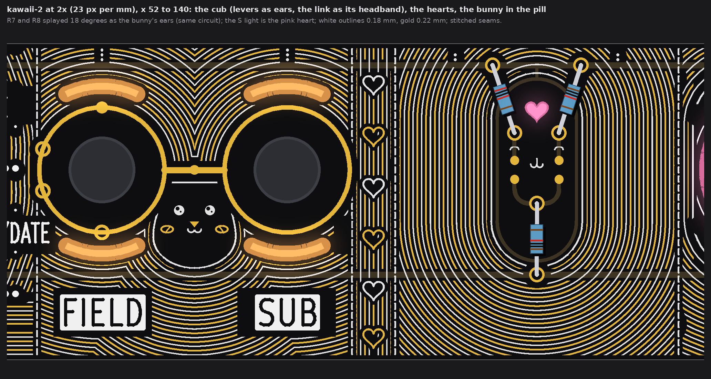
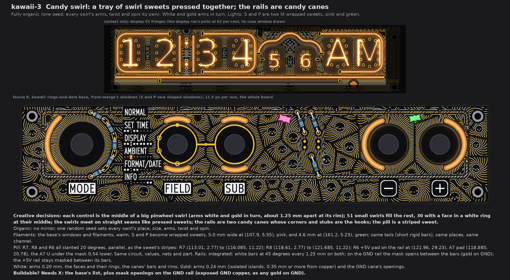
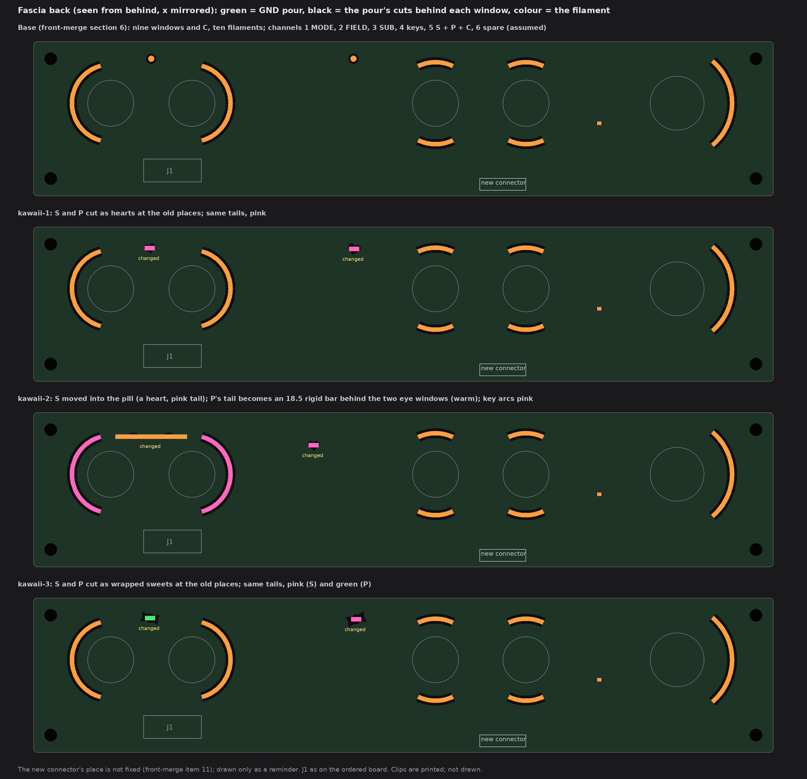

# TS06 fascia, kawaii: three faces over the fascia light base (drawings only, nothing built)

2026-10-14, front round 3, run fascia-kawaii. The owner's word for this theme: "kawaii - name speaks for itself"; all three faces
wild, art over the whole board, info first. Every character is my own; none is an existing character, brand or emblem. The owner's
queue changes of 19:5x UTC are in: the two top-edge dots are gone and their lights feed shaped windows, each face arranges the pill
(the ladder's capsule) and fills it, each face says what it does with the rails, and display V1 Fringes (the display run's pick)
stands above each face as context.

Each face is fascia R with the owner's rings-and-dots (front-merge section 6) and front-merge's windows and C, drawn from the board
file's copy that pass 4 used, at one scale (11.5 px per mm), windows lit. No board, schematic, fab, tool, 3D, firmware or spec file
was touched. The scripts are scratch (copies of the science run's), not in the repo. Marks: *measured* is from the drawing's raster
(23 px per mm) or the board file; *inferred* is arithmetic; *assumed* is my reading.

## 1. What every face keeps

* **Fixed:** the outline, holes, controls and their places, J1, the names, plates, key legends, tube maps, dot leaders and the
  top-edge tube index; FIELD's and SUB's gold rings, the link, the four SUB marks on FIELD's ring and the GND via; C by AMBIENT.
* **Info first:** white and gold keep 0.75 mm from every name, plate, key legend, tube-map dot, leader and index dot, and from
  E1's exposed gold (rings, link, marks, the dial's and ladder's pads), so each stands on its own calm ground. Gold keeps 0.35 mm
  from all other copper; white may run over copper under the mask. Nothing crosses a legend (section 6).
* **The light base:** front-merge's windows and C, warm by default. The two 2.0 mm dots info S (108.6, 4.5) and info P
  (160.9, 4.5) are gone on every face; their lights now feed shaped windows (section 5).
* **Channels on the new fascia connector** (J1 is full; front-merge items 10 and 11), grouping *assumed* as the organic run's:
  1 MODE, 2 FIELD up + down, 3 SUB up + down, 4 the two keys, 5 info S + P + C, 6 spare. All three faces stay on 1 to 5. Nothing
  comes from DISP. No face adds a filament, so the 5 V worst case is the base's (front-merge section 5).
* **Fab note (once):** bare-FR4 windows still need the fab's yes (pass 1's coupon). Not decided here.

## 2. kawaii-1 Mochi crowd

* **Creative decisions:** a crowd of 126 small round characters of my own (soft, flat-bottomed mochi) packed largest-first into
  every free space. Each leans and looks toward its nearest control. Faces come from a small set (dot, happy, sleepy, wink and
  sparkle eyes; w, u, o and 3 mouths); some have bunny, cat or bear ears or a sprout. Sugar dots and four-point sparkles fill the
  gaps. White and gold bodies alternate.
* **Fully organic.** No mirror anywhere; one random seed sets every size, tilt, face and place.
* **Filaments:** the base's, warm: MODE arc 38 flex; FIELD and SUB up and down, 18.5 rigid in curved clips (or 38 flex); the key
  arcs, 38 flex each; C's tail. **S and P become two lit hearts**, 3.3 mm and 2.9 mm wide, at (108.4, 5.55) and (161.3, 5.35),
  tilted -14 and +11 degrees. Same tails, same places, same channel, **pink** (the sold rigid pink).
* **Pill:** nothing moved (E1's places for R6, R7 and R8). A sleepy mochi is tucked in at its top between R7 and R8, and a small
  heart sits between the landing dots. The circuit is unchanged.
* **Rails: shown, white.** A 0.3 mm white line runs over each masked rail, its corners and its stubs to the lugs. The crowd sits on
  them like shelves (the characters keep 0.5 mm off the lines).
* **White:** outlines and faces 0.18 mm, sugar dots r 0.13, sparkles; over masked copper only.
* **Gold:** 54 of the bodies and the blush ovals, 0.22 mm; isolated islands, 0.68 mm or more from copper.
* **Buildable? OK** on the base's own needs (front-merge items 9 to 11); the hearts are cut like the other windows.

## 3. kawaii-2 Plush pals

* **Creative decisions:** the fascia is a plush sewn from panels, with white stitches on the seams, and the controls are the
  characters:
  * a daisy round the dial (18 petals with gold midribs);
  * a cub whose ears are the two levers and whose headband is the gold link;
  * a bunny in the pill whose ears are R7 and R8;
  * a hamster whose cheeks are the keys (their arcs lit pink as blush), whose closed eyes are the lit P window, and whose paws hold
    the minus and plus;
  * a column of hearts.

  Each panel is filled with its character's outline repeated, white and gold in turn, like a sticker's borders.
* **Strictly symmetric.** Each panel is mirrored exactly on its own axis: the dial's panel (x 0 to 55.8, y 0 to 32) on the control
  row y 16 (its rails, taps, ladder, leaders and name rows are all mirrored there); the hems under it on x 24.99 (MODE) and 52.89;
  the cub on 75.68; the hearts on 98.28; the bunny on 118.885; the hamster on 160.9; the edge on 188.215.
  * A panel keeps a stroke only if its mirror image keeps it, so the cuts round the information are mirrored too.
  * *Measured:* the share of a panel's ink with no mirror partner within 2 px is 0 for the daisy, the hems and the edge, at most
    0.2 per cent for the cub and the bunny, and at most 1.3 per cent for the hearts and the hamster (raster rounding).
  * Where a screw's mirror image falls inside a panel, at (4.5, 27.5) and (45.48, 35.5), a sewn button fills the mirrored cut: the
    art's twin of a part.
* **Filaments:**
  * The base's MODE arc and FIELD and SUB arcs stay warm.
  * **The key arcs become pink** (38 flex, pink; the cheeks).
  * **P becomes the hamster's closed eyes:** two windows 3.2 x 1.15 mm, 0.95 thick, at (156.3, 6.3) and (165.5, 6.3). They are lit
    by **one 18.5 rigid bar, warm**, lying level at y 6.3 from x 151.65 to 170.15 behind both. It replaces the tail and sits 1.8 mm
    lower.
  * **S moves into the pill** as a 3.0 mm pink heart at (118.885, 8.35). Its tail moves 10.3 mm right and 3.85 mm down. C stays as
    the base.
* **Pill:** R7 (20k) and R8 (10k) are splayed 18 degrees out as the bunny's ears. R6 does not move. The circuit, values, nets and
  part do not change.
  * The top pads stay on the GND rail, at x 113.31 and 124.47 (were 116.085 and 121.685).
  * The bottom pads stay at x 116.085 and 121.685, now at y 11.33 (were 11.77), so the LEVA and LEVB drops are 0.44 mm longer.
  * The pads keep 1.0 mm or more from the capsule's GND walls (*inferred*).
  * The landing dots (the eyes) do not move. Nor do the A7 U and its route to J1 pin 4 (A7, at (154.4, 30.55) on the back, as on
    the ordered board).
* **Rails: hidden** under the mask, as in E1; the panels' white runs over them.
* **White:** outlines 0.18 mm at 1.1 mm pitch, the characters, the seams (0.7 mm dashes), the buttons.
* **Gold:** the half-pitch outlines 0.22 mm, the petals' midribs, the cub's nose and blush, the hamster's nose; isolated islands,
  0.36 mm or more from copper.
* **Buildable? Needs X:** the base's list, plus new clip places and pour cuts for the P bar and the moved S tail, and pink flex
  for the key arcs.

## 4. kawaii-3 Candy swirl

* **Creative decisions:** a tray of swirl sweets pressed together.
  * Each control is the middle of a big pinwheel swirl: 46 to 58 arms, white and gold in turn, about 1.25 mm apart at its rim,
    each with its own twist and spin.
  * 51 smaller swirls fill the rest. 30 of them have a face in a white ring at their middle.
  * The swirls meet on straight seams, like pressed sweets.
  * The rails are two candy canes; their corners and stubs to the lugs are the hooks.
  * The pill is a striped sweet.
* **Fully organic.** No mirror; one random seed sets every swirl's place, size, arms, twist and spin.
* **Filaments:** the base's windows and filaments, warm. **S and P become two lit wrapped sweets**: 5.0 mm wide at (107.9, 5.55),
  **pink**, and 4.6 mm at (161.2, 5.25), **green**. Same tails at the same places (*assumed* the shortest sold rigid bar, 18.5,
  lying behind each sweet), same channel.
* **Pill:** R7, R8 and R6 are all slanted 20 degrees, parallel, as the sweet's stripes. White and gold stripes 0.95 mm apart run
  parallel to them inside the capsule. The circuit, values, nets and part do not change.
  * R7 runs from (113.01, 2.77) to (116.085, 11.22).
  * R8 runs from (118.61, 2.77) to (121.685, 11.22). Its top pad meets the capsule's GND stem, which is the same net.
  * R6's +5V pad sits on the rail at (121.96, 29.23), 1.25 mm from the capsule's bottom arc (*inferred*). Its A7 pad is at
    (118.885, 20.78), and the A7 U under the mask moves 0.54 mm lower.
* **Rails: integrated** as canes. White bars at 45 degrees, every 1.25 mm, cross both rails, and a white rim runs 0.6 mm off each
  cane. On the GND rail the mask opens between the bars (gold, on GND); the +5V rail stays masked between its bars. The copper does
  not change.
* **White:** the arms 0.20 mm, the faces and their rings, the canes' bars and rims.
* **Gold:** the arms 0.24 mm (isolated islands, 0.34 mm or more from any copper that is not the GND rail), and the GND cane's
  openings.
* **Buildable? Needs X:** the base's list, plus mask openings on the GND rail (exposed GND copper, like any gold on GND).

## 5. The light base and what each face changes

| Face | Change against the base | Filament (sold list), form | Colour | Channel | On the fascia's back |
|---|---|---|---|---|---|
| kawaii-1 | S and P reshaped as hearts (3.3 and 2.9 mm), same places | the base's tails | pink | 5 | the pour cuts follow the hearts |
| kawaii-2 | **S moved** to (118.885, 8.35) as a 3.0 mm heart; **P reshaped and moved 1.8 mm down** into two closed-eye windows at (156.3, 6.3) and (165.5, 6.3); key arcs recoloured | S: the tail, moved; P: **one 18.5 rigid bar**, level, x 151.65 to 170.15; keys: 38 flex | S pink, P warm, keys **pink** | 5, 5, 4 | new pour cuts and clip places; the S tail sits between R7's and R8's leads on the pill's back (room *assumed*) |
| kawaii-3 | S and P reshaped as wrapped sweets (5.0 and 4.6 mm), same places | the tails (*assumed* 18.5 rigid) | S pink, P **green** | 5 | the pour cuts follow the sweets |

**Colours each face ships with:** kawaii-1 warm + pink; kawaii-2 warm + pink; kawaii-3 warm + pink + green. No face adds a
filament or a channel; the 5 V worst case stays the base's.

## 6. The checks (*measured* on the raster, 23 px per mm)

| Check | Rule | kawaii-1 | kawaii-2 | kawaii-3 |
|---|---|---|---|---|
| White, gold to a name, plate, key legend, tube map, leader or index dot | 0.75 | 0.78, 1.04 | 0.78, 0.80 | 0.78, 0.78 |
| White, gold to E1's exposed gold (rings, link, marks, pads) | 0.30 (frame 0.75 drawn) | 0.74, 1.03 | 0.75, 0.75 | 0.74, 0.74 |
| Pattern gold to copper (kawaii-3: other than the GND cane it opens) | 0.30 | 0.68 | 0.36 | 0.34 |
| White, gold to a lit window | 0.35 | 0.39, 0.59 | 0.39, 0.39 | 0.37, 0.37 |
| White to the pattern's gold | 0.30 | 0.31 | 0.31 | 0.31 |
| Lit window to copper | 0.30 | 0.68 | 0.68 | 0.35 (the sweets to the GND rail) |
| Free board within 1.2 mm of some ink | (no empty space) | 99.9 % | 96.8 % | 99.8 % |

* The least window-to-legend gap on every face is the base's C to AMBIENT's box, 0.26 mm on this raster (front-merge gave 0.32
  with its own box). It is the base's, not a face's; the board-change run should measure it in KiCad.
* What stays dark on kawaii-2 is the characters' own faces (inside the cub's head, the bunny's capsule) and the ring of mask between
  each knob and its window.

## 7. My pick

**kawaii-2 Plush pals.** Here the controls are the characters: the levers are the cub's ears with the link as its headband, the keys
are the hamster's lit cheeks, and R7 and R8 are the bunny's ears. So it reads as kawaii from arm's length, while every name keeps its
calm ground, and it is the strictly symmetric one. kawaii-1 Mochi crowd is the warmest fill if the owner wants the whole board
covered without panels.

## 8. Left open, assumed

* *Assumed:* the info tails are short bars (as the science run took them). kawaii-3's sweets want the shortest sold rigid bar
  behind each.
* *Assumed:* kawaii-2's S tail fits on the pill's back between the leads of R7 and R8. The back's room was not checked.
* The rearranged pills are drawn on the art model's places (E1). The ordered board (`R-open`) still has R6 to R8 elsewhere, as
  1206 parts on the back; the board-change run places them.
* The pattern's gold is isolated islands (no net), except kawaii-3's cane openings, which are the GND rail itself. Stems to GND can
  be added if the fab wants no floating copper; not drawn.
* The faces' smallest strokes (0.15 to 0.18 mm silk) are at the fab's silk limit used before (0.15); the canes' mask openings are
  0.3 mm wide (*inferred* printable, not asked).
* Not checked: KiCad DRC (no board file edited), and the back's own copper behind the new and moved windows.
