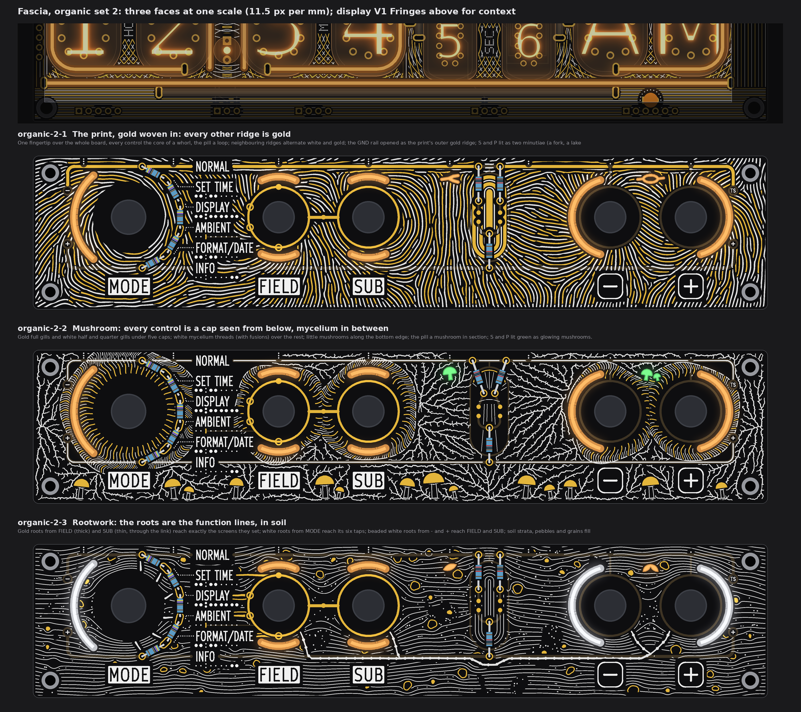
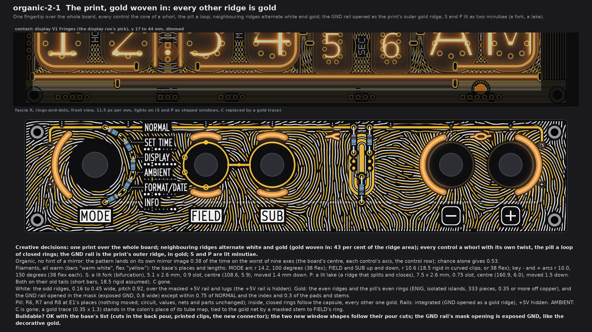
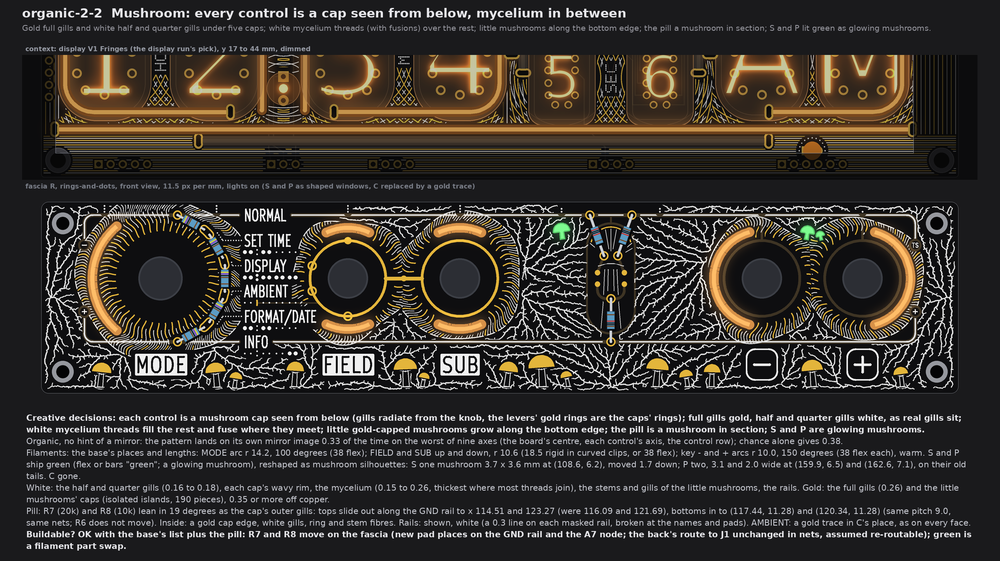
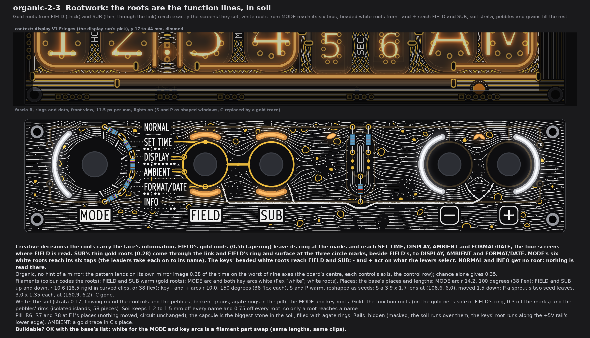
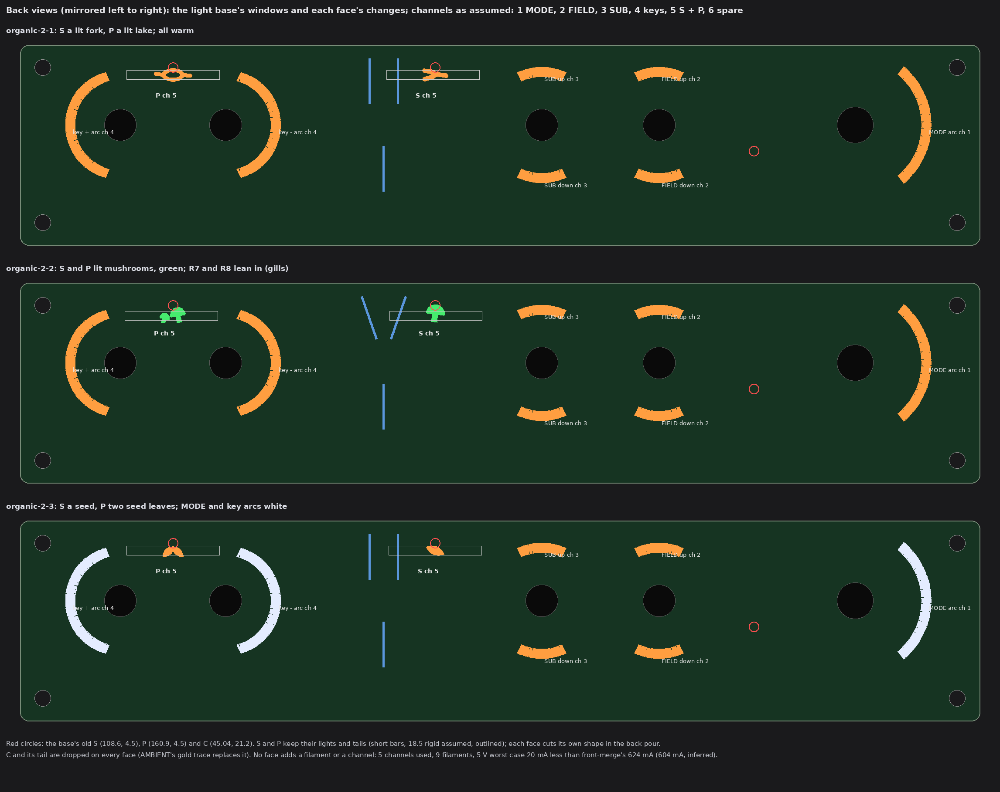
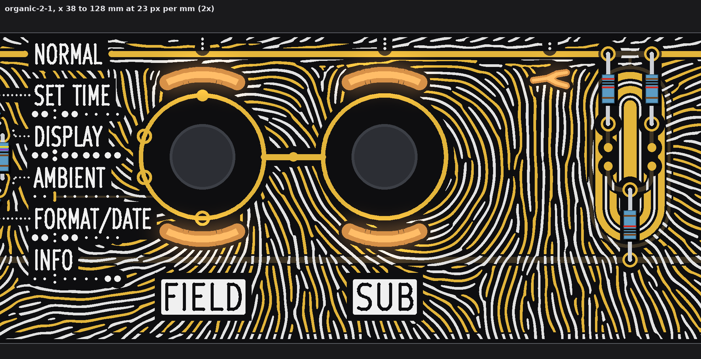

# TS06 fascia, organic set 2: the print with gold woven in, mushroom, rootwork that carries the function lines (drawings and checks only)

2026-10-14, front round 3, run fascia-organic-2. The owner's words for this set (19:5x UTC): "add the organic set back to the queue
with these changes: more gold integration in fingerprint, lines can alternate for example , / replace heartwood for mushroom
variant , make rootwork actually convey info". The first set (`TS06-FASCIA-organic.md`) stays as history. All three faces take the
queue's changes A1 to A5: the top dots S and P are gone and their lights feed shaped windows; each face says what it does with the
pill and the rails; display V1 Fringes stands above each face for context; window C by AMBIENT is gone and a gold trace takes its
place.

No board, schematic, fab, tool, 3D, firmware or spec file was touched. Each face is fascia R as front-merge left it (rings-and-dots:
FIELD's and SUB's gold rings and link, the four marks on FIELD's ring, the dial's and the ladder's pads, the names, plates, leaders,
tube maps and index; `PCB/art/TS06-FRONT-merge.md` section 6), at one scale (11.5 px per mm), lights on. Marks: *measured* is on the
drawn rasters (23 px per mm) or the art model; *inferred* is arithmetic; *assumed* is my reading. The scripts are scratch copies of
the first organic run's and the kawaii run's, not in the repo.

**All three are fully organic and wild** (no hint of a mirror: each lands on its own mirror image less often than chance on the
worst of nine axes, section 6). They differ by motif (a print, fungi, roots in soil), by lead ink (gold and white in equal turns;
white-led with gold gills; white soil with gold function roots), by what the lights draw (two lit minutiae; two glowing green
mushrooms; a seed and a sprout, with the lights coloured to match the roots), and by what they do with the pill and the rails.

## 1. What every face keeps, and the queue's changes

* **Fixed:** outline, holes, controls and their places, J1, the names, plates, key legends, dot leaders, tube maps, the index, FIELD's
  and SUB's gold rings, the link, the four SUB marks on FIELD's ring, the GND via. Pattern stays 0.78 or more from every legend and
  0.74 or more from E1's exposed gold (section 6), so each stands on its own calm ground.
* **A1, S and P:** the two 2.0 mm dots at (108.6, 4.5) and (160.9, 4.5) are gone; their lights and tails stay and light shaped
  windows (section 5). The tails are *assumed* short bars (18.5 rigid), as the kawaii and science runs took them.
* **A5, AMBIENT:** window C (45.04, 21.2) and its tail are gone on every face. In its place, in AMBIENT's tube map where the colon's
  two dots were, a **gold trace** 0.35 wide and 1.3 long (45.04, 20.62 to 21.58), ENIG, 0.46 below AMBIENT's name and 0.97 from the
  map's dots (*measured* on the model). It stands for the colon, which is what AMBIENT changes (pass 4's tube map). It sits **on the
  gold net** through a masked copper stem, 0.25 wide, along the map row (y 21.1) to FIELD's ring at (57.96, 21.1), 12.9 mm, under the
  map's white dots. *Assumed:* that "on the gold net" meant tied, not an isolated island; the stem can be dropped if not.
* **A4:** display V1 Fringes (`PCB/art/TS06-DISP-final/v1-fringes.png`), y 17 to 44 mm, dimmed, above each face.
* **Channels on the new fascia connector** (J1 is full; front-merge items 10 and 11), grouping *assumed* as the first organic run's:
  1 MODE, 2 FIELD up + down, 3 SUB up + down, 4 the two keys, 5 S + P, 6 spare. No face adds a filament or a channel. With C gone
  the fascia carries 9 filaments; at 20 mA each the 5 V worst case drops 20 mA below front-merge's 624 mA, to 604 mA (*inferred*).
* **Fab note (once):** bare-FR4 windows still need the fab's yes (pass 1's coupon). Not decided here.

## 2. organic-2-1 The print, gold woven in

* **Creative decisions:** one fingertip over the whole board; **neighbouring ridges alternate white and gold** (the ridges are
  labelled and two-coloured so that each ridge's neighbours across a valley take the other ink; 78 per cent of the ridge contact
  alternates, the rest is where ridges fork, as in a real print); every control the core of a whorl with its own twist; the pill a
  loop of closed rings; the GND rail is the print's outer ridge, in gold, and the ridges near it run along it; S and P are lit minutiae.
* **Organic.** Mirror overlap 0.38 on the worst axis, chance 0.53 (*measured*).
* **Filaments:** all warm (bars "warm white", flex "yellow"), the base's places and lengths: MODE arc (38 flex), FIELD and SUB up
  and down (18.5 rigid in curved clips, or 38 flex), key arcs (38 flex each). **S: a lit fork** (a ridge that splits), slot 0.9,
  5.1 x 2.6 mm (x 106.05 to 111.15, y 4.70 to 7.30), centre (108.6, 5.9), 1.4 mm lower than the old dot. **P: a lit lake** (a ridge that splits and closes round an island
  of mask), slot 0.75, 7.5 x 2.6 mm (x 157.13 to 164.67, y 4.69 to 7.31), centre (160.9, 6.0), 1.5 mm lower. Both on their old tails.
* **White:** the odd ridges, 0.17 to about 0.45 wide, pitch 0.92, 579 pieces; over the masked +5V rail and lugs.
* **Gold:** the even ridges and the pill's even rings, ENIG, 333 isolated islands, 43 per cent of the ridge area; plus the opened
  GND rail.
* **Pill:** R6, R7 and R8 at E1's places; **nothing moved**, circuit, values, nets and parts unchanged. Inside, closed rings follow
  the capsule (the print's loop core), every other one gold, clear of the pads, the landing dots and the bodies.
* **Rails: integrated.** The GND rail (0.8 wide) is opened in the mask along its length as the print's outer gold ridge (exposed
  GND, like decorative gold on GND), broken within 0.75 of NORMAL and the index and within 0.3 of the pads and the stems that hang from it; the +5V rail stays masked
  and hidden under the white ridges (no bare 5 V on the face, as pass 4 chose).
* **Buildable? OK** with the base's list (cuts in the back pour, printed clips, the new connector); the two new window shapes want
  their own pour cuts; the GND rail's mask opening is one more mask edit.

## 3. organic-2-2 Mushroom (replaces Heartwood)

* **Creative decisions:** every control is a mushroom **cap seen from below**: gills radiate from the knob to a wavy rim, the
  levers' gold rings are the caps' rings; full gills gold, half and quarter gills white and shorter, as real gills sit (the radial
  print a cap leaves is its **spore print**); white **mycelium** threads grow from the caps' rims and the little mushrooms' feet over
  the rest of the board and fuse where they meet (389 fusions); 14 little gold-capped **mushrooms** stand along the bottom edge
  between the plates; the pill is a mushroom in section; S and P are glowing mushrooms.
* **Organic.** Mirror overlap 0.33, chance 0.38 (*measured*).
* **Filaments:** the base's places and lengths, warm, except **S and P, green** (flex or bars "green", on the sold list; a glowing
  mushroom). S: one mushroom silhouette 3.7 x 3.6 mm, x 106.75 to 110.43, y 4.35 to 7.97 (cap 3.7 wide on a stem), centred 1.7 mm
  lower than the old dot. P: two mushrooms, caps 3.1 and 2.0 wide, x 158.37 to 163.57, y 4.90 to 8.17. Both on their old tails.
* **White:** the half and quarter gills (0.16 to 0.18), each cap's rim, the mycelium (0.15 to 0.26, thickest where most threads
  join), the stems and gills of the little mushrooms, the pill's gills and stem fibres, the rail lines; 298 pieces.
* **Gold:** the full gills (0.26), the little mushrooms' caps, the pill's cap edge; 190 isolated islands.
* **Pill: rearranged.** R7 (20k) and R8 (10k) **lean in 19 degrees** as the cap's outer gills: their top pads slide out along the
  GND rail to (114.51, 2.77) and (123.27, 2.77) (were x 116.09 and 121.69), their bottom pads come in to (117.44, 11.28) and
  (120.34, 11.28) (were (116.09, 11.77) and (121.69, 11.77)). Same parts, values, nets and 9.0 mm pitch; R6 does not move. *Measured*
  on the model: the bottom pads 1.00 apart edge to edge, every moved pad 1.55 or more from the capsule's copper, the top pads still on
  the GND rail. Inside the capsule: a gold cap edge (r 4.25), white gills fanning up from the stem's top, a ring and stem fibres.
* **Rails: shown, white.** A 0.3 white line on each masked rail, its corners and its stubs to the lugs, broken at NORMAL, INFO and
  the pads; the mycelium keeps 0.3 off it. It reads as the bed the mushrooms grow in.
* **Buildable? Needs X:** the base's list, plus the pill's new pad places for R7 and R8 on the fascia. The ordered board
  (`R-open.kicad_pcb`) still has R6 to R8 elsewhere as 1206 parts on the back (the kawaii run noted the same); the board-change run
  places them and re-routes A7's two pads to J1 (nets unchanged, room *assumed*). Green is a filament part swap.

## 4. organic-2-3 Rootwork that carries the function lines

* **Creative decisions:** the roots are the face's information; everything else is soil. **Each control's roots reach exactly what
  it serves, and nothing else does** (soil keeps 1.2 to 1.5 mm off every name and 0.75 off every root):

  | Control | Roots (ink, width) | Reach | True because (source) |
  |---|---|---|---|
  | FIELD | gold, 0.56 tapering to 0.36, from FIELD's ring at its marks | SET TIME, DISPLAY, AMBIENT, FORMAT/DATE | FIELD is read on screens 2 to 5, not on 1 and 6 (spec Rev D.4 section 1, the control table, `knowledge/TERMINAL-06-spec.txt`) |
  | SUB | gold, 0.28, a thin twin beside FIELD's root, leaving the three circle marks | DISPLAY, AMBIENT, FORMAT/DATE | SUB is read only when FIELD is thrown (spec section 1, the SUB rule), so SUB's roots come through the link and FIELD's ring: the rule drawn as a graft. AMBIENT's SUB use is control option 2 (`TS06-FRONT-merge.md` section 5) and its open circle mark (section 6); the spec's table predates it and says "not read" there |
  | MODE | white, 0.46 tapering to 0.28, six short radial roots | its six taps at 30 degree steps; the leaders carry each tap on to its name | the rotary picks the screen, six positions 30.00 degrees apart (spec section 1 and the control scheme rev B, "Step angle closed") |
  | - and + | white, beaded (nodules every 2.2 mm), 0.36 to 0.50, one taproot along the +5V rail's lower edge | FIELD and SUB (a branch up into each ring) | "Buttons are always - / + on whatever the levers point at" (spec section 1) |
  | NORMAL, INFO | no root | | every input is ignored on both parking screens (spec section 1) |

  Thickness codes the control (thick gold FIELD, thin gold SUB, white MODE, beaded white keys), and the lights match: the gold-rooted
  levers lit warm, the white-rooted MODE arc and key arcs lit white. The soil: white strata that flow round the controls, the pill
  and 70 pebbles (a stream function), broken here and there; gold-rimmed pebbles; white grains; agate rings in the pill.
* **Organic.** Mirror overlap 0.28, chance 0.35 (*measured*).
* **Filaments:** the base's places and lengths. Colours: FIELD and SUB arcs warm; **MODE arc and both key arcs white** (flex
  "white", sold); S and P warm. **S: a seed** (a lens 3.9 x 1.7, tilted 22 degrees) at (108.6, 6.0), 1.5 mm lower than the old dot;
  **P: a sprout's two seed leaves** (lenses 3.0 x 1.35, at plus and minus 42 degrees) at (160.9, 6.2), 1.7 mm lower. Both on their old tails.
* **White:** the strata (0.17), grains, the pill's agate rings, MODE's and the keys' roots; 883 pieces.
* **Gold:** the seven function roots (on the gold net's side: they come to 0.31 of FIELD's ring and marks, *measured*; tie them on by
  closing the gap if the fab wants them on the net) and the pebbles' rims; 58 pattern islands.
* **Pill:** R6, R7 and R8 at E1's places, **nothing moved**, circuit unchanged; the capsule is the biggest stone in the soil, filled
  with agate rings; the keys' taproot dips under R6's +5V pad (to y 31.4) on its way.
* **Rails: hidden** (masked, as in E1); the soil runs over them.
* **Buildable? OK** with the base's list; white for MODE and the keys is a filament part swap (same lengths, same clips).

## 5. The light base and what each face changes

| Face | Change against the base | Filament (sold list), form | Colours shipped | Channel | Cost on the back |
|---|---|---|---|---|---|
| all | C and its tail dropped (A5) | | | 5 loses C | one pour cut less |
| organic-2-1 | S: lit fork 5.1 x 2.6 at (108.6, 5.9), 1.4 lower; P: lit lake 7.5 x 2.6 at (160.9, 6.0), 1.5 lower | the old tails (18.5 rigid, *assumed*) | all warm | 5 | the pour cuts follow the shapes |
| organic-2-2 | S: one mushroom 3.7 x 3.6, 1.7 lower; P: two mushrooms 5.2 x 3.3 | the old tails | warm; **S and P green** | 5 | the pour cuts follow the shapes; R7 and R8 move (section 3) |
| organic-2-3 | S: a seed 3.6 x 1.9 overall at (108.6, 6.0), 1.5 lower; P: two seed leaves 4.1 x 2.0 overall at (160.9, 6.2), 1.7 lower | the old tails | warm; **MODE arc and key arcs white** | 5; 1 and 4 white | the pour cuts follow the shapes |

All windows keep 0.68 or more from copper and 1.17 or more from a legend (*measured*). No face needs a sixth channel.

## 6. The checks (*measured* on the 23 px per mm rasters)

| Check | Rule | 2-1 print | 2-2 mushroom | 2-3 rootwork |
|---|---|---|---|---|
| White, gold to a name, plate, key legend, tube map, leader or index | 0.75 | 0.78, 0.79 | 0.78, 0.80 | 0.78, 0.80 |
| White, gold to E1's exposed gold (rings, link, marks, pads) | 0.30 (0.75 frame drawn) | 0.74, 0.74 | 0.74, 0.75 | 0.68, 0.77 (roots 0.31, on purpose) |
| Pattern gold to any other copper | 0.30 | 0.34 | 0.35 | 0.37 |
| White, gold to a lit window | 0.35 | 0.36, 0.36 | 0.36, 0.37 | 0.39, 0.40 |
| White to gold | 0.15 | 0.22 | 0.22 | 0.22 |
| Gold to the board edge | 1.4 (pass 4's checker) | 1.48 | 1.61 | 1.48 |
| Gold to a screw head (r 2.25) | 3.0 | 3.05 (keep-out) | same | same |
| Thinnest white / gold piece | 0.15 silk | 0.17 / 0.26 | 0.17 / 0.25 | 0.17 / 0.27 |
| Lit window to copper, to a legend | 0.30 | 0.68, 1.17 | 0.68, 1.17 | 0.68, 1.17 |
| Free board within 1.2 mm of some ink | no empty space | 99.7 % | 98.1 % | 99.4 % |
| Mirror overlap, worst axis / chance | below chance | 0.38 / 0.53 | 0.33 / 0.38 | 0.28 / 0.35 |

White runs over masked copper (rails, lugs, the key rings, the stems) by design, as on every face before. The pattern's gold is
isolated islands (no net) except the print's opened GND rail; stems to GND can be added if the fab wants no floating copper.

## 7. Detail and my pick

The print at 23 px per mm, x 38 to 128: the names on their calm ground, AMBIENT's gold trace in its map, FIELD's and SUB's whorls
with the ridges alternating gold and white, the opened GND rail, the lit fork (S) and the pill's ring loop.

**My pick: 2-1, the print.** It is the owner's own change made literal: every other ridge is gold, so gold runs through the whole
board instead of sitting round the levers, the print covers 99.7 per cent of the free board, and it needs nothing beyond the light
base. Rootwork is the runner-up where the face should explain itself: it is the only one whose art is the function lines.

## 8. Left open, assumed

* The connector's channel grouping is *assumed* (front-merge left it open); the info tails are *assumed* short bars.
* AMBIENT's gold trace is tied to the gold net by a masked stem (*assumed* wanted); the stem's 12.9 mm under the mask is not on any
  earlier drawing.
* Rootwork follows control option 2 (SUB on AMBIENT) from front-merge and the owner's standing marks; the spec's control table still
  says "not read" for SUB on AMBIENT, and the firmware does not implement the control scheme yet (spec section 5). If option 2 is
  dropped, AMBIENT's SUB root and its circle mark go together.
* Mushroom's R7 and R8 places are drawn on the art model (E1). The back's room for their routes and for the S and P tails beside the
  pill is not checked; the board-change run places them.
* The green and white filaments' glow through 1.6 mm FR4 next to warm windows is not tried; the bench decides.
* Not checked: KiCad DRC (no board file edited). Ridge pitch, gill counts, strata pitch, pebble sizes and the seeds are choices.
