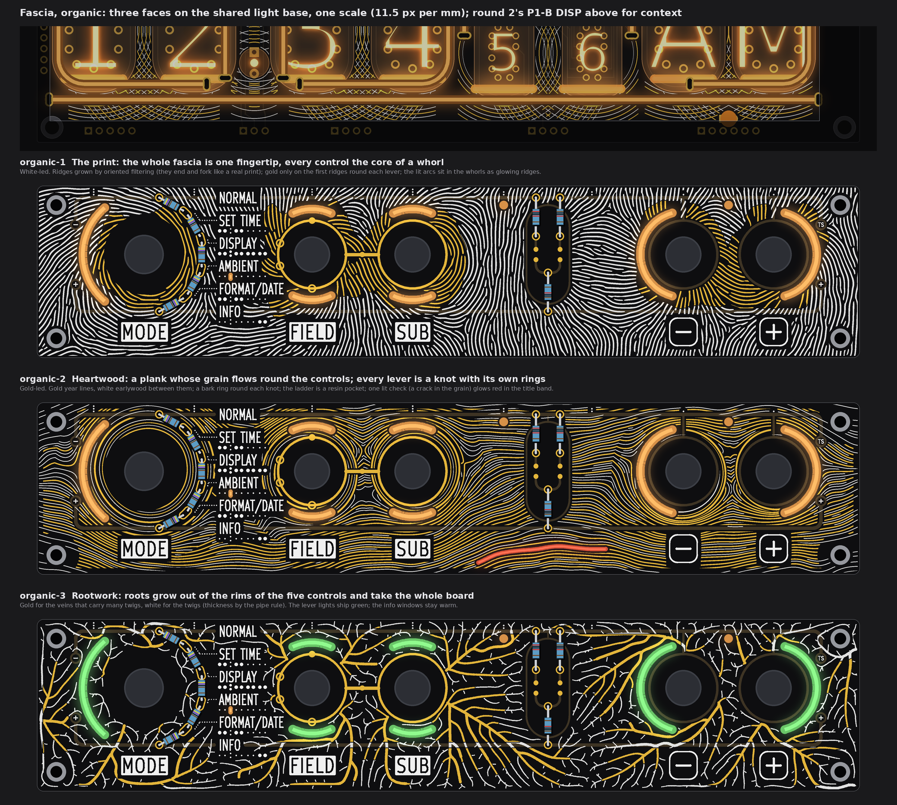
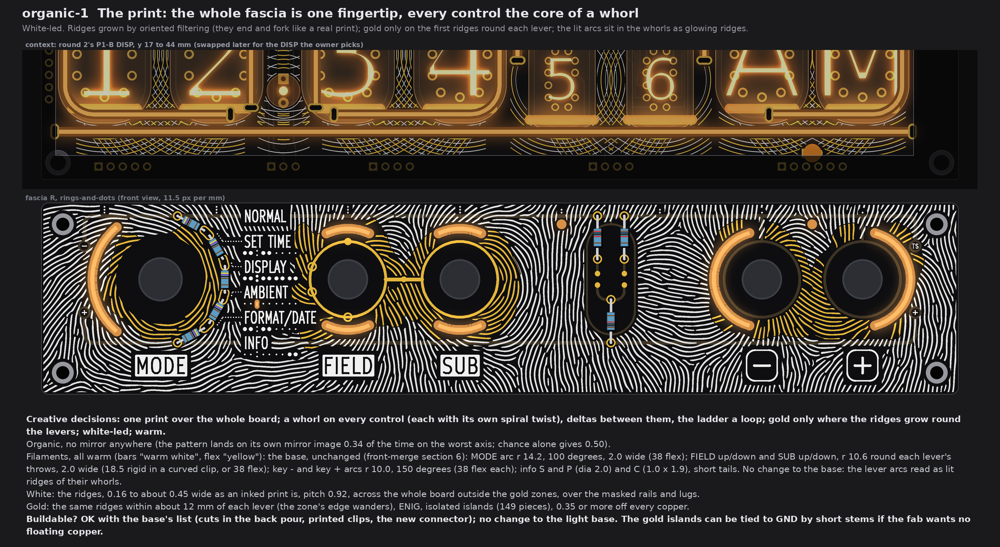
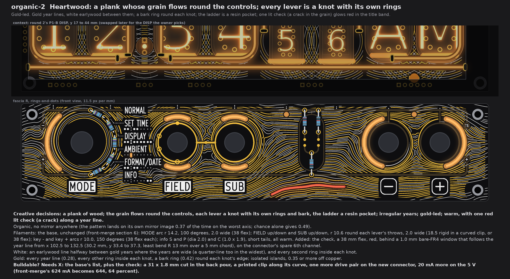
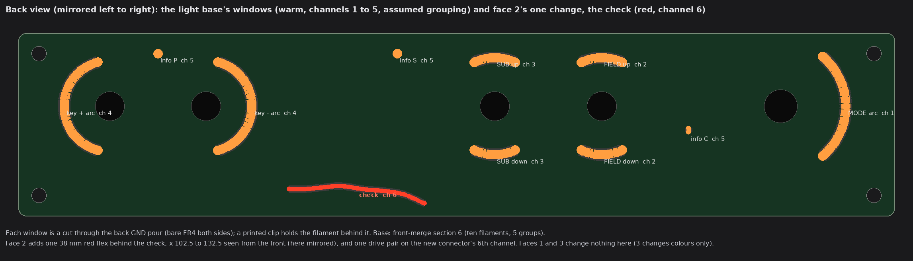
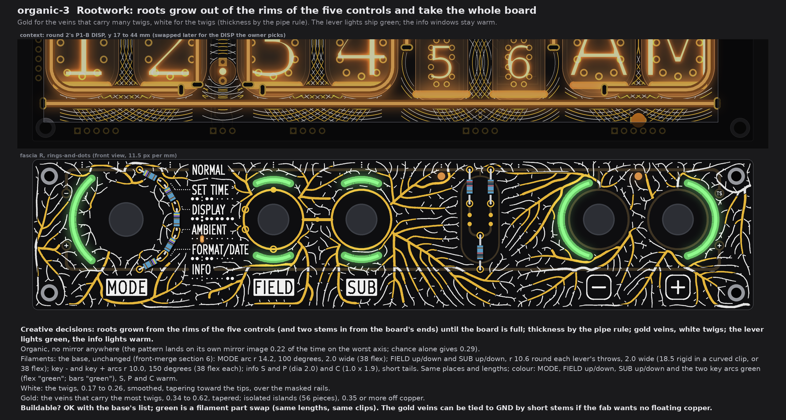
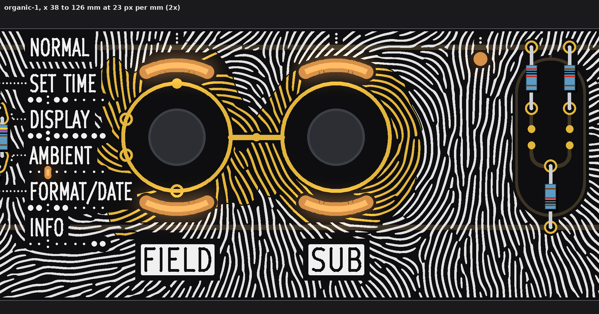

# TS06 fascia, theme organic: three faces on the shared light base (drawings and checks only)

2026-10-14, front round 3, run fascia-organic. No board, schematic, fab, tool, 3D, firmware or spec file was touched. The faces are
drawn on fascia R as front-merge left it (E1 made rings-and-dots: FIELD's and SUB's gold rings and link, the four marks on FIELD's
ring, the dial's pads, the ladder, the tube map, the names and plates; `PCB/art/TS06-FRONT-merge.md` section 6), with that
section's nine windows and C as the light base. One scale, 11.5 px per mm; above each face, round 2's P1-B DISP (y 17 to 44 mm,
dimmed) for context only. Marks: *measured* is on the drawn rasters (23 px per mm) or the art model; *inferred* is arithmetic;
*assumed* is my reading, not measured or asked. The scratch scripts stay in the run's folder, not in the repo.

**All three are fully organic and wild:** the pattern runs over the whole board (white over the masked rails and lugs too), and
every name, plate, key plate, leader, the tube map, the index and E1's gold stands on its own clear ground (0.78 mm or more).
They differ by motif (a print, a plank, roots), by lead ink (white, gold, gold-and-white), by what the lights draw (the base as
lit ridges; the base plus a lit crack; the base in green), and by composition (one field round many cores; a flow with knots;
a branching network).

## The light base (common to all), and the channels

* **Windows** (bare FR4, no copper either side, lit from behind; front-merge section 6, unchanged in place and size): MODE arc
  r 14.2 about the dial, 130 to 230 degrees, 2.0 wide (38 flex); FIELD up and down, SUB up and down, r 10.6 round each lever's
  throws (18.5 rigid in a curved clip, or 38 flex); key - and key + arcs r 10.0, 150 degrees each (38 flex); info S (108.6, 4.5)
  and P (160.9, 4.5), dia 2.0, and C (45.04, 21.2), 1.0 x 1.9 (short tails). Ten filaments.
* **Channels on the new fascia connector** (J1 is full; front-merge items 10 and 11). The grouping is *assumed* (front-merge
  did not fix it): 1 MODE, 2 FIELD up + down, 3 SUB up + down, 4 the two keys, 5 info S + P + C, 6 spare. Faces 1 and 3 use
  1 to 5; face 2 puts its one new filament on 6. Nothing comes from DISP.
* **Fab note (once):** bare-FR4 windows still need the fab's yes (pass 1's coupon). Not decided here.

## 1. The print (white-led)

* **Creative decisions:** one fingertip over the whole board; every control is the core of a whorl with its own spiral
  twist, deltas sit between them, the ladder is a loop; the ridges are grown by oriented filtering from noise, so they end and
  fork like a real print; gold only on the first ridges round each lever (growth round the levers); the lit arcs read as glowing
  ridges of their whorls.
* **Organic.** No mirror: the pattern lands on its own mirror image 0.34 of the time on the worst of nine axes (the board's
  centre, each control's axis, the control row); chance alone gives 0.50 (*measured*).
* **Filaments:** the base, unchanged; all warm (bars "warm white", flex "yellow").
* **White:** the ridges, 0.16 to about 0.45 wide (as an inked print varies), pitch 0.92, over the whole board outside the gold
  zones; 685 pieces.
* **Gold:** the same ridges within about 12 mm of each lever (the zone's edge wanders), ENIG, 149 isolated islands.
* **Buildable? OK** with the base's list (cuts in the back pour, printed clips, the new connector, front-merge's DRV block). No
  change to the light base.

## 2. Heartwood (gold-led)

* **Creative decisions:** a plank; the grain is the flow round the knots (a stream function, so each knot's edge is a grain
  line), every lever a knot with its own rings and a bark ring, the ladder a resin pocket where the grain stops; years of
  irregular width; gold-led; one lit **check** (a crack) along a year line in the title band, red, like an ember in the grain.
* **Organic.** Mirror overlap 0.37, chance 0.49 (*measured*).
* **Filaments:** the base, all warm, plus **the check**: one 38 mm flex, red, behind a 1.0 mm bare-FR4 window that follows the
  year line from x 102.5 to 132.5 (30.2 mm, y 33.4 to 37.3, least bend R 13 over a 5 mm chord, *measured* on the traced line;
  the flex's limit, R 6, is *assumed* as in pass 1). Channel 6.
* **White:** an earlywood line halfway between the gold years where the years are wide (a quarter-line too in the widest),
  and every second ring inside each knot; 283 pieces.
* **Gold:** every year line (0.28), every other ring inside each knot, a bark ring (0.42) round each knot's edge; 309 islands.
* **Buildable? Needs X:** the base's list, plus for the check a 31 x 1.8 mm cut in the back pour, a printed clip along its curve,
  one more drive pair on the connector, and on DRV a 14th PWM channel of 16 (or a share of the info group's). 5 V: one more
  filament at 20 mA, so front-merge's 624 mA becomes 644 (64 per cent of the 1.0 A regulator), *inferred*.

## 3. Rootwork (gold veins, white twigs; green lights)

* **Creative decisions:** roots grown by space colonisation from the rims of the five controls (5 to 7 roots each, at uneven
  angles) and two stems in from the board's ends, until the free board is used up; thickness by the pipe rule (a vein carries
  all its twigs); gold veins, white twigs; the lever lights ship **green**, the info lights stay warm.
* **Organic.** Mirror overlap 0.22, chance 0.29 (*measured*).
* **Filaments:** the base, same places and lengths; colours: MODE, FIELD up and down, SUB up and down and both key arcs green
  (flex "green", bars "green", both on the sold list), S, P and C warm.
* **White:** the twigs, 0.17 to 0.26, smoothed, over the masked rails; 411 pieces.
* **Gold:** the veins that carry the most twigs, 0.34 to 0.62, tapered; 56 islands.
* **Buildable? OK** with the base's list; green is a part swap (same lengths, same clips).
* Note: it is the lightest of the three (ink 12 per cent of the board against 17 and 20); the roots leave 1 to 2 mm between
  twigs everywhere, no larger gap.

## 4. Checks (*measured* on the 23 px per mm rasters)

| Check | Rule | 1 print | 2 heartwood | 3 rootwork |
|---|---|---|---|---|
| Pattern to a legend (names, plates, key plates, tube map, leaders, index) | 0.75 | 0.78 | 0.78 | 0.79 |
| Gold to E1's copper (rails, rings, link, pads, marks, the tie via) | 0.3 | 0.35 | 0.35 | 0.35 |
| Pattern to a lit window | 0.35 | 0.39 | 0.39 | 0.39 |
| White to gold | 0.15 | 0.18 | 0.22 | 0.18 |
| Gold to the board edge | 1.4 (pass 4's checker) | 3.57 | 1.48 | 1.48 |
| Gold to a screw head (r 2.25) | 3.0 | 3.05 or more (keep-out) | same | same |
| Thinnest white piece / gold piece | 0.15 silk | 0.26 / 0.26 | 0.17 / 0.25 | 0.17 / 0.26 |
| The check window to copper, to the edge, to a name | 0.3 | | 2.94, 2.28, 10.8 | |
| Mirror overlap, worst axis / chance | below chance | 0.34 / 0.50 | 0.37 / 0.49 | 0.22 / 0.29 |

Gold keeps 9.3 mm off the dial's centre (the knob keep-out, 9.0) and 8.5 off FIELD, SUB and the keys. All decorative gold is
isolated islands (no net); each face can tie them to GND with short stems if the fab wants no floating copper.

## 5. Detail and my pick

The print at 23 px per mm, x 38 to 126: the names on their clear ground, FIELD's and SUB's gold whorls with the marks on FIELD's
ring, the ridges ending and forking, the ladder.

**My pick: 1, the print.** It is the owner's own word made literal and it covers the board like the S faces of round 2, with the
levers as the cores of the whorls and gold only where the ridges grow round them. It needs nothing beyond the shared light base;
heartwood is the runner-up if the owner wants a gold-led face with one extra lit line.

## 6. Left open, assumed

* The connector's channel grouping (section "light base") is *assumed*; front-merge left it open.
* Ridge pitch 0.92, grain pitch about 1.0, ring pitch 0.80, the line widths, the knots' radii (dial 15.6, FIELD 11.0, SUB 10.2,
  keys 10.3 and 9.3) and the seeds are choices, not measured needs.
* No case window is drawn on the fascia (none was on the round 2 faces); the DISP strip carries its own.
* The red check's glow through 1.6 mm FR4 next to warm windows is not tried; the bench decides.
* Scripts are scratch copies of round 2's and front-merge's; nothing in `tools/`, the boards or the schematics changed.
