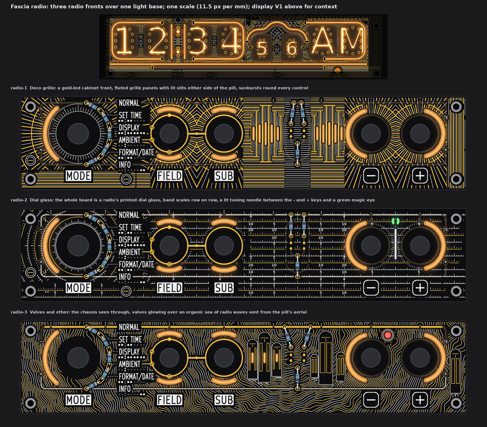
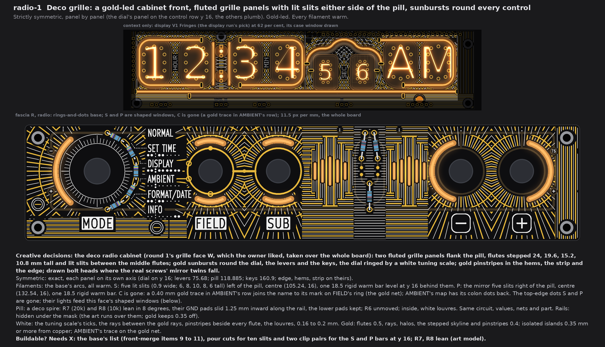
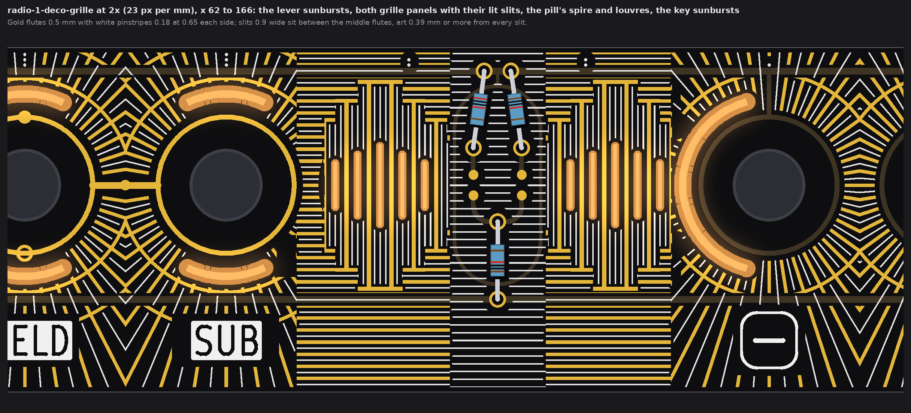
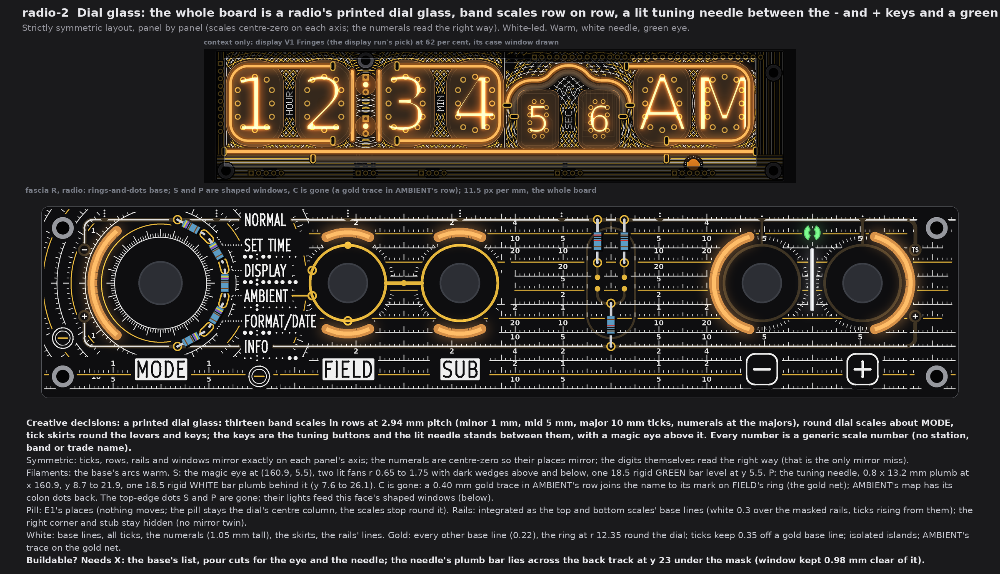
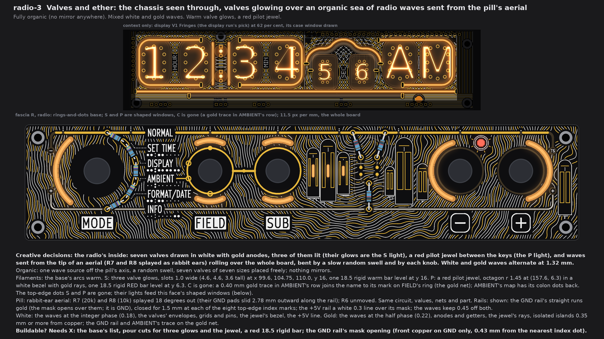
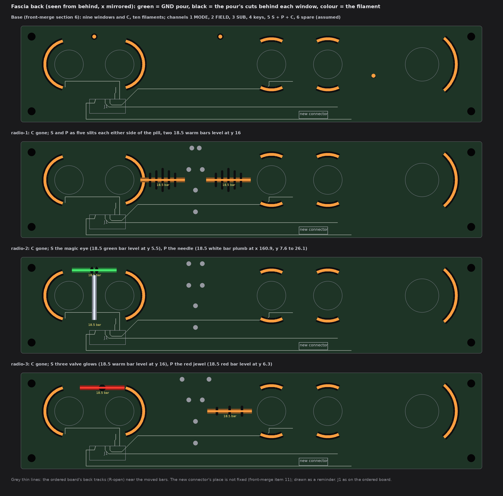

# TS06 fascia, radio: three radio fronts over one light base (drawings only, nothing built)

2026-10-14, front round 3, run fascia-radio. The owner's theme: "radio" (a radio front: dial scales, bands, tuning needle,
grille, valves; generic numbers only, no station or trade names). All three faces are wild and cover the whole board. They differ by
creative decisions, not by how busy they are:

* **radio-1 Deco grille:** gold-led, strictly symmetric, all warm.
* **radio-2 Dial glass:** white-led, strictly symmetric, warm + white needle + green magic eye.
* **radio-3 Valves and ether:** mixed, fully organic, warm valve glows + red pilot jewel.

Radio-1 takes round 1's grille face W (`TS06-FRONT-art-B-deco.md` section 4), which the owner liked, over the whole fascia.

The queue changes A1 to A5 are in on every face:
* no top-edge dots: S and P light shaped windows;
* the pill and the rails are said per face;
* display V1 Fringes is in the strip above each face;
* the AMBIENT cutout C is gone, with a gold trace in its row (section 1).

Each face is fascia R with the owner's rings-and-dots (front-merge section 6), drawn from the board file's copy that pass 4 used, at
one scale (11.5 px per mm), windows lit. No board, schematic, fab, tool, 3D, firmware or spec file was touched. The scripts are
scratch (copies of the kawaii-2 run's base and checks), not in the repo.

Marks: *measured* is from the drawing's raster (23 px per mm) or the board file; *inferred* is arithmetic; *assumed* is my reading.

## 1. What every face keeps

* **Fixed:** the outline, holes, controls and their places, J1, the names, plates, key legends, tube maps, dot leaders and the
  top-edge tube index; FIELD's and SUB's gold rings, the link, the four SUB marks on FIELD's ring and the GND via.
* **Info first:** every name, legend, map and leader keeps 0.78 mm of calm ground (rule 0.75), and E1's gold keeps its 0.75 frame.
  No art crosses a legend.
* **Numbers:** the only numbers in the art are generic scale numbers on radio-2's dial glass. There are no station, band or trade
  names and no logos.
* **The AMBIENT cutout is gone (A5),** as in kawaii-2:
  * window C at (45.04, 21.2) and its tail are removed;
  * AMBIENT's tube map gets back its two colon dots;
  * a **0.40 mm gold trace** runs level at y 18.645 from x 52.43 to 55.75, into the outer edge of AMBIENT's mark on FIELD's ring.
    So it is on the gold net, which ties to GND through the link's via.
  * *Measured:* 0.78 from the name and the map, 10.0 from other copper, 0.78 or more from the pattern.
* **Channels on the new fascia connector** (J1 is full; front-merge items 10 and 11), grouping *assumed* as the earlier runs':
  1 MODE, 2 FIELD up + down, 3 SUB up + down, 4 the two keys, **5 S + P (C dropped)**, 6 spare. Nothing comes from DISP. No face adds
  a filament, so the six channels hold.
* **5 V:** nine fascia filaments instead of ten, so 20 mA less than the base at 20 mA each (*inferred*).
* **Fab note (once):** bare-FR4 windows still need the fab's yes (pass 1's coupon). Not decided here.
* **Symmetric faces** (1 and 2) are mirrored panel by panel. The dial's panel is mirrored on the control row y 16; the others are
  mirrored plumb on their own axes: levers 75.68, pill 118.885, keys 160.9, plus the hems, the strip and the edge.
  * Where a real screw's mirror twin falls, at (4.5, 27.5) and (45.48, 35.5), a bolt head is drawn so the clear ground is not a hole
    in the art.
  * On radio-1, the pill panel ends at x 139.0, where the key arc's keep-out begins. Its mirror then leaves no dark patch by SUB.

## 2. radio-1 Deco grille

* **Creative decisions:** a gold deco cabinet.
  * Two fluted grille panels flank the pill. The flutes step 24, 19.6, 15.2 and 10.8 mm tall away from each panel's centre, with
    gold pinstripes above and below the stepped skyline.
  * Lit slits stand between the middle flutes.
  * Gold sunbursts ring the dial, the levers and the keys, with halos round the levers and keys.
  * A white tuning scale (60 ticks, majors every 30 degrees) circles the MODE knob.
  * The hems, the strip and the edge carry pinstripes and flutes.
* **Strictly symmetric** (exact, panel by panel). *Measured* mirror misses: 0 on every panel, except 0.05 per cent of the white in
  the edge panel (raster rounding).
* **Filaments:** the base's arcs (MODE 38 flex; FIELD and SUB 18.5 rigid in curved clips or 38 flex; keys 38 flex), all warm.
  * **S:** five lit slits, 0.9 mm wide and 6, 8, 10, 8, 6 mm tall, left of the pill at x 100.04 to 110.44 (centre 105.24, 16).
    One **18.5 rigid warm bar** lies level at y 16 behind them, x 95.99 to 114.49.
  * **P:** the mirror five slits right of the pill (centre 132.54, 16), with one **18.5 rigid warm bar**, x 123.29 to 141.79.
  * The slits glow brightest at the bar's row and fade toward their ends (*assumed*, from FR4's spread).
* **Pill: a deco spire.**
  * R7 (20k) and R8 (10k) lean in 8 degrees. Their GND pads slide 1.25 mm inward along the rail, to x 117.34 and 120.43.
  * The lower pads keep their x and rise 0.09 mm to y 11.68, so the 9.0 mm lead pitch is kept. R6 (10k) does not move.
  * White louvres fill the capsule round the parts.
  * Same circuit, values, nets and part. The GND pads stay on the GND rail, 1.19 mm apart (*inferred*).
* **Rails: hidden** under the mask. The art runs over them; gold keeps 0.35 off the copper.
* **White:** the tuning scale, the rays between the gold rays, pinstripes 0.65 mm each side of every flute, and the louvres
  (0.16 to 0.2 mm).
* **Gold (leads):** flutes 0.5 mm; rays, halos, the skyline and pinstripes 0.4 mm; the bolt slots. They are isolated islands
  0.36 mm or more from copper, plus AMBIENT's trace on the gold net. Gold 801 mm², white 452 mm² (*measured*).
* **Buildable? Needs X:** the base's list (front-merge items 9 to 11), plus pour cuts for ten slits and two clip pairs for the bars
  at y 16. R7 and R8 lean (art model; see section 6).

## 3. radio-2 Dial glass

* **Creative decisions:** the whole board is a printed dial glass.
  * Thirteen band scales run in rows at 2.94 mm pitch, between the rails and below them. Each has minor ticks every 1 mm, mid ticks
    every 5 mm and major ticks every 10 mm, with a numeral at each major.
  * Round scales circle MODE: a 3-degree inner ring, then nine arc scales outside the MODE window.
  * Tick skirts ring the levers and the keys.
  * The **- and + keys are the tuning buttons.** The lit **needle** stands between them, with a **magic eye** above it.
  * The numbers are generic scale numbers (multiples of 1, 2, 5, 10, 20), centre-zero on each panel's axis. 55 numerals are
    placed, each only where all of it sits on allowed ground.
* **Strictly symmetric layout:** ticks, rows, rails and windows mirror exactly.
  * The numerals mirror in place, but each digit reads the right way. That is the only mirror miss (*measured*: at most 0.2 per cent
    of the gold and 5 per cent of the white, in the panels with numerals).
  * If the owner counts the upright digits as near-symmetric, the digits can go and leave the ticks alone.
* **Filaments:** the base's arcs, warm.
  * **S: the magic eye** at (160.9, 5.5). It is two lit fans, r 0.65 to 1.75 over 124 degrees each, with dark wedges above and
    below. One **18.5 rigid green bar** lies level at y 5.5, x 151.65 to 170.15.
  * **P: the tuning needle,** 0.8 x 13.2 mm plumb at x 160.9, y 8.7 to 21.9. One **18.5 rigid white bar** stands **plumb** behind
    it, y 7.6 to 26.1, 1.1 mm below the eye's bar.
* **Pill: E1's places.** Nothing moves: the pill is the dial's centre column, and the scales stop round it.
* **Rails: integrated.** Each rail is the base line of the top or bottom scale: white 0.3 mm over its mask, with ticks rising from
  it.
  * The left corners and stubs are drawn too, since they mirror on y 16.
  * The right corner and stub (x 180.61 to 182.4) have no mirror twin, so they stay hidden.
* **White (leads):** the base lines, all ticks, the 1.05 mm numerals, the skirts and the rails' lines. White 412 mm².
* **Gold:** every other base line (0.22 mm) and a ring at r 12.35 round the dial. Ticks keep 0.35 off a gold base line. Isolated
  islands, plus AMBIENT's trace. Gold 103 mm².
* **Buildable? Needs X:** the base's list, plus pour cuts for the eye and the needle, a green and a white 18.5 rigid bar, and a plumb
  clip pair.
  * *Measured* on the ordered board (`R-open`): a 0.25 mm back track runs level at y 23.0 from x 150.4 to 173.0. The needle window
    stops 0.98 mm above it.
  * The plumb bar lies across that track on the solder mask (*assumed* fine: an insulated glass body). The bar's bottom clip
    (y 26.1) is 2.98 mm below the track and 4.3 mm above J1.

## 4. radio-3 Valves and ether

* **Creative decisions:** the radio's inside, seen through.
  * Seven valves are drawn in white with gold anodes and getters. Three are lit: their glows are the S light.
  * A red pilot jewel sits between the keys: it is the P light.
  * Radio waves roll over the whole board, white and gold in turn about every 1.32 mm. They start at the tip of an aerial (R7 and
    R8 splayed as rabbit ears), are bent by a slow random swell, and lean round each knob.
  * The valves sit on top of the waves; the waves stop 0.35 mm short of each valve.
* **Fully organic:** one wave source off the pill's axis, a random swell, and seven valves of seven sizes placed freely. Nothing
  mirrors.
* **Filaments:** the base's arcs, warm.
  * **S: three valve glows,** slots 1.0 mm wide (4.6, 4.6 and 3.6 mm tall) at x 99.6, 104.75 and 110.0, y 16. One **18.5 rigid
    warm bar** lies level at y 16, x 95.5 to 114.0.
  * **P: a red pilot jewel,** an octagon r 1.45 at (157.6, 6.3), in a white bezel with gold rays. One **18.5 rigid red bar** lies
    level at y 6.3, x 148.35 to 166.85.
* **Pill: rabbit-ear aerial.** R7 (20k) and R8 (10k) splay 18 degrees out (kawaii-2's move). Their GND pads slide 2.78 mm outward
  along the rail, to x 113.30 and 124.47, and the lower pads rise to y 11.33. R6 does not move. Same circuit, values, nets and part.
* **Rails: shown.**
  * The GND rail's straight runs are **gold**: the mask opens over them, and it is GND.
  * The mask stays closed for 1.5 mm at each of the eight top-edge index marks (x 13.2, 36.6, 64.0, 87.4, 108.6, 129.1, 150.4,
    171.4), so no silk lands on the gold. *Measured:* 0.43 mm from the nearest index dot (rule 0.30).
  * The corners and the stub to the "-" lug stay masked.
  * The +5V rail is a **white** 0.3 mm line over its mask, because decorative gold is only on GND.
  * The waves keep 0.45 mm off both rails.
* **White:** the waves at the whole phase (0.18 mm); the valves' envelopes, grids and pins; the jewel's bezels; the +5V line.
  White 627 mm².
* **Gold:** the waves at the half phase (0.22 mm), the anodes, getters and the jewel's rays. Isolated islands 0.35 mm or more from
  copper, plus the GND rail and AMBIENT's trace on GND. Gold 429 mm².
* **Buildable? Needs X:** the base's list, plus pour cuts for three glows and the jewel, a red 18.5 rigid bar, and the GND rail's
  mask opening (front copper on GND only).

## 5. The light base and what each face changes

| Change against the base | Filament (sold list), form | Channel | On the fascia's back |
|---|---|---|---|
| **C and its tail removed** (A5, all faces) | none | 5 loses C | C's pour cut closes |
| radio-1 **S**: dot (108.6, 4.5) becomes 5 slits round (105.24, 16) | 18.5 rigid warm, level at y 16 | 5 | 5 slit cuts, 2 clips |
| radio-1 **P**: dot (160.9, 4.5) moves 28.4 left and 11.5 down, to 5 slits round (132.54, 16) | 18.5 rigid warm, level at y 16 | 5 | 5 slit cuts, 2 clips |
| radio-2 **S**: the magic eye, moved 52.3 right and 1.0 down, to (160.9, 5.5) | 18.5 rigid **green**, level at y 5.5 | 5 | 2 fan cuts, 2 clips |
| radio-2 **P**: the needle, moved down to x 160.9, y 8.7 to 21.9 | 18.5 rigid **white**, **plumb** | 5 | 1 slot cut, 2 clips |
| radio-3 **S**: three glows round (104.75, 16) | 18.5 rigid warm, level at y 16 | 5 | 3 slot cuts, 2 clips |
| radio-3 **P**: the jewel, moved 3.3 left and 1.8 down, to (157.6, 6.3) | 18.5 rigid **red**, level at y 6.3 | 5 | 1 octagon cut, 2 clips |

**Colours each face ships with** (all sold: the rigid bars come in warm white, white, red, green, blue and pink):
* radio-1: warm only.
* radio-2: warm + green (eye) + white (needle).
* radio-3: warm + red (jewel).

**Bar fit, *measured*** on the art model and the ordered board (`R-open`):

| Bar (body 2.0 wide) | To R6 to R8's plated pads (rule 0.4) | To a key's courtyard (r 6.2) | To J1 | To a back track |
|---|---|---|---|---|
| radio-1 S | 2.74 | 29.7 | 36.0 | 9.07 |
| radio-1 P | 2.74 | 2.41 | 14.7 | 9.07 |
| radio-2 eye | 29.1 | 3.38 | 23.9 | 16.4 |
| radio-2 needle (plumb) | 37.3 | 3.30 | 4.30 | crosses the y 23.0 track under the mask (section 3) |
| radio-3 S | 3.27 | 30.2 | 36.5 | 9.07 |
| radio-3 P | 23.1 | 2.50 | 23.1 | 15.6 |

On `R-open` the back has no via near any bar. R6 to R8 are 1206 parts elsewhere on the ordered board, so the pad gaps above are
the art model's (E1's through-hole places).

## 6. The checks (*measured* on the raster, 23 px per mm)

| Check | Rule | radio-1 | radio-2 | radio-3 |
|---|---|---|---|---|
| White, gold to a name, plate, key legend, tube map, leader or index dot | 0.75 | 0.78, 0.78 | 0.78, 0.81 | 0.80, 0.78 |
| White, gold to E1's exposed gold (rings, link, marks, pads, AMBIENT's trace) | 0.30 (frame 0.75 drawn) | 0.74, 0.75 | 0.75, 0.75 | 0.45, 0.45 (to the gold rail) |
| Pattern gold to copper | 0.30 | 0.36 | 0.36 | 0.35 |
| White, gold to a lit window | 0.35 | 0.39, 0.39 | 0.39, 0.40 | 0.39, 0.39 |
| White to the pattern's gold | 0.30 | 0.31 | 0.31 | 0.31 |
| Lit window to copper; to a legend | 0.30 | 0.68; 1.17 | 0.68; 1.17 | 0.68; 1.17 |
| AMBIENT's trace to a legend; to other copper | 0.75; 0.30 | 0.78; 10.0 | 0.78; 10.0 | 0.78; 10.0 |
| Free board within 1.2 mm of some ink | (no empty space) | 98.5 % | 95.3 % | 99.3 % |

White over the masked rails and lugs is allowed, as in E1, so white to copper reads 0. What stays dark is the ring of mask between
each knob and its window. On radio-2 the spacing of the scales (2.94 mm rows) is open by design.

## 7. My pick

**radio-1 Deco grille.** It carries the grille the owner liked over the whole board, in gold, exactly mirrored, with every name on
calm ground and both lights turned into the grille's own slits. radio-3 Valves and ether is the fullest and most alive (the S-tier
ripple look in radio form); radio-2 Dial glass is the most "radio" at a glance, with the needle between the tuning keys.

## 8. Left open, assumed

* *Assumed:* the S and P lights are 18.5 rigid bars (the shortest sold), held in printed clips at their ends.
* *Assumed:* the slits, glows and fans light evenly enough through the FR4 from a 2 mm bar crossing them. The bench decides; the
  10 mm slits on radio-1 will be brighter at the middle.
* *Assumed:* radio-2's plumb bar may lie across the masked back track at y 23. If not, the track takes a short dogleg round the bar's
  lower end (below y 26.6).
* The rearranged pills are drawn on the art model's places (E1). The board-change run places R6 to R8.
* The pattern's gold is isolated islands (no net). Stems to GND can be added if the fab wants no floating copper; not drawn.
* The smallest strokes (0.14 to 0.18 mm silk) are at the fab's silk limit used before (0.15). Radio-2's numerals are 1.05 mm tall.
* Not checked: KiCad DRC (no board file was edited).
