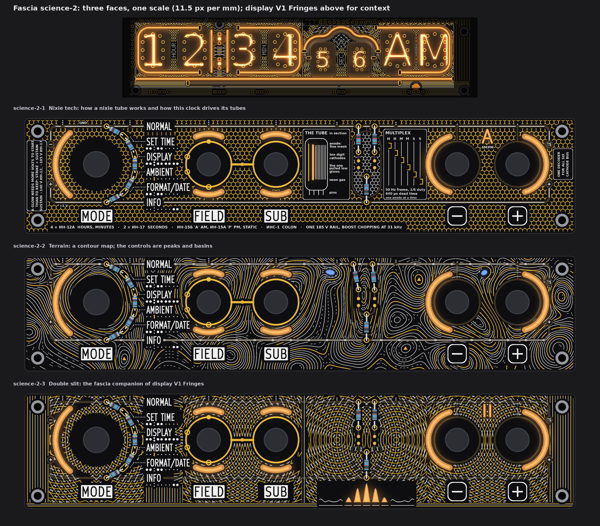
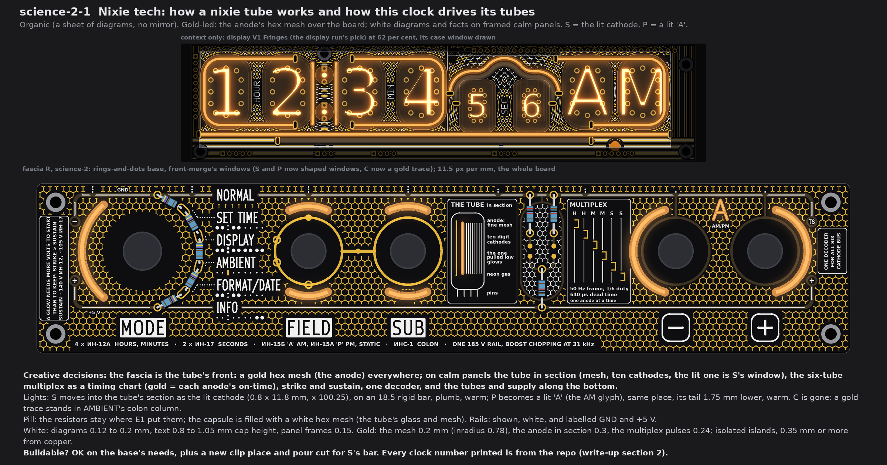
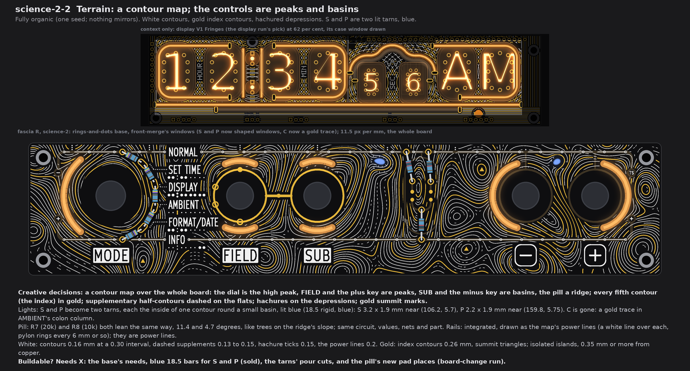
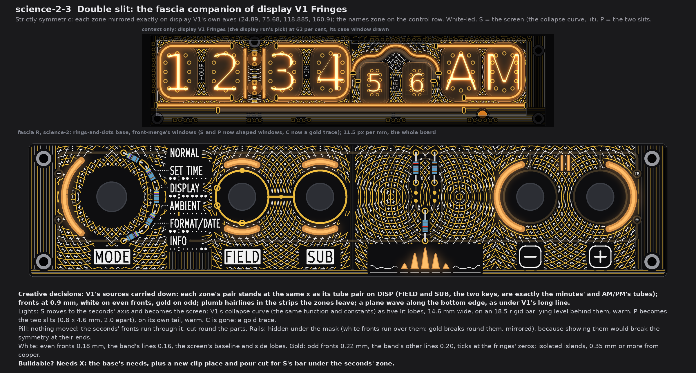
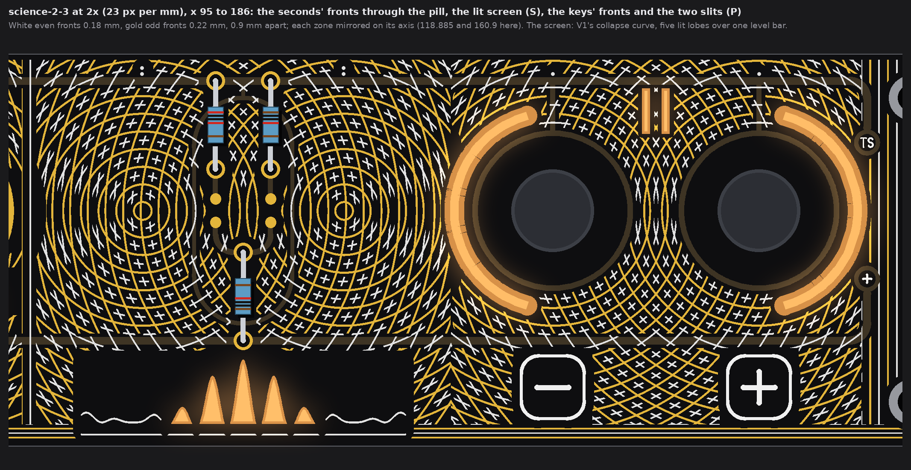
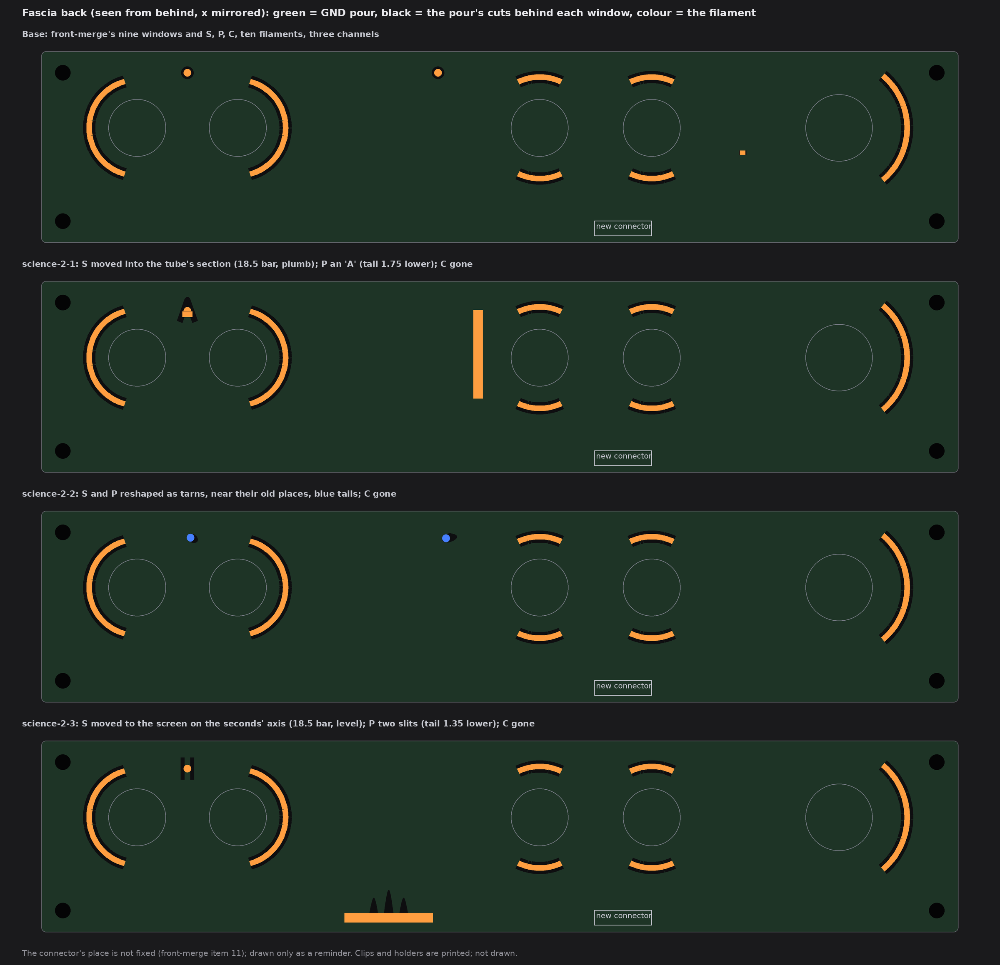

# TS06 fascia, science-2: nixie tech, terrain, double slit (drawings only, nothing built)

2026-10-14, front round 3, run fascia-science-2. This is the science set again, with the owner's changes: "replace rule30 for a
matching variant of display v1 with double slit, replace clock tree for infographics on nixie tech, replace windtunnel for terrain
elevation lines". The first set (`TS06-FASCIA-science.md`) stays as history. The queue changes A1 to A5 are in:

* The two top-edge dots are gone; their lights feed shaped windows.
* Each face arranges and fills the pill, and says what it does with the rails.
* Display V1 Fringes stands in the context strip.
* AMBIENT's cutout C is gone; a gold trace stands in its place.

Each face is fascia R with the owner's rings-and-dots (front-merge section 6), at one scale (11.5 px per mm), drawn from the board
file's copy that pass 4 used. No board, schematic, fab, tool, 3D, firmware or spec file was touched. The scripts are scratch (copies
of the first science run's and the display run's), not in the repo. Marks: *measured* is from the drawing's raster (23 px per mm) or
the board file; *inferred* is arithmetic; *assumed* is my reading.

## 1. What every face keeps

* **Fixed:** the outline, holes, controls and their places, and J1. Also the names, plates, key legends, tube maps, dot leaders and the
  top-edge index. Also FIELD's and SUB's gold rings, the link, the four SUB marks on FIELD's ring and the GND via.
* **Info first:** the pattern keeps 0.75 mm from every name, plate, key legend, tube-map dot, leader and index dot. It also keeps
  0.75 mm from E1's gold (rings, link, marks, the dial's and ladder's pads). Gold keeps 0.35 mm from all copper. White keeps 0.3 mm
  from exposed gold. Both keep 0.35 mm from a window. Nothing crosses a legend.
* **A5, the gold trace:** C's window and its tail are gone on all three faces. In its place a gold trace, 0.36 mm wide, runs plumb
  from (45.04, 20.65) to (45.04, 21.55). It stands in the tube map's colon column in AMBIENT's row, where the other rows have their
  colon dots. It is an isolated island on its own 0.75 mm calm frame. It keeps 0.95 mm from the nearest map dot and 0.8 mm from
  AMBIENT's box (*measured*).
* **The light base:** front-merge's nine windows. S and P keep their light and their channel, and change shape (section 5). C's tail
  goes, so the info channel drives only S and P. That is one filament fewer, 20 mA less at front-merge's rating (*inferred*). It is
  still three fascia channels.
* **Fab note (once):** the bare-FR4 windows still need the fab's yes (pass 1's coupon). Not decided here.

## 2. science-2-1 Nixie tech

* **Creative decisions:** the fascia is the tube's front: a gold anode mesh over the board, and framed white diagrams of the tube,
  its multiplex and its supply. On the calm panels stand:
  * the tube in section: the mesh, ten cathodes, and the lit one, which is S's window;
  * the six-tube multiplex as a timing chart, time running down, gold for each anode's on-time;
  * strike and sustain (left edge) and the one cathode decoder (right edge);
  * the tubes and the supply in one line along the bottom.
* **Organic:** a sheet of diagrams, nothing mirrored.
* **Filaments:** the base's, all warm, with two changes.
  * **S moves into the tube's section** as the lit cathode: a window 0.8 x 11.8 mm, plumb at x 100.25, y 9.4 to 21.2. It is lit by an
    **18.5 rigid bar, warm, plumb** behind it (y 6.05 to 24.55). That is 8.4 mm left of the old dot and 10.8 mm lower.
  * **P becomes a lit "A"** (the AM glyph of the AM/PM tube): two legs and a bar, 0.7 mm strokes, 3.2 x 4.6 mm, apex at
    (160.9, 3.95). It has its own tail, lowered 1.75 mm to the glyph's middle. "AM/PM" stands under it.
* **Pill:** the resistors stay where E1 put them (nothing moved; the circuit is unchanged). The capsule is filled with a finer
  white hex mesh: the tube's glass.
* **Rails: shown, white,** with a 0.26 mm white line over each straight run. They are labelled "GND" and "+5 V" at the left end.
* **White:** the diagrams, 0.15 to 0.2 mm; the text, 0.7 to 1.05 mm cap height; the panel frames, 0.15 mm.
* **Gold:** the mesh, 0.2 mm (cells 1.56 mm across the flats); the anode in section, 0.3 mm; the multiplex pulses, 0.24 mm.
  All are isolated islands.
* **Buildable? OK** on the base's needs, plus a new clip place and pour cut for S's plumb bar. The back behind it was not checked
  (*assumed* free).

**What is printed, and where each fact comes from.** Each line is printed exactly once. Nothing else on the face is a number.

| Printed | Source |
|---|---|
| 4 × ИН-12А hours, minutes; 2 × ИН-17 seconds | `knowledge/TERMINAL-06-spec.txt` lines 6 and 7; `README.md` line 3 |
| ИН-15Б 'A' AM, ИН-15А 'Р' PM | spec lines 165 to 166 and 469 |
| static (the ИН-15 pair) | spec lines 486 to 487 (a transistor per cathode, on the expanders); `Claude outputs/TERMINAL-06-anode-driver-study.md` line 51 |
| ИНС-1 colon | spec line 7 |
| one 185 V rail, boost chopping at 31 kHz | spec line 383 ("a converter chopping 185 V at 31 kHz"); `TERMINAL-06-measurements-PCB-GYVER-NETLIST.md` section 2 (the inductor, switch and diode, a fixed 31 kHz) |
| H H M M S S, the six multiplexed tubes | `README.md` line 32 ("six-tube multiplex"), with spec line 6 |
| 50 Hz frame, 1/6 duty | `README.md` lines 32 to 33 (50 Hz refresh); spec line 585 ("1/6 duty") |
| 640 µs dead time | `README.md` line 33 |
| one anode at a time | GYVER-NETLIST section 2 ("only one opto conducts at a time") |
| one decoder for all six, cathode bus | anode-driver study line 40 (cathode N of every multiplexed tube ties to output N) |
| sustain ~140 V ИН-12, ~105 V ИН-17 | spec line 588 |
| ten digit cathodes | GYVER-NETLIST line 127 (ИН-12А: pins 2 to 11 are the cathodes 0 to 9) |
| GND, +5 V on the rails | the fascia's own nets (E1, `PCB/TS06-FASCIA-pass4.md`) |
| general physics, no figures | "anode: fine mesh", "neon gas", "the one pulled low glows", "a glow needs more volts to start than to keep: strike > sustain" |

* The info theme handles the clock's setting and data; this face keeps to the tubes.
* *Drawn, not to scale:*
  * The multiplex chart's slot widths, and the dead-time gaps between pulses.
  * The four pin stubs under the tube. They are a section, not a pin count; the ИН-12А has 12 pins.
* Part numbers are left out (parts by type): "decoder", "boost".

## 3. science-2-2 Terrain

* **Creative decisions:** a contour map over the whole board, with the controls as its peaks and basins and S and P as lit tarns.
  * The dial is the high peak, FIELD and the plus key are peaks, and SUB and the minus key are basins. The pill is a ridge.
  * Every fifth contour (the index contour) is gold.
  * On the flats, dashed supplementary half- and quarter-contours fill the ground. On the cliffs, the intermediate contours drop out,
    as on a real map.
  * Hachure ticks point down into the depressions, and gold triangles mark the free summits.
  * There are no spot-height numbers, so the map prints nothing that could be read as data.
* **Fully organic:** 34 random hills (one seed) are kept off the controls' own slopes, with a tilt across the board. Each control's
  peak or basin is set a little off its centre and stretched at its own angle. Nothing mirrors.
* **Filaments:** the base's, warm. **S and P become two lit tarns**, each the inside of one contour round a small basin.
  * S: 3.2 x 1.9 mm, x 104.62 to 107.82, y 4.73 to 6.60. Its middle is 2.4 mm left of and 1.2 mm below the old dot.
  * P: 2.2 x 1.9 mm, x 158.73 to 160.92, y 4.81 to 6.70. Its middle is 1.1 mm left of and 1.3 mm below the old dot.
  * Both use **blue** tails, 18.5 rigid bars (blue is sold in that size).
* **Pill:** R7 and R8 both lean the same way, like trees on the ridge's slope. The circuit, values, nets and part do not change.
  * R7 (20k) runs from (114.30, 2.77) on the GND rail to (116.085, 11.59). Its LEVA drop is 0.18 mm longer.
  * R8 (10k) runs from (120.95, 2.77) on the GND rail to (121.685, 11.74). Its LEVB drop is 0.03 mm shorter.
  * The bottom pads keep 1.05 mm from the capsule's walls (*inferred*). R6, the landing dots, A7 and its route to J1 do not move.
  * The contours run through the capsule, which is the ridge's crest.
* **Rails: integrated** as the map's power lines (they carry GND and +5 V). Each has a 0.2 mm white line over it, with pylon rings
  (r 0.32) about every 6 mm (53 pylons). The contours break 0.3 mm round them.
* **White:**
  * the contours, 0.16 mm at one interval;
  * the dashed supplements, 0.13 to 0.15 mm;
  * the hachures, 0.15 mm;
  * the power lines, 0.2 mm.
* **Gold:** the index contours, 0.26 mm, and the summit triangles. All are isolated islands.
* **Buildable? Needs X:**
  * the base's needs;
  * blue 18.5 bars for S and P;
  * pour cuts that follow the tarns;
  * the pill's new pad places (board-change run).

## 4. science-2-3 Double slit (the fascia companion of display V1)

* **Creative decisions:** display V1 Fringes carried down onto the fascia, with its sources, fronts, plane wave, strips and
  collapse curve.
  * **The same sources:** each zone's pair stands at the same x as its tube pair on DISP. In the hours zone that is x 13.21 and
    36.57; in the seconds zone, 108.635 and 129.135. In the minutes zone, FIELD and SUB (63.99, 87.37) are exactly the minute
    tubes' x. In the AM/PM zone, the two keys (150.4, 171.4) are exactly the ИН-15 pair's x. The names zone takes the colon's two
    lamps, 14 mm apart on its axis. All sit on the control row (y 16).
  * **The same fronts:** 0.9 mm apart, white on even fronts (0.18 mm) and gold on odd ones (0.22 mm). Both families are drawn, so
    they cross in V1's lattice.
  * **The same plane wave:** lines parallel to the bottom edge, 0.45 mm apart, white and gold in turn, as under V1's long line.
  * **The same strips:** plumb hairlines fill the strips the mirrored zones leave: x 0.6 to 8.4, 96.3 to 97.8 and 181.8 to 190.8,
    and the foot of the names zone.
  * **The same collapse curve,** with V1's function and constants: cos²(πu/3.2) · sinc²(u/11.2). It becomes S's lit window, the
    screen.
* **Symmetric, exactly:**
  * Each zone is mirrored on display V1's own axes: hours 24.89, minutes 75.68, seconds 118.885 and AM/PM 160.9.
  * The names zone is mirrored on the control row (y 16). Its names are left-set, so a plumb mirror would cut it away.
  * The art is cut by a mirrored mask, so a break round a part on one side shows on the other. The final pass keeps a pixel only
    if its mirror image is kept: 0 mismatched pixels in every zone, white and gold (*measured*).
* **Filaments:** the base's, all warm, with two changes.
  * **S moves to the seconds' axis and becomes the screen:** five lit lobes of the collapse curve, 14.6 mm wide (x 111.59 to 126.19,
    y 31.20 to 37.70), parted by 0.5 mm or more of mask at the fringes' zeros. An **18.5 rigid bar, warm**, lies level behind them
    (y 37.0, x 109.6 to 128.1). Under the lobes run a white baseline with the curve's side lobes and gold ticks at the zeros.
  * **P becomes the two slits:** 0.8 x 4.6 mm each, 2.0 mm apart centre to centre, mirrored on 160.9 (x 159.5 to 162.3, y 3.55 to
    8.15). It has its own tail, lowered 1.35 mm to the slits' middle.
* **Pill:** nothing moved; the circuit is unchanged. The seconds' fronts run through the capsule, cut round the parts. R7 and R8
  stand mirror-placed, as in E1.
* **Rails: hidden** under the mask. White fronts run over them, and the gold breaks round them (mirrored). Showing them would break
  the symmetry: their ends (x 10.79, 41.19 and 180.61, and the corners down to the lugs) have no mirror images.
* **White:** the even fronts, the band's lines (0.16 mm), the hairlines, and the screen's baseline and side lobes.
* **Gold:** the odd fronts, the band's other lines (0.20 mm), the odd hairlines, and the ticks at the zeros. All are isolated
  islands.
* **Buildable? Needs X:** the base's needs, plus a new clip place and pour cut for S's level bar under the seconds' zone. The back
  there was not checked (*assumed* free).

## 5. The light base and what each face changes

| Face | S | P | C | Colour | Channel |
|---|---|---|---|---|---|
| all | | | gone; gold trace at (45.04, 20.65 to 21.55) | | info channel: S and P only |
| science-2-1 | **moved** into the tube's section: lit cathode 0.8 x 11.8 at x 100.25; **18.5 rigid, plumb** | reshaped as a lit "A" (3.2 x 4.6), same place; tail 1.75 lower | | warm | the base's 3 |
| science-2-2 | reshaped as a tarn (3.2 x 1.9), middle 2.4 left, 1.2 lower | reshaped as a tarn (2.2 x 1.9), middle 1.1 left, 1.3 lower | | **blue** (S, P) | the base's 3 |
| science-2-3 | **moved** to the seconds' axis as the screen (5 lobes, 14.6 wide, y 31.2 to 37.7); **18.5 rigid, level** | reshaped as two slits (0.8 x 4.6), same place; tail 1.35 lower | | warm | the base's 3 |

* **Colours each face ships with:** science-2-1 warm only; science-2-2 warm + blue (the tarns); science-2-3 warm only (as V1's
  default; V1's blue twins are on DISP).
* **On the fascia's back:** each moved or reshaped window needs its pour cut redrawn. Each moved light (science-2-1 S, science-2-3 S)
  needs a new clip place and a longer wire run to the connector. No new channel, no new part type.

## 6. The checks (*measured* on the raster, 23 px per mm)

| Check | Rule | science-2-1 | science-2-2 | science-2-3 |
|---|---|---|---|---|
| White, gold to a name, plate, key legend, tube map, leader or index dot | 0.75 | 0.78, 0.78 | 0.78, 0.78 | 0.78, 0.79 |
| White, gold to E1's exposed gold (rings, link, marks, pads, the A5 trace) | 0.30 (frame 0.75 drawn) | 0.74, 0.74 | 0.74, 0.74 | 0.74, 0.74 |
| Pattern gold to any copper (rails, lugs, capsule, key rings) | 0.30 | 0.35 | 0.35 | 0.35 |
| White, gold to a lit window | 0.35 | 0.40, 0.39 | 0.39, 0.39 | 0.39, 0.39 |
| White to the pattern's gold | 0.30 | 0.30 | 0.33 | 0.33 |
| Lit window to copper | 0.30 | 0.44 | 0.68 | 0.39 |
| Free board within 1.2 mm of some ink | (no empty space) | 99 % | 99.7 % | 96 % |

* The face's own text and diagrams (science-2-1) stand inside the allowed ground: 0 text pixels off it (*measured*).
* White over copper reads 0.0 on every face because white silk may run over the masked rails. In science-2-1 it does so on purpose.
* What is left dark is the information's own ground, the ring of mask round each knob, science-2-3's calm ground under the screen, and
  science-2-1's framed panels.

## 7. My pick

**science-2-3 Double slit.** It is the companion the owner asked for. Its pairs are V1's pairs: FIELD and SUB and the two keys sit
exactly under the minute tubes and the ИН-15 pair. The fronts, the plane wave and the collapse curve are V1's own, and its one moved
light (the screen) is the experiment's result drawn in light. science-2-1 is the pick if the owner wants a fascia that teaches; it
is the only face whose words are the point.

## 8. Left open, assumed

* *Assumed:* the info tails are short bars (as the first science run took them). science-2-1 and science-2-3 give S an 18.5 rigid
  bar of its own; science-2-2's tarns want the shortest sold bar behind each.
* *Assumed:* the back is free behind S's new places: plumb at x 100.25 (science-2-1), and level at y 37.0 under the seconds' zone
  (science-2-3). Not checked against the back's copper.
* The rearranged pill (science-2-2) is drawn on the art model's places (E1). The ordered board (`R-open`) still has R6 to R8
  elsewhere, as 1206 parts on the back; the board-change run places them.
* The pattern's gold is isolated islands (no net), including the A5 trace. Stems to GND can be added if the fab wants no floating
  copper; not drawn. science-2-1's mesh is one large island.
* The smallest strokes (0.15 to 0.16 mm silk) and the 0.7 to 0.8 mm text are at or under the fab's silk limit used before (0.15 mm). The
  text was not checked for print legibility.
* Not checked: KiCad DRC (no board file edited), and the back's own copper behind the new and moved windows.
