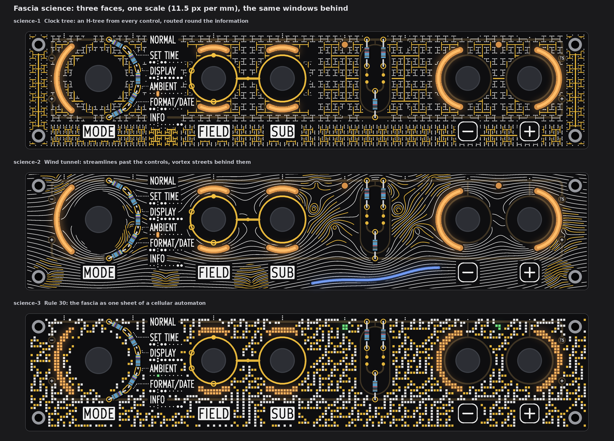
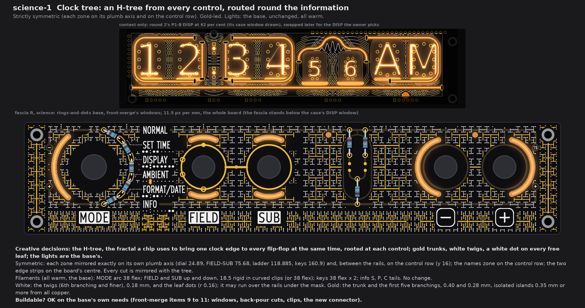
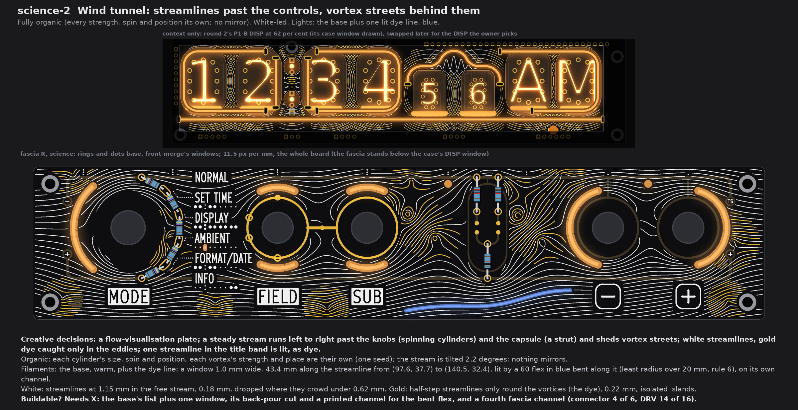
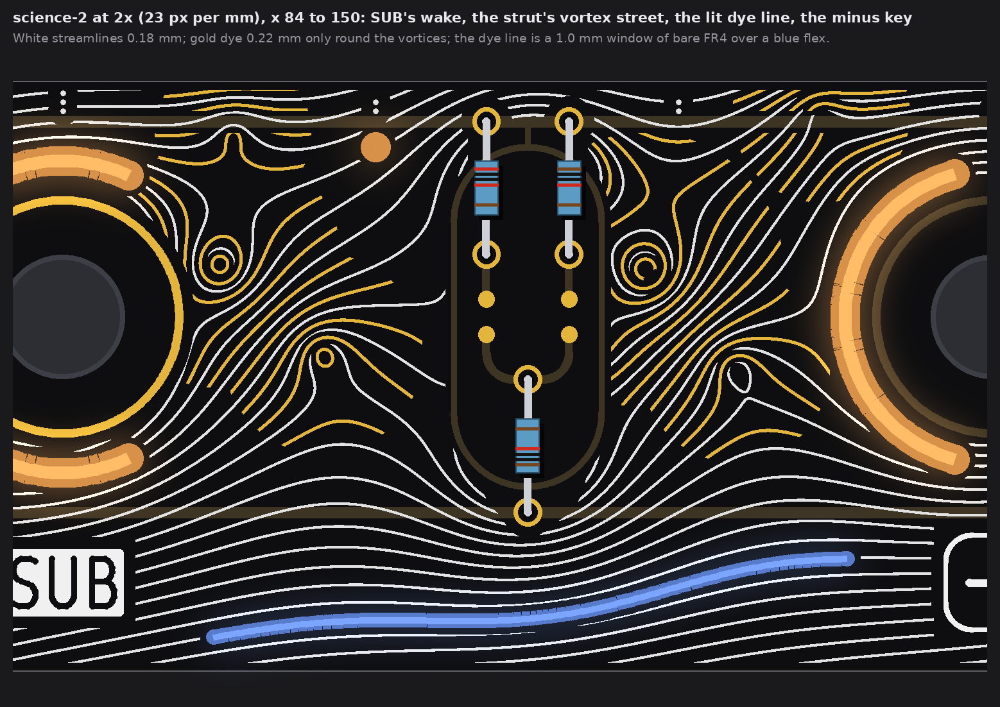
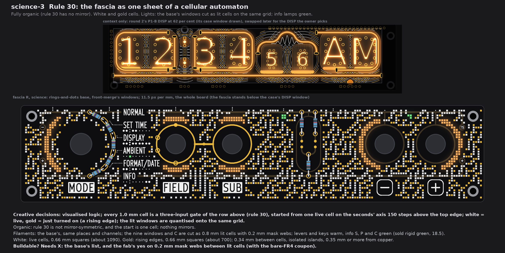
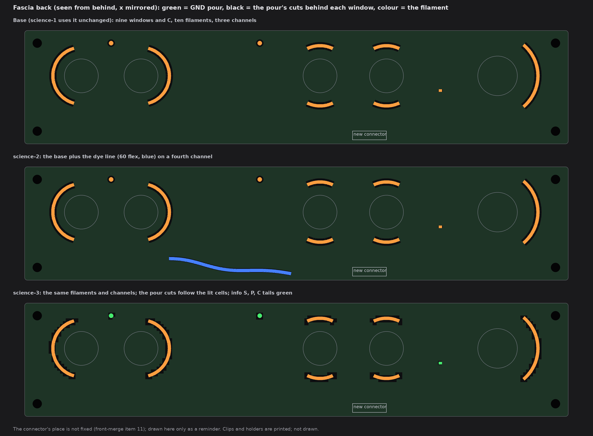

# TS06 fascia, science: three faces over the fascia light base (drawings only, nothing built)

2026-10-14, front round 3, run fascia-science. The owner's words for this theme: "science - waveforms, visualised logic, parametric
art, fractals, etc"; all three faces wild, art over the whole board, the windows and lights of one back kept unless a change helps
the theme. Each face is fascia R with the owner's rings-and-dots (front-merge section 6) and front-merge's nine windows and C, drawn
from the board file's copy pass 4 used, at one scale (11.5 px per mm). Round 2's P1-B DISP stands above each face in a thin strip,
for context only.

No board, schematic, fab, tool, 3D, firmware or spec file was touched. The scripts are scratch (copies of front-merge's and P1's), not
in the repo. Marks: *measured* is from the drawing's raster (23 px per mm) or the board file; *inferred* is arithmetic; *assumed* is
my reading.

## 1. What every face keeps

* **Fixed:** the outline, holes, controls and their places, J1, the names, plates, key legends, tube maps, dot leaders and the
  top-edge index; FIELD's and SUB's gold rings, the link, the four SUB marks on FIELD's ring and the GND via; the rails and lugs
  under the mask.
* **Info first:** the pattern keeps 0.75 mm from every name, plate, key legend, tube-map dot, leader and index dot, and 0.75 mm
  from E1's gold (rings, link, marks, the dial's and ladder's pads), so each stands on its own calm ground. Gold keeps 0.35 mm
  from all copper; white keeps 0.35 mm from exposed gold and may run over copper under the mask (the rails); both keep 0.4 mm from
  a window, out of the knob and the caps, and out of the ladder's capsule. Nothing crosses a legend.
* **The light base:** front-merge's nine windows and C, ten filaments, three fascia channels, warm by default. What each face
  changes is in section 5 and `lights-back.png`.
* **Fab note (once):** the bare-FR4 windows still need the fab's yes (pass 1's coupon). Not decided here.

## 2. science-1 Clock tree

* **Creative decisions:** the H-tree, the fractal a chip uses to bring one clock edge to every flip-flop at the same moment, grown
  from every control and routed round the information; gold trunks, white twigs, a white dot on every free leaf; lights as the base.
* **Symmetric.** Each zone is mirrored exactly on its own plumb axis (dial 24.89, FIELD-SUB 75.68, ladder 118.885, keys 160.9)
  and, between the rails, on the control row (y 16); the names zone on the control row; the two edge strips on the board's centre
  (x 95.7). The cuts round the information are mirrored with the tree (a piece stays only if its mirror images stay).
* **Filaments:** the base, unchanged, all warm: MODE arc 38 flex; FIELD and SUB up and down, 18.5 rigid in curved clips (or 38
  flex); the key arcs 38 flex each; the info S, P and C tails.
* **White:** the sixth branching and finer, 0.18 mm, and leaf dots r 0.16.
* **Gold:** the trunk and the first five branchings, 0.40 mm (the first three) and 0.28 mm; isolated islands.
* **Buildable? OK** on the base's own needs (front-merge items 9 to 11).

## 3. science-2 Wind tunnel

* **Creative decisions:** a flow-visualisation plate. A steady stream runs left to right past the knobs (spinning cylinders, each
  with its own spin) and the ladder's capsule (a strut of three cylinders) and sheds vortex streets behind the dial, SUB, the
  capsule and the plus key; white streamlines, gold dye caught only in the eddies; one streamline in the title band is lit, as dye.
* **Fully organic.** Every cylinder's size, spin and place and every vortex's strength and place are their own (one random seed);
  the stream is tilted 2.2 degrees; nothing mirrors.
* **Filaments:** the base, warm, plus the **dye line**: a window 1.0 mm wide along the streamline from (97.6, 37.7) to
  (140.5, 32.4), 43.4 mm long, lit by a **60 mm flex in blue** bent along it behind the board (least radius over 20 mm; rule 6).
* **White:** streamlines 1.15 mm apart in the free stream, 0.18 mm, dropped where they crowd under 0.62 mm (round the knobs).
* **Gold:** half-step streamlines only round the 13 vortices (the dye), 0.22 mm; isolated islands.
* **Buildable? Needs X:** the base's list, plus one window, its cut in the back GND pour, a printed channel for the bent flex, and a
  fourth fascia channel (section 5).

## 4. science-3 Rule 30

* **Creative decisions:** visualised logic. The fascia is one sheet of the elementary cellular automaton rule 30: every 1.0 mm cell
  is a three-input gate of the three cells above it. It starts from one live cell on the seconds' axis (x 118.885) 150 steps above
  the top edge, so the sheet is fully grown; each row is one step. White = a live cell, gold = a cell that has just turned on (a
  rising edge). The lit windows are cut onto the same grid: lit cells.
* **Fully organic.** Rule 30 has no mirror, and one start cell gives none.
* **Filaments:** the base's, same places and channels. The nine windows and C are cut as 0.8 mm lit cells with 0.2 mm mask webs
  (MODE 51 cells, FIELD 21 up and 22 down, SUB the same, minus 54, plus 52, S 4, P 3, C 1). Levers and keys warm; **info S, P and C
  green** (the sold rigid green, 18.5, *assumed* that the tails are short bars).
* **White:** about 1090 live cells, 0.66 mm squares, 0.34 mm apart.
* **Gold:** about 700 rising edges, 0.66 mm squares; isolated islands.
* **Buildable? Needs X:** the base's list, and the fab's yes on 0.2 mm mask webs between lit cells (with the bare-FR4 coupon).

## 5. The light base and what each face changes

| Face | Change against the base | Filament (sold list), form | Colour | Channel | On the fascia's back |
|---|---|---|---|---|---|
| science-1 | none | the base's ten | warm | the base's 3 | the base's cuts and clips |
| science-2 | **adds** the dye-line window (1.0 x 43.4 mm, a streamline in the title band) | 60 flex, bent along it, least radius over 20 mm | blue | **a fourth fascia channel**: connector pin 4 of 6; DRV 14 of 16 with front-merge's per-zone build; 5 V worst case +20 mA, 644 mA (64 per cent) *inferred* | one more cut in the back GND pour; a printed channel holding the flex; 2 wires |
| science-3 | **reshapes** the nine windows and C into lit cells on the automaton's grid | the base's, unchanged | warm; info S, P, C green | the base's 3 | the pour cuts follow the cells' outline (or one cut round each group of cells); no new part |

**Colours each face ships with:** science-1 warm only; science-2 warm + blue (the dye line); science-3 warm + green (the info lamps).

## 6. The checks (*measured* on the raster, 23 px per mm)

| Check | Rule | science-1 | science-2 | science-3 |
|---|---|---|---|---|
| White, gold to a name, plate, key legend, tube map, leader or index dot | 0.75 | 0.78, 0.80 | 0.78, 0.80 | 0.77, 0.82 |
| White, gold to E1's exposed gold (rings, link, marks, pads) | 0.30 (frame 0.75 drawn) | 0.75, 0.74 | 0.74, 0.76 | 0.80, 0.78 |
| Pattern gold to any copper (rails, lugs, capsule, key rings) | 0.30 | 0.36 | 0.36 | 0.37 |
| White, gold to a lit window | 0.35 | 0.40 | 0.39 | 0.37 |
| White to the pattern's gold | 0.30 | 0.33 | 0.33 | 0.30 (0.34 nominal) |
| Lit window to copper | 0.30 | 0.35 | 0.35 | 0.41 |
| Free board within 1.2 mm of some ink | (no empty space) | 97 % | 98 % | 94 % |

* The least window-to-legend gap on every face is the base's info C to AMBIENT's box: 0.26 mm on this raster (front-merge gave
  0.32 with its own box). It is the base's, not a face's; the board-change run should measure it in KiCad.
* What is left dark is the information's own ground and the ring of mask between each knob and its window.

## 7. My pick

**science-2 Wind tunnel.** It is the most striking and the most coherent: one physical idea moves the whole face, the streamlines
cover every free millimetre and part round each name, and its one extra light (a blue dye line) is something the theme draws, not
a decoration. science-1 is the strict, symmetric choice if the owner wants the fascia to stand still under a busy DISP.

## 8. Left open, assumed

* *Assumed:* the tails behind info S, P and C are short bars (front-merge calls them "tails"); science-3's green needs a green one.
* *Assumed:* a 60 flex can be held along a 43 mm curve with its spare length folded behind the board; the bench decides.
* The gold of every face is isolated islands (no net). Stems to GND can be added where a trunk meets the GND rail if the fab wants
  no floating copper; not drawn.
* The connector's place on the fascia's back is not fixed (front-merge item 11); `lights-back.png` marks it only as a reminder.
* Silk squares 0.66 mm and lines 0.18 mm are above the fab's silk limit used before (0.15); the 0.2 mm mask webs of science-3 are
  *inferred* printable, not asked.
* Not checked: KiCad DRC (no board file edited); the back's own copper behind the new and reshaped windows.
