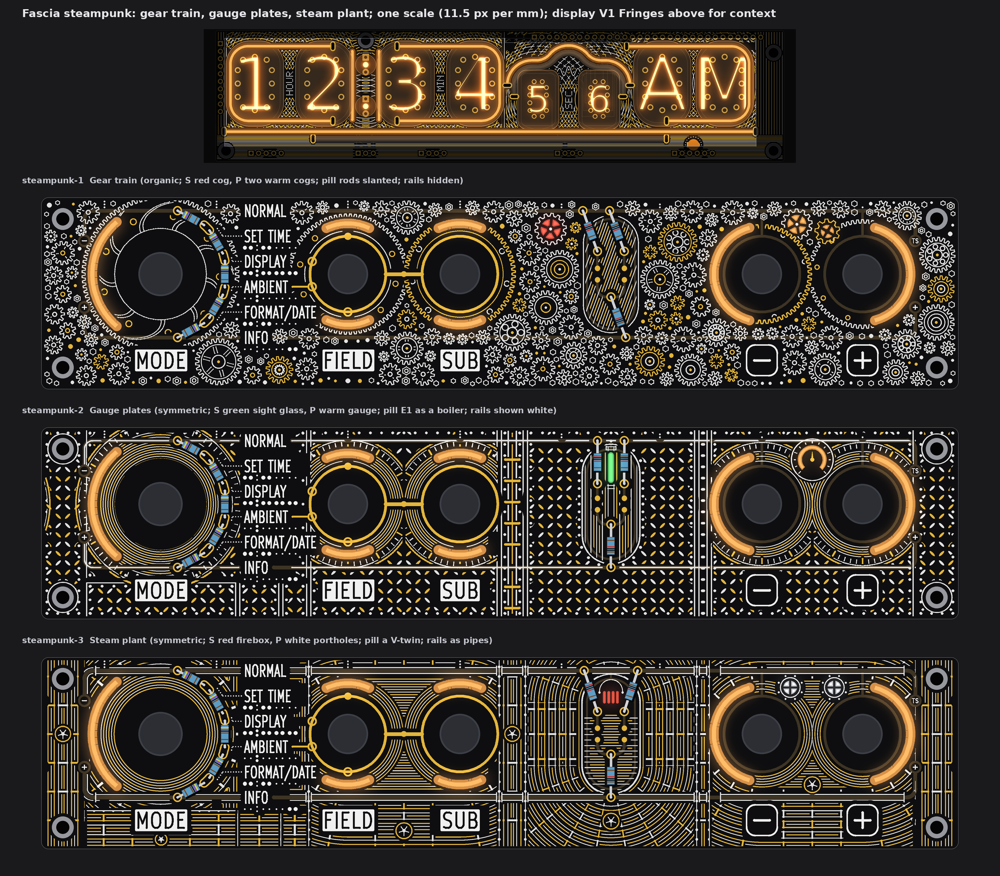
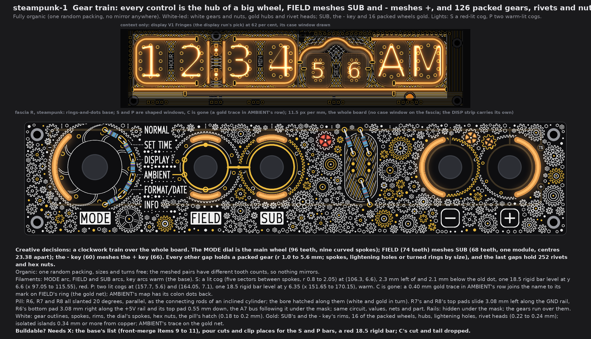
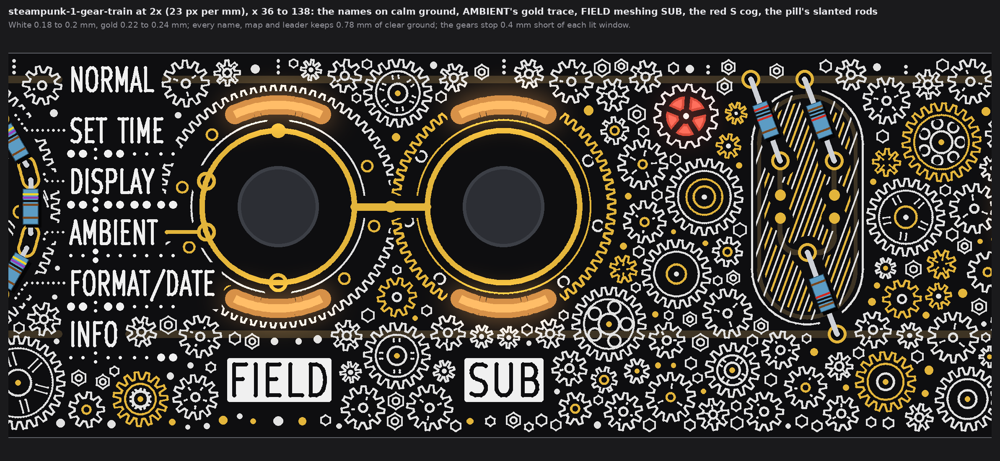
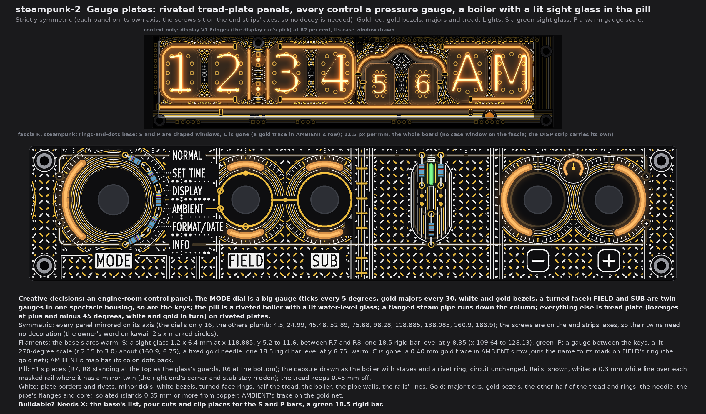
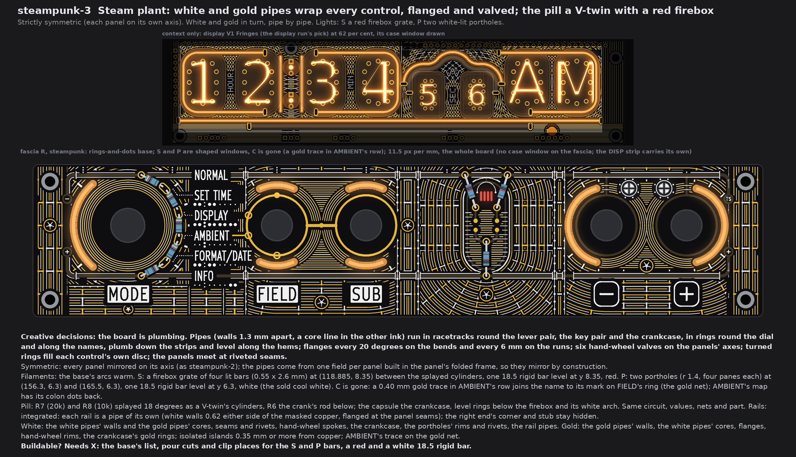
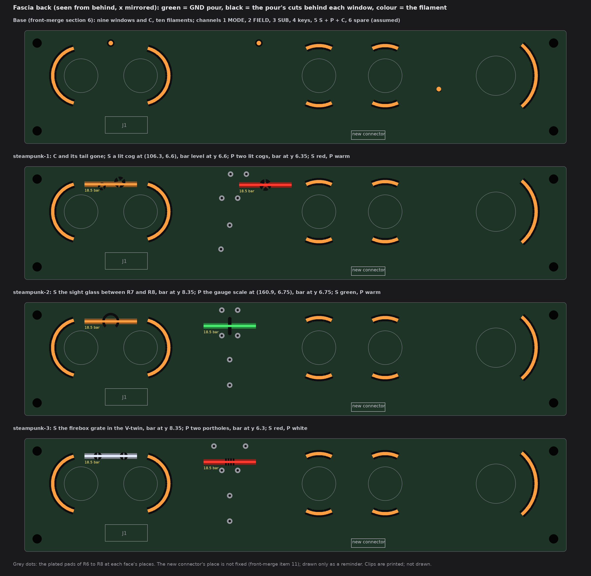

# TS06 fascia, steampunk: gear train, gauge plates, steam plant (drawings only, nothing built)

2026-10-14, front round 3, run fascia-steampunk. The owner's theme list names steampunk with no words of its own; the brief reads it
as gears, gauges, rivets, pipes, pressure dials and brass plates, all original, no brands. Three wild faces that differ by motif,
symmetry, what the lights draw, white-led or gold-led, colours, the pill and the rails. Art covers the whole board; every name,
plate, map and E1's gold stands on its own calm ground.

Queue changes A1 to A5 are in on every face: no top-edge dots (S and P light shaped windows), the pill rearranged and filled, the
rails hidden, shown or integrated, display V1 Fringes in the strip above each face, and **the AMBIENT cutout C gone, with a gold trace
in its row** (section 1). The owner's later word on kawaii-2 (21:5x UTC, the x-marked circles drawn only for symmetry: "unnecessary
standoff mirrors") is taken here too: the symmetric faces need no decoy at a screw's mirror point (section 1).

Each face is fascia R with the owner's rings-and-dots (front-merge section 6), drawn from the board file's copy that pass 4 used, at
one scale (11.5 px per mm), windows lit. No board, schematic, fab, tool, 3D, firmware or spec file was touched. The scripts are
scratch (copies of the kawaii-2 run's, plus a new steampunk script), not in the repo. Marks: *measured* is from the drawing's
raster (23 px per mm) or the board file; *inferred* is arithmetic; *assumed* is my reading.

## 1. What every face keeps

* **Fixed:** the outline, holes, controls and their places, J1, the names, plates, key legends, tube maps, dot leaders and the
  top-edge tube index; FIELD's and SUB's gold rings, the link, the four SUB marks on FIELD's ring and the GND via.
* **The AMBIENT cutout is gone (A5),** as in kawaii-2:
  * window C at (45.04, 21.2) and its tail are removed; the mask and the pour close over it;
  * AMBIENT's tube map gets back its two colon dots (45.04, 20.65 and 21.55), as on every other map;
  * **a 0.40 mm gold trace** runs level at y 18.645 from x 52.43 to 55.75, where it meets the outer edge of AMBIENT's circle mark on
    FIELD's ring, so it is on the gold net (GND through the link's via);
  * *measured:* 0.78 mm from the name and the map, 10.0 mm from other copper, 0.78 mm or more from the art.
* **The panels of the symmetric faces (2 and 3).** Each panel is mirrored on its own axis. The two end strips (x 0 to 9.0 and
  182.4 to 191.4) are panels whose axes run through the screws (x 4.5 and 186.9), so each screw mirrors onto itself. No panel needs
  a decoy at a screw's mirror point. The panels and axes:
  * the dial panel (x 9.0 to 55.8, y 0 to 32), mirrored on the control row y 16;
  * the others plumb: the hems below it (axes 24.99, 45.48, 52.89), levers 75.68, column 98.28, pill 118.885, a 2.6 mm seam strip
    138.085, keys 160.9.
* **Channels on the new fascia connector** (J1 is full; front-merge items 10 and 11), grouping *assumed* as the earlier runs':
  1 MODE, 2 FIELD up + down, 3 SUB up + down, 4 the two keys, **5 S + P (C dropped)**, 6 spare. Nothing comes from DISP.
* **5 V:** nine fascia filaments instead of ten, so 20 mA less than the base at 20 mA each (*inferred*). No face adds a filament.
* **Fab note (once):** bare-FR4 windows still need the fab's yes (pass 1's coupon). Not decided here.

## 2. steampunk-1 Gear train

* **Creative decisions:** a clockwork train over the whole board.
  * The MODE dial is the main wheel: 96 teeth and nine curved spokes.
  * FIELD (74 teeth) meshes SUB (68 teeth). They share one module, and the pitch circles meet on the link (centres 23.38 apart).
  * The - key (60 teeth) meshes the + key (66 teeth), centres 21.0 apart.
  * 126 packed wheels fill the other gaps (r 1.0 to 5.6 mm). By size they get spokes, lightening holes or turned rings.
  * 252 rivets and hex nuts fill the last gaps.
* **Fully organic.** One random packing sets every wheel's place, size and turn, with no mirror anywhere. The meshed pairs have
  different tooth counts, so even they do not mirror.
* **Filaments:**
  * The MODE arc, FIELD and SUB arcs and the key arcs are warm (the base).
  * **S is red:** a lit cog with five sectors between spokes (r 0.8 to 2.05) at (106.3, 6.6). It sits 2.3 mm left of and 2.1 mm
    below the old dot. One 18.5 rigid bar lies level at y 6.6 (x 97.05 to 115.55).
  * **P is warm:** two lit cogs at (157.7, 5.6) and (164.05, 7.1), behind them one 18.5 rigid bar level at y 6.35 (x 151.65 to
    170.15).
* **Pill:** R6, R7 and R8 are all slanted 20 degrees, parallel, as the connecting rods of an inclined cylinder. Its bore is hatched
  along them in white and gold.
  * R7's and R8's top pads slide 3.08 mm left along the GND rail (to 113.01 and 118.61). Their lower pads rise 0.55 mm and still
    cover the landing tracks' ends.
  * R6's bottom pad slides 3.08 mm right along the +5V rail (to 121.96). Its top pad (A7) moves 0.55 mm down, and the A7 bus under
    the mask follows it.
  * The circuit, values, nets and part do not change (*inferred* from the art model).
* **Rails: hidden** under the mask, as in E1; the gears run over them.
* **White:** the gear outlines, spokes, rims, the dial's spokes, the hex nuts and the pill's hatch (0.18 to 0.2 mm).
* **Gold:** SUB's and the - key's rims, 16 of the packed wheels, hubs, lightening holes and rivet heads (0.22 to 0.24 mm). All are
  isolated islands 0.34 mm or more from copper, plus AMBIENT's trace.
* **Buildable? Needs X:**
  * the base's list (front-merge items 9 to 11);
  * pour cuts and clip places for the S and P bars;
  * a red 18.5 rigid bar;
  * C's cut and tail are dropped.

## 3. steampunk-2 Gauge plates

* **Creative decisions:** an engine-room control panel.
  * The MODE dial is a big pressure gauge: ticks every 5 degrees, gold majors every 30, a white and a gold bezel, and a turned face.
  * FIELD and SUB are twin gauges in one spectacle housing; so are the keys. Each gauge keeps to its own side of the pair's axis.
  * The pill is a riveted boiler with a lit water-level glass.
  * A flanged steam pipe runs down the column.
  * Everything else is tread plate (lozenges at plus and minus 45 degrees, white and gold in turn) on riveted plates, one plate per
    panel.
* **Strictly symmetric:** every panel is mirrored on its axis (section 1). *Measured:* no ink pixel in any panel lacks its mirror
  partner within 2 px.
* **Filaments:**
  * The base's arcs are warm.
  * **S is green:** a sight glass 1.2 x 6.4 mm at x 118.885, y 5.2 to 11.6, between R7 and R8. One 18.5 rigid bar lies level at
    y 8.35 (x 109.64 to 128.13).
  * **P is warm:** a gauge between the keys, its 270-degree scale lit (r 2.15 to 3.0) about (160.9, 6.75), with a fixed gold
    needle. One 18.5 rigid bar lies level at y 6.75.
* **Pill:** E1's places. R7 and R8 stand at the top as the glass's guards and R6 at the bottom. The capsule is drawn as the boiler
  with staves and a rivet ring. Nothing moves; the circuit is unchanged.
* **Rails: shown, white.** A 0.3 mm white line runs over each masked rail where it has a mirror twin. The right end's corner and
  stub stay hidden. The tread keeps 0.45 mm off.
* **White:** plate borders and rivets, minor ticks, the white bezels, turned-face rings, half the tread, the boiler, the pipe walls
  and the rails' lines.
* **Gold:** major ticks, the gold bezels, the other half of the tread and rings, the needle, the pipe's flanges and core. All are
  isolated islands 0.35 mm or more from copper, plus AMBIENT's trace.
* **Buildable? Needs X:** the base's list, pour cuts and clip places for the S and P bars, and a green 18.5 rigid bar.
  * *Assumed:* the glass (6.4 mm tall) and the P scale (5.1 mm tall) glow evenly enough from a 2.0 mm bar through the FR4; the
    bench decides.

## 4. steampunk-3 Steam plant

* **Creative decisions:** the board is plumbing.
  * Each pipe has walls 1.3 mm apart and a core line in the other ink. White pipes and gold pipes alternate.
  * The pipes run in racetracks round the lever pair, the key pair and the crankcase. They make rings round the dial and runs along
    the names, run plumb down the strips and level along the hems.
  * Flanges sit every 20 degrees on the bends and every 6 mm on the runs.
  * Six hand-wheel valves sit on the panels' axes.
  * Turned rings fill each control's own disc and the waist between each pair.
  * The panels meet at riveted seams.
* **Strictly symmetric:** every panel is mirrored on its axis (section 1). The pipes come from one field per panel, built in the
  panel's folded frame, so they mirror by construction. *Measured:* no ink pixel lacks its mirror partner within 2 px.
* **Filaments:**
  * The base's arcs are warm.
  * **S is red:** a firebox grate of four lit bars (0.55 x 2.6 mm) at (118.885, 8.35), between the splayed cylinders, under a white
    arch. One 18.5 rigid bar lies level at y 8.35.
  * **P is white** (the sold cool white): two portholes (r 1.4, four panes each) at (156.3, 6.3) and (165.5, 6.3), with riveted
    rims. One 18.5 rigid bar lies level at y 6.3.
* **Pill:** R7 (20k) and R8 (10k) are splayed 18 degrees as a V-twin's cylinders, and R6 is the crank's rod below. The capsule is
  the crankcase, with level rings below the firebox. The circuit, values, nets and part do not change.
* **Rails: integrated.** Each rail is a pipe of its own: white walls 0.62 mm either side of the masked copper, flanged at the panel
  seams. The right end's corner and stub stay hidden.
* **White:** the white pipes' walls and the gold pipes' cores, seams and rivets, hand-wheel spokes, the crankcase, the firebox
  arch, the portholes' rims and rivets, and the rail pipes.
* **Gold:** the gold pipes' walls, the white pipes' cores, flanges, hand-wheel rims and the crankcase's gold rings. All are isolated
  islands 0.35 mm or more from copper, plus AMBIENT's trace.
* **Buildable? Needs X:** the base's list, pour cuts and clip places for the S and P bars, and a red and a white 18.5 rigid bar.

## 5. The light base and what each face changes

The MODE arc, the four lever arcs and the two key arcs do not change on any face. S and P are the only lights that move. Each is one
18.5 rigid bar (the shortest sold), lying level behind its window, on channel 5.

| Face | S window, place, bar | P window, place, bar |
|---|---|---|
| base | dot (108.6, 4.5) | dot (160.9, 4.5) |
| steampunk-1 | lit cog (106.3, 6.6); bar x 97.05 to 115.55, y 6.6 | two lit cogs (157.7, 5.6), (164.05, 7.1); bar x 151.65 to 170.15, y 6.35 |
| steampunk-2 | sight glass x 118.885, y 5.2 to 11.6; bar x 109.64 to 128.13, y 8.35 | gauge scale about (160.9, 6.75); bar x 151.65 to 170.15, y 6.75 |
| steampunk-3 | firebox grate (118.885, 8.35); bar x 109.64 to 128.13, y 8.35 | two portholes (156.3, 6.3), (165.5, 6.3); bar x 151.65 to 170.15, y 6.3 |

**On the back,** each window needs a pour cut and two clip places at its bar's ends. C's cut and tail are dropped.

**Colours each face ships with:**
* steampunk-1: warm + red (S red);
* steampunk-2: warm + green (S green);
* steampunk-3: warm + red + white (S red, P white).

All are sold as 18.5 rigid bars (front-merge section 5).

**The bars' fit** (*measured* on the art model, gap from the bar's 2.0 mm body to the nearest plated pad, r 0.95; rule 0.4):

| Face | S bar to a pad | P bar to a pad | P bar to a key's footprint (r 6.2) |
|---|---|---|---|
| steampunk-1 | 1.88 (R7's top pad, moved) | 26 or more | 2.54 |
| steampunk-2 | 1.47 (R8's lower pad) | 26 or more | 2.14 |
| steampunk-3 | 1.03 (R8's lower pad) | 26 or more | 2.59 |

* steampunk-1's S bar stays 6.6 mm outside SUB's lever footprint.
* *Measured* on the ordered board (`R-open`) by kawaii-2: there are no tracks or vias on the back in x 100 to 140, y 0 to 22, only
  the GND pour.

## 6. The checks (*measured* on the raster, 23 px per mm)

| Check | Rule | steampunk-1 | steampunk-2 | steampunk-3 |
|---|---|---|---|---|
| White, gold to a name, plate, key legend, tube map, leader or index dot | 0.75 | 0.80, 0.99 | 0.78, 0.81 | 0.80, 0.80 |
| White, gold to E1's exposed gold (rings, link, marks, pads, AMBIENT's trace) | 0.30 (frame 0.75 drawn) | 0.74, 0.74 | 0.74, 0.75 | 0.74, 0.74 |
| Pattern gold to copper | 0.30 | 0.34 | 0.35 | 0.35 |
| White, gold to a lit window | 0.35 | 0.39, 0.40 | 0.39, 0.39 | 0.40, 0.40 |
| White to the pattern's gold | 0.30 | 0.31 | 0.31 | 0.31 |
| Lit window to copper; to a legend | 0.30 | 0.48; 1.17 | 0.48; 1.17 | 0.68; 1.17 |
| AMBIENT's trace to a legend; to other copper | 0.75; 0.30 | 0.78; 10.0 | 0.78; 10.0 | 0.78; 10.0 |
| Free board within 1.2 mm of some ink | (no empty space) | 98.1 % | 98.8 % | 99.0 % |
| Mirror misses (share of a panel's ink with no partner within 2 px) | 0 | (organic) | 0 in every panel | 0 in every panel |

* White over the masked copper (the rails, the pill's GND capsule, the A7 bus) is allowed, as in E1.
* What stays dark, as before, is the ring of mask between each knob and its window.

## 7. My pick

**steampunk-1 Gear train.** It is the most steampunk at arm's length: every control is the hub of a wheel, FIELD visibly drives SUB
and - drives +, and the packed wheels fill the board with nothing mirrored and every name on clear ground. steampunk-2 Gauge plates is
the calm, exact alternative (each control reads as a gauge), and steampunk-3 Steam plant is the most gold.

## 8. Left open, assumed

* *Assumed:* the S and P lights are 18.5 rigid bars lying level behind their windows, on channel 5, as in kawaii-2.
* *Assumed:* the AMBIENT trace's place (section 1), as kawaii-2 read it.
* The rearranged pills are drawn on the art model's places (E1). The ordered board (`R-open`) still has R6 to R8 elsewhere, as 1206
  parts on the back; the board-change run places them.
* The pattern's gold is isolated islands (no net). Stems to GND can be added if the fab wants no floating copper; not drawn.
* The smallest strokes (0.16 to 0.18 mm silk) are at the fab's silk limit used before (0.15).
* Not checked: KiCad DRC (no board file was edited), and the back's own copper behind the moved windows beyond section 5.
