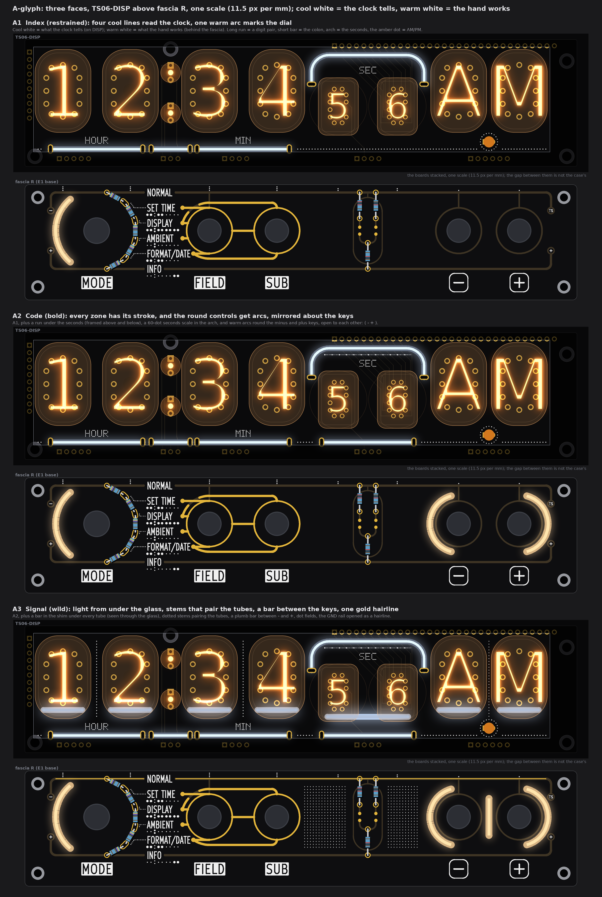
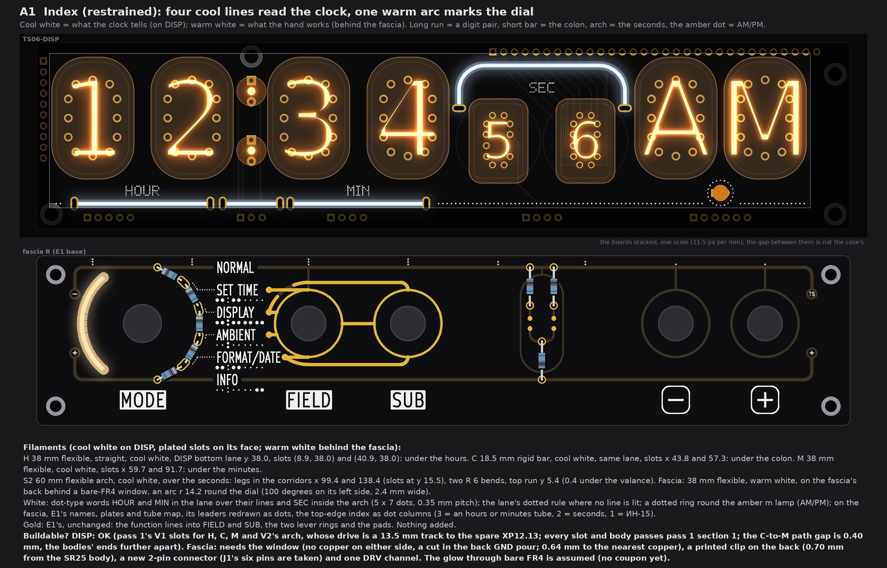
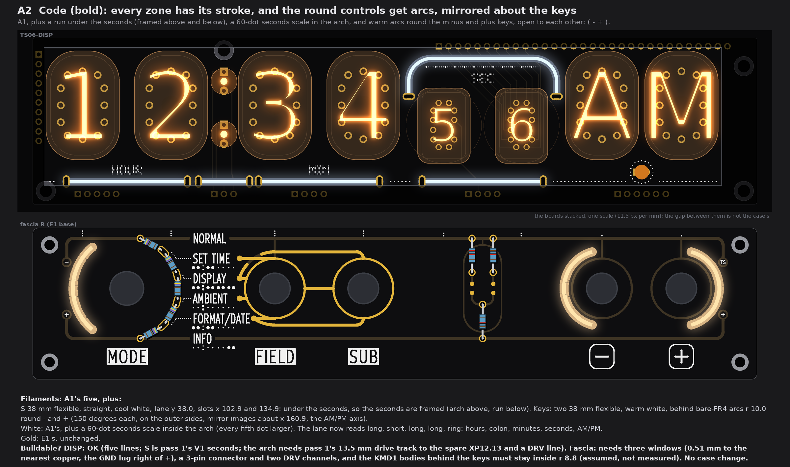
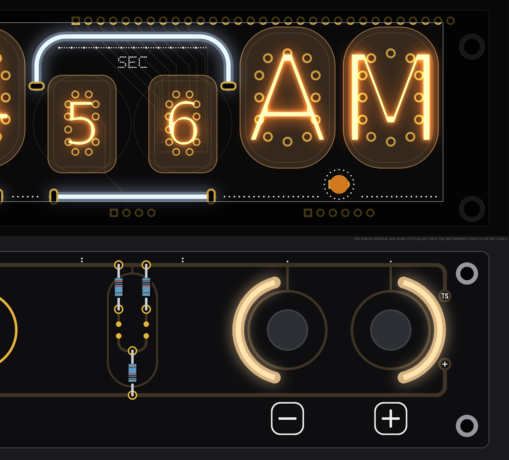
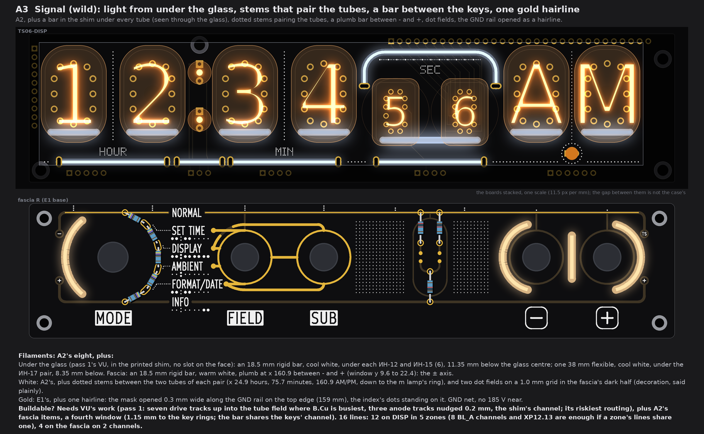

# TS06 front art A, "Glyph": lit lines as a code for the zones (three faces, TS06-DISP above fascia R; drawings only, nothing built)

No board, schematic, fab, tool, 3D, firmware or spec file was touched. The pictures are drawn from `PCB/TS06-DISP/TS06-DISP.kicad_pcb` and fascia R (`PCB/TS06-FASCIA-rhythm`, the copy with its control holes opened that pass 4 used), read with Python and never written, on top of fascia pass 4's E1 art. Marks: *listing data* is from the shop pages; *inferred* is arithmetic or a typical figure; *assumed* is my reading, not measured or asked. No prices. The scratch scripts are in the run's scratch folder (`front-art-A/work`), not in the repo.

## 1. The idea in one paragraph

A few bold filament strokes and a second voice of white dots, everything on one grid. The grid is already in the boards: the fascia's controls stand under the display's zones (the dial at x 24.89 is the hours' axis, the middle of FIELD and SUB at 75.68 is the minutes', the ladder at 118.89 is the seconds', the middle of the keys at 160.9 is the amber m lamp and the AM/PM pair). Each stroke is symmetric about its own zone's axis. **The code:**

| | Meaning |
|---|---|
| **Cool white** | what the clock tells (every line on DISP) |
| **Warm white** | what the hand works (every line behind the fascia) |
| Long level run | a digit pair (hours, minutes; seconds in A2 and A3) |
| Short rigid bar | punctuation: the colon |
| Arch | the seconds (the only zone that moves every second) |
| The amber m lamp in a dotted ring | AM/PM (no line fits there, see section 5) |
| Arc round a control | something you turn or press round (the dial; the keys) |
| Dots | the index: words in a 5 x 7 dot type, dotted rules and leaders, dot columns on the fascia's top edge (3 = an hours or minutes tube, 2 = seconds, 1 = ИН-15) |

The colour split keeps pass 4's rule that nothing may say a false thing: no warm line points at a tube, so the dial under the hours does not claim to set the hours. Gold stays almost out: E1's function lines (which name works which lever) are still the only exposed gold in A1 and A2; A3 adds one hairline.

**Behaviour (a proposal, no firmware touched):** each zone is one channel and can be dimmed or animated (Steady, Breathe, Glitch, Live). Suggested: the seconds' arch Breathes once a second; the zone that FIELD has selected Breathes while a setting screen is open; the fascia's key arcs light only on screens 2 to 5, where the keys work (spec section 1). Then the light says which zone the hand is changing, with no line crossing the face.

## 2. A1 "Index" (restrained)

* **Filaments:** H 38 mm flexible, straight, cool white, DISP bottom lane y 38.0, slots (8.9, 38.0) and (40.9, 38.0), under the hours; C 18.5 mm rigid bar, cool white, same lane, slots x 43.8 and 57.3, under the colon; M 38 mm flexible, cool white, slots x 59.7 and 91.7, under the minutes; S2 60 mm flexible arch, cool white, over the seconds, legs in the corridors x 99.4 and 138.4 (slots at y 15.5), two R 6 bends, top run y 5.4; fascia: one 38 mm flexible, warm white, on the fascia's back behind a bare-FR4 arc window r 14.2 round the dial (100 degrees on its left side, 2.4 mm wide).
* **White:** HOUR and MIN in dot type in the lane over their lines, SEC inside the arch (5 x 7 dots, 0.35 mm pitch, 0.25 mm dots); the lane's dotted rule wherever no line is lit; a dotted ring round the m lamp; on the fascia, E1's names, plates and tube map, its leaders redrawn as dots, its top-edge bulbs replaced by dot columns.
* **Gold:** E1's, unchanged (the function lines into FIELD and SUB, the lever rings, the pads).
* **Buildable? DISP: OK.** The slot sites are pass 1's V1 (H, C, M) and V2 (the arch), rechecked here with pass 1's own checker: every slot and body passes section 1's rules; the arch needs pass 1's 13.5 mm drive track to the spare XP12.13. **Fascia: needs** the window (no copper on either side, a cut in the back GND pour; 0.64 mm to the nearest copper, the GND lug), a printed clip on the back (the filament keeps 0.70 mm from the SR25 body, r 12.5), a new 2-pin connector (J1's six pins are all used: +5V, GND, A6, A7, D7, D8) and one DRV channel.

## 3. A2 "Code" (bold)

* **Filaments:** A1's five, plus S 38 mm flexible, straight, cool white, lane y 38.0, slots x 102.9 and 134.9, under the seconds (the seconds are framed: arch above, run below); and two 38 mm flexible, warm white, behind bare-FR4 arcs r 10.0 round the minus and plus keys (150 degrees each, on the outer sides, mirror images about x 160.9): ( - + ).
* **White:** A1's, plus a 60-dot seconds scale inside the arch (every fifth dot larger). The lane now reads long, short, long, long, ring: hours, colon, minutes, seconds, AM/PM.
* **Gold:** E1's, unchanged.
* **Buildable? DISP: OK** (five lines; S is pass 1's V1 seconds). **Fascia: needs** three windows (0.51 mm to the nearest copper, the GND lug right of plus), a 3-pin connector and two DRV channels; the KMD1 bodies behind the keys must stay inside r 8.8 (*assumed*, not measured). No case change.

## 4. A3 "Signal" (wild)

* **Filaments:** A2's eight, plus pass 1's VU under the glass (in the printed shim, no slot on the face): an 18.5 mm rigid bar, cool white, under each ИН-12 and ИН-15 (six), 11.35 mm below the glass centre, and one 38 mm flexible, cool white, under the ИН-17 pair, 8.35 mm below; and on the fascia an 18.5 mm rigid bar, warm white, plumb at x 160.9 between minus and plus (window y 9.6 to 22.4): the plus-minus axis.
* **White:** A2's, plus dotted stems between the two tubes of each pair (x 24.9, 75.7 and 160.9, the last down to the m lamp's ring) and two dot fields on a 1.0 mm grid in the fascia's dark half. The dot fields carry no information: decoration, said plainly.
* **Gold:** E1's, plus one hairline: the mask opened 0.3 mm wide along the GND rail on the fascia's top edge (159 mm in two runs, broken at NORMAL), the index's dots standing on it. GND net; no 185 V on the fascia.
* **Buildable? Needs** VU's work (pass 1 called it the riskiest routing: seven drive tracks up into the tube field where B.Cu is busiest, three anode tracks nudged 0.2 mm, a channel in the shim), plus A2's fascia items and a fourth window (1.15 mm to the key rings; the bar shares the keys' channel). 16 lines: 12 on DISP in 5 zones (the 8 BL_A channels and XP12.13 are enough if a zone's lines share one), 4 on the fascia on 2 channels.

## 5. What the checks said, and what does not fit

| Check (rule) | A1 | A2 | A3 |
|---|---|---|---|
| DISP lines, pass 1's `problems()` (glass 0.5, stem 0.5, screw head 0.3, slot to other copper 0.3, to 185 V 0.6 track / 0.8 pad, edge 0.5) | none | none | none (VU lines are in the shim, pass 1's own findings stand) |
| Least gap between two lines (0.4) | 0.40, C to M, measured on the slot-to-slot paths (the bodies' ends are further apart) | same | same |
| DISP silk dot to a pad / slot pad / glass / a body | 0.54 / 1.86 / 2.55 / 0.88 | 0.54 / 1.66 / 2.55 / 0.82 | 0.54 / 1.66 / 0.65 / 0.82 |
| Fascia window to copper / silk / edge / screw / knob keep-out (r 9) | 0.64 / 1.46 / 3.98 / 5.76 / 4.0 | 0.51 / 1.19 / 3.98 / 5.76 / 4.0 | 0.51 / 1.19 / 3.98 / 5.76 / 4.0 |
| Fascia silk dot to exposed gold (0.30) / to a name | 0.43 / 0.48 | 0.43 / 0.48 | 0.43 / 0.48 |

* **Not buildable, so not drawn: a pair of short bars under AM/PM, mirrored about the m lamp.** Every slot site between the ИН-15 pair's lane and the lamp falls on a 185 V anode: ANODE_AM runs down at x 157.1 and ANODE_PM at x 164.7 on B.Cu, and a slot there is -0.64 mm from them. Right of the seconds, free slot centres on y 38 are only x 150.3 and below, 158.8 to 160.8 (under the lamp itself) and 174.3 to 182.8, too short for an 18.5 mm bar on the right. So AM/PM keeps the lamp as its mark, ringed in white dots. Pass 1's plumb bar in the right band would work but needs the case's right wall moved out about 4 mm and breaks the symmetry; I left it out.
* *Assumed:* that bare FR4 glows evenly and reads warm white from a warm-white filament lying on the back, through the board (thickness *assumed* 1.6 mm) (no coupon has been made; pass 1's coupon question still stands); that the filament body is 2.0 mm and bends at R 6 (*listing data* and pass 1); the KMD1 bodies' size behind the panel.
* Every face rides on pass 1's driver plan (a 16-channel PWM chip on TS06-DRV, not built): "OK" above means the geometry and the board rules, not the drive.

## 6. My pick

**A2 "Code".** It is the only face where every zone has its own stroke and the two temperatures split reading from doing, with no case change, no new 185 V risk and only three windows and a small connector on the fascia; A1 is the fallback if the fascia should stay untouched apart from the dial, and A3's under-glass light is the one to try on the bench before anyone routes for it.
