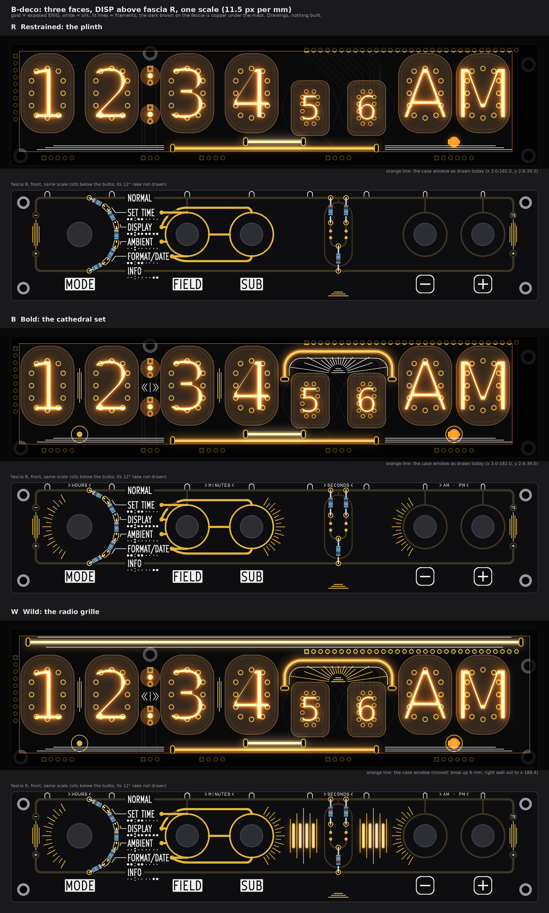
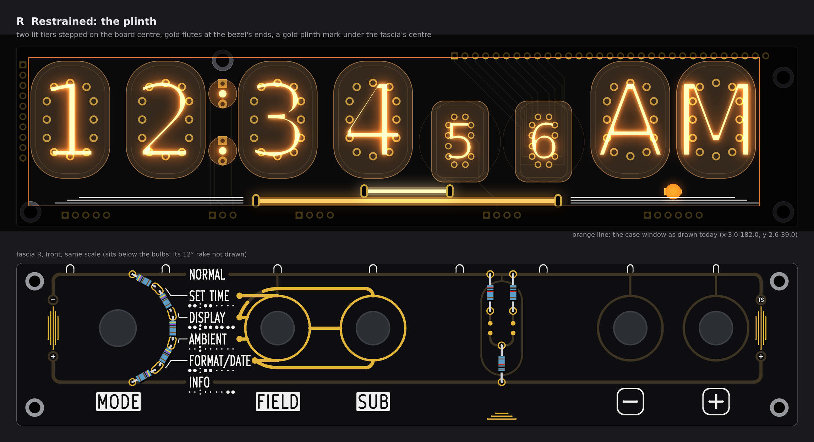
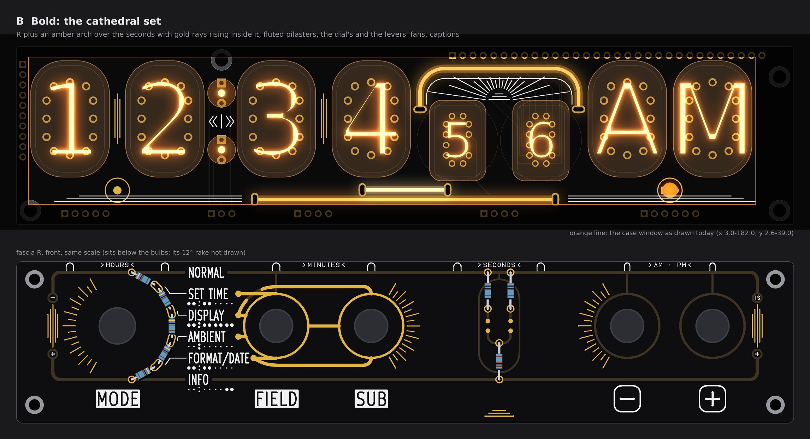
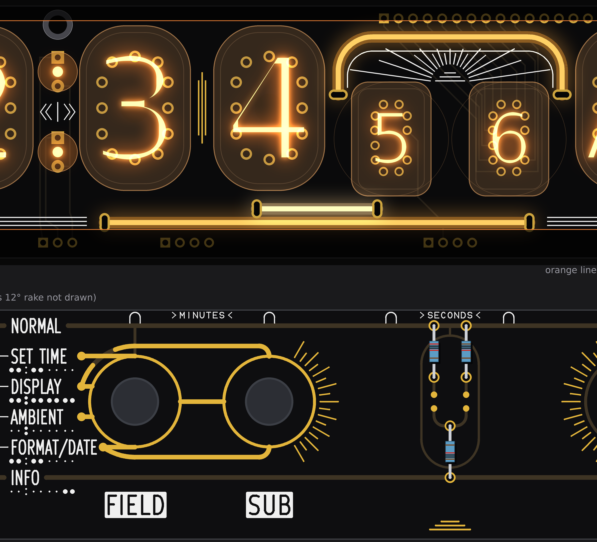
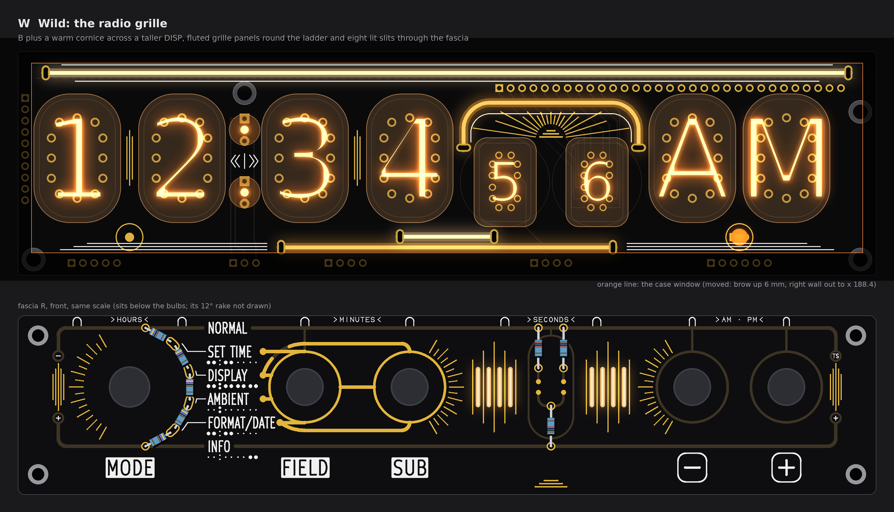

# TS06 front art, B-deco: 1930s radio-set geometry on DISP and fascia R (three faces; drawings only, nothing built)

No board, schematic, fab, tool, 3D, firmware or spec file was touched. The pictures are drawn from `PCB/TS06-DISP/TS06-DISP.kicad_pcb` (pass 1's extract, rechecked: all 30 footprints at the same place), fascia R's board (pass 4's E1 built on `PCB/TS06-FASCIA-rhythm` with its control holes opened) and pass 1's slot-site scan. Every lit line went through pass 1's line checker, and each fascia face went through `check()` of `tools/fascia_gold.py`. Gold on DISP was painted through a mask of what may be exposed, so it shows only where it can be built. Marks: *listing data* is from the shop pages; *inferred* is arithmetic or a typical figure; *assumed* is my reading. No prices. The scratch scripts are in the run's output folder, not in the repo.

## 1. The direction, and the symmetry that holds

Gold leads, as fine Deco geometry: fluted parallel lines, stepped bars, fans of rays from the dial and the levers, chevrons that frame the tube groups. Amber and warm-white filaments draw an arch and stepped bars that repeat the gold shapes. White silk is used for pinstripes and small engraved-style captions. **The function lines stay the heaviest gold on the fascia.** They keep pass 4's 0.8 mm, and every added gold line is a 0.25 to 0.3 mm hairline. On a face like B the added gold covers about a third of the area of the function lines' gold (*inferred*: lengths × widths).

**Mirror symmetry about the board centre (x 95.7) holds for the frame, but it cannot hold for the whole face.** These parts mirror exactly:

* DISP's lit plinth (each pair of slot x values adds up to 191.4);
* the white pinstripes beside the plinth;
* W's cornice and W's case window (x 3.0 to 188.4);
* the fascia's rails, lugs and end flutes.

The rest of the front is not centred on x 95.7:

* the tube row's own centre is x 92.3 (glass edges 3.48 to 181.13);
* today's case window is centred on x 92.5;
* the controls stand under their tubes;
* SUB's ring touches the centre line (its edge is at x 95.5).

A mark placed on the centre line therefore reads as part of SUB. **So the hero ornament takes a second axis, x 118.885, through the seconds pair's centre.** On DISP that axis carries the arch and the rays inside it. On the fascia it carries the ladder. SUB (87.37) and minus (150.4) are exact mirror images about this axis, so their fans face each other across the ladder's capsule. Each tube pair's own ornament is symmetric about that pair's centre:

* the fluted pilasters in the hours and minutes gaps;
* HL9's gold ring under AM/PM, and its unlit twin under the hours.

## 2. Face R, restrained: the plinth

* **Filaments:**
  * P1, a flexible 80 mm line in amber (the listing's "yellow", whose own lit photo glows amber, *listing data*). It runs level at y 37.8 under the minutes and seconds, slots x 58.7 and 132.7.
  * P2, a rigid 26 mm bar in warm white (the rigid bars are not sold in amber, *listing data*). It runs level at y 35.4 above P1's middle, slots x 85.2 and 106.2.
  * Together they make a two-step plinth on the board centre. The 0.4 mm gap between the bodies equals pass 1's line-to-line minimum.
* **White:** three stepped pinstripes (0.2 mm) on each side of the plinth, at y 36.9, 37.6 and 38.3 in DISP's bottom lane, mirrored about x 95.7 and kept inside today's window (from x 9.4, which mirrors x 182.0).
* **Gold:** none on DISP. On fascia R, two pieces:
  * five plumb flutes (0.25 mm islands, 0.6 mm pitch, stepped so the centre one is longest) between the lugs at each end, mirrored;
  * three stepped bars (0.3 mm) in the bottom band, on the ladder's axis, echoing the plinth.
* **Buildable? OK.** Four plated slots, each at one of pass 1's free sites:
  * all pass the 185 V rules (worst slot to a 185 V track 2.20 mm, to a 185 V pad 4.52 mm);
  * all pass the glass rule (worst 1.19 mm, P2 to M1);
  * each line needs one drive track to a BL_A strip pin, as in pass 1 (not routed here).

  The fascia face passes `check()` with no problem, needs no new hole, and the case does not change.

## 3. Face B, bold: the cathedral set

* **Filaments:** R's P1 and P2, plus A, a flexible 60 mm amber arch over the seconds pair (pass 1's V2 arch):
  * the legs are plumb at x 99.4 and 138.4, in pass 1's two corridors;
  * the slots are at y 15.5;
  * the top runs level at y 6.3, below the valance;
  * the corners are R 6 (*assumed* bend radius).
* **White:**
  * R's pinstripes;
  * a hairline 0.6 mm inside the arch, concentric with its corners;
  * 17 rays in the arch, long and short alternating, rising from a three-step base set between the two ИН-17 faces;
  * a chevron pair « | » between the colon lamps, pointing out to the hours and the minutes. It is white rather than gold because COLON_U and COLON_RET (185 V) run under that spot.
  * On the fascia's top band, the captions HOURS, MINUTES, SECONDS and AM · PM, each at its group's centre between the tube-index bulbs and framed by two small chevrons. They are drawn in a monoline Deco capital of my own, 1.0 mm tall with a 0.15 mm stroke.
* **Gold:**
  * On DISP, as mask openings on the BL_K pour:
    * fluted pilasters (three 0.25 mm flutes, the centre one longer) in the hours and minutes gaps;
    * a ring round HL9 (the m lamp);
    * an unlit twin under the hours gap (a ring and a disc).
  * On the fascia:
    * R's flutes and bars;
    * the dial's fan, 17 rays from 120 to 240 degrees, r 10.4 out to 13.4 and 12.1 alternating, fanning outwards to the left;
    * SUB's fan, 17 rays from −60 to 60 degrees, r 8.9 out to 12.0 and 10.6;
    * minus's fan, the mirror image of SUB's about the ladder's axis.

    All of these are islands, 214 mm of hairline in total.
* **Buildable? OK.**
  * Six slots, all clear (the arch: glass 1.27 mm, ИН-17 stem 1.03 mm, worst 185 V track 6.10 mm), plus a drive track each.
  * Every gold piece on DISP keeps 0.6 mm from other-net front copper and 0.8 mm from 185 V pads. Nothing had to be clipped.
  * Fascia `check()` passes: gold to white 0.32 mm (a caption against the ladder's top pads; the rule is 0.30).
  * No new hole and no case change.
  * The rays are white, not gold, because S1's ten cathode tracks (KS0 to KS9) cross the arch's right half diagonally on the front.

## 4. Face W, wild: the radio grille

* **Filaments:**
  * B's three lines.
  * K, a flexible 185 mm warm-white cornice, level at y −1.2 in a new 6 mm strip on top of DISP. Its slots are at x 6.2 and 185.2, mirrored on the board centre. It is 1.55 mm clear of XP12's pads and 0.75 mm clear of H3's screw head.
  * Behind each fascia grille panel, one flexible 38 mm amber line, level at the control row. It lights four bare-FR4 slits (1.0 × 9 mm), eight slits in all. These lines are not drawn; their glow is.
* **White:** as B, plus a pinstripe about 0.8 mm above and below the cornice body (y −3.0 and 0.65).
* **Gold:**
  * B's gold, plus the rays and their stepped base in gold rather than white;
  * on the fascia, two fluted grille panels, one on each side of the capsule and mirrored about the ladder's axis. Each panel has five plumb flutes, stepped at 12, 16, 20, 16 and 12 mm, with the lit slits between them. The nearest gold to a slit is 0.575 mm.
* **Buildable? Not as the boards stand.** It needs five named changes:
  1. DISP grows 6 mm at the top, and the case brow rises 6 mm. That loses the spec's brow look, which hides the domes and getter bands.
  2. The right wall moves out to x 188.4 so the window is symmetric. H4's screw head (x 185.2 to 190.7, y 4.8 to 10.3) then shows in the window's top-right corner.
  3. KS0 to KS9 move off the front under the arch (a re-route, not checked) so the rays can be gold.
  4. The fab must agree to the bare-FR4 slits (pass 1's coupon question, §6.3).
  5. A printed holder and wiring are needed for the two lines behind the fascia (pass 1's VT fallback; J1 cannot carry them).

  The fascia face itself passes `check()`.

## 5. The checks in one place

| Line | Kind, length, colour | Slots (x, y) | Glass / stem | Slot to other copper | Slot to 185 V pad / track | Result |
|---|---|---|---|---|---|---|
| P1 plinth, lower | flexible 80, amber | (58.7, 37.8), (132.7, 37.8) | 3.59 / 3.59 | 4.52 / 1.24 | 4.52 / 4.58 | fits |
| P2 plinth, upper | rigid 26, warm white | (85.2, 35.4), (106.2, 35.4) | 1.19 / 1.43 | 1.20 / 2.67 | 8.85 / 2.20 | fits |
| A arch (B, W) | flexible 60, amber | (99.4, 15.5), (138.4, 15.5) | 1.27 / 1.03 | 1.76 / 2.13 | 6.75 / 6.10 | fits |
| K cornice (W) | flexible 185, warm white | (6.2, −1.2), (185.2, −1.2) | clear | clear of XP11 and XP12 | none near | fits the grown board only |

The rules are pass 1's: glass 0.5, slot to other copper 0.3, slot to a 185 V pad 0.8 and to a 185 V track 0.6, edge 0.5. Pass 1's lane rule is still true: no line passes under HL9 in the window.

| Fascia R, `check()` | R | B | W | Rule |
|---|---|---|---|---|
| Gold to gold, exposed (narrowest: the end flutes) | 0.35 | 0.35 | 0.35 | 0.30 |
| Gold to white | 0.37 | 0.32 | 0.32 | 0.30 |
| Gold to the edge | 1.55 | 1.55 | 1.55 | 1.4 |
| Gold to a screw | 7.62 | 7.62 | 7.62 | 3.0 |
| Margin outside the dial's 9.0 keep-out | 3.75 | 1.27 | 1.27 | ≥ 0 |
| Narrowest web, all copper counted as gold | 0.32 | 0.32 | 0.32 | 0.30 |
| Added gold (hairline), mm | 90 | 214 | 366 | (function lines: pass 4's 194 mm at 0.8) |

## 6. My pick

**B, the cathedral set.** It is the richest face that can be built on the boards as they stand: six slots, mask openings on the BL_K pour, gold islands and white on the fascia, no new hole and no case change, with the function lines still the heaviest gold. W's grille panels and gold rays are its upgrade once the coupon answers the bare-window question and S1's cathode tracks can leave the front.

## 7. Left open, assumed, not drawn

* **Not routed:** the drive track from each new slot to a BL_A strip pin (one per line, as pass 1); the zones (suggested: plinth Steady, arch Breathe or Live on the seconds).
* **Assumed, from pass 1:** body 2.0 mm, bend R 6, slot 1.0 × 2.5, glass as a rounded rectangle. If the bend radius is R 10 the arch breaks, exactly as in pass 1's V2.
* **Colour names:** "amber" is the flexible listing's "yellow" (*listing data*, its lit photo). The rigid bars come only in warm white, white, red, green, blue and pink, so the rigid upper tier is warm white.
* **Captions:** these are my own monoline letters drawn as silk lines. KiCad's stroke font could not be rendered here (no KiCad, no Docker); either can be built. At 1.0 mm tall with a 0.15 mm stroke they are at the fab's silk limit (*inferred*). SECONDS sits 0.32 mm from the ladder's top pads.
* **HL9's twin** sits under the hours gap (x 24.89), by the pairs' logic. Its board-centre mirror would be x 30.5, under H1's glass, where it would belong to no group.
* **Nothing was refused.** The worktree guard stopped three compound shell commands before they ran; I split them into plain ones.
