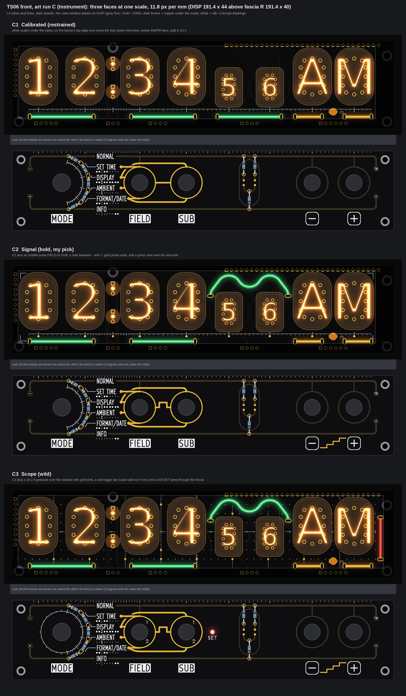
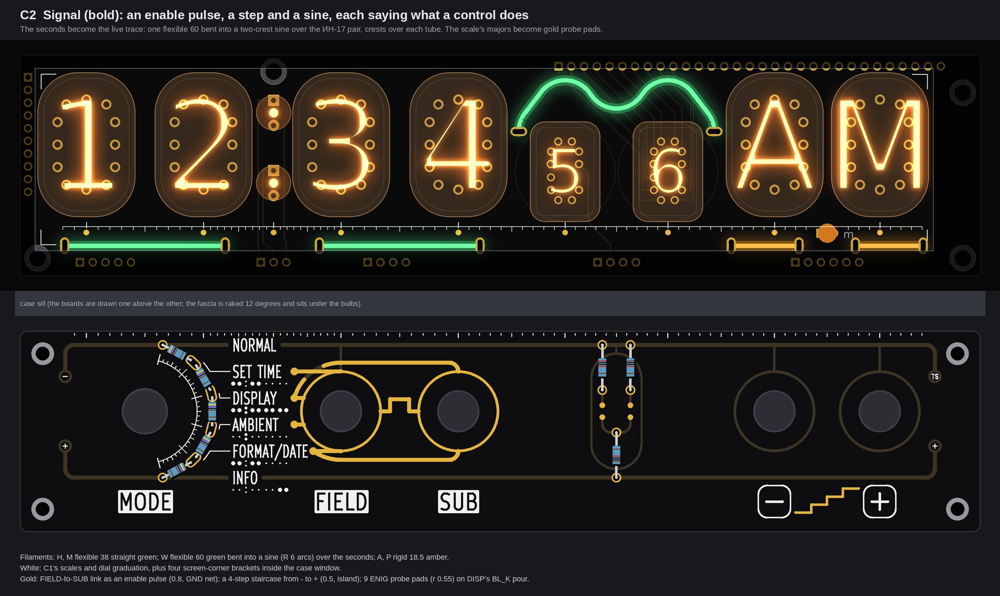
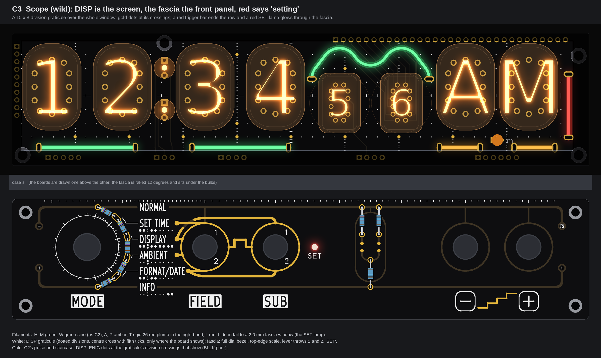
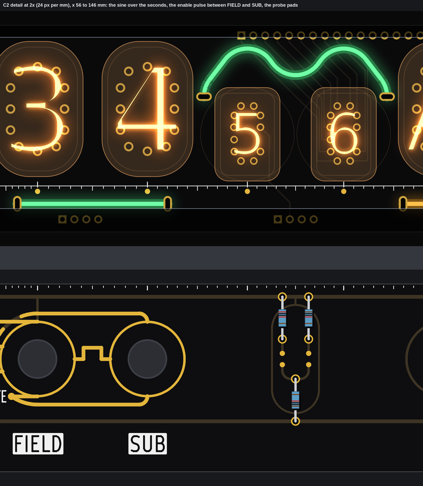

# TS06 front, art run C: Instrument (three faces of TS06-DISP above fascia R; drawings only, nothing built)

The clock read as a laboratory instrument: DISP is the screen, fascia R is the front panel. White silk leads (scales, a graticule, graduations, small captions); gold is the signal (an enable pulse, a step, probe pads); filaments are indicator lines, coloured by meaning: **green = time** (hours, minutes, seconds), **amber = display** (the AM/PM pair), **red = a setting state** (C3 only). At most these three colours.

No board, schematic, fab, tool, 3D, firmware or spec file was touched. DISP's geometry is re-read from `PCB/TS06-DISP/TS06-DISP.kicad_pcb` in this branch (identical to the extract lights pass 1 used); fascia R is pass 4's E1 on R's real geometry (the committed `PCB/TS06-FASCIA-rhythm` board with its control holes opened). Every fascia face was run through `check()` of `tools/fascia_gold.py` two ways (exposed only; all copper counted as gold): **no problem on any face**. Marks: *listing data* from the shop pages; *inferred* is arithmetic or a typical figure; *assumed* is my reading. The scratch scripts are in the run's scratch folder, not in the repo.

## The shared rules I drew to

* **Info first.** Pass 4's E1 function lines (which name works which lever) stay the heaviest gold on every face (0.8 mm). Nothing new crosses them. E1's tube maps under the names stay. Only E1's bulb index on the top edge is replaced (by a scale that does the same job).
* **One scale for the tube row, on both boards.** The majors are the nine tube centres (H10, H1, colon, M10, M1, S10, S1, ИН-15Б, ИН-15А); ten divisions between neighbours, so the spacing changes with the tube pitch, like a calibrated (non-linear) instrument scale. It runs under the tubes on DISP and along the top edge of the fascia, so the two boards line up by eye.
* **Gold only where it means something and is safe.** On DISP the gold is mask openings on the BL_K pour (the face's return plane), at least 1.4 mm from any other copper (185 V rule: 0.6). On the fascia the new gold is on E1's GND tree or an isolated island.
* **Slots.** Every filament end is a plated slot (1.0 x 2.5, *inferred*), checked against both copper layers with pass 1's rules (0.25 to other nets, 0.6 to 185 V tracks, 0.8 to 185 V pads, keep-outs, edge). Drive ends sit on (or next to) their BL_A track; return ends on the pour.

## C1 Calibrated (restrained)

* **Filaments:** H, M, S: flexible 38 (straight, slot to slot 32), green, at y 38.0, each centred under its pair (slots x 8.89/40.89, 59.68/91.68, 102.89/134.89). A, P: rigid 18.5 (slot to slot 13.5, *assumed* 2.5 mm leads), amber, x 141.75 to 155.25 and 166.5 to 180.0. A and P sit 1.9 mm outward from their tube centres because ANODE_AM and ANODE_PM (185 V, back layer, x 157.1 and 164.7) block a centred slot; mirrored about HL9's "m" (x 160.9), they frame it.
* **White:** DISP: an axis at y 34.2 with the tube-row scale (majors 0.20 mm crossing the axis, divisions 0.15 mm, a gap at HL9's pads); fascia: the same scale hanging from the top edge (ticks stop 0.3 mm short of NORMAL's capitals), and the dial graduated (arc r 10.4, 5 degree ticks, a long tick at each of the six detents, outside the knob's r 9.0).
* **Gold:** E1's function lines only (194 mm exposed); none on DISP.
* **Buildable? OK**, with what any line on DISP needs: a DISP revision with 10 plated slots and a short BL_A track to each of the 5 drive slots, and the committed DISP silk ornament replaced by the scale. Least slot margins: H 0.68 mm to H1's standoff keep-out; A's drive slot 0.79 mm and P's 0.74 mm to the 185 V AM/PM tracks (rule 0.6). Fascia: silk only against E1.

## C2 Signal (bold)

* **Filaments:** H, M, A, P as C1. **W:** flexible 60, green, bent into a sine over the ИН-17 pair: R 6 arcs of 105 degrees with straight runs of 5.3 and 1.2 mm, slots in the two corridors pass 1 found (x 99.4 and 138.37, y 15.2), path 53.9 mm against 54 for a 60 (*assumed* slot 2 mm past the silicone). The two crests stand over S10's and S1's centres (0.002 mm off), the trough between the tubes; crest top y 5.0 (the body's edge meets the valance's lower edge, y 4.0, and is 0.95 mm clear of XP12's joints), body 1.3 mm from the glass. The seconds become the live trace; it can breathe or tick with the second (zone effect, firmware).
* **White:** C1's scales and dial graduation, plus four screen-corner brackets inside the case window (3 mm legs, 0.20 mm).
* **Gold:** FIELD to SUB's link becomes an **enable pulse** (square, 0.8 mm, 2.4 mm high, on E1's GND tree): the spec's rule "SUB is read only when FIELD is in its second position" drawn as a gate. Between the minus and plus legends, a **step**: a four-step staircase rising from minus to plus (0.5 mm, an isolated island). On DISP, nine **probe pads** (ENIG discs r 0.55 on the BL_K pour) at the scale's majors, at least 1.4 mm from any other copper (nearest: COLON_L, 185 V). Fascia exposed gold 217 mm.
* **Buildable? OK**, as C1 plus the two corridor slots (1.76 mm from KS7 on the back) and nine mask openings on DISP. The staircase floats: the brief allows islands; if the "no gold that floats" rule from pass 4 should hold, one masked stem to the minus key's GND stem ties it (not drawn).

## C3 Scope (wild)

* **Filaments:** H, M, A, P and the sine W as C2. **T:** rigid 26 (slot to slot 21), red, plumb in the right band at x 184.6, y 13.6 to 34.6 (slots 1.19 mm from H2's and H4's keep-outs): the trigger mark that ends the row. **L:** red flexible, hidden: from slots on DISP below the sill line, its tail runs behind the sill and down the fascia's back to a printed holder at a 2.0 mm window right of SUB (100.4, 16.0), the **SET lamp**; length about 95 mm (*inferred*, pass 1's lower route, no sill notch). T and L show one state: lit while the dial is on a setting screen (2 to 5); they can share one BL_A channel.
* **White:** DISP: a 10 x 8 division graticule over the window (divisions 17.9 x 4.55 mm, 231 dots of r 0.14 at fifth-divisions, only where the board shows; the centre cross at x 92.5, y 20.8 as hairlines with fifth ticks), in place of the bottom scale. Fascia: the dial's graduation closed into a full bezel (15 degree ticks round the left), the top-edge scale, numerals 1 and 2 at each lever's two throws, and "SET" under the lamp (1.6 mm monoline strokes).
* **Gold:** C2's pulse and step; on DISP, eleven ENIG dots (r 0.5) at the graticule's division crossings that show, at least 2.41 mm from other copper.
* **Buildable? Needs four things:** (1) the case's right wall moved out 4 mm (window to x 186.0; pass 1 section 1) for T; (2) in fascia R a copper-free, mask-free 2.0 mm window with a keep-out in the back GND pour (nearest front copper 3.88 mm, nearest back track 10 mm), a printed holder, and the hidden red tail; (3) the far end's contact for L: a single-ended filament (sample first) or a hairpin, as pass 1 section 6.1; (4) the owner's OK for 1.6 mm captions, under `fascia_art`'s 3.0 mm text rule (*inferred* within the fab's silk minimum). The graticule replaces DISP's silk ornament.

## The detail of my pick

## My pick

**C2 Signal.** Each new mark says what a control does (FIELD enables SUB, the keys step a value, the seconds are the live trace), while E1's function lines stay the heaviest strokes, so the face still reads info first. It needs nothing beyond what any line on DISP needs: no case change, no fascia hole, no new text rule.

## Not drawn, open, assumed

* The waveforms do not point at tubes: pass 4 showed that a lever-to-tube pointer says something false (FIELD does not change M10). The register between controls and tubes is the shared scale instead.
* Not rechecked: the filament driver and current per BL_A channel (pass 1 section 8); C1 and C2 use 5 lines, C3 7 (T and L can share one), against 8 BL_A channels.
* Silk over DISP pads is clipped by the fab as usual; the scale skips HL9's pads. The fab's silk minimum for 0.15 mm lines and 1.6 mm captions is *inferred*, not asked.
* The boards are drawn one above the other with a band for the sill; the real fascia is raked 12 degrees under the bulbs.
