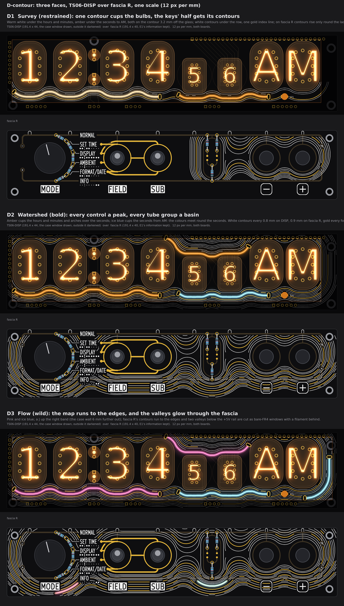
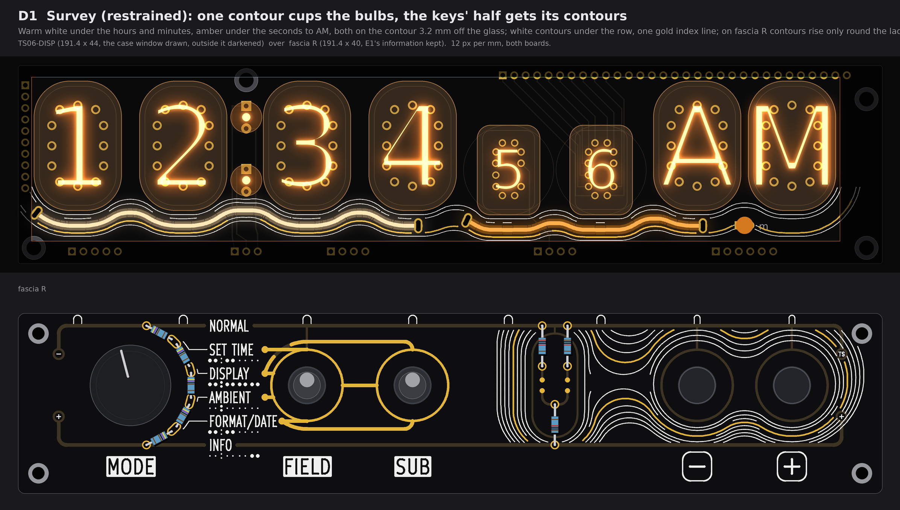
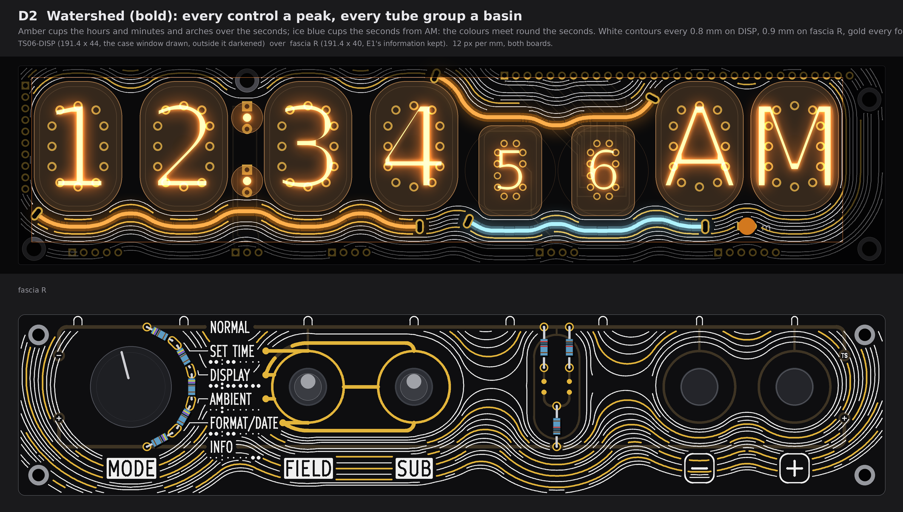
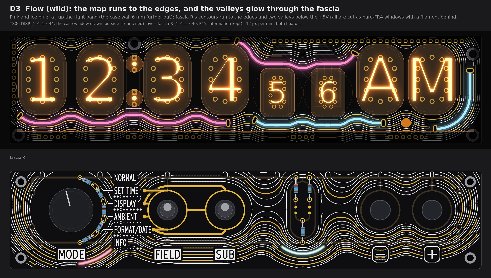
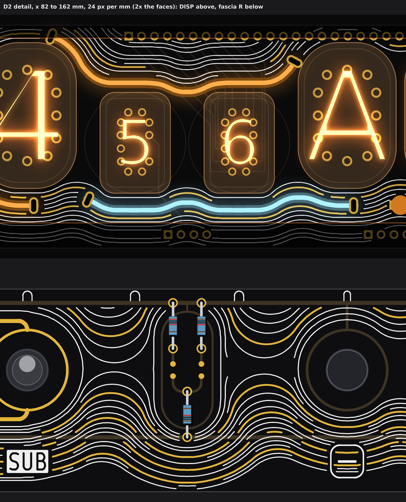

# TS06 front art D, "Contour": the controls are peaks, the tube groups are basins (three faces; drawings only, nothing built)

No board, schematic, fab, tool, 3D, firmware or spec file was touched. The pictures are drawn from `PCB/TS06-DISP/TS06-DISP.kicad_pcb` (parsed, never written), fascia R's E1 of pass 4 (`PCB/TS06-FASCIA-pass4.md`, rebuilt from its own scratch scripts on `PCB/TS06-FASCIA-rhythm`'s geometry with the control holes opened) and pass 1's rules for slots and bodies (`PCB/TS06-DISP-lights-pass1.md` section 1). Marks: *listing data* is from the shop pages; *inferred* is arithmetic; *assumed* is my reading, not measured or asked. No prices. The scratch scripts are in the run's output folder, not in the repo.

## 1. The idea, and how the lines are made

Every white and gold line is a real contour of one height field, not a hand-drawn curve.

* **DISP:** the tubes are the basins. A line at level *d* is everything *d* mm from the glass (the ИН-12/ИН-15 ovals as rounded rectangles r 8, the ИН-17 face r 3 plus its round stem, the two colon lamps, all *assumed* as in pass 1). Each level is then closed with a 7 mm disc, so every inward turn is R 7 and no line ever folds into a gap between bulbs. Levels every 0.8 mm.
* **Fascia R:** the controls are the peaks. The cores are the dial with its ring, the FIELD-SUB gold, the ladder's capsule and the two keys. Each level drifts up by 0.3 × *d*, so the lines crowd on the steep side under a control and open toward the tubes above it: the information runs downhill to the bulbs. Levels every 0.9 mm; that leaves 0.63 mm between lines on the steep side.
* **Ink:** white silk 0.20 mm for the in-between lines. Gold (ENIG) 0.35 mm for every fourth line (the index lines). The filaments are the brightest index lines.
* **Info first:** each line breaks round anything that carries meaning. White keeps 0.45 mm from silk and 0.75 mm from the names and plates; gold keeps 0.4 mm from all ink and copper. Names, plates, the tube map and E1's gold function lines (0.8 mm) all stand on clear ground, the way a map leaves room round its labels.
* **Saddles:** a line stops 1.2 mm short of a saddle's pinch, as maps do, so no line has a kink.
* **Spatial match:** fascia R sits on the tubes' grid. The dial (x 24.9) is under the hours pair, FIELD and SUB (x 64.0, 87.4) under M10 and M1, the ladder (x 118.9) under the seconds pair, and the keys (x 150.4, 171.4) under AM and PM. Each massif's lines open upward toward the group above it. This is spatial, not a claim about which tube a control changes; E1's tube map still says that.
* **Filament lines:** each filament follows a level line that is also opened with a 6.5 mm disc. By construction every bend is 6.5 mm or more. Measured on the drawn line with a 5 mm chord, the bends are 6.2 mm or more; the gap is grid noise of 0.1 mm. Each length is a sold size, with the slot-to-slot run = L − 6 (pass 1's model).

**One finding that shapes all three faces: HL9 (the "m", which stays) cuts the bottom lane.** The 3.2 mm contour (the one through the old LED anode pads) rises into the cup between AM and PM and meets HL9's body (−0.7 mm). So no filament on that contour crosses x 158 to 164. The m LED becomes the line's full stop.

## 2. D1 Survey (restrained)

* **Filaments:**
  * flexible 95 mm, warm white, on the 3.2 mm contour, from M1's old anode pad leftward, cupping M10, the colon, H1 and H10, to a BL_K slot at x 4.1 (zone 4);
  * flexible 60 mm, amber, on the same contour, from AM's old anode pad leftward under the ИН-17 pair to a BL_K slot at x 99.4 (zone 7).
  * The colours meet across an 8.8 mm break at the M1/S10 junction: hours and minutes in one colour, seconds in the other.
* **White:** DISP: three contours under the row (0.8, 1.6 and 5.6 mm off the glass; 696 mm). Fascia R: the contours round the ladder and the keys only (859 mm), the half E1 left dark, so the face now balances.
* **Gold:** DISP: one index line 4.8 mm under the glass, on the BL_K pour (161 mm). Fascia R: one index line round the ladder and the keys (143 mm).
* **Buildable? OK.** It needs a DISP revision with 4 plated slots and mask openings for the gold:
  * Two slots replace the old anode pads of M1 and AM on their own BL_A tracks; two new BL_K slots go in the pour. No new track.
  * Slot to other-net copper: 2.4 mm or more (rule 0.25); to 185 V pads 5.6 mm (rule 0.8); to 185 V tracks 2.4 mm (rule 0.6); to the board edge 0.5 mm or more.
  * Body to glass 2.15 mm, to the colon lamps 2.2, to a screw head 3.1, line to line 8.8.
  * Fascia: no new hole. `fascia_gold.check` reports no problem in either view.

## 3. D2 Watershed (bold)

* **Filaments:**
  * flexible 95 mm, amber, the 3.2 mm contour from M1's pad to x 4.1 (zone 4);
  * flexible 60 mm, ice blue, the 3.2 mm contour from AM's pad to x 99.4 (zone 7);
  * flexible 60 mm, amber, the 1.6 mm contour in the pocket over the ИН-17 pair. Its drive end is at (92.1, 2.3), hidden behind the brow over M1. It arches over both seconds tubes to a BL_K slot at (140.0, 7.2), below the valance.
  * Amber holds the hours and minutes and arches over the seconds; ice blue cups the seconds from below: the colours meet round the seconds.
* **White:** every 0.8 mm on DISP except the index levels (2113 mm). Every 0.9 mm across all of fascia R below the top rail (2294 mm).
* **Gold:** DISP index lines at 1.6 and 4.8 mm, on BL_K, 0.8 mm or more from pads and from 185 V or cathode tracks, 0.7 mm from other tracks (434 mm). Fascia R: every fourth line (3.6, 7.2, 10.8, 14.4; 603 mm). The gold breaks where it would cross a rail or a stem, so no copper is shorted.
* **Buildable? Needs one drive track.** No BL_A pad is near the pocket, so the arch needs a new BL track of about 40 mm, or a back-side wire, from a spare BL_A pin. The route through the ИН-17 cathode tracks is not checked. Everything else passes as D1:
  * The arch's body clears the glass by 0.58 mm and the stems by 0.81 (rule 0.5). Its free slot is 0.57 mm from an ИН-15 cathode track on the back. That passes pass 1's 0.25 for other nets, but is under 0.6 if the cathodes are counted as 185 V.

## 4. D3 Flow (wild)

* **Filaments on DISP:**
  * flexible 95 mm pink and 60 mm ice blue, on the 3.2 mm contour as in D2;
  * flexible 60 mm pink, the pocket arch as in D2;
  * flexible 38 mm ice blue, a J on the 5.6 mm contour. It starts from a slot on BL_A8's own track at (172.7, 38.0), 2.4 mm below the old PM pad, and runs round PM's corner and up the right band to (186.8, 14.2) (zone 8).
* **Filaments on fascia R:** flexible 38 mm pink behind a 14.5 mm window (x 28 to 41, under the MODE plate's right end) and flexible 38 mm ice blue behind an 18.5 mm window (x 110 to 128, under the ladder). Each window follows a contour, 1.2 mm wide, bare FR4; the rest of each 28 mm lit body stays hidden behind the mask.
* **White:** everything to the board edges on both boards (DISP 2005 mm, fascia 2498 mm).
* **Gold:** DISP index lines at 1.6, 4.8 and 8.0 mm (573 mm). Fascia R every fourth line (588 mm).
* **Buildable? Needs four things:**
  * The case's right wall moves out about 6 mm (window to x 188.5) for the J; pass 1's J needed 4.
  * The pocket arch's drive track, as in D2.
  * Two window cut-outs on fascia R, with a printed clip on the back for each filament.
  * A 2-wire feed for each window filament: from a spare BL_A pin as in pass 1's VT, or from two new back pads. BL_A1, A2, A3 and A6 stay free if the arch takes A5.

  On the T layout (E1, divider on the front) the back is clear behind both windows. On the ordered R, R2 and R3 sit behind the left window (*inferred* from R's courtyards); J1's courtyard (x 146.7 to 164.1) is clear of the right one. The windows were not run through the checker (they are not ink); every line's centre keeps 0.55 mm or more from a window's edge.

## 5. Detail

D2, x 82 to 162 mm at 24 px per mm. It shows:

* where the amber arch, the ice-blue cup and the gold index lines meet round the seconds;
* the drive slot at M1's old anode pad, and the free BL_K slot at the M1/S10 junction;
* on fascia R, the ladder and keys massifs: lines crowd under each control and open toward the bulbs.

## 6. Checks

| Check | D1 | D2 | D3 | Rule |
|---|---|---|---|---|
| `fascia_gold.check` on E1 + contours, exposed only / all copper as gold | no problem / no problem | no problem / no problem | no problem / no problem | the checker's |
| Fascia gold to white | 0.37 | 0.35 | 0.35 | 0.30 |
| Fascia gold to the edge | 1.82 | 1.51 | 1.51 | 1.4 |
| Fascia gold to a screw | 6.26 | 3.16 | 3.16 | 3.0 |
| Fascia gold, margin to the knob keep-out / lever rings | 3.75 / 1.5 | 3.75 / 1.5 | 3.75 / 1.5 | 0 |
| DISP gold to pads and to 185 V or cathode tracks / to other tracks (raster, 0.1 mm grid) | 0.8 / 0.7 or more | 0.8 / 0.7 or more | 0.8 / 0.7 or more | 0.6 for 185 V; the pour's own clearance is 0.5 |
| Slots (pass 1's rules, exact) | pass | pass | pass | 0.25 / 0.8 / 0.6 / 0.5 |
| Filament body to glass, smallest | 2.15 | 0.58 | 0.58 | 0.5 |
| Filament bend, smallest (5 mm chord) | 7.0 | 6.2 | 6.2 | 6 (*assumed*) |

The DISP lines' silk spacing (0.8 mm level step) and the fascia's 0.63 mm steep-side spacing keep silk to silk at 0.43 mm or more; the checker found no pair under 0.25.

## 7. Assumed values

* Glass outlines as in pass 1 (rounded rectangles; the ИН-17 face corner r 3).
* Bend radius 6 mm, body 2.0 mm, tabs 5 mm each end, slot 2 mm past the silicone (pass 1's model).
* Ice blue as on sale: *listing data* (the brief's list; the pictures I viewed show blue, pink, warm white, yellow, red and green).
* Light through 2.0 mm bare FR4 is soft and dim (*assumed*, not tried).
* Mask openings on the BL_K pour show as ENIG gold (standard, *inferred*).

## 8. My pick

**D2 Watershed.** It is the most coherent of the three: two colours that hold the hours and minutes, then meet round the seconds; a contour field that crowds under each control and opens toward the bulb above it; info still first. It costs only one drive track beyond D1, which can be built today as drawn.
