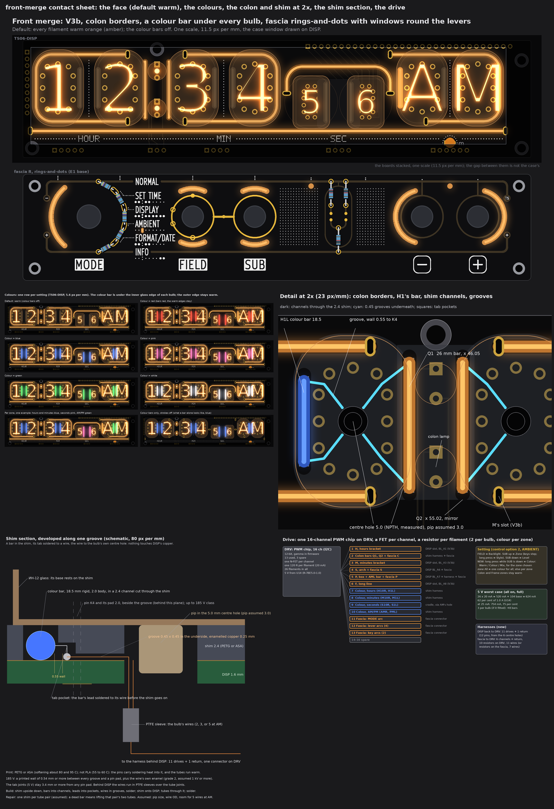
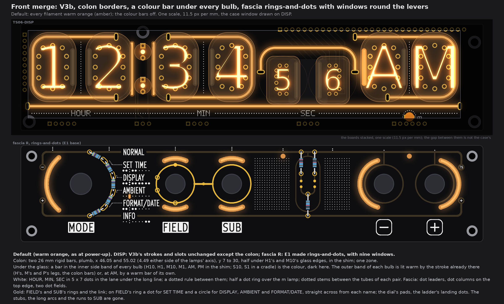
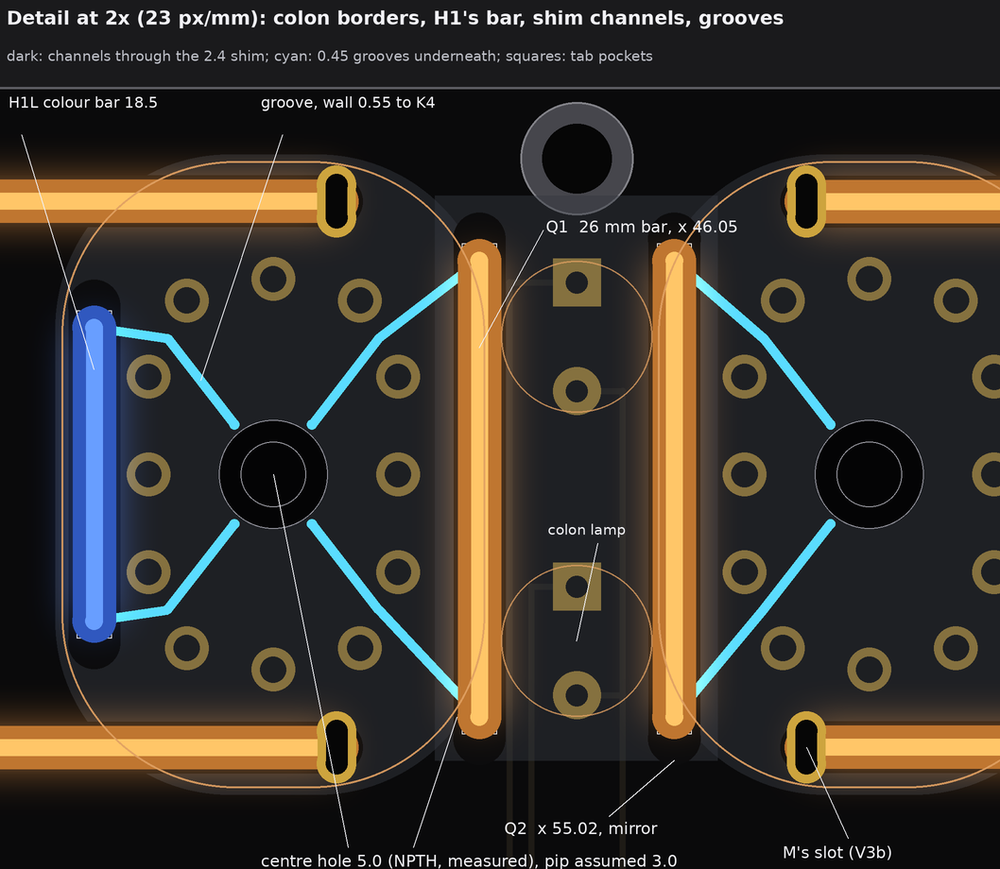
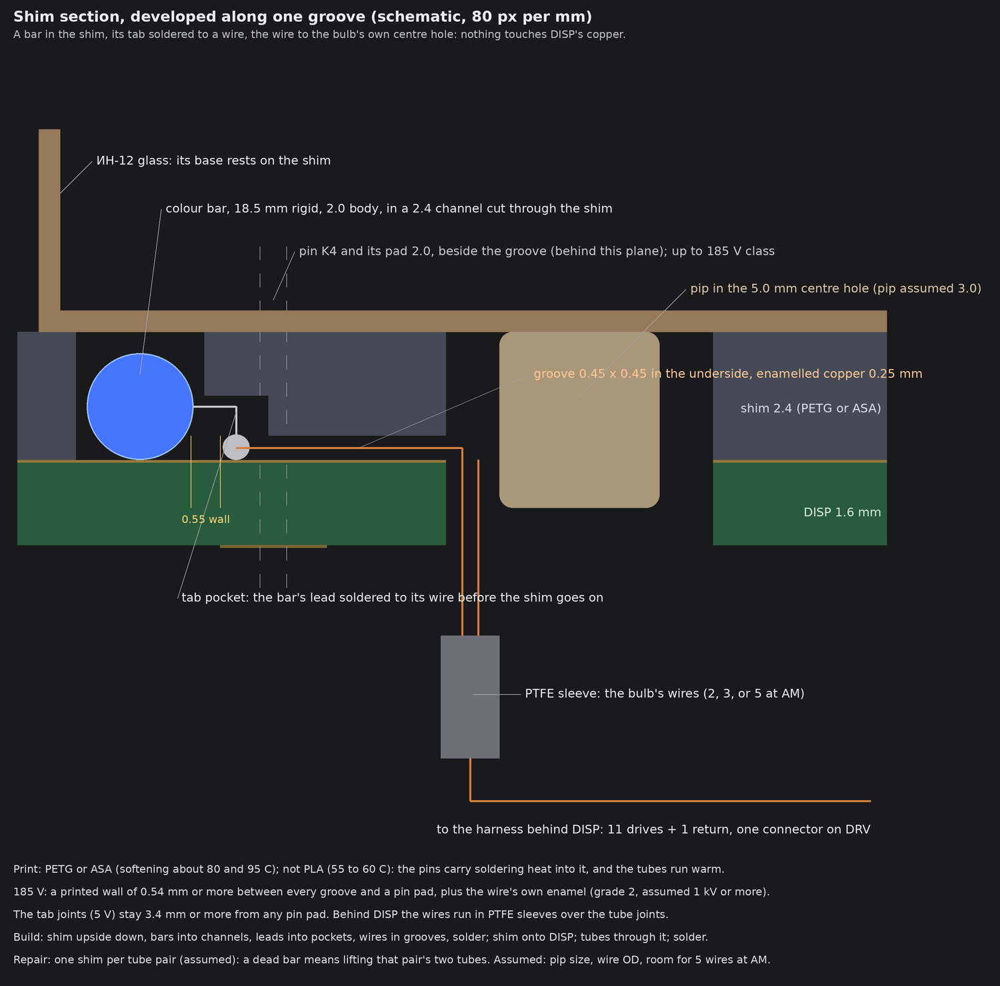
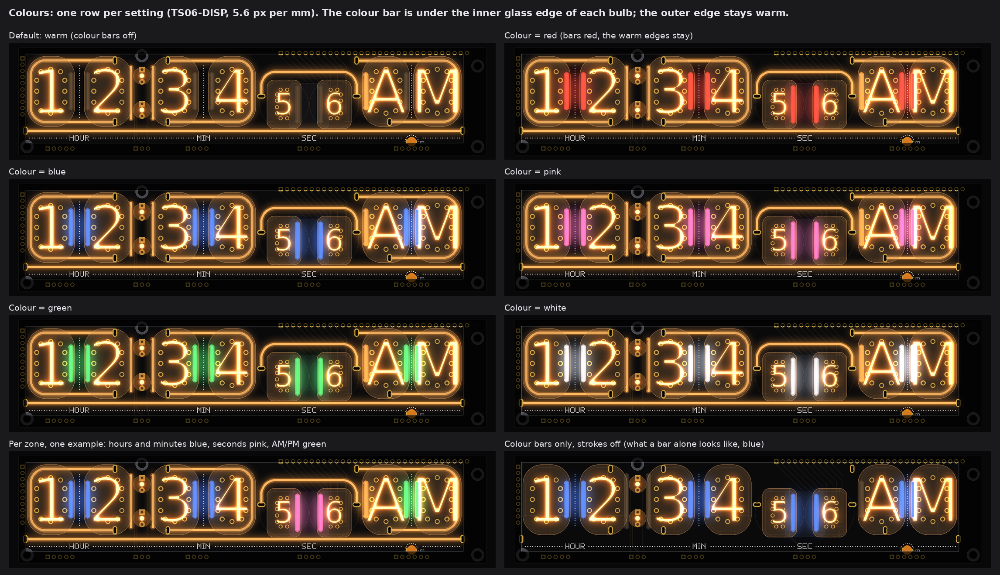
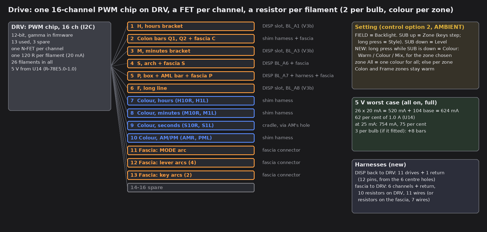

# TS06 front merge: V3b, colon borders, a colour bar under every bulb, fascia rings-and-dots (the base for the patterns; drawings and checks only)

No board, schematic, fab, tool, 3D, firmware or spec file was touched. I read `PCB/TS06-DISP/TS06-DISP.kicad_pcb` (through pass 2's extract), fascia R's art model (pass 4's E1, the copy with its control holes opened) and `tools/fascia_art.py` with scripts, and wrote pictures only. Marks: *measured* is from a board file or the art model; *listing data* is from the shop pictures in `qa/backlight-options/reference/`; *inferred* is arithmetic; *assumed* is my reading, not measured or asked. The scratch scripts stay in the run's folder, not in the repo.

**In short.** V3b stays as it is, less its horizontal colon bar. The colon gets two plumb bars that frame the lamps, half under H1's and M10's glass. Under the glass there is room for **two lights per bulb, not three**: V3b's brackets and box already fill the top and bottom bands of every ИН-12 and ИН-15, so only the two side bands are left. In each bulb the outer side band is lit warm by the stroke that already runs there (H's, M's and P's legs, the colon bars) or by a warm bar of its own (AM). The inner side band takes **one colour bar**. All of these, and the two bars under the ИН-17s, are **wired inside the printed shim**. The wires leave through the 5.0 mm hole that each ИН-12 and ИН-15 already has at its centre, so no DISP track is touched. **3 per bulb does not fit** under any ИН-12 or ИН-15. The drive needs 13 of the 16 PWM channels, and the 5 V worst case is 624 mA (62 per cent). On the fascia, the owner's rings-and-dots replaces E1's stubs and long arcs, and nine windows sit round the dial, the levers and the keys. Every gold function line that is left stays.

## 1. What fits under the glass: 2 per bulb, not 3

Every ИН-12 and ИН-15 has four bands between its pin ring and its glass edge (pass 2, *measured*): top and bottom (4.44 mm) and left and right (2.99 mm). V3b's inlays fill the top and bottom bands of all six. That leaves the two side bands. Each one takes one 2.0 mm body, 0.50 mm from the pin pads (rule 0.4). The ring inside has no room for a body: 1.4 mm between the centre hole and the pins.

| Side band (x, mm) | Holds | Free for a bar? |
|---|---|---|
| H10 left (4.97) | H's leg (V3b) | no: the stroke is there (−2.00 overlap if a bar were added) |
| H10 right (21.45), H1 left (28.33) | colour bars H10R, H1L | yes, 0.50 to the pins, 4.88 apart |
| H1 right (44.81) | the colon bar Q1 (x 46.05) | no: 0.76 overlap with Q1 |
| M10 left (55.75) | the colon bar Q2 (x 55.02) | no |
| M10 right (72.23), M1 left (79.13) | colour bars M10R, M1L | yes |
| M1 right (95.61) | M's leg (V3b) | no |
| AM left (142.16) | warm bar AML | yes |
| AM right (158.64), PM left (163.16) | colour bars AMR, PML | yes, 2.52 apart |
| PM right (179.64) | P's leg (V3b) | no |

All of these are *measured* on the drawn lines, with an 18.5 mm bar's body from y 10.08 to 25.58. Each band holds one 2.0 body. Two bodies need 4.4 mm and a band has 2.99. Two bars end to end need about 27 mm and a band has 22.3 between the brackets' runs. So:

* **2 per bulb fits, in one form only:** the outer edge warm and the inner edge a colour. The outer edge is lit by H's leg (H10), the colon bars (H1, M10), M's leg (M1), AM's own warm bar, and P's leg (PM). The inner edge holds the colour bar. Each tube pair is mirror-symmetric: warm outside, colour inside, ( warm | colour  colour | warm ).
* **3 per bulb does not fit** under any ИН-12 or ИН-15. It would fit under the ИН-17s (they stand about 10 mm off the board and have room on four sides), but one zone with three colours and three zones with two does not make a setting, so I did not draw it.
* **The owner's literal wish** cannot be built with V3b: a small warm filament of its own under every bulb, plus colour filaments. H10, M1 and PM have no second free band. The warm light under those three comes from V3b's legs, which are on the hours, minutes and AM/PM zone channels.
* **The ИН-17s:** one colour bar each on the inner side, S10R at x 114.15 and S1L at x 123.62. They are 0.85 mm or more from the lead pads and 1.04 from F, in a printed cradle under the pair. The arch is their warm frame, as the legs are for the ИН-12s.

Pass 1's VU places, a bar under each bulb at 11.35 below its centre, are taken by V3b's bracket runs (y 30.40). That is why the bars stand in the side bands.

## 2. The face (default: everything warm)

* **Filaments on DISP (16):**
  * V3b's strokes, unchanged: H 95 mm flex, M 95 flex, S 60 flex arch, P 95 flex box, F 185 flex at y 34.0. All five are warm, on DISP slots with pass 2's tracks.
  * The colon: Q1 and Q2, 26 mm rigid, plumb at x 46.05 and 55.02, y 7 to 30. They are warm and in the shim.
  * AML: 18.5 mm rigid, warm, in the shim.
  * Eight colour bars, 18.5 mm rigid: H10R, H1L, M10R, M1L, AMR and PML in the shim, S10R and S1L in the cradle. They are off by default.
* **Filaments on the fascia (10):** behind bare-FR4 windows, all warm. A 38 mm flex behind the MODE arc. Four lever arcs, each a 38 mm flex or an 18.5 mm bar in a curved clip. Two 38 mm flex behind the key arcs. Three short tails behind the info windows S, P and C.
* **White:**
  * On DISP: HOUR, MIN and SEC in 5 x 7 dot type in the lane under F (y 35.9 to 38.0); a dotted rule along y 37.0 between the words; half a dot ring over the m lamp (its lower half is behind the sill); dotted stems at x 24.89, 75.68 and 160.9 between the tubes of each pair.
  * On the fascia: A3's dot leaders, dot columns on the top edge and two dot fields, with holes cut round window S. AMBIENT's two colon dots are gone, because window C takes their place.
* **Gold:** FIELD's and SUB's rings and the link. The four marks on FIELD's ring (section 6). The dial's pads and the ladder's landing dots. One plated via on the link (the GND tie).
* **Buildable?**
  * DISP: **needs the shim and cradle wiring** (section 4). It assumes room for the wires beside each ИН-12's glass pip in the 5.0 mm centre hole. With that, there is no DISP copper change beyond V3b.
  * Fascia: **needs** cuts in the back GND pour behind the windows, printed clips, one via and a new connector (J1's six pins are taken).
  * DRV: **needs** the PWM block, which breaks the through-hole rule as pass 1 said.
* **Channels:** 13 of 16 (section 5).
* **Worst-case 5 V current:** 624 mA at 20 mA a filament (62 per cent of U14's 1.0 A). It is 754 mA at 25 mA a filament.

**Checks** (*measured* on the drawing; the rules are pass 1's and pass 2's):

| Item | Least clearance |
|---|---|
| Colour and warm bars to an ИН-12 or ИН-15 pin pad | 0.50 (rule 0.4) |
| ИН-17 bars to a lead pad, and to F | 0.85, 1.04 |
| Colon bars to H1's and M10's pins, to the colon pads, to H3's head | 1.23, 2.38, 1.25 |
| Bar to a stroke's body, bar to bar | 1.04, 2.52 |
| V3b's slots | as pass 2: only H's lower slot needs the ANODE_H1 move (*measured* again: it is −0.80 mm from today's track) |
| White dots to a pad (HL9 at its V3b place), slot pad, glass, a stroke, a bar | 0.27, 1.51, 0.63, 0.67, 1.12 |

## 3. The colon borders

Q1 and Q2 are 26 mm rigid bars, plumb, 4.49 mm either side of the lamps' axis (x 50.535). That puts each body just outside the lamps' 6.97 mm outline. They run from y 7 to 30, which covers both lamps (y 8.0 to 29.0). Q1's centre line lies under H1's glass for 73 per cent of its length, and Q2's under M10's for 85 per cent. The tubes are 0.5 mm off symmetric about the colon; the bars are symmetric. They form one zone on one channel.

**On DISP slots they do not fit:** both ends of Q1 are within 0.6 of COLON_U (185 V, F.Cu, at x 47.44), and Q2's top end crosses K6 (B.Cu). Pass 2 found the same lack of room there. In the shim they need nothing on DISP: their grooves enter H1's and M10's pin rings (walls 0.54 and 0.55) to those tubes' centre holes.

## 4. The wiring inside the print (the owner's question 1)

**Yes, it works, and it is the only way the bars fit.** The same ten shim bars on DISP slots would need 22 slots, and **21 of them clash** with copper (*measured*). Most clash with the cathode tracks that fan through the tube field on B.Cu, and some with COLON_U and ANODE_S10. That is where pass 1 said B.Cu is busiest.

* **The shim:** printed, 2.4 mm thick, so `IN12_SEAT` goes from 2.0 to 2.4 (pass 2). There is one shim per tube pair (*assumed*, for repair). It has:
  * channels 2.4 wide cut through for V3b's inlays, the seven bars and the two colon bars;
  * a tab pocket at each bar end;
  * grooves 0.45 x 0.45 in its underside;
  * a pocket over each centre hole.
* **The wire:** enamelled copper 0.25 mm, grade 2 (*assumed* OD 0.29), one wire per groove in the ring. Behind DISP the wires run in PTFE sleeving over the tube joints.
* **Each bar:** both leads are bent down into pockets and soldered to their wires before the shim is seated. Each groove runs from a tab, through a gap in the pin ring (K7/K8 or K5/K4 at the top, K0/anode or K2/K1 at the bottom), to the tube's own 5.0 mm centre hole (*measured*: an NPTH at the centre of every ИН-12 and ИН-15 footprint), then down beside the pip.
* **The cradle under the ИН-17s:** its grooves run down the gap between the two tubes and along y 31.9. They enter AM's ring between CAT_B_AMP and pin 8 in a groove 0.9 wide that carries 3 wires (wall 0.54, 0.65 from F).
* **Wires per hole:** H10 2, H1 3, M10 3, M1 2, AM 5, PM 2. That is 11 drives and 6 returns, joined behind DISP into **one 12-pin harness to DRV**. There is a shared return, and each filament has its own resistor on DRV.
* **185 V:** every groove keeps a printed wall of **0.54 mm or more** to a pin pad (*measured*; my rule 0.5 is *assumed*). The cathodes and the anode sit up to 185 V class. Behind that wall is the wire's own enamel (*assumed* 1 kV or more for grade 2). The bare tab joints carry 5 V or 0 V and stay 3.4 mm or more from any pin pad. This is not the 0.6/0.8 copper rule, because nothing bare is near: what matters is the plastic and the enamel. A bench test of one shim at 250 V DC between a pin and its neighbouring wire is cheap and would settle it.
* **Heat:** print in PETG or ASA (they soften at about 80 and 95 C). **Not PLA** (55 to 60 C): the tube pins carry soldering heat into the shim, and the tubes run warm. A bar at 20 mA dissipates about 50 mW (*inferred*).
* **Build:** shim upside down, bars into their channels, leads into the pockets, wires into the grooves, solder the joints. Then thread the wire ends through the centre holes, put the shim onto DISP, put the tubes through it and solder them. Last, sleeve the wires behind DISP and plug them into DRV.
* **Repair:** a dead bar means lifting that pair's two tubes (26 joints). The bars are LEDs (*assumed* long life); handling is the risk. Pass 1's VU had the same limit.
* **What it saves:** 20 slots, about 11 drive tracks into the tube field, and the anode nudges pass 1 needed. V3b's own C slots and BL_A2's 27 mm track go too. The DISP copper is V3b's and nothing more.
* **Assumed, and to measure:**
  * the ИН-12 pip's diameter (I took 3.0 mm, which leaves a 1.0 mm ring for wires; AM's hole takes 5);
  * the gap between DISP and DRV, for the harness;
  * the enamel's rating;
  * that a bar's leads bend into a 1.2 mm deep pocket.

  If the pip fills the hole, the fallback is one 2 mm NPTH per bulb at a copper-free spot. That is a DISP change I did not check.
* **It can carry other enclosed lines:** any filament that lies under glass in the shim. The strokes stay on their slots, because they lie on the face outside the shim.

## 5. Colour, control and drive

**Sold colours** (*listing data*, two listings):
* Rigid bars, 18.5, 26, 38, 54 and 68 mm: warm white, white, red, green, blue, pink.
* Flexible, 38 to 460 mm: yellow, red, green, blue, pink, white. All are 3 V DC, under 300 mA, CRI 80.
* **Closest to the neon's orange:** the bars' "warm white", which glows amber-orange in its listing photo, and the flex "yellow", which glows amber. Neither is sold as orange.
* That the two match each other and the neon is *assumed*; the bench decides. Red is deeper than the neon, and warm + red mixed under a bulb moves toward it.
* **Default:** warm on every filament on both boards. The colour bars are off.
* **The strokes stay single-colour:** a second colour would need a second body beside each stroke, and its band is full. So it is not cheap.

**Where Colour goes in option 2** (AMBIENT, FIELD = Backlight): SUB up = Zone (the keys step through zones; a long press = Style), SUB down = Level. **New: a long press while SUB is down cycles Colour: Warm / Colour / Mix** for the selected zone. With the zone "All" it is **one colour for all**; with Hours, Minutes, Seconds or AM/PM it is **per zone**. The Colon and Frame zones stay warm. No new lever and no new rule: SUB is still read only when FIELD is thrown.

| Build | Colour control | Channels: strokes and colon + colour + fascia | Fits 16? | Worst-case 5 V (20 mA a filament) |
|---|---|---|---|---|
| 2 per bulb (drawn) | one for all | 6 + 1 + 3 = 10 | yes | 624 mA, 62 % |
| **2 per bulb (drawn)** | **per zone** | **6 + 4 + 3 = 13** | **yes, 3 spare** | **624 mA, 62 %** |
| 2 per bulb | per bulb | 6 + 8 + 3 = 17 | no: put the fascia on 2 channels (16), or a second chip | 624 mA |
| 3 per bulb (does not fit) | one for all | 6 + 2 + 3 = 11 | yes | 784 mA, 78 % |
| 3 per bulb (does not fit) | per zone | 6 + 8 + 3 = 17 | no: a second chip | 784 mA |

**Colour sets from what is sold** (2 per bulb: warm + one bar colour; Mix is the third look):
* **ember:** warm + red. Subtle; Mix gives a deeper orange, nearer the neon.
* **ice:** warm + blue. The strongest contrast.
* **rose:** warm + pink.

With 3 (not buildable) it would be warm + red + blue. **I recommend ice, per zone:** one bar colour (blue) everywhere, with per-zone control (13 channels). One-for-all comes free through zone "All".

**Over 16, the cheapest fix:** a second PWM chip of the same part at another I2C address. That is one chip, its address straps and its 16 FETs as needed, with no new signals. A zone x colour matrix (high-side P-FET per zone, low-side N-FET per colour, 4 + 3 parts) saves the chip but time-shares the PWM and risks visible flicker on the camera and in the eye; I would not.

**5 V:**
* There are 26 filaments: 5 strokes, 2 colon bars, AML, 8 colour bars and 10 on the fascia.
* At 20 mA each (120 R at 5 V, Vf about 2.6 V, *inferred*) that is 520 mA, plus the 104 mA left on the 5 V side (pass 2) = **624 mA, 62 per cent** of the R-78E5.0-1.0. At pass 1's 25 mA it is 754 mA (75 %).
* All on at full only happens in Mix at 100 per cent. I recommend 20 mA; the bench decides.

## 6. Fascia R: rings-and-dots (the owner's call) and the windows

**Gold that stays:**
* FIELD's and SUB's rings (r 7.9) and the link between them;
* the dial's four tap pads;
* the ladder's landing dots and pads.

**Gold that goes** (19 items, *measured*):
* the four name lugs;
* SET TIME's and FORMAT/DATE's level lines, and DISPLAY's and AMBIENT's stubs;
* the two long arcs round FIELD (with the hop's masked bridge);
* the two runs to SUB and their corners;
* the masked tie stem at x 63.99. The gold net now ties to GND through **one plated via on the link** (75.68, 16.0), so no stem crosses a window. This is one new hole.

**The marks on FIELD's ring:** a filled dot (r 0.75) for SET TIME, which uses FIELD only. An open circle (r 0.80, line 0.30) for DISPLAY, AMBIENT and FORMAT/DATE, which also use SUB. Each mark sits **straight across from its name**, where the name's row meets the ring:

| Name | Mark | At (x, y) | To a window | To a name | To the next mark |
|---|---|---|---|---|---|
| SET TIME | dot | ring top (63.99, 8.10) | 0.95 (FIELD up) | 11.2 | 7.4 |
| DISPLAY | circle | (56.55, 13.36) | 5.6 | 4.5 | 3.4 |
| AMBIENT | circle | (56.55, 18.64) | 5.6 | 3.0 | 3.4 |
| FORMAT/DATE | circle | ring bottom (63.99, 23.90) | 0.75 (FIELD down) | 5.7 | 7.2 |

**Ambiguous: yes, two of the four.**
* By plain distance, DISPLAY's and AMBIENT's nearest points on the ring are both at its far left, **1.6 mm apart**. Two circles there would nearly touch, so I used the straight-across points.
* SET TIME's and FORMAT/DATE's rows only graze the ring's top and bottom. Their marks sit there, 11 and 6 mm right of the names.
* Their nearest points by distance would be up-left (−151 degrees) and down-left (135 degrees). SET TIME's would then be 3.2 mm from DISPLAY's.

Either reading clears every window and name. The owner picks (question 4).

**Windows** (bare FR4, no copper on either face, no mask, lit warm from behind; *measured* on the art model, with 0.3 to copper and white *assumed*):

| Window | Where | Copper | White / name | Other |
|---|---|---|---|---|
| MODE arc | r 14.2 about the dial, 130 to 230 deg, 2.0 wide | 0.84 | 1.66 / 5.24 | SR25 body 0.70, knob 4.2 |
| FIELD up, FIELD down | r 10.6 about FIELD, -115 to -65 and 65 to 115 deg (the lever's two throws) | 0.95, 0.75 (the marks) | 5.3 / 1.21 (FORMAT/DATE) | |
| SUB up, SUB down | the same about SUB | 1.23 | 29 / 4.1 (SUB) | |
| key - arc, key + arc | r 10.0, 105 to 255 and -75 to 75 deg (A2's) | 0.85, 0.71 | 4.1, 1.39 | KMD1 bodies inside r 8.8 *assumed* |
| info S, info P | (108.6, 4.5), (160.9, 4.5), dia 2.0 (pass 2's) | 0.33 | 46 and 20 / 31 and 74 | |
| info C | (45.04, 21.2), 1.0 x 1.9, replaces AMBIENT's colon dots | 5.56 | 0.65 / 0.32 (AMBIENT) | 0.1 lower than pass 2, to keep 0.32 |

* Pass 2's H and M windows become FIELD's arcs.
* Pass 2's frame windows F1 and F2 are dropped, because the MODE arc and the + arc now close the bezel at both ends.
* **No window round the ladder:** it is circuit, not a function, and A3's dot fields read better there.
* Fascia white to gold is 0.43, to a window 0.59, to a name 0.48.
* The windows suit only this rings-and-dots version. They would not suit E1 as it is: FIELD's arcs cross its runs.

## 7. The change list against V3b (input for the board-change run)

| # | Board | Change | Mark |
|---|---|---|---|
| 1 | DISP | Keep V3b: H, M, S, P and F slots and drive tracks (pass 2's table), ANODE_H1 moved about 1 mm, HL9 3.0 mm down, BL_A4 and BL_A5 deleted, no growth | *measured* (pass 2) |
| 2 | DISP | Drop V3b's C: no slots at (43.78, 30.40) and (57.28, 30.40), no BL_A2 track; BL_A2's strip pin spare | *measured* |
| 3 | DISP | No slot, track or hole for the colon bars, AML or the colour bars: they use the six existing 5.0 mm centre holes | *measured* (holes), *assumed* (pip room) |
| 4 | DISP | White: HOUR, MIN, SEC (5 x 7, pitch 0.35, dot 0.25) at y 35.9; rule at y 37.0; half ring r 2.7 over HL9; stems at x 24.89, 75.68, 160.9 from y 7.5 to 28.5 | *measured* on the drawing |
| 5 | Shim | Printed PETG or ASA, 2.4 mm, one per tube pair; channels 2.4 wide for the inlays, 7 bars and 2 colon bars; grooves 0.45 (0.9 for the cradle's 3 wires); tab pockets; centre pockets; `IN12_SEAT` 2.0 to 2.4 | *inferred* |
| 6 | Cradle | Printed, under the ИН-17 pair, holding S10R (x 114.15) and S1L (x 123.62), grooves to AM's ring | *inferred* |
| 7 | Harness | 11 drives + 1 return, enamelled 0.25 mm in the shim, PTFE sleeving behind DISP, a 12-pin connector on DRV | *inferred* |
| 8 | DRV | 16-channel I2C PWM chip (TSSOP or a module: breaks the through-hole rule), 13 N-FETs, 26 resistors of 120 R (0204); RN1 and the MPSA42's PWM role go | *inferred*; room not checked |
| 9 | Fascia | Rings-and-dots: 19 gold items removed, 4 marks and one GND via added (one new plated hole) | *measured* (art model) |
| 10 | Fascia | 9 windows plus C (section 6), cuts in the back GND pour, printed clips for 7 filaments and 3 tails | *measured* (fronts), *inferred* (back) |
| 11 | Fascia | A new connector (J1 is full): 6 channels + return, with 10 resistors on DRV (11 wires) or on the fascia's back (7 wires) | *inferred* |
| 12 | Case | 0.4 mm deeper for the 2.4 mm shim (pass 2); no window change; room for the harness between DISP and DRV | *inferred*, *assumed* |

## 8. My pick and the owner's questions

**My pick:** the face as drawn, which is V3b with the colon borders and two lights per bulb (warm outer edge, colour inner bar), wired in the shim through the centre holes. Use blue bars ("ice") with per-zone colour (13 channels, 62 per cent of the 5 V). On the fascia, use rings-and-dots with the nine windows. It keeps every DISP track, keeps every gold function that is left, and is symmetric pair by pair.

Questions (at most 5):
1. **Is "warm outer edge + colour inner bar" the 2 per bulb you want?** 3 does not fit, and a warm bar of its own under every bulb does not fit at H10, M1 and PM. *Recommendation: yes.*
2. **Which bar colour: blue, red or pink, the same everywhere?** *Recommendation: blue (ice).*
3. **Can you measure the ИН-12 pip's diameter** (one caliper reading)? The wiring through the centre holes depends on it. *Recommendation: measure before the shim is drawn in CAD.*
4. **The SET TIME and FORMAT/DATE marks: ring top and bottom (straight across), or up-left and down-left (nearest by distance)?** *Recommendation: straight across, as drawn.*
5. **Colour on a long press while SUB is down: is that the right place?** *Recommendation: yes. It needs no new lever, and zone "All" gives one colour for all.*

**Not checked:** a real DRC (no board file was edited); the bench glow of a bar under the glass and through bare FR4; the enamel's breakdown; the pip; the gap behind DISP; the DRV room for the PWM block.
