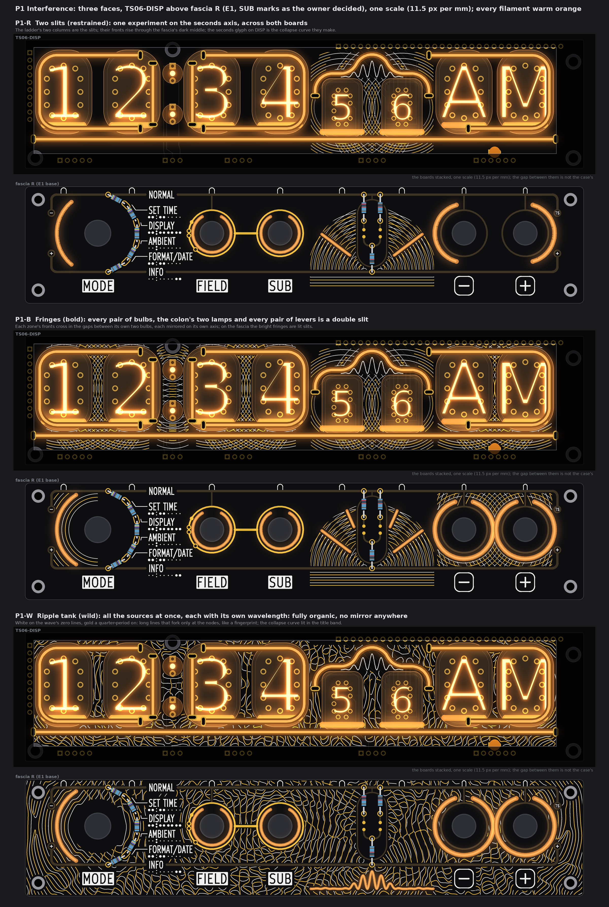
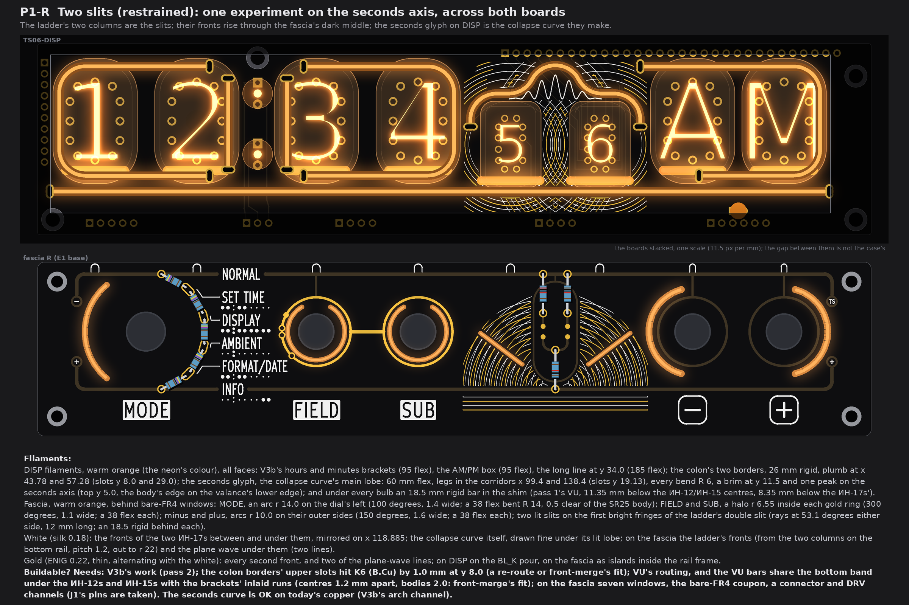
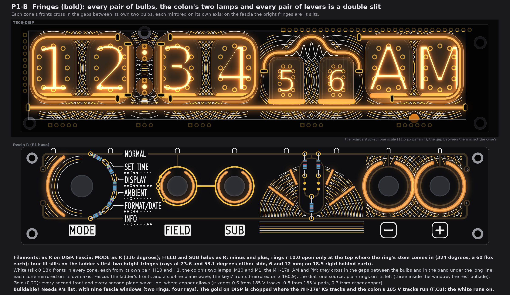
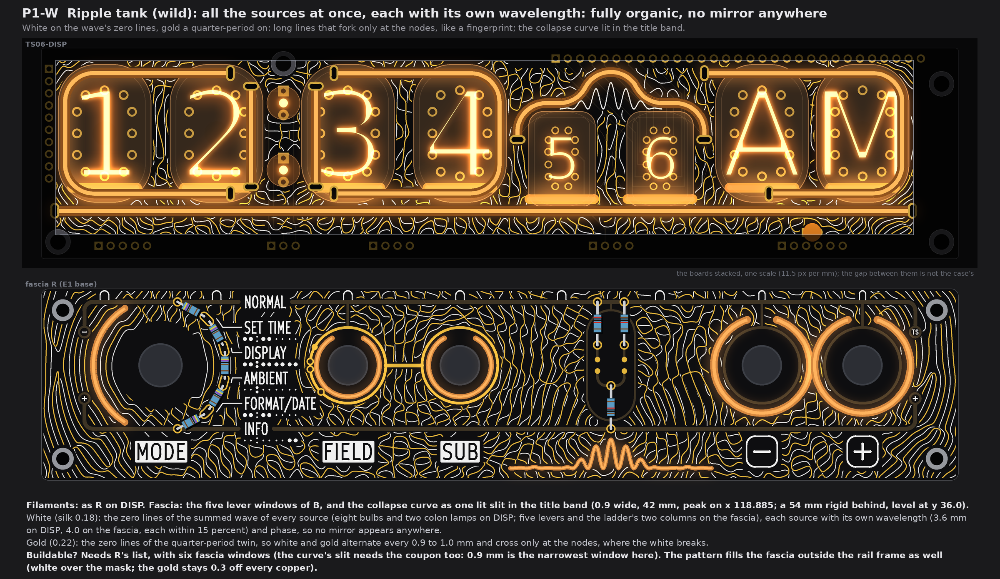
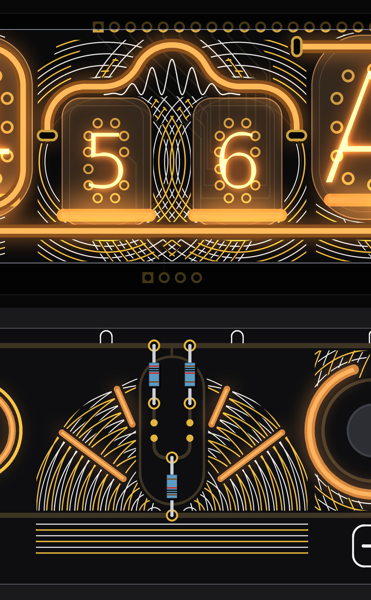

# TS06 front, pattern P1: Interference (three faces on the merged base; drawings only)

2026-10-14. A variation on the owner's double-slit picture (`qa/front-merge/reference/2026-10-14-double-slit-wave.png`): two
sources, circular fronts that cross, and the collapse curve (a tall centre peak, falling side lobes). Every face stands on the
base of the brief: DISP is pass 2's V3b (brackets, AM/PM box, the long line at y 34.0, HL9 3.0 mm lower), the colon has two plumb
borders, every bulb has a small filament under it, every filament is warm orange; fascia R is E1 with windows round the five
levers, decorative lit windows and E1's rails under the mask. Drawn from the board files (DISP and fascia R's copy), one scale,
11.5 px per mm, tubes lit, the case window drawn.

**The owner's SUB-marks decision is in every face:** E1's two long SUB arcs and the name stubs are gone; on FIELD's gold ring,
at the point closest to each screen name, a dot (FIELD only: SET TIME) or a circle (also SUB: DISPLAY, AMBIENT, FORMAT/DATE);
the FIELD-SUB link stays.

## 1. The idea

* **The sources are pairs the clock already has.** Each pair of bulbs (H10 and H1, M10 and M1, the ИН-17s, AM and PM), the
  colon's two lamps, the two keys, and the ladder's two columns. A pair is a double slit; its fronts are circles round its two
  centres, white and gold in turn, and they cross on the pair's own axis.
* **The ladder is the experiment.** Its two columns stand on the fascia's bottom rail like two slits in a wall. Their fronts
  rise through the fascia's dark middle; under the rail a few straight lines are the incoming plane wave; the top rail is the
  screen. Above it, on DISP, the seconds glyph is the collapse curve: the same axis, x 118.885, on both boards.
* **The seconds glyph** is the curve's main lobe in filament (a bend under R 6 is not possible, so the side lobes cannot be
  filament): a 60 mm flex with its legs in the corridors, a flat brim and one tall peak. Under it, in fine white, the whole curve
  with its side lobes (cos² fringes under a sinc² envelope).
* **Symmetric or organic, never between.** In R and B every field is mirrored on its own axis by construction: the clipped
  lines are cut to the part that matches its mirror image, so a break round one side's copper shows on the other side too.
  W is the opposite: every source has its own wavelength and phase, and no mirror appears anywhere.
* **Info first.** Nothing enters the glass, the colon lamps, a filament body, a slot, the case's valance, or, on the fascia,
  0.8 mm round a name, plate, key plate, the tube map or a leader; the ladder's capsule stays clear inside. The fronts break round
  them the way a map leaves room for its labels; no piece shorter than 1.6 mm is left.

## 2. P1-R, restrained: two slits

* **Filaments (all warm orange):**
  * DISP (all faces): V3b's hours and minutes brackets (95 mm flex each), the AM/PM box (95 flex), the long line at y 34.0
    (185 flex); the colon's two borders, 26 mm rigid, plumb at x 43.78 and 57.28 (slots at y 8.0 and 29.0); the seconds curve,
    60 mm flex, slots (99.40, 19.13) and (138.37, 19.13), every bend R 6, brim at y 11.5, peak top at y 5.0 (the body's edge on
    the valance's lower edge, y 4.0); under every bulb an 18.5 mm rigid bar in the shim (pass 1's VU: 11.35 mm below the
    ИН-12/ИН-15 centres, 8.35 mm below the ИН-17s').
  * Fascia, behind bare FR4: MODE, an arc r 14.0 on the dial's left, 100 degrees, 1.4 wide (38 flex at R 14, 0.5 clear of the
    SR25 body); FIELD and SUB, a halo r 6.55 inside each gold ring, 300 degrees, 1.1 wide (38 flex each); minus and plus, arcs
    r 10.0 on their outer sides, 150 degrees, 1.6 wide (38 flex each); two lit slits on the ladder's first bright fringes
    (rays at 53.1 degrees each side, 12 mm, an 18.5 rigid behind each).
* **White:** the ИН-17s' fronts between and under the pair (pitch 0.9, mirrored on x 118.885); the fine collapse curve under
  its lit lobe; the ladder's fronts (pitch 1.2, out to r 22) and two plane-wave lines.
* **Gold:** every second front and the other two plane-wave lines (DISP: on the BL_K pour; fascia: islands inside the rail frame).
* **Buildable? Needs X** (section 5's list), seven fascia windows.

## 3. P1-B, bold: fringes

* **Filaments:** DISP as R. Fascia: MODE as R but 116 degrees; FIELD and SUB halos as R; minus and plus as rings r 10.0, open
  only at the top where each ring's stem comes in (324 degrees, a 60 flex each); four lit slits on the ladder's first two bright
  fringes (rays at 23.6 and 53.1 degrees each side, 6 and 12 mm, an 18.5 rigid behind each).
* **White:** fronts in every zone from its own pair: in the gaps between the bulbs, between the colon lamps and in the band under
  the long line, each zone mirrored on its own axis (hours x 24.89, colon 50.535, minutes 75.68, seconds 118.885, AM/PM 160.9).
  Fascia: the ladder's fronts and a six-line plane wave; the keys' fronts, mirrored on x 160.9; the dial is a single source, so
  plain rings on its left (three inside its window, arcs outside it).
* **Gold:** every second front and plane-wave line, where copper allows; it is chopped where the ИН-17s' KS tracks and the
  colon's 185 V tracks run on F.Cu (the white runs on over the mask).
* **Buildable? Needs X** (section 5's list), nine fascia windows.

## 4. P1-W, wild: ripple tank

* **Filaments:** DISP as R. Fascia: the five lever windows of B, and the collapse curve as one lit slit in the title band
  (0.9 wide, 42 mm, peak on x 118.885, from y 31.5 to 37.9; a 54 mm rigid behind it, level at y 36.0).
* **White:** the zero lines of the summed wave of all the sources at once (eight bulbs and the two colon lamps on DISP; five
  levers and the ladder's two columns on the fascia), each source moved up to 1.5 mm, with its own wavelength (3.6 mm on DISP,
  4.0 on the fascia, each within 15 percent) and phase. The lines are long and fork only at the nodes, like a fingerprint.
* **Gold:** the zero lines of the same wave a quarter period on, so white and gold alternate every 0.9 to 1.0 mm; they meet only
  at the nodes, where the white breaks. On the fascia the pattern also fills outside the rail frame (white over the mask; gold
  0.3 or more off all copper).
* **Buildable? Needs X** (section 5's list), six fascia windows; the curve's slit, 0.9 mm, is the narrowest window and needs the
  coupon most.

## 5. The checks, and what each face needs

Measured on the drawn rasters (0.02 mm grid) against DISP's board file and fascia R's copy, with the rules of pass 1 section 1,
pass 2 section 1 and E1's copper:

| Check | Rule | R | B | W |
|---|---|---|---|---|
| DISP gold to 185 V copper (F.Cu tracks; pads) | 0.6; 0.8 (keep-outs drawn at 0.65 and 0.85) | 0.66 | 0.66 | 0.66 |
| DISP white and gold to the glass outlines | 0.3 | 0.31 | 0.31 | 0.31 |
| Fascia white and gold to names, plates, key plates, tube map, leaders | 0.75 | 6.09 | 2.13 | 0.78 |
| Fascia gold to E1's copper (rails, rings, stems, pads, E1 gold) | 0.3 | 0.39 | 0.36 | 0.35 |
| Fascia white and gold to the lit windows | 0.35 | 0.39 | 0.39 | 0.37 |
| White to gold where they cross | 0.15 break | yes | yes | yes |
| Seconds curve body to the ИН-17 glass | 0.5 | 0.50 | 0.50 | 0.50 |

**DISP, every face:**

* The seconds curve is **OK on today's copper**: both slots stand in pass 1's free corridors (no slot conflict found), and it
  takes V3b's arch channel (BL_A6) and drive track. It crosses the KS tracks under the mask, as V3b's arch does.
* **Needs** V3b's own work (pass 2: the slots, ANODE_H1 moved about 1 mm, the drive tracks, HL9 3.0 mm down).
* **Needs** a fit for the colon borders: their upper slots at y 8.0 sit 1.0 mm into K6 (B.Cu), both sides. A re-route of K6 or
  a shorter bar; front-merge's call.
* **Needs** VU's routing (pass 1: seven drive tracks up into the tube field, the shim's channel), and a fit for its bars: under the
  ИН-12s and ИН-15s the VU bar (y 29.18) and the bracket's inlaid run (y 30.40) share the bottom band, centres 1.2 mm apart with
  2.0 mm bodies. Drawn as the brief places them; front-merge decides which moves.
* The gold is mask openings on the BL_K pour; the white is silk over the mask, so it may pass over the KS and colon tracks.

**Fascia, every face:** bare-FR4 windows (no copper on either side, cuts in the back GND pour), the fab's coupon for the glow,
printed holders behind, and a connector with DRV channels for the lines behind the fascia (J1's six pins are taken). *Assumed,
not measured:* the key switch bodies stay inside r 8.8 (the key windows' filaments clear them by 0.2 mm), and the FIELD and SUB
switch bodies leave r 5.5 to 7.6 free for the halos' filaments. If they do not, the halos are lit from the side and glow less.
The gold pattern is isolated islands (no net); it can be tied to GND with short stems if the fab wants no floating copper.

Nothing is drawn that I found **not buildable**; every face carries the lists above.

## 6. Detail

x 92 to 150 mm at 23 px per mm: the seconds curve with the fine curve under it, the ИН-17s' fronts crossing on their axis, the
ladder's double slit with its lit fringes and plane wave, and the left half of the keys' field.

## 7. My pick

**P1-B.** It is the owner's picture made the clock's own: every pair the clock already has is a double slit, every field is
mirrored on its own zone's axis, and the ladder's lit fringes under the seconds' collapse curve make the eye-catcher. If the owner
wants one more lit element, W's lit collapse curve in the title band can replace B's plane wave without touching anything else.

## 8. Left open, assumed

* No second filament colour is shown (the brief allowed one face to show it); every filament is warm orange.
* No new white dots: the fronts carry the fill; E1's own dots stay.
* The fronts' pitch (0.9 mm on DISP, 1.2 on the fascia), the line widths (white 0.18, gold 0.22) and W's random seed are
  choices, not measured needs. The 0.18 silk is above the fab's limit used before (0.15).
* The fine collapse curve under the seconds lobe is silk over the KS tracks (masked), so it costs nothing on the board.
* Scripts are scratch (copies of A's and pass 2's tools); nothing in `tools/`, the boards or the schematics changed.
