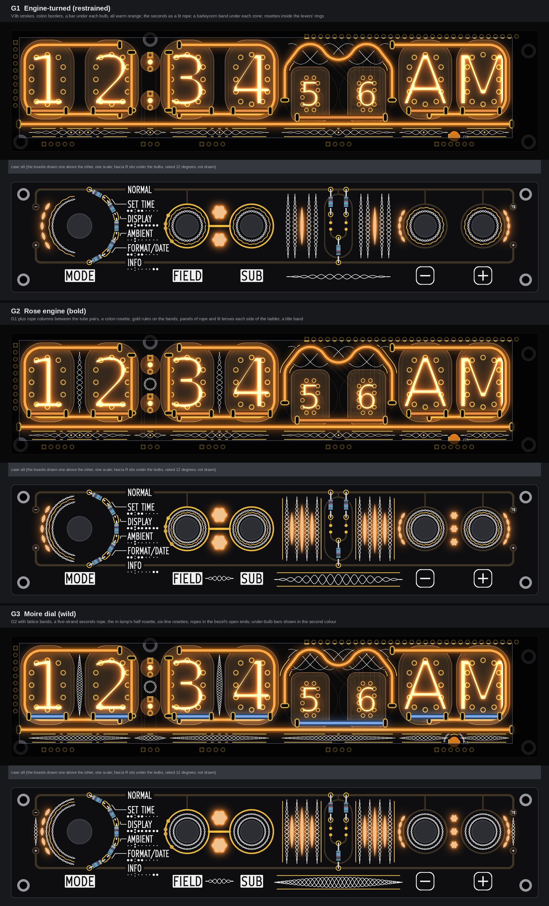
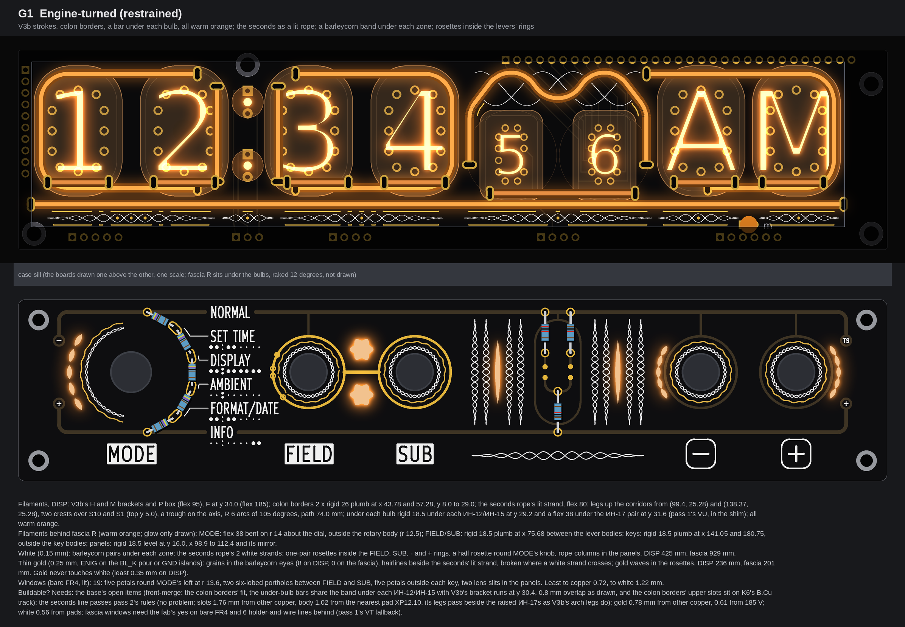
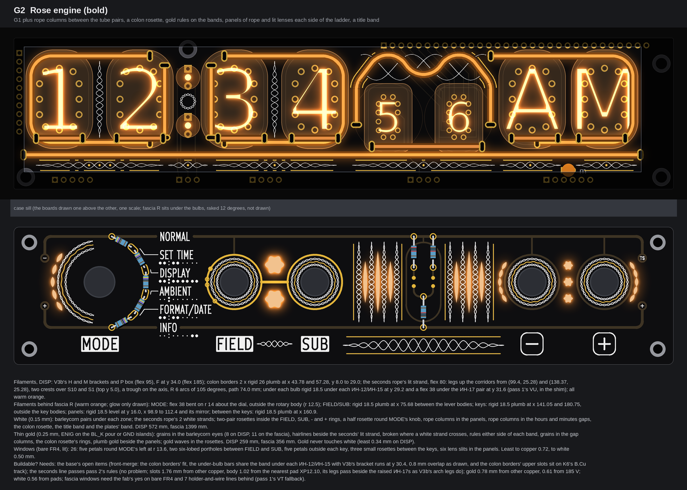
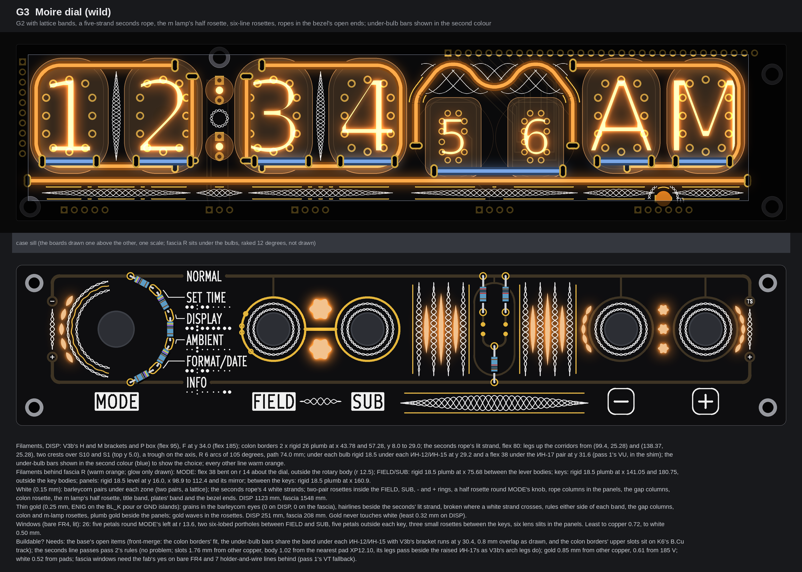
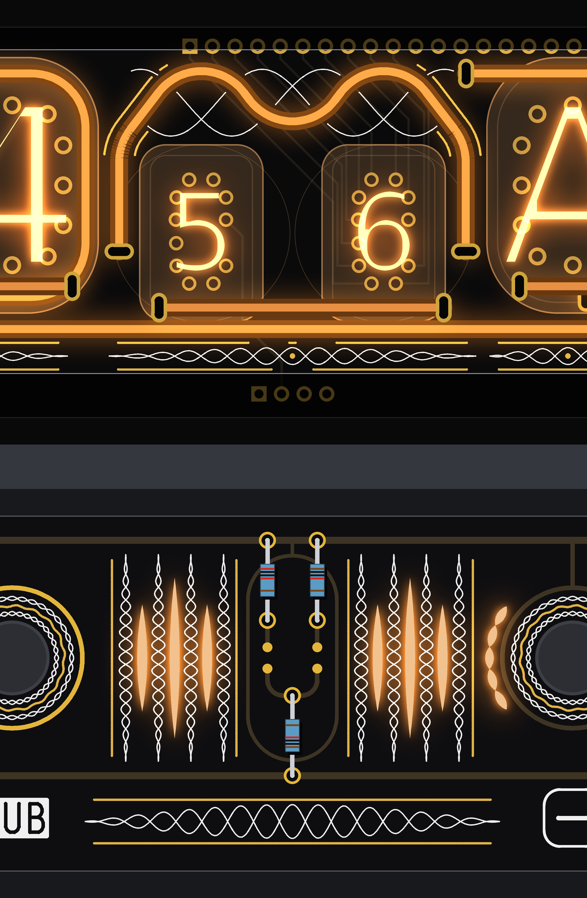

# TS06 front pattern P2, Guilloché: watch-dial engraving on the merged front (three faces; drawings only, nothing built)

No board, schematic, fab, tool, 3D, firmware or spec file was touched. The pictures are drawn on the base the front-pattern brief gives: TS06-DISP as pass 2's V3b, with the two colon borders and a bar under each bulb, and fascia R as pass 4's E1 with windows round the levers. DISP is read from `PCB/TS06-DISP/TS06-DISP.kicad_pcb` (pass 1's extract) and fascia R from the board pass 4 used. Both are read with Python and never written. Marks: *measured* is read off a board file or the drawing; *inferred* is arithmetic or a typical figure; *assumed* is my reading. No prices. The scratch scripts are in the run's scratch folder, not in the repo.

## 1. The pattern, and how the symmetry is kept exact

A watch dial is engraved on a rose engine: fine lines that wave a whole number of times along a band or round a centre. I used three of its figures, each in white silk (0.15 mm) alternating with thin gold (ENIG, 0.25 mm):

* **Barleycorn:** two white strands cross along a band; each eye holds a gold grain, and gold rules run either side.
* **Rope:** three or five strands, each a third or a sixth of a wave from the next. **The seconds glyph is a rope whose lit strand is the filament.**
* **Rosette:** rings that wave 18 times round a lever (24 times round the dial). White pairs cross; a gold ring waves between them.

**Symmetry is exact, by construction.** Each element has its own mirror axis:

* on DISP, the zone axes: hours x 24.89, colon 50.535, minutes 75.68, seconds 118.885, AM/PM 160.9 (the m lamp);
* round a lever, both axes through its centre;
* the two panels and the title band, the ladder's axis x 118.885;
* the keys' windows, the AM/PM axis x 160.9.

Each line is cut where it meets an obstacle, and it is also cut where its mirror image would meet one. So a break on one side is always a break on the other. Nothing on the front is organic, and nothing is near-symmetric.

**Ink rules (my scan's settings):**

* **Gold never touches white.** Gold is laid after the white and keeps 0.3 mm from it; where a white strand crosses a gold line, the gold breaks. That break is the braid's over-and-under.
* **DISP gold** sits on the BL_K pour. It keeps 0.45 mm from other copper on F.Cu, 0.8 mm from a 185 V pad or F.Cu track, and 0.6 mm from a 185 V track on B.Cu.
* **Fascia gold** is GND islands. It keeps 0.4 mm from all copper and 1.4 mm from the edge.
* **Info first:** nothing comes within 0.75 mm of a name, plate or key legend. The function lines, rings, tube map, index bulbs, pads, resistors and windows all keep their margins.

**The owner's change on SUB's marks (14 Oct) is drawn on all three faces:**

* E1's two long arcs to SUB and the name stubs (the lug dots and level lines) are gone. The FIELD to SUB link stays.
* On FIELD's gold ring, at the point nearest each name, there is a mark: a dot for SET TIME (FIELD only), and a circle for DISPLAY, AMBIENT and FORMAT/DATE (also SUB).
* Least gap from a mark to its name: 0.84 mm (FORMAT/DATE).
* The GND tie stem now drops from the ring's top.

**The seconds glyph** (the same on all three faces):

* **The filament:** a flexible 80, warm orange. Its legs rise up pass 1's two corridors from slots at (99.4, 25.28) and (138.37, 25.28). It crests over S10 and S1 at y 5.0 and dips on the axis, with R 6 arcs of 105 degrees. The path is 74.0 mm, the 80's slot-to-slot length.
* **The white strands** are the same wave, a third of a wave on either side. They cross the lit strand and pass under it. **Thin gold** hairlines run beside the lit strand, with gold grains in the rope's eyes.
* So the seconds read as a crown in a frame: the frame's legs stand as tall as the brackets' legs, and the crown is a lit rope.
* **Clearances** (*measured*): body to glass 1.23 mm, to the nearest pad 1.02 (XP12.10); line to M 1.79, to P 2.84; slots 1.76 and 2.16 mm from other copper.
* Pass 1's checker flags the legs as 1.0 mm inside the ИН-17 "stem" circle (r 10). Pass 2 dropped that rule (the ИН-17s stand 7.8 mm off the board; only their lead pads count), and V3b's own arch legs stand in the same place.

## 2. G1 Engine-turned (restrained)

* **Filaments:**
  * DISP: V3b's H and M brackets and P box (flexible 95), and F at y 34.0 (flexible 185). The colon borders are two rigid 26s, plumb at x 43.78 and 57.28, y 8.0 to 29.0. Then the seconds rope's lit strand (section 1).
  * Under each ИН-12 and ИН-15, a rigid 18.5 at y 29.2; under the ИН-17 pair, a flexible 38 at y 31.6 (pass 1's VU, in the shim).
  * Behind fascia R, six lines:
    * MODE: a flexible 38 bent on r 14 about the dial, outside the rotary body (r 12.5, *assumed* round);
    * FIELD and SUB: a rigid 18.5 plumb at x 75.68, between the lever bodies;
    * the keys: two rigid 18.5s plumb at x 141.05 and 180.75, outside the key bodies;
    * the panels: two rigid 18.5s level at y 16.0.
  * All warm orange.
* **White:**
  * DISP: a barleycorn band under each zone, and the rope's two white strands.
  * Fascia: one crossing pair in each lever's rosette, a half rosette round MODE's knob, four rope columns each side of the ladder, and a short barleycorn in the title band.
  * Length: DISP 425 mm, fascia 929 mm.
* **Gold:**
  * DISP: grains in the band eyes, rules either side of each band, hairlines beside the lit strand. 236 mm and 8 grains.
  * Fascia: a waving gold ring in each rosette and one round MODE, 201 mm.
* **Windows (bare FR4, lit; 19):**
  * five petals round MODE's left at r 13.6;
  * two six-lobed portholes between FIELD and SUB, on the minutes axis;
  * five petals outside each key;
  * one lens slit in each panel.
* **Buildable? Needs the base's open items**, and the fab's yes on bare FR4. Six holder-and-wire lines go behind the fascia (pass 1's VT fallback). The pattern itself passes the rules above (section 5).

## 3. G2 Rose engine (bold)

* **Filaments:** G1's, plus a seventh line behind the fascia: a rigid 18.5 plumb at x 160.9, between the key bodies. All warm orange.
* **White:** G1's, plus:
  * rope columns in the hours and minutes gaps (on x 24.89 and 75.68, y 6.9 to 28.9);
  * a rosette between the colon lamps;
  * two crossing pairs in each lever's rosette;
  * a second pair round MODE;
  * a full barleycorn in the title band, and a short one between the FIELD and SUB plates.
  * Length: DISP 572 mm, fascia 1399 mm.
* **Gold:** G1's, plus:
  * grains in the gap columns, and the colon rosette's two rings;
  * a second hairline on the seconds rope;
  * two gold plumb lines beside each panel;
  * rules either side of the title band, and 11 grains in the fascia's barleycorn eyes.
  * Length: DISP 259 mm, fascia 356 mm.
* **Windows (26):** G1's, plus three lens slits in each panel (12, 18 and 12 mm tall) and three small rosettes between the keys.
* **Buildable? Needs** the same as G1, with seven lines behind the fascia.

## 4. G3 Moiré dial (wild)

* **Filaments:** G2's. **The bars under the bulbs are shown in a second sold colour (blue) to show the choice.** Every other line stays warm orange, and orange stays the default for these bars too.
* **White:** G2's, with:
  * two crossing pairs a quarter wave apart in every band and gap column (a lattice);
  * a five-strand seconds rope (the lit strand and four white ones);
  * the m lamp's half rosette above the sill;
  * three-pair rosettes round the levers;
  * a rope in each of the bezel's open ends (x 9.0 and 182.4).
  * Length: DISP 1123 mm, fascia 1548 mm.
* **Gold:** G2's rules, rings and plumb lines, plus a plain outer ring in each lever's rosette. The lattice leaves no room for grains. Length: DISP 251 mm, fascia 208 mm.
* **Windows (26):** as G2.
* **Buildable? Needs** the same as G2. The lattice puts white 0.32 mm from gold at the least (rule 0.30), the tightest figure on the three faces.

## 5. The checks in one place

DISP gold was measured on its centre lines and grains against the board file's copper. White was measured against the pads. The fascia windows and gold were measured against every item of E1's art.

| Check (my rule) | G1 | G2 | G3 |
|---|---|---|---|
| DISP gold to other copper, F.Cu (0.45) | 0.78 (KS8) | 0.78 (KS8) | 0.85 (ANODE_S10) |
| DISP gold to a 185 V track or pad, either layer (0.6 / 0.8) | 0.61 (ANODE_M10, B.Cu) | 0.61 | 0.61 |
| DISP white to a pad (0.3) | 0.56 | 0.56 | 0.52 |
| White to gold, DISP (0.3) | 0.35 | 0.34 | 0.32 |
| Fascia window to copper, gold or masked (0.3) | 0.72 | 0.72 | 0.72 |
| Fascia window to white (0.3) | 1.22 | 0.50 | 0.50 |
| MODE window outside the knob's 9.0 keep-out | 4.05 | 4.05 | 4.05 |
| Fascia gold art to E1's copper (0.30) / to a screw (3.0) | 0.46 / 12.3 | 0.96 / 12.3 | 0.96 / 12.3 |
| Added gold, DISP / fascia, mm | 236 / 201 | 259 / 356 | 251 / 208 |
| Windows | 19 | 26 | 26 |

Lines on DISP, least gaps (rule 0.4), *measured*: H, M and P to F 1.6; M to the seconds line 1.79; M to the right colon border 2.07; H to the left border 2.52; the seconds line to P 2.84.

**Open items in the base, not in the pattern** (front-merge's fit decides them; I drew the base as the brief gives it):

1. **The bars under the bulbs** (pass 1's VU at y 29.2) share the band under each ИН-12 and ИН-15 with V3b's bracket and box runs at y 30.4. Their bodies overlap by 0.8 mm as drawn (*measured*).
2. **The colon borders' upper slots** at (43.78, 8.0) and (57.28, 8.0) lie on K6's B.Cu track (−1.0 mm). The borders need either a track move or slots lower down.

**Not checked here:** fascia `check()`, because my lines are polylines and the checker is pairwise. The rules above were applied by raster masks at 0.05 mm and measured afterwards.

## 6. My pick

**G2, the rose engine.** Every zone and every lever carries one engraved figure, each mirrored on its own axis. It fills DISP's gaps and the fascia's empty half with rope, rosettes and lit lenses, while the names, plates, legends and function lines stand clear, and it needs no change beyond the base's own.

## 7. Left open, assumed, not drawn

* **Not routed:** the drive track of the seconds line's slot (one, as V3b's arch had), the under-bulb wiring (front-merge), and the behind-fascia holders and wires.
* **Assumed:**
  * the bodies behind the fascia: the rotary taken round at r 12.5; the levers 10.4 wide; the keys 13.75 × 16.9 (pass 1's case-model figures);
  * that bare FR4 glows evenly from a filament behind;
  * body 2.0 mm, bend R 6, slot 1.0 × 2.5 (pass 1);
  * the lever nut at r 4.2 (the rosettes start at r 4.6).
* **Silk widths:** at 0.15 mm the white is at the fab's silk limit (*inferred*, as in A and B). The crossing white strands assume the fab keeps two silk lines that touch at a point; they are one net-less ink.
* **Colour:** "warm orange" means the sold colour nearest the neon. Naming that sold colour is front-merge's item. G3's blue is the second option, shown on one class of line only.
* **AMBIENT's circle:** I followed the owner's message, which gives AMBIENT a circle (SUB too). Pass 4's SETS had AMBIENT as FIELD only. The firmware question is not mine; I flag it.
