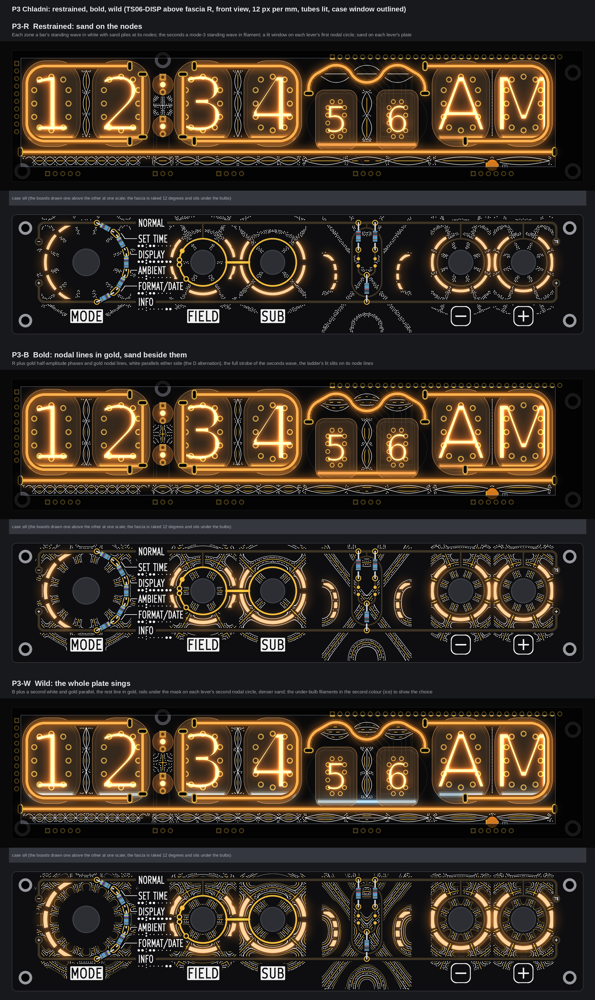
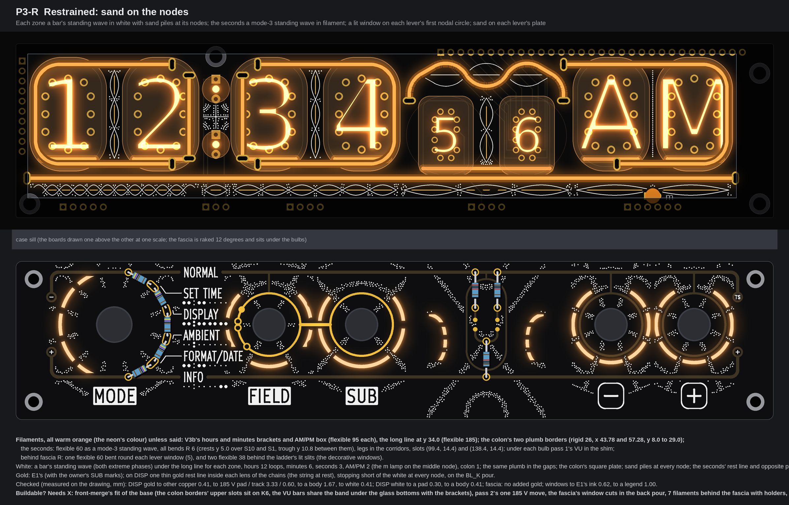
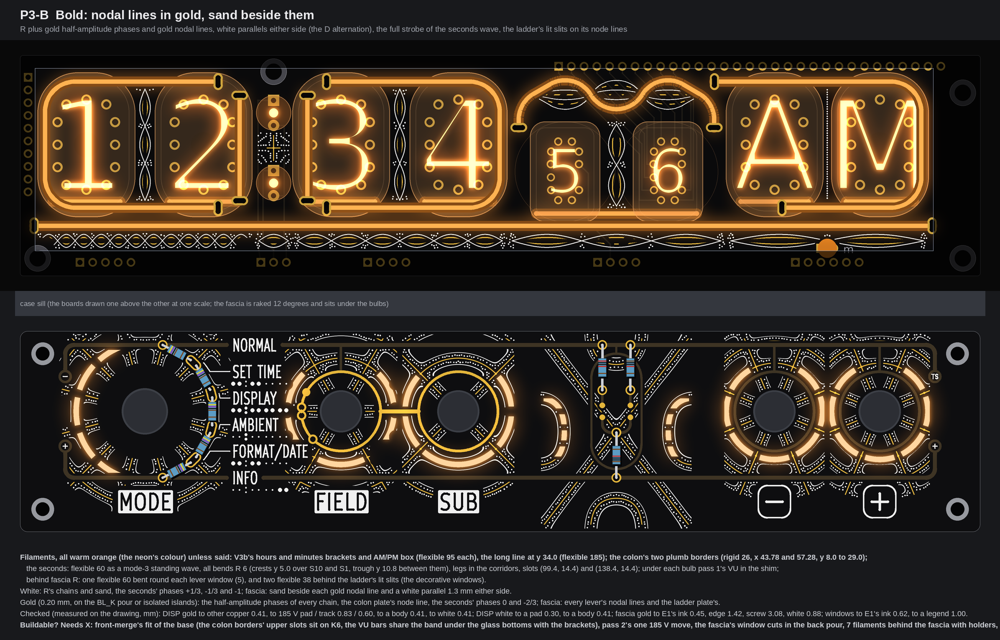
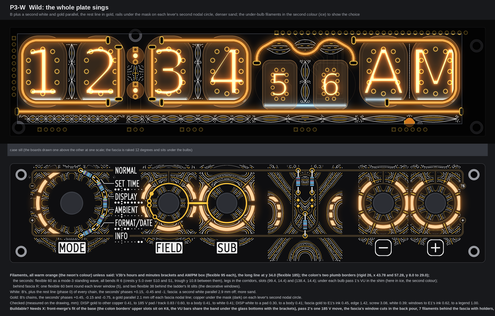
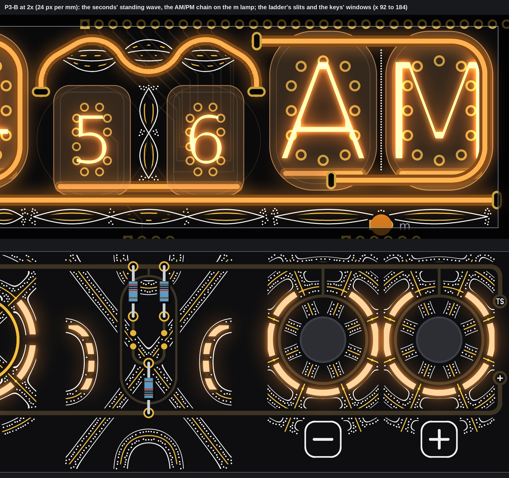

# TS06 front pattern P3, "Chladni": sand on a vibrating plate (three faces, TS06-DISP above fascia R; drawings only, nothing built)

No board, schematic, fab, tool, 3D, firmware or spec file was touched. The pictures are drawn from `PCB/TS06-DISP/TS06-DISP.kicad_pcb` (through pass 2's extract) and fascia R (the copy with its control holes opened that pass 4 used), read with Python and never written. Marks: *measured* is from the board files or the drawing; *inferred* is arithmetic; *assumed* is my reading. The scratch scripts are in the run's scratch folder (`front-pattern/P3`), not in the repo.

## 1. The idea

A plate held at one point and bowed at its edge rings in one mode; sand runs off the parts that move and piles up on the lines that stand still (the nodal lines). So, on both boards:

* **White dots are the sand.** They gather on a nodal line, thick on it and thinning away from it.
* **Thin gold is the nodal line itself**, with white parallels either side in the bolder faces: white, gold, white, as the owner liked in D.
* **Each zone and each lever is its own plate, in its own mode.** The numbers are not random; each counts something:

| Plate | Mode | What the count says |
|---|---|---|
| Hours (DISP) | a bar with 12 loops under the long line; 3 loops plumb between H10 and H1 | 12 hours |
| Colon | a bar with 1 loop; a square plate (1, 3) between the two lamps | one beat |
| Minutes | 6 loops; 3 plumb between M10 and M1 | the tens of minutes, 0 to 5 |
| Seconds | 3 loops, the same mode as the seconds glyph above; 2 plumb between S10 and S1 | the glyph's own mode |
| AM/PM | 2 loops; the amber m lamp (HL9, moved 3.0 mm down by V3b) stands exactly on the middle node | two halves of the day |
| MODE (fascia) | circular, 6 nodal diameters | its six positions: the diameters fall at ±15°, ±45°, ±75° from level, exactly where E1's resistor taps (±15°, ±45°) and the chain's two ends (±75°) sit |
| FIELD | circular, 3 nodal diameters | its own figure |
| SUB | circular, 2 | its own figure |
| − and + | circular, 4 each, mirror images about x 160.9 | the pair |
| The ladder | a rectangular plate (2, 4) about x 118.9 | the seconds' axis on the fascia |

* **Symmetry is exact.** Every plate is mirrored about its own axis, and the art is cut by a mask that is itself mirrored (a pixel is used only if its mirror image is free too). Nothing on a plate is near-symmetric. The one form that is not mirrored about its own lever is MODE's window: it is the mirror image of E1's resistor chain on the other side of the dial (same radius, 13.7 mm, same angles), so the dial reads as one symmetric figure: lit arc on the left, resistor arc on the right.
* **Info first.** Art is drawn only on free ground: white keeps 0.45 mm from all of E1's ink and 0.9 mm from every name, plate, key legend and tube-map dot; gold keeps 0.45 mm from E1's ink, 1.4 mm from the edge and 3.0 mm from a screw; on DISP nothing goes under the glass (0.5 mm), within 0.4 mm of a filament body or slot pad, or on a pad. No line crosses a legend; the names, the tube map and the gold function marks stand on clear ground in all three faces.
* **The owner's SUB decision is drawn** (the note of 2026-10-14): E1's two long SUB arcs and the name stubs are gone; FIELD's gold ring carries a dot at the point closest to SET TIME and a small circle (the ring broken inside it) at the points closest to DISPLAY, AMBIENT and FORMAT/DATE; the FIELD-SUB link stays. That freed the ground round FIELD and SUB for their windows.

### The seconds glyph: a standing wave, not a sine

The filament (flexible 60, warm orange) is the string at the top of its swing in mode 3: crest over S10, trough between the pair, crest over S1. Every bend is R 6 (crest and trough arcs of 58.7° either side, straights of 3.7 mm at 30°), the legs stand in the corridors, slots at (99.4, 14.4) and (138.4, 14.4), slot to slot 54.0 mm for a 60. Crest tops y 5.0 over the tube centres (the body's edge meets the valance), trough y 10.8, the string's rest line y 7.9. Round it, in white and thin gold, the other phases of the same wave: the same curve scaled about the rest line (+1/3, 0, −1/3, −2/3, −1 in B), so all of them pinch through the two nodes where the filament crosses its rest line. That is what makes it a standing wave rather than a travelling sine: a bundle of strings pinched at fixed nodes, the filament the brightest of them, the mirrored phase (−1) a white ghost of it. *Measured:* slots 1.76 and 2.16 mm from other copper, 7.0 mm or more from 185 V; body 1.3 mm from the ИН-17 glass, 1.75 from the stems.

## 2. The base every face keeps

* **DISP = pass 2's V3b, no growth:** hours and minutes brackets and the AM/PM box (flexible 95 each), the long line at y 34.0 (flexible 185), HL9 3.0 mm lower at (160.9, 38.5). **Colon: two plumb rigid 26 bars at x 43.78 and 57.28**, y 8.0 to 29.0, borders to both lamps (V3b's horizontal bar dropped). **Under every bulb** pass 1's VU in the shim, seen through the glass (rigid 18.5 under each ИН-12 and ИН-15 at y 29.2, flexible 38 under the ИН-17 pair at y 31.6). Every filament warm orange; W shows the second colour (ice) under the bulbs.
* **Fascia R = E1** with the owner's SUB marks, **windows round the levers** (bare FR4, lit from behind), **decorative lit windows** (the ladder's slits) and **rails under the mask** (E1's, plus W's on each lever's second nodal circle).
* **The windows are the plates' first nodal circles**, cut where the nodal diameters cross them (1.6 mm of mask left across each): MODE r 13.7, the six-fold cut (5 arcs, 150° on the left); FIELD and SUB r 10.6, three- and two-fold; − and + r 9.6, four-fold. Behind each, one flexible 60 bent to the window's radius (body 50 mm: 270° at r 10.6, 298° at r 9.6; the window is drawn only where the body reaches, centred on the bottom). The ladder's slits stand on its own plate's node lines either side of the capsule (x 118.9 ± 9 to 14.5, y 7 to 25), 2.0 mm long with 1.2 mm bridges, as W's grille: eight slits, four a side, mirrored; two flexible 38 behind them.

## 3. Face R, restrained: sand on the nodes

* **Filaments:** the base (section 2), all warm orange; on the fascia the five lever windows 0.9 mm wide and the ladder's slits.
* **White:** each zone's bar standing wave under the long line, drawn as its two extreme phases (a chain of lenses: 12, 1, 6, 3, 2 loops), the same plumb in the gaps between the paired tubes, the colon's square plate between the lamps, a pile of sand across every node, one plumb line of grains in the 1.5 mm gap between AM and PM; the seconds' rest line and opposite phase (0 and −1). Fascia: sand only, on each lever's nodal lines and the ladder's.
* **Gold:** E1's (with the SUB marks); on DISP one thin rest line inside each lens of the chains (the string at rest), stopping 0.3 mm short of the white at every node, on the BL_K pour (152 mm). No added gold on the fascia.
* **Buildable? Needs X:** the base's own items (section 6), the window cuts and the seven filaments behind the fascia. The art itself is silk and mask openings on the pour.

## 4. Face B, bold: nodal lines in gold, sand beside them

* **Filaments:** as R; windows 1.1 mm wide.
* **White:** R's chains, piles and plates; the seconds' phases +1/3, −1/3 and −1; on the fascia, sand beside every gold nodal line and a white parallel 1.3 mm either side of it (white, gold, white).
* **Gold (0.20 mm):** the half-amplitude phases (±1/2) of every chain on DISP, on the BL_K pour; the colon plate's node line; the seconds' phases 0 and −2/3 (broken where KS tracks cross on F.Cu); on the fascia every lever's nodal lines and the ladder plate's, as isolated islands. 193 mm of gold on DISP, 470 mm on the fascia (E1's FIELD-SUB link at 0.8 mm and the lever rings at 0.5 stay the heaviest gold; the added lines are 0.20).
* **Buildable? Needs X:** as R. The gold needs nothing new: mask openings on the BL_K pour (DISP) and isolated islands (fascia).

## 5. Face W, wild: the whole plate sings

* **Filaments:** as B, windows 1.3 mm wide; **the under-bulb filaments shown in ice**, the second colour, to show the choice (warm orange stays the default).
* **White:** B's, plus the rest line of every chain; the seconds' bundle in six phases (+0.15, −0.45, −1 white); on the fascia a second white parallel 2.9 mm off each nodal line; more sand.
* **Gold:** B's chains; the seconds' phases +0.45, −0.15, −0.75; on the fascia a gold parallel 2.1 mm off each nodal line (white, gold, white, gold, white either side). **Copper under the mask** (a dark sheen, no opening) on each lever's second nodal circle: rails, as W's.
* **Buildable? Needs X:** as B, and the ice option needs front-merge's second filament under each bulb.

## 6. The checks in one place

Measured on the drawn pixels (12 px per mm, so to about 0.1 mm), every value the least found:

| Check (rule) | R | B | W |
|---|---|---|---|
| DISP gold to other copper, pad or track (0.4) | 0.41 | 0.41 | 0.41 |
| DISP gold to a 185 V pad / track (0.8 / 0.6) | 3.33 / 0.60 | 0.83 / 0.60 | 0.83 / 0.60 |
| DISP gold to a filament body / slot pad (0.4) | 1.67 / 3.60 | 0.41 / 2.48 | 0.41 / 2.48 |
| DISP gold to white (0.3) | 0.41 | 0.41 | 0.41 |
| DISP white to a pad / body / glass (0.3 / 0.4 / 0.5) | 0.30 / 0.41 / 0.50 | 0.30 / 0.41 / 0.83 | 0.30 / 0.41 / 0.83 |
| Fascia gold to E1's ink / edge / screw / a legend (0.45 / 1.4 / 3.0 / 0.9) | none drawn | 0.45 / 1.42 / 3.08 / 0.90 | 0.45 / 1.42 / 3.08 / 0.90 |
| Fascia gold to white (0.3) | none | 0.88 | 0.39 |
| Windows to E1's ink / a legend / the edge / a screw / a bush or the knob (0.6 / 1.0 / 1.5 / 3.0 / 0.6) | 0.62 / 1.00 / 3.71 / 6.97 / 4.22 | 0.62 / 1.00 / 3.71 / 6.87 / 4.12 | 0.62 / 1.00 / 3.71 / 6.77 / 4.02 |
| Seconds wave: slots to other copper / 185 V; body to the ИН-17 glass / stems | 1.76 / 7.0; 1.30 / 1.75 | same | same |

**What the base still needs (all three faces, not my geometry to fix; front-merge checks it):**

1. The colon borders' upper slots at (43.78, 8.0) and (57.28, 8.0) sit 1.0 mm into K6 (B.Cu) as drawn at the nominal place.
2. Pass 1's VU bars (y 29.2) and V3b's bracket and box runs under the glass bottoms (y 30.40) share one 4.4 mm band under each ИН-12 and ИН-15; drawn together the bodies overlap by 0.8 mm (*measured* on the centre lines, 1.22 mm apart for 2.0 mm bodies). One of them has to move; I drew both where their passes put them.
3. Pass 2's one 185 V move (ANODE_H1, about 1 mm) for the hours bracket's lower slot; HL9 3.0 mm down.
4. On the fascia: no copper on either side of each window (a cut in the back GND pour), seven filaments on the back with printed holders, and a connector and drive channels for them (J1's six pins are all used).

*Assumed:* bare FR4 glows evenly from a filament lying behind it (pass 1's coupon question still stands); filament body 2.0 mm, bends R 6, slot 2 mm past the silicone (pass 1's model); the ИН-17s stand 7.8 mm off the board; that the gold of the bundle may be broken where KS0 to KS9 cross on F.Cu (it is drawn broken; moving them to B.Cu, B-deco's W item 3, would let it run whole).

## 7. My pick

**B, nodal lines in gold.** It says the idea plainest: gold where the plate stands still, white sand piled beside it, one mode per zone and per lever, and a seconds glyph that reads as a standing wave because its ghost phases pinch through the same nodes; it needs nothing beyond the base, the windows and the filaments behind them.
