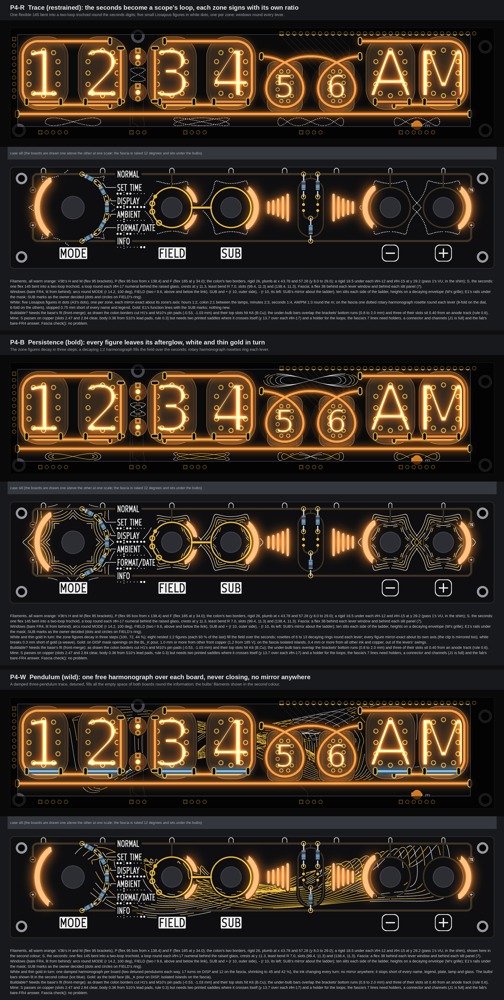
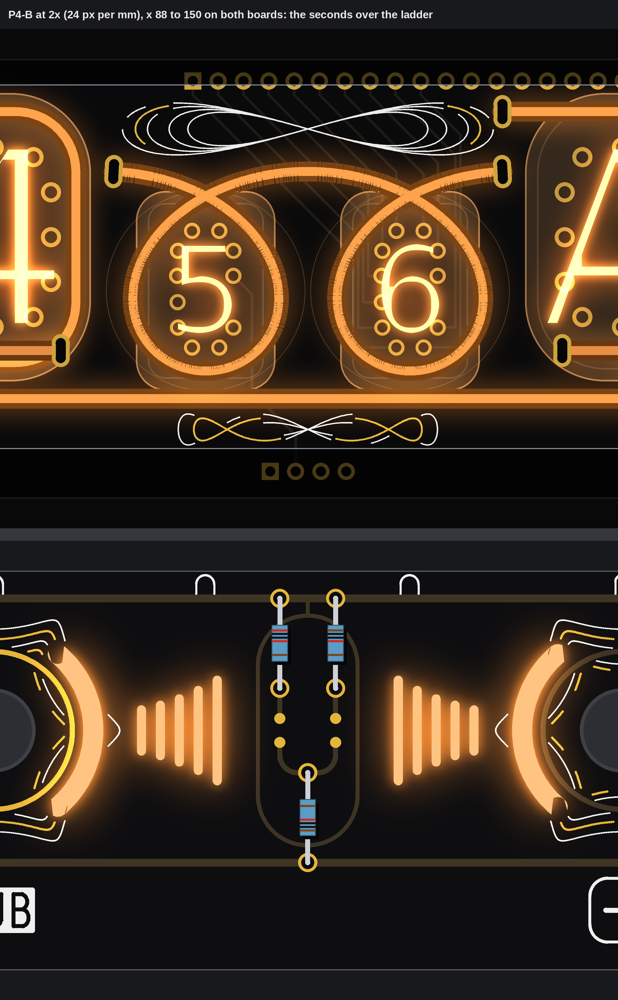
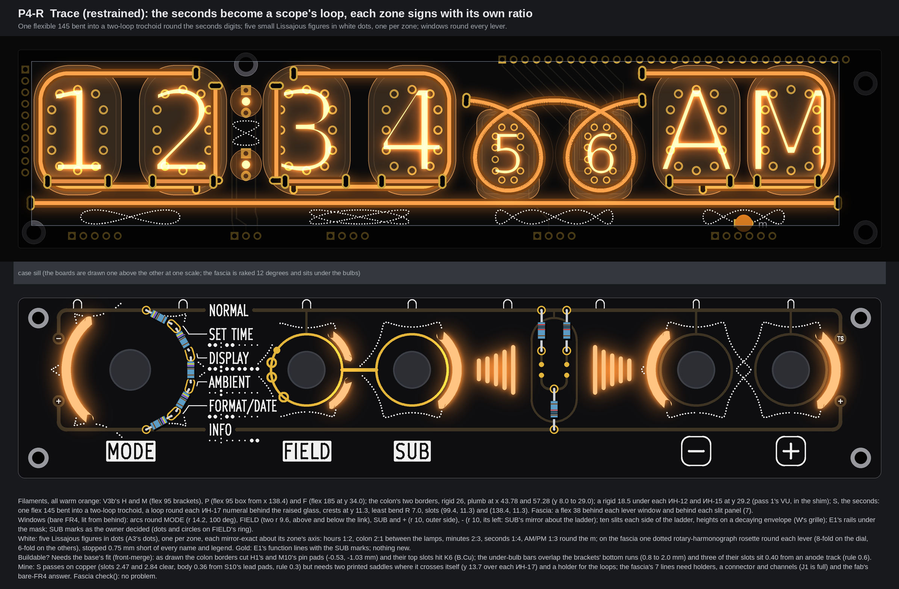
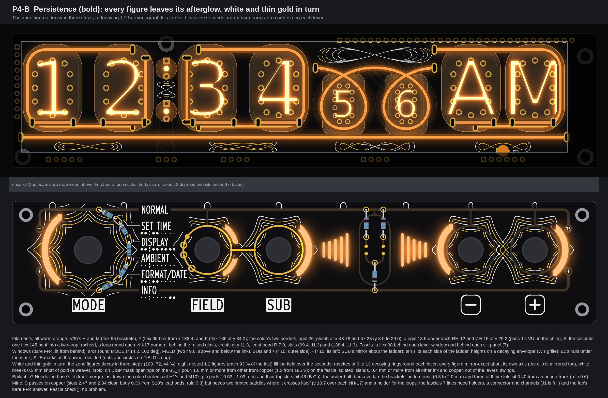
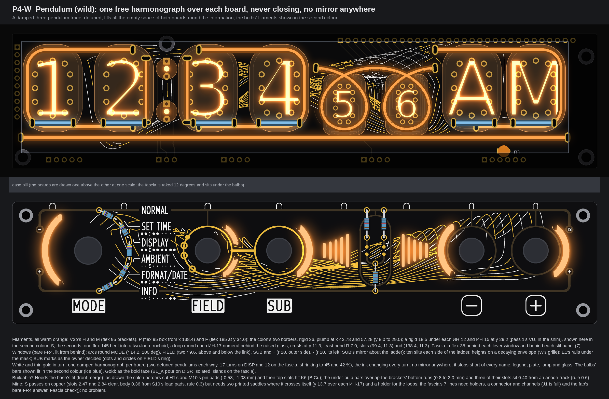

# TS06 front, pattern run P4: Harmonograph (three faces of DISP above fascia R on the merged base; drawings only, nothing built)

The front as an oscilloscope's figures, C's sine taken further: Lissajous curves (two frequencies at a fixed ratio) and harmonograph curves (the same, decaying, so the trace spirals in and leaves a family of nested figures). Every white and gold line on these faces is one of those curves, computed, not drawn by hand; the seconds become a real one in filament.

No board, schematic, fab, tool, 3D, firmware or spec file was touched; no agent-commons write. DISP's geometry is read from `PCB/TS06-DISP/TS06-DISP.kicad_pcb` (pass 1's extract), fascia R is pass 4's E1 on R's real geometry (the copy pass 4 used), both through copies of the earlier runs' scratch scripts. Every fascia face was run through `check()` of `tools/fascia_gold.py` two ways (exposed only; all copper counted as gold). Marks: *measured* is from a board file; *listing data* from the shop pages; *inferred* is arithmetic; *assumed* is my reading. The scratch scripts stay in the run's scratch folder, not in the repo.

## 1. The idea, and the rules I drew to

* **One family of curves.** x = A sin(p t + phase), y = B sin(q t). The ratio p:q gives the figure; a decay e^(-dt) turns it into a harmonograph. A curve swept sideways while it circles (a trochoid) is what a scope draws for a circle plus a time base: that is the seconds.
* **Each zone signs with its own ratio**, in a band 3 mm tall under the long line (y 35.6 to 38.65): hours 1:2 (a lying figure eight), minutes 2:3, seconds 1:4, AM/PM 1:3 (its middle lobe round the m lamp); the colon gets 2:1 (a standing figure eight) between its two lamps. Each figure is mirror-exact about its zone's plumb axis by its phase: with p odd and q even any phase is symmetric (t to t + pi maps x to -x); with p even and q odd the phase is 0; with both odd it is pi/2. *Inferred* (algebra), checked on the drawn points.
* **Symmetric or organic, never between.** R and B are strictly symmetric: every figure about its own axis, and where copper or a legend cuts a figure, the cut is mirrored too (the clip mask is intersected with its own mirror about the zone's axis; on the fascia about the control row, the ladder's axis and the keys' midline x 160.9). W is fully organic: one detuned, damped harmonograph per board that never closes, no mirror anywhere.
* **White and thin gold in turn** (D's alternation): ink changes with each decay step (B) or each turn of the slow pendulum (W). Where white meets gold it stops 0.3 mm short and the gold runs through, so crossings read as a weave and never as silk on gold.
* **Info first.** On the fascia every pattern line keeps 0.75 mm from the names, plates, legends, tube maps and index, 0.45 mm from other white, and gold keeps 0.55 mm from all other ink and copper (0.4 from the line's edge plus its half width), out of the knob's r 9.0, the levers' r 6.0 and swings, 1.45 mm off the edge. On DISP white keeps 0.45 mm from glass, lamps and filament bodies and 0.25 mm from pads; gold sits on the BL_K pour 1.0 mm from any other front copper (1.2 from 185 V), the rule of 0.6 / 0.8 with margin.
* **The owner's decision on SUB marks** (arrived during the run, cheap here, so drawn on all three faces): E1's two long arcs to SUB, the hop's masked bridge and the names' stubs are gone; on FIELD's gold ring, at the point nearest each name, a dot for SET TIME (FIELD only) and a circle for DISPLAY, AMBIENT and FORMAT/DATE (SUB too); the FIELD-SUB link stays. `check()` passes with them (the FORMAT/DATE circle is the nearest gold to white, 0.31 mm, rule 0.30).

## 2. The seconds: a two-loop trochoid in filament (all three faces)

* **The curve:** x = 118.9 + 3.263 t + 12.0 sin t, y = 21.25 - 10.0 cos t, t from -6.22 to 6.22, mirror-exact about x 118.9. A crest at y 11.25 between the tubes and one at each end; between them a loop round each ИН-17 numeral, behind the raised glass (the ИН-17s stand 7.8 mm off the board, pass 2), glowing through it, down to y 31.25. It replaces V3b's arch, and it is the ИН-17 pair's "filament under the bulb" (pass 1's VU bar there is dropped: the loops pass under both bulbs).
* **Filament:** one flexible 145 (slot to slot 139), warm orange. Drawn path 139.44 mm, 0.44 mm over the sold run (*inferred*; the bend into each slot takes it up, or y 21.25 drops 0.1 mm). Least bend R 7.0 (rule R 6). Slots (99.4, 11.27) and (138.4, 11.27), in the two corridors, heading out level; 2.47 and 2.84 mm from other copper (KS7 and CAT_B_AMP on B.Cu), no 185 V near. Body to S10's lead pads 0.36 mm (rule 0.3), to an ИН-12/ИН-15 pin pad 4.59, to the numeral box 1.34 (*assumed* box 5.2 x 9.2 mm). Body to M's and P's bodies more than 0.4.
* **It crosses itself twice**, at (108.6, 13.7) and (129.1, 13.7), just over each ИН-17's glass top. One strand rides over the other: each crossing needs a small printed saddle (*assumed* room: the tubes stand 7.8 mm proud). The loops behind the glass need a holder too. That is the cost of a curve more eye-catching than a sine.

## 3. The base as drawn, and what it does not fit today

Drawn on every face as the brief gives it: V3b's H and M brackets (flex 95), P's box from x 138.4 (flex 95), F at y 34.0 (flex 185), HL9 3.0 mm lower at (160.9, 38.5); the colon's two borders, rigid 26, plumb at the nominal x 43.78 and 57.28 (y 8.0 to 29.0, centred on the lamps); a rigid 18.5 under each ИН-12 and ИН-15 at y 29.2 (pass 1's VU); every filament warm orange, (255, 138, 40) in the pictures. Front-merge fixes the exact fit; my checks (pass 1 section 1, pass 2 section 1 rules, *measured* on the drawn centre lines) found:

| Item | Finding |
|---|---|
| Colon borders at x 43.78 / 57.28 | body over H1's pin pad 5 by 0.53 mm and M10's pin 11 by 1.03 (rule: 0.4 clear); each top slot (y 8.0) is -0.45 / -0.62 mm from K6 (B.Cu, rule 0.25). Bottom slots pass (1.42, 1.83). |
| Under-bulb bars at y 29.2 | overlap the brackets' and the box's bottom runs at y 30.4 (bodies 0.8 mm into each other; 2.0 at the outer bulbs, where the bracket's corner passes); the bars under H1 and M10 also touch the colon borders' bottom slots (gaps -1.48, -0.07); slots under H10, H1 and M1 are 0.40 from an anode track (rule 0.6: pass 1's 0.2 mm nudge). |
| V3b's H, M, P, F | as pass 2 (H's lower slot needs ANODE_H1 moved; the rest pass). |

So in V3b's bands there is no room for a bar under each bulb next to the bracket runs, and none for the owner's second colour beside it. W shows the choice by lighting the same bars in a second colour (ice blue, the listing's blue); orange stays the default.

## 4. The fascia: E1, the windows round the levers, W's slits and rails

* **Windows round the levers** (bare FR4, no copper either side, lit warm orange from behind), each mirror-exact about the control row: MODE an arc r 14.2, 100 degrees on its left (A1's, 2.0 wide); FIELD two arcs r 9.6, 40 degrees each above and below the link (1.6 wide; the room the long arcs left); SUB an arc r 10, 100 degrees on its right; minus the same on its left (SUB's mirror about the ladder's axis); plus on its right (minus's mirror about x 160.9). Nearest E1 copper to a window 0.65 mm (FIELD's ring); the pattern keeps 0.4 mm or more (rule *assumed* 0.3, pass 2).
* **W's decorative lit windows:** five slits 0.9 mm wide each side of the ladder, mirror-exact about its axis, heights 5.1, 6.0, 7.2, 8.9 and 11.0 mm toward the capsule (a decaying cosine, the harmonograph's envelope), pitch 1.9; 4.9 mm or more from E1's copper, 0.46 or more from the pattern's gold.
* **Rails under the mask:** E1's, unchanged.
* **Light:** one flexible 38 behind each lever window, bent on the window's own radius (r 9.6 or more), and one behind each slit panel, level at y 16 (W's way): seven lines.

## 5. P4-R Trace (restrained)

* **Filaments:** the base (section 3) and S (section 2), all warm orange; seven flexible 38 behind the fascia windows.
* **White:** the five zone figures in dots (A3's white dots, 0.26 mm, 0.55 mm pitch); on the fascia one dotted rotary-harmonograph rosette round each lever, x + iy = A(e^(it) + 0.12 e^(-int)): 8-fold on the dial, 6-fold on the others, each symmetric about both axes through its lever, stopped short of every name and legend (382 dots on the fascia, 432 on DISP).
* **Gold:** E1's function lines with the SUB marks; nothing new.
* **Buildable? Needs** the base's fit (section 3), two saddles and a holder for S, and on the fascia seven lines, their holders, a connector and channels (J1's six pins are all used) and the fab's answer on bare FR4 (pass 1's coupon). Fascia `check()`: no problem either way.

## 6. P4-B Persistence (bold)

* **Filaments:** as R.
* **White and gold in turn:** every zone figure decays in three steps (100, 72, 44 % height), white, gold, white; over the seconds a decaying 1:2 harmonograph (eight nested lying figure eights, each 93 % of the last) fills the field between the crests and the valance; round each lever a rosette of 6 to 13 decaying rings (each 90 % of the last). DISP: 360 mm white, 201 mm gold; fascia: 593 mm white, 366 mm gold, all 0.15 and 0.20 mm wide (the function lines stay 0.8, the heaviest strokes).
* **Gold:** on DISP mask openings on the BL_K pour (the bottom band); over the seconds the field is white only, since KS0 to KS9 run on F.Cu there and leave no 1.0 mm room for gold (mirrored, so the field stays symmetric). On the fascia isolated islands, all in one group (where two rosettes meet between the keys and between FIELD and SUB, their gold joins into one island).
* **Buildable? As R.** Fascia `check()`: no problem (least gold to gold 0.39 mm, gold to white 0.34, to a lever's keep-out 0.09 margin, to the dial's 0.47).

## 7. P4-W Pendulum (wild)

* **Filaments:** as R; the bars under the bulbs drawn lit in the second colour (ice blue) to show the choice; the default stays orange.
* **White and gold in turn:** DISP x = 93.4 + e(t)(80 sin(1.004t + 0.35) + 8.5 sin(3.011t + 1.3)), y = 18.6 + e(t)(15.5 sin(2.003t + 0.9) + 4.6 sin(4.987t + 2.2)), 36 turns shrinking to 30 %; the fascia's the same kind, 26 turns. The detuning (1.004, 2.003, 3.011...) means the trace never closes and nothing mirrors; it fills every free pocket like a fingerprint and stops short of every name, plate, lamp and glass. DISP: 342 mm white, 435 mm gold; fascia: 341 mm white, 1114 mm gold.
* **Gold:** as B. The fascia's exposed gold is now six times E1's own (194 mm); it stays the thinnest ink, but the weight inversion xstream asked for is weakest here.
* **Buildable? As R.** Fascia `check()`: no problem (gold to gold 0.39, gold to white 0.32, lever keep-out margin 0.16, dial 0.11).

## 8. The checks in one place

| Check (rule) | R | B | W |
|---|---|---|---|
| S: slots to other copper (0.25; 185 V 0.6 / 0.8) | 2.47 / 2.84 | same | same |
| S: body to ИН-17 lead pad (0.3), least bend (R 6) | 0.36, R 7.0 | same | same |
| Fascia `check()`, exposed / all copper | no problem / no problem | no problem / no problem | no problem / no problem |
| Lever windows to copper / to white (0.3 *assumed*) | 0.65 / 0.41 | 0.46 / 0.49 | 0.46 / 0.52 |
| Slits to copper (E1 / the pattern's gold) | 4.89 / none | 4.89 / none | 4.89 / 0.46 |
| DISP gold to other front copper (1.0; 1.2 at 185 V) | no gold | by construction (raster 0.05 mm) | same |
| The base (section 3) | needs front-merge's fit | same | same |

## 9. My pick

**P4-B Persistence.** It is the one where the pattern, the seconds curve and the five zone figures are all the same idea at three strengths, strictly symmetric everywhere with every cut mirrored, and with D's white and thin gold in turn while the function lines stay the heaviest strokes. R is the fallback if the fascia should stay quiet; W shows the organic way, but on a face this full of information its trace only shows in pockets.

## 10. Left open, assumed, not drawn

* **Assumed:** the ИН-17 numeral box (5.2 x 9.2 mm) and that a loop behind the raised glass reads as light round the numeral, not across it; the filament body 2.0 mm, R 6 least bend, slot 1.0 x 2.5 (pass 1); bare FR4 glowing evenly from a filament behind (no coupon yet); the KMD1 bodies inside r 8.8 behind the levers (the FIELD arcs' inner edge is at r 8.8, no margin).
* **Not drawn:** a second filament beside the first under each bulb (no room in V3b's bands, section 3); the saddles and holders; the fascia lines' wiring; real silk type sizes for the dots (0.26 mm dots, *inferred* printable as A3's).
* **Not checked:** KiCad DRC on any changed copper (no board edited); the drive (pass 1's PWM plan); the 3 mm deep stack of a crossing strand against the case window's glass.
