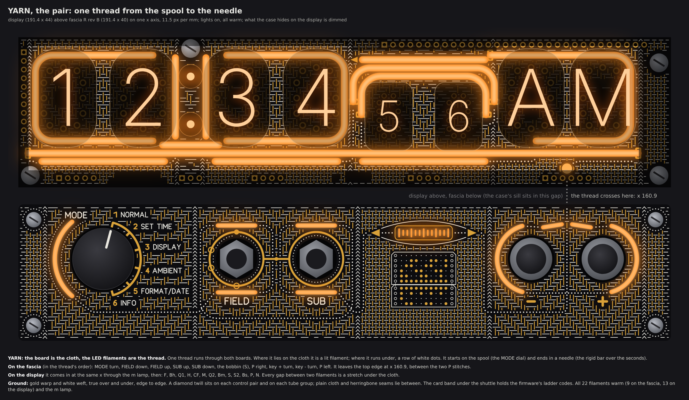
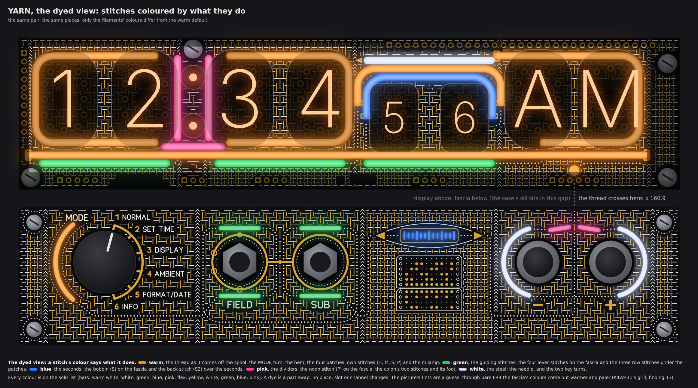
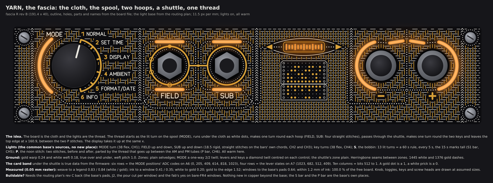
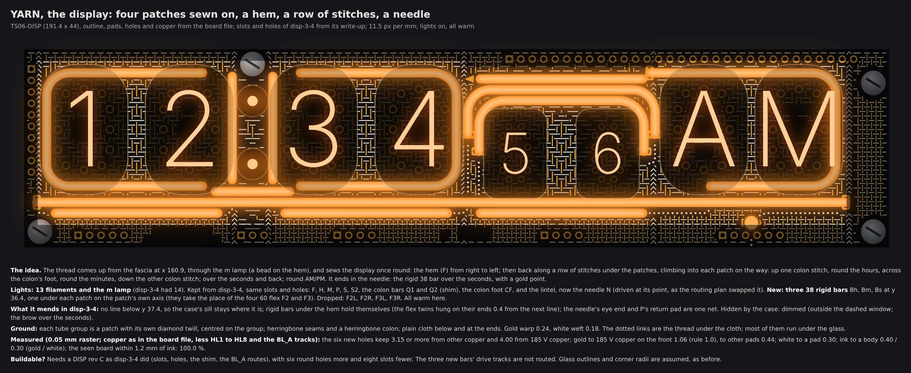
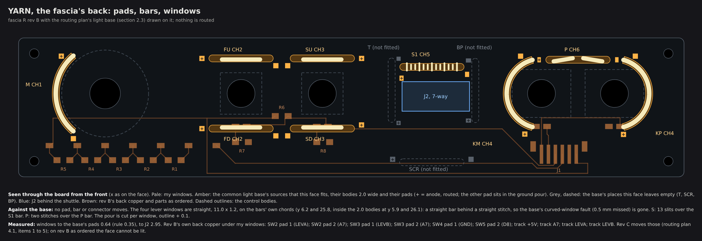
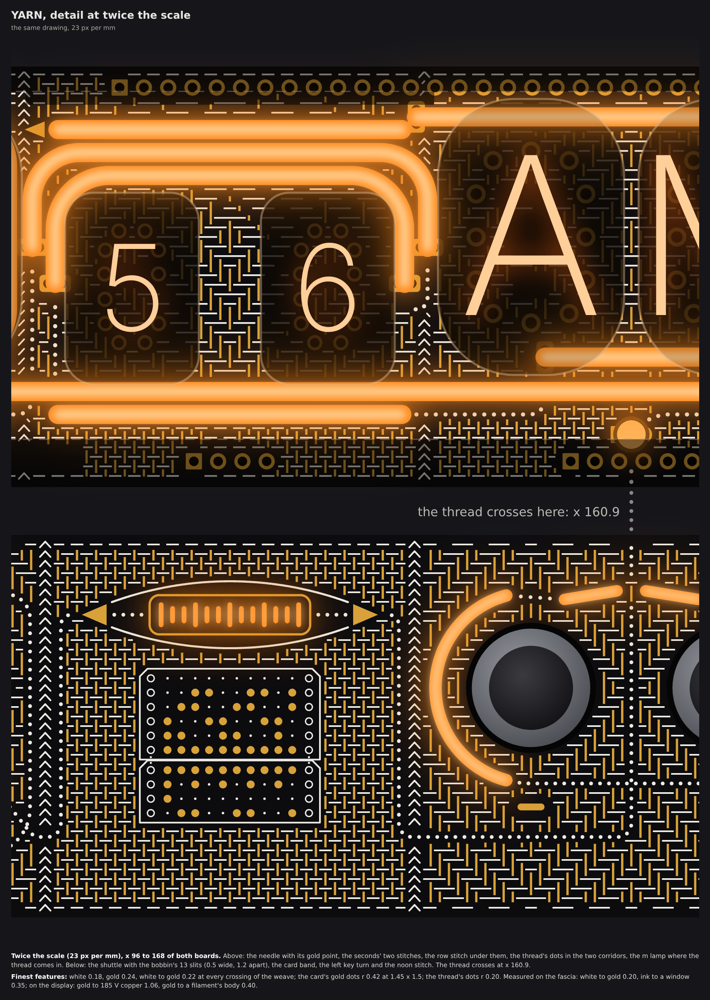

# TS06 pair YARN: one fascia face and one display light layout, one thread (drawings and checks only)

2026-11-15, run pair-yarn, on the owner's card answer (verbatim in `TS06-PAIR-YARN/BRIEF.md`). No board, schematic, fab, tool, 3D,
firmware, spec or page file was touched.

The script is in the repo: `python3 PCB/art/TS06-PAIR-YARN/draw_yarn.py` (helpers `yarn_boards.py`, `yarn_kit.py`). It reads both
board files and two firmware files, draws every picture and prints every number below into `TS06-PAIR-YARN/measures.txt`.

Marks: *measured* = by that script (board files; a 0.05 mm raster, gaps given one pixel short); *inferred* =
arithmetic; *assumed* = my reading. Frames: each board's own, mm, y down. Both share one x axis (*measured*, `3d/case-pair/case_pair.py`).

## 1. The idea in five lines

1. The board is the cloth. The LED filaments are the thread. There is one thread.
2. On top of the cloth the thread is a lit filament. Under the cloth it is a row of white dots.
3. It starts on the spool (the MODE dial), takes a turn round each hoop (FIELD, SUB), goes through the shuttle, takes a turn round
   the keys, and leaves the fascia at x 160.9.
4. It enters the display at x 160.9 through the m lamp, sews the hem, then a row of stitches, climbing round each tube group.
5. It ends in a needle: the rigid bar over the seconds.

## 2. The creative decisions, each with its reason

* **The ground is cloth:** gold warp, white weft, true over and under, edge to edge. One rule gives full cover and white
  and thin gold in turns.
* **Real drafts.** Diamond twill on each control pair and tube group; plain in the shuttle's zone and at the edges; a one-way
  2/2 twill at MODE; herringbone seams. A diamond twill is its own mirror image on both axes. MODE has its names on one side,
  so it is plainly directional.
* **Every light is part of the one thread.** The gaps the parts force become the stretches under the cloth.
* **The lever windows are straight stitches.** A stitch is straight, and so is an 18.5 bar. The base's curved windows missed
  0.5 mm of it (K4W411 grill 7).
* **A turn round each hoop.** Then the thread's path in the levers' zone is its own mirror image, dot for dot.
* **The shuttle sits over J2, and its bobbin is S.** J2 feeds every fascia light. S echoes the seconds: 13 lit turns are a 60 s
  rule, one each 5 s, the 15 s marks tall.
* **P is two stitches that meet at noon,** parted by the thread. P echoes AM/PM. The thread goes up between them and comes out
  between the AM and PM tubes.
* **The card band holds the firmware's ladder codes.** No ornament that only looks like data (section 5).
* **On the display the lintel is the needle.** A rigid bar is straight steel. The thread (P's top run) ends at its eye.
* **Three rigid bars under the hem replace F2 and F3:** a row of stitches, one under each patch. Rigid bars hold themselves, and
  nothing sits below y 37.4.
* **The m lamp is a bead on the hem.** The thread comes in there. Its x is the keys' middle on the fascia.

**Changed from the brief's concept:**
* "The shuttle (the pill with R7 and R8)": on rev B, R7 and R8 are 1206 parts on the back at (64.24, 30.0) and (87.62, 30.0)
  (*measured*). The pill is empty on the face. So the shuttle carries S and covers J2, not the resistors.
* "Passes the two hoops": it takes a full turn round each, for the mirror.
* Diamond twill in every zone: not in the shuttle's zone (plain, so the card stands calm) and not at MODE.
* Rev B's file still holds the SUB box and its runs (16 gold items, *measured*). The base's rings, link and marks
  (front-merge section 6) are drawn in their place.

## 3. The lights

**Fascia: 9 filaments, all on the common base's places** (routing plan 2.3). Window sizes are *measured*.

| Name | Part | Place and window | Length x width | Colour (dyed) | Channel |
|---|---|---|---|---|---|
| MODE turn | 38 flex | M: r 14.2 about the dial, 130 to 230 deg | 24.8 x 1.3 | warm (warm) | CH1 |
| FIELD up, FIELD down | 18.5 rigid | FU, FD: x 57.90 to 70.10, y 6.2 and 25.8 | 12.2 x 1.2 | warm (green) | CH2 |
| SUB up, SUB down | 18.5 rigid | SU, SD: x 81.25 to 93.45, y 6.2 and 25.8 | 12.2 x 1.2 | warm (green) | CH3 |
| key - turn, key + turn | 38 flex | KM, KP: r 10.0, 105 to 255 and -75 to 75 deg | 26.2 x 1.3 | warm (white) | CH4 |
| S, the bobbin | 18.5 rigid | S1: 13 slits, x 111.45 to 126.35, y 7.05 to 9.65 | 0.5 wide, 1.2 apart | warm (blue) | CH5 |
| P, the noon stitch | 18.5 rigid | P: two stitches, x 153.30 to 168.50, y 5.25 to 7.35, 3.0 apart | 2 x 6.8 x 1.2 | warm (pink) | CH6 |

T, SCR and BP stay empty. Every window lies over its bar's 2.0 body (S: 91 %) and ends 1.65 or more inside the bar's ends.

**Display: 13 filaments and the m lamp** (disp-3-4: 14). Places are disp-3-4's unless marked new.

| Name | Part | Place | Drawn | Colour (dyed) | Channel |
|---|---|---|---|---|---|
| F, the hem | 185 flex | y 34.0, x 2.80 to 181.81 | 179.0 | warm (warm) | ch 3 |
| H, M, P, the patches | 95 flex each | slots at x 39.48, 61.10 (y 5.27, 30.40); (138.40, 5.27), (151.86, 30.40) | 89.9 | warm (warm) | ch 0, 1, 2 |
| S, the seconds' patch | 60 flex | slots (98.20, 18.92), (139.57, 18.92), crown y 9.0 | 57.0 | warm (warm) | ch 4 |
| S2, the back stitch | 60 flex | slots (100.60, 22.69), (137.17, 22.69), crown y 11.4 | 54.3 | warm (blue) | ch 11 |
| Q1, Q2, the colon | 26 rigid | x 46.05 and 55.02, y 6.0 to 29.0, in the shim | 23.0 | warm (pink) | ch 5 |
| CF, the colon's foot | 18.5 rigid | y 31.6, holes x 42.785, 58.285 | 16.5 | warm (pink) | ch 10 |
| **Bh, Bm, Bs, row stitches (new)** | 38 rigid | y 36.4; holes x 7.39 / 42.39, 58.18 / 93.18, 101.385 / 136.385 | 36.0 | warm (green) | ch 6, 8, 7 |
| N, the needle | 38 rigid | y 6.6, holes x 101.385 (driven), 136.385 | 36.0 | warm (white) | ch 12 |
| the m lamp | 3 mm LED | (160.9, 38.5), V3b's place | | amber | ch 13 |

Twelve line channels and the m lamp: one fewer than the routing plan's table (ch 9 spare). 5 V worst case 832 mA (*inferred*:
two filaments fewer than disp-3-4 with K4W411). Dyes are part swaps.

## 4. What each ink does

* **White (silk):** the weft, 0.18; the thread under the cloth, dots r 0.20 at 0.95 (r 0.22 at 1.0 on the display); the seams,
  0.18; the shuttle's outline, 0.22; the card's edges and pricks.
* **Gold (ENIG, no net):** the warp, 0.24, cut 0.22 before every weft that crosses over it; the card's ones (r 0.42); the
  bobbin's frame, 0.24; the shuttle's tips; the needle's point. The base's rings, link, marks and index stay.
* **Mask:** black, the cloth between the threads.
* **Windows (bare FR4):** only section 3's lights. Lit width 1.2 to 1.3; the bobbin's slits 0.5 on 0.7 webs.
* Pitch: weft 1.000; warp 1.000, 0.974 (levers), 0.955 (keys), so a warp lies on every control's axis. Fascia: 1445 white and
  1376 gold dashes, 354 dots. Display: 1561, 1325, 72 (*measured*).
* Fonts in the pictures: the names in the script's own stroke alphabet, scaled to KiCad's widths (`tools/fascia_art.py`);
  notes in DejaVu Sans, tube digits in Inter. No font file is in the repo. Knob, keys and glass: *assumed* sizes.

## 5. The card band

Two laced cards under the shuttle, ten rows. Read by script from `firmware/nixieClock_TS06/ts06pair.ino` and
`firmware/ts06_bringup/ts06_bringup.ino`.

* Columns: the ten bits of an ADC code, 512 at the left, 1 at the right. A gold dot is a 1. A white prick is a 0.
* Upper card, six rows: the MODE positions 1 to 6 on A6: 0, 205, 409, 614, 818, 1023.
* Lower card, four rows: the lever states on A7: 1023 (none), 682 (FIELD), 512 (SUB), 409 (both).
* The script checks the six codes against the firmware's rounding, (a + 102) / 205 + 1.

## 6. The checks

**Fascia** (*measured*):

| Check | Rule | Got |
|---|---|---|
| Weave to a legend, white / gold | 0.75 | 0.83 / 0.84 |
| The thread's dots to a legend | 0.48 | 0.65 |
| White / gold to a window | 0.35 / 0.30 | 0.41 / 0.35 |
| White to gold | 0.15 | 0.20 |
| My gold to the base's gold | 0.35 | 0.35 |
| A window to a legend | 0.30 | 0.41 |
| Gold / white to the board edge | 1.40 / 0.30 | 1.52 / 0.44 |
| A window to a pad of the light base (all 24) / to J2 | 0.35 / 0.30 | 0.64 / 2.95 |
| Free board within 1.2 mm of ink | no empty space | 100.0 %; largest empty spot r 1.62, on the bottom edge at x 9.9 |

**Symmetry per zone** (*measured*):
* Lights: every window's end is 0.000 mm from its mirror image in the levers', shuttle's and keys' zones.
* Drafts: 0 cells differ from their mirror image.
* As drawn, the mirror keeps this share of the weave's pixels: 0.969 (levers), 0.997 (shuttle), 0.929 (keys). What differs: the
  names FIELD and SUB, the base's marks on FIELD's ring, - and +, and in the keys' zone the thread's way in from the left.

**Display** (*measured*; copper as in the board file, less HL1 to HL8, the BL_A tracks and M_A):
* The six new holes: 3.15 or more to other copper (rule 0.25), 4.00 or more to 185 V copper (rule 0.8).
* Gold to 185 V copper on the front: 1.06 (rule 1.00). Gold to other pads, slots and KS tracks: 0.44 (rule 0.35).
* White to a pad 0.30 (rule 0.30); white to gold 0.20 (rule 0.15); gold / white to a filament's body 0.40 / 0.30 (rule 0.30).
* Body to body: 0.40 (F to the bars and CF; S to N and S2; rule 0.4). N to P 0.02: disp-3-4's known overlap (its grill,
  finding 7); with the plan's swap both ends are on BL_K.
* The seen board within 1.2 mm of ink: 100.0 %; the largest empty spot r 1.10.
* Symmetry: seconds (S, S2, N, Bs) 0.000; colon (Q1, Q2, CF) 0.000; H, M, Bh, Bm about the tubes' own middle 0.010; F 0.000.
  P is one directional piece, as in V3b.
* disp-3-4's own slots, re-measured, match its grill. H's driven slot sits on today's ANODE_H1, which final-3 D6 moves.

**The crossing** (*measured*): the thread leaves the fascia at x 160.900 and enters the display at x 160.900.

## 7. Buildable?

**Fascia, against the common light base: no pad, bar, connector or channel changes.** Needs the routing plan's rev C back.
* Windows only: the four lever windows straight (were arcs); S as 13 slits over S1; P as two stitches over the P bar.
* Rev B's own back copper under my windows (*measured*): SW2 pads 1 and 2, SW3 pads 1 and 2, SW4 pad 1, SW5 pad 2; tracks
  +5V, A7, LEVA, LEVB. The plan's rev C already moves these (4.1, items 1 to 5).
* Bare-FR4 windows still wait on the coupon.

**Display, against disp-3-4:**
* F2L, F2R, F3L, F3R go: four 60 flex, eight slots, the split pad. BL_A11 (42.9 mm) is not needed.
* Bh, Bm, Bs come: three 38 rigid, six round holes at y 36.4. Their three drive tracks are **not routed**.
* The sill: no change. The lowest body ends at y 37.40; the sill is at 39.0. disp-3-4 needed it 0.8 to 1.1 lower.
* The lintel is the needle: same holes, driven at the left as the plan swapped it. Its gold point is 0.385 off the cap (*inferred*).
* The white names HOUR, MIN, SEC are not drawn.
* The rest is disp-3-4's list: the slots, the shim, the harness, BL_A10's 40 mm route, the names CF and BL_A12.

## 8. A grill of my own work: the five worst risks

1. **The thread may read as ornament, not as one path.** On the display most stretches under the cloth are under the glass; only
   72 dots show. Fix: if it fails at arm's length, drop the display's dotted links and keep the story on the fascia (354 dots).
2. **One item in the keys' zone has no mirror twin:** the thread's way in, from the left. The owner dislikes near-symmetry.
   Fix: let the thread leave at the right edge (x about 183.6). The zone is then exact, but the thread no longer parts P.
3. **The bobbin's slits may merge into one glow** (0.5 slits on 0.7 webs through 2.0 mm FR4; K4W411's grill doubted its 0.45
   webs). Fix: a coupon row; the fall-back is 7 slits at 2.4.
4. **The new bars are not routed and their lead pitch is a guess** (35.0, as the lintel's). They lie over masked 185 V
   tracks, as F does. Fix: measure one bar on the bench; route and DRC on rev C.
5. **About 2700 gold dashes, 0.24 wide.** A fab may thieve or refuse them, and some margins sit at the rule (0.35 to the
   base's gold, 0.30 white to a pad; raster numbers). Fix: emit vectors, run KiCad's DRC and the 0.15 opening test, and write
   "isolated islands are intended" in the order.

## 9. Questions for the owner

1. **The thread:** a directional thread over an exactly mirrored cloth, as drawn? Or must the keys' zone mirror too, with the
   thread leaving at the right edge?
2. **The seconds:** needle, patch stitch and back stitch (three lines, as you chose in disp-3-4), or without the back stitch S2?
3. **The dyes:** is warm the default and the five-colour view the option, or the other way round?

